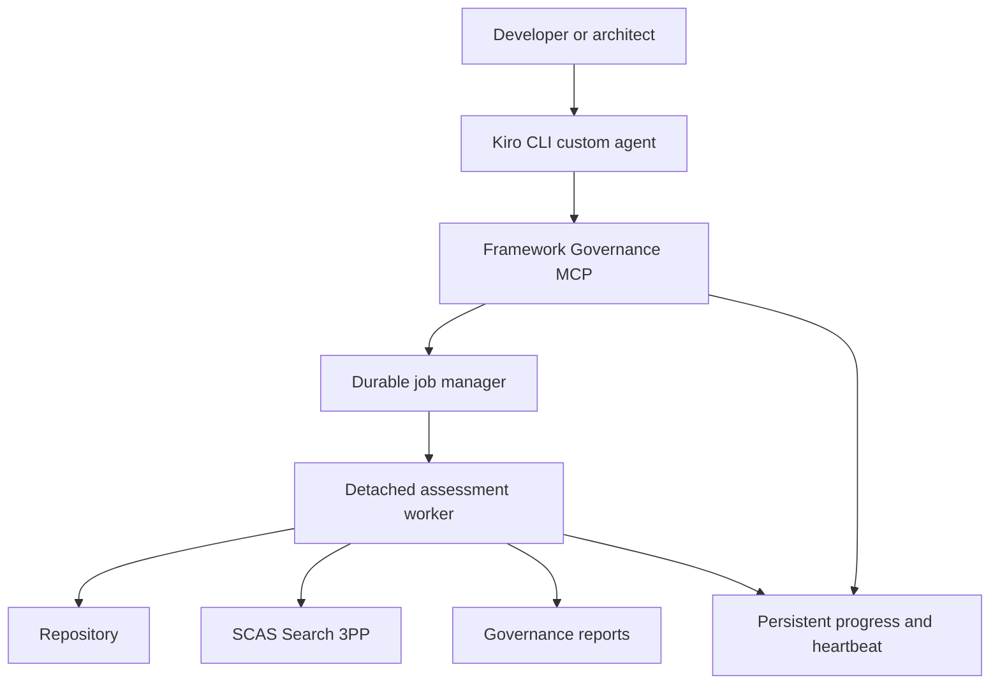
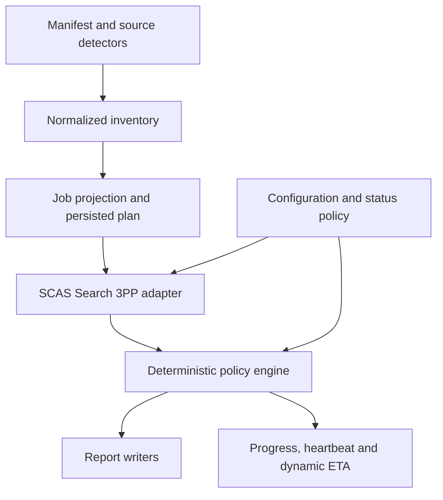

# High-Level Design

## 1. Purpose

Framework Governance Agent inventories software components used by a repository,
verifies them with SCAS Search 3PP, applies a versioned
traffic-light policy and generates evidence-backed reports through CLI or Kiro.

## 2. Context

Kiro is the conversational orchestrator. The MCP service is the trusted
execution boundary for scanning, lookup, decisions and report generation.
Long-running work belongs to a detached worker rather than one MCP request.

## 3. Logical architecture

### Components

| Component | Responsibility |
|---|---|
| Repository scanner | Parse manifests, lockfiles, runtime declarations, base images and limited source evidence |
| Normalizer | Canonicalize component names, ecosystems, evidence and Package URLs |
| SCAS token provider | Exchange a refresh token and cache the access token in memory |
| SCAS Search 3PP adapter | Query `/ordering/components/search` with SCAS filters |
| Policy engine | Assign Green, Amber, Yellow, Red or Grey with a named rule |
| Report writer | Produce JSON, Markdown, HTML, CSV and CycloneDX |
| Durable job manager | Inventory, project duration, persist job plan and launch/reconnect/cancel |
| Assessment worker | Continue SCAS requests independently of an MCP call |
| State writer | Atomically persist heartbeat, item progress, status counts and ETA |
| MCP server | Expose safe tools to Kiro using stdio JSON-RPC |
| CLI | Enable local, CI and troubleshooting execution |

## 4. Key design decisions

1. Lockfiles and resolved dependencies override declared ranges.
2. Source evidence has lower confidence and cannot create a known version.
3. Source code is not sent to SCAS; only normalized name/version metadata is sent.
4. A catalog outage produces Grey, not Red.
5. Unknown components are Red by default, but policy is configurable.
6. Report generation is part of the deterministic service, not LLM prose.
7. The MCP surface does not expose arbitrary shell execution or deletion.
8. Refresh/access tokens are never stored in configuration, report data or logs.
9. Exact-version search falls back to name-only search to distinguish version
   mismatch from a completely absent component.
10. Maven coordinates use ordered name resolution: full coordinate, group
    prefix, exact group-leaf library name, then partial group-leaf name.
11. A Stako comment stating that a newer version exists overrides a Red
    outcome and is always consolidated under Amber.
12. Partial Maven matches are Yellow/manual-review evidence, never automatic
    approval.
13. Approved internal OCI glob patterns are evaluated before catalog access.
14. Assessment state is atomically written after each item and on a periodic
    heartbeat so clients can reconnect without restarting work.
15. The initial ETA is configuration-based; the live ETA uses an exponential
    moving average of completed-item duration.
16. Cancellation is cooperative between component lookups, avoiding partial
    report publication.

## 5. Deployment

The initial deployment is a native local stdio MCP process launched by Kiro.
No web server or container is required. A future shared deployment can wrap the
same service in an authenticated remote MCP/HTTP service.

## 6. Quality attributes

| Attribute | Design response |
|---|---|
| Auditability | Evidence, policy rule, timestamp and raw catalog mapping are retained |
| Security | Local source scan, environment-based token, read-oriented MCP tools |
| Reliability | Detached jobs survive MCP/Kiro request cancellation; persisted state enables reconnect |
| Extensibility | Detector, adapter and writer responsibilities are separated |
| Portability | Python 3.11+, no mandatory third-party runtime dependencies |
| Performance | Excluded directories and source-file cap prevent unbounded scans |
| Observability | Projection, current item, progress, counts, heartbeat, log and dynamic ETA |
| Usability | Offline sortable HTML findings and animated/filterable status chart |

Future catalog adapters may query Ericsson's Maven repository and PyPI
Artifactory/JFrog after SCAS. They are explicit extension points and are not
part of the current runtime.

## 7. Trust boundaries

- Repository boundary: potentially untrusted content; files are parsed, never executed.
- SCAS boundary: authenticated internal service; response is treated as data.
- Authentication boundary: the refresh token enters through a process
  environment variable and is exchanged for a short-lived bearer token.
- Kiro boundary: requests tools and explains results; does not set governance status.
- Output boundary: reports may contain internal component metadata and require approved handling.
