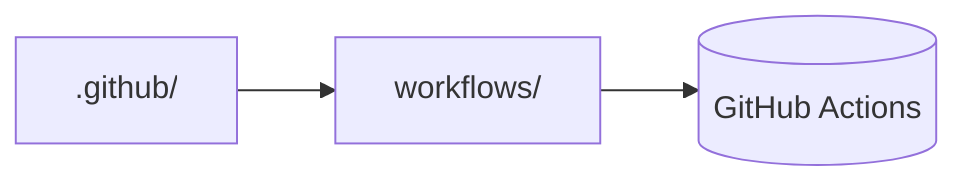

# .github Folder Specification

| Field | Value |
|-------|-------|
| Specification identifier | SPEC-dotgithub |
| Repository-relative folder | `.github/` |
| Role | Workflow / automation — GitHub platform configuration (Actions workflows) |
| Current commit | `2f4774f0476d5b47426ac1548c479f132c467332` |
| Generated/refreshed | 2026-11-03 |
| Status | Draft until maintainer review |
| Parent specification | [`../SPECS.md`](../SPECS.md) |

Authority notice: the source files, tests, and build definitions in this
repository remain authoritative. This specification is derived, bounded
evidence and must be reconciled with source on any conflict.

## 1. Intent and significance

This folder holds GitHub platform configuration for the repository. At this
commit its sole content is the Actions workflows directory, which contains the
scheduled OpenWiki documentation-update workflow. It is a pure
aggregation/ancestor boundary holding `workflows/`.

## 2. Scope and contents

- Direct files: 0 project-owned. Immediate child folders: 1 (`workflows/`).
- [`workflows/`](workflows/SPECS.md) — GitHub Actions workflow definitions.

## 3. Inputs

- None directly. The workflows under `workflows/` are triggered by GitHub events
  and schedules.

## 4. Outputs

- None directly. Delivers CI/automation via `workflows/`.

## 5. Contracts and models

### 5.1 Behavioral contracts

- GitHub reads workflow YAML from `.github/workflows/` (platform convention).

### 5.2 Declared models and callable surface

Not applicable — a container folder with no symbols.

### 5.3 Required invariants

- Workflow definitions must remain under `.github/workflows/` to be discovered.

## 6. Interaction points

| Direction | Folder | Type |
|-----------|--------|------|
| Parent | [`../`](../SPECS.md) | containment |
| Child | [`workflows/`](workflows/SPECS.md) | ownership |

## 7. Exception and error handling

Not applicable — container folder. Workflow-level failures are handled by the
GitHub Actions runtime.

## 8. Environment variables and configuration

None directly. Workflows declare their own env and secrets (see `workflows/`).

## 9. Storage, memory, and resource map

| Resource | Owner | Lifetime | Release |
|----------|-------|----------|---------|
| Workflow definitions | repository | persistent | n/a |

## 10. Interaction diagram

## 11. Cross-cutting design considerations

- Automation: this is the entry point for repository CI/automation on GitHub.

## 12. Spec-driven development protocol

Future work must: (1) record any new GitHub configuration here; (2) identify the
affected `workflows/` and root specs; (3) validate workflow YAML; (4) implement
keeping definitions under `workflows/`; (5) lint/dry-run the workflow;
(6) reconcile this spec.

Acceptance scenarios:

- SPEC-dotgithub-AC1 (valid): Given a workflow in `workflows/`, When an event
  fires, Then GitHub Actions discovers and runs it.
- SPEC-dotgithub-AC2 (invalid): Given malformed workflow YAML, When parsed, Then
  GitHub reports a workflow error.
- SPEC-dotgithub-AC3 (compatibility): Given a new workflow is added, When placed
  under `workflows/`, Then it is documented and validated like the existing one.
- SPEC-dotgithub-AC4 (verification): Given the OpenWiki workflow, When validated,
  Then its YAML is syntactically valid.

## 13. Verification strategy

Workflow YAML validation (lint / GitHub's own parsing). No checks were executed
for this documentation task.

## 14. Evidence inventory

| File | Type | Bytes |
|------|------|-------|
| (no direct project-owned files) | — | — |

The only direct child in scope is [`workflows/`](workflows/SPECS.md).

## 15. Unknowns and review items

- No other GitHub configuration (issue templates, CODEOWNERS, dependabot) exists
  at this commit; confirm with the maintainer whether any is planned.
