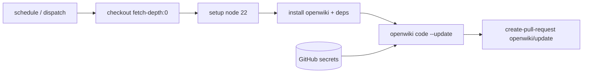

# .github/workflows Folder Specification

| Field | Value |
|-------|-------|
| Specification identifier | SPEC-dotgithub-workflows |
| Repository-relative folder | `.github/workflows/` |
| Role | Workflow / automation — GitHub Actions workflow that refreshes the OpenWiki documentation |
| Current commit | `2f4774f0476d5b47426ac1548c479f132c467332` |
| Generated/refreshed | 2026-11-03 |
| Status | Draft until maintainer review |
| Parent specification | [`../SPECS.md`](../SPECS.md) |

Authority notice: the source files, tests, and build definitions in this
repository remain authoritative. This specification is derived, bounded
evidence and must be reconciled with source on any conflict.

## 1. Intent and significance

This folder holds the repository's GitHub Actions workflows. At this commit it
contains one workflow that, on a daily schedule or manual dispatch, regenerates
the OpenWiki documentation and opens a pull request with the updated
`openwiki/` content. This is the automation that keeps the generated wiki
current; this specification documents the workflow as evidence but does not run
or modify OpenWiki. It is a leaf directory.

## 2. Scope and contents

- Direct files: 1. Immediate child folders: 0.
- [`openwiki-update.yml`](openwiki-update.yml) — the "OpenWiki Update" workflow.

## 3. Inputs

- Triggers: `workflow_dispatch` (manual) and a `schedule` (`cron: "0 8 * * *"`).
- Secrets: `OPENAI_API_KEY`, `OPENWIKI_LANGSMITH_API_KEY`, `LANGSMITH_API_KEY`
  (referenced as `${{ secrets.* }}`; values are not stored in the repository).
- Repository contents checked out with full history (`fetch-depth: 0`).

## 4. Outputs

- An automated pull request (branch `openwiki/update`) adding changes under
  `openwiki`, `AGENTS.md`, `CLAUDE.md`, and this workflow file.
- Direct effect: updates to the generated [`../../openwiki/`](../../README.md)
  content (OpenWiki is an excluded, generated boundary and is not part of this
  specification scope beyond noting the relationship).

## 5. Contracts and models

### 5.1 Behavioral contracts

- Permissions: `contents: write`, `pull-requests: write` (direct evidence).
- Steps: checkout (full history), set up Node.js 22, install
  `openwiki@0.4.3` + `mermaid@11.16.0` + `jsdom@29.1.1`, run
  `openwiki code --update --print`, then create a pull request via
  `peter-evans/create-pull-request@v7`.
- Provider configuration via env: `OPENWIKI_PROVIDER: openai`,
  `OPENWIKI_MODEL_ID: "gpt-5.6-terra"`, plus LangSmith tracing variables.
- Third-party actions are pinned to commit SHAs with version comments.

### 5.2 Declared models and callable surface

| Symbol | Kind | Source |
|--------|------|--------|
| `OpenWiki Update` workflow | GitHub Actions workflow | [`openwiki-update.yml`](openwiki-update.yml) |
| `update` job | job | [`openwiki-update.yml`](openwiki-update.yml) |

### 5.3 Required invariants

- Secrets are referenced via the GitHub secrets store, never embedded.
- The workflow opens a pull request rather than pushing directly to the default
  branch (review-gated change).
- Full history (`fetch-depth: 0`) is required so the update can diff against the
  last documented commit.

## 6. Interaction points

| Direction | Folder | Type |
|-----------|--------|------|
| Parent | [`../`](../SPECS.md) | containment |
| Outbound | repository root files (`AGENTS.md`, `CLAUDE.md`) and `openwiki/` | PR add-paths (generated boundary) |

OpenWiki content is an excluded, generated boundary; this spec only records the
workflow's relationship to it and does not document OpenWiki pages as evidence.

## 7. Exception and error handling

Step failures (install, OpenWiki run, PR creation) fail the job per GitHub
Actions semantics. A missing required secret causes the dependent step to fail.
No custom retry is declared.

## 8. Environment variables and configuration

Direct evidence (job env): `OPENWIKI_PROVIDER`, `OPENAI_API_KEY` (secret),
`OPENWIKI_MODEL_ID`, `OPENWIKI_LANGSMITH_API_KEY` (secret),
`LANGSMITH_API_KEY` (secret), `LANGCHAIN_PROJECT`, `LANGCHAIN_TRACING_V2`. The
cron schedule is `"0 8 * * *"`.

## 9. Storage, memory, and resource map

| Resource | Owner | Lifetime | Release |
|----------|-------|----------|---------|
| GitHub-hosted runner (`ubuntu-latest`) | GitHub Actions | per run | reclaimed after run |
| Checked-out repository (full history) | runner | per run | discarded after run |
| Installed npm packages | runner | per run | discarded after run |
| `openwiki/update` PR branch | repository | until merged/closed | deleted on merge |

## 10. Interaction diagram

## 11. Cross-cutting design considerations

- Security: secrets are stored in GitHub, not the repository; third-party actions
  are SHA-pinned (supply-chain hardening).
- Review gate: changes land via a pull request, not a direct push.
- Separation: this workflow operates on the generated OpenWiki boundary, which
  is excluded from the `SPECS.md` scope.

## 12. Spec-driven development protocol

Future work must: (1) record any workflow change here; (2) identify affected
`.github` and root specs; (3) validate the workflow YAML; (4) implement keeping
secrets externalized and actions SHA-pinned; (5) lint/dry-run the workflow;
(6) reconcile this spec.

Acceptance scenarios:

- SPEC-dotgithub-workflows-AC1 (valid): Given the daily schedule fires, When the
  job runs, Then OpenWiki is regenerated and a pull request is opened.
- SPEC-dotgithub-workflows-AC2 (invalid/missing secret): Given a required secret
  is absent, When the OpenWiki step runs, Then the job fails without leaking a
  value.
- SPEC-dotgithub-workflows-AC3 (compatibility): Given a pinned action version is
  bumped, When updated, Then the new commit SHA and version comment are set
  together.
- SPEC-dotgithub-workflows-AC4 (verification): Given the workflow YAML, When
  validated, Then it parses as a valid GitHub Actions workflow.

## 13. Verification strategy

Workflow YAML validation and a manual `workflow_dispatch` run in a controlled
context. No checks were executed for this documentation task; OpenWiki was not
run.

## 14. Evidence inventory

| File | Type | Bytes |
|------|------|-------|
| [`openwiki-update.yml`](openwiki-update.yml) | GitHub Actions YAML | see file |

## 15. Unknowns and review items

- The model id `gpt-5.6-terra` and OpenWiki version `0.4.3` are declared values;
  confirm they remain valid for the maintainer's environment.
- This workflow depends on externally configured GitHub secrets; their presence
  cannot be verified from the repository.
