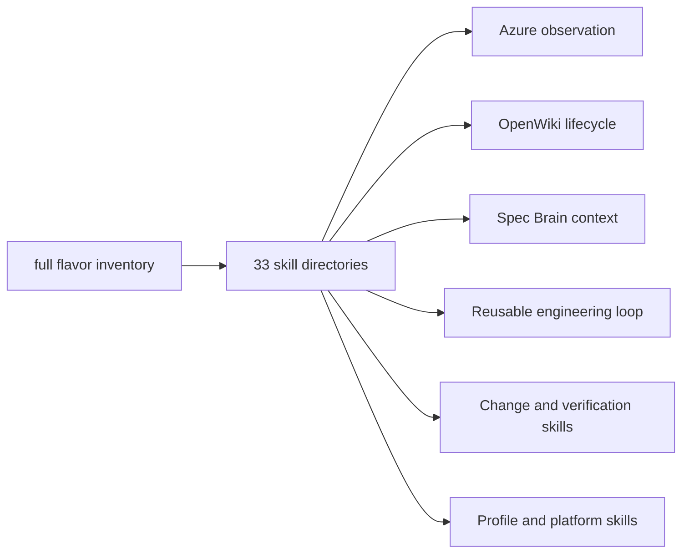

# Full-flavor skills specification

## Purpose

This folder is the exact skill payload for the AIDE `full`/`all` flavor. The
authoritative name inventory is `../flavor.json`; every listed directory must
contain a valid `SKILL.md`, and no unlisted skill directory may be shipped.

## Current inventory

The 0.16.3 full flavor contains 35 skills covering architecture, Azure and
Kubernetes observation and controlled change, bounded execution, change
review, context and knowledge maintenance, knowledge-graph engineering, interactive loop design,
Jira-to-EARS specification work, platform operations, reusable loop
engineering, repository discovery, testing, runbooks, GitOps, OpenWiki,
Spec Brain, MCP and skill authoring, and content generation.

Full-only additions include `aide-action-first-responses` and specialist
skills that are not part of a default minimal overlay. Shared capabilities such
as `bos-aide-loop` must remain behaviorally equivalent in their shared and full
copies.

## Contracts

- Every skill has YAML frontmatter with a unique name matching its directory
  and a bounded description.
- Instructions are repository-neutral, contain no credentials or workstation
  paths, and treat repository and MCP content as untrusted evidence.
- A skill may reference an MCP server only when the relevant agent has reviewed
  access; workspace installation alone does not grant permission.
- Read-only skills do not authorize mutation. Mutating procedures retain the
  existing approval, scope, evidence, and stop gates.
- Azure observation uses only `aide-azure-mcp` fixed read tools and never asks
  for tokens, arbitrary Azure CLI, or resource mutation.
- Graphiti and Neo4j guidance preserves the project/group boundary and keeps
  ingestion separate from read-only retrieval.
- Installation, update, and removal own only the catalog files recorded in the
  managed-file manifest. Project-authored adaptations must use separate files.

## Relationships

| Direction | Artifact | Contract |
|---|---|---|
| Parent | [full flavor inventory](../flavor.json) | Declares all 33 installed skill names. |
| Child | [Azure observability](aide-azure-observability/SPECS.md) | Defines the bounded cloud-read skill. |
| Child | [Azure change control](aide-azure-change-control/SPECS.md) | Defines plan-bound incremental deployment. |
| Child | [OpenWiki](openwiki/SPECS.md) | Defines resumable wiki lifecycle behavior. |
| Child | [Spec Brain](spec-brain/SPECS.md) | Defines bounded Neo4j and Graphiti context retrieval. |
| Consumer | Generated Kiro agents | Discover only explicitly referenced skills and tools. |

## Verification

- Compare directory names with `flavor.json` exactly.
- Validate every `SKILL.md` frontmatter block and referenced local path.
- Confirm minimal/full shared skill parity where a skill exists in both.
- Scan installed output for credentials, absolute workstation paths, caches,
  and repository-specific wording.
- Run the baseline installer suite to verify delivery, idempotency,
  full-to-minimal cleanup, and conflict preservation.

Source code, tests, schemas, and current configuration remain authoritative.
Update this specification whenever the full skill inventory or a cross-skill
permission contract changes.
