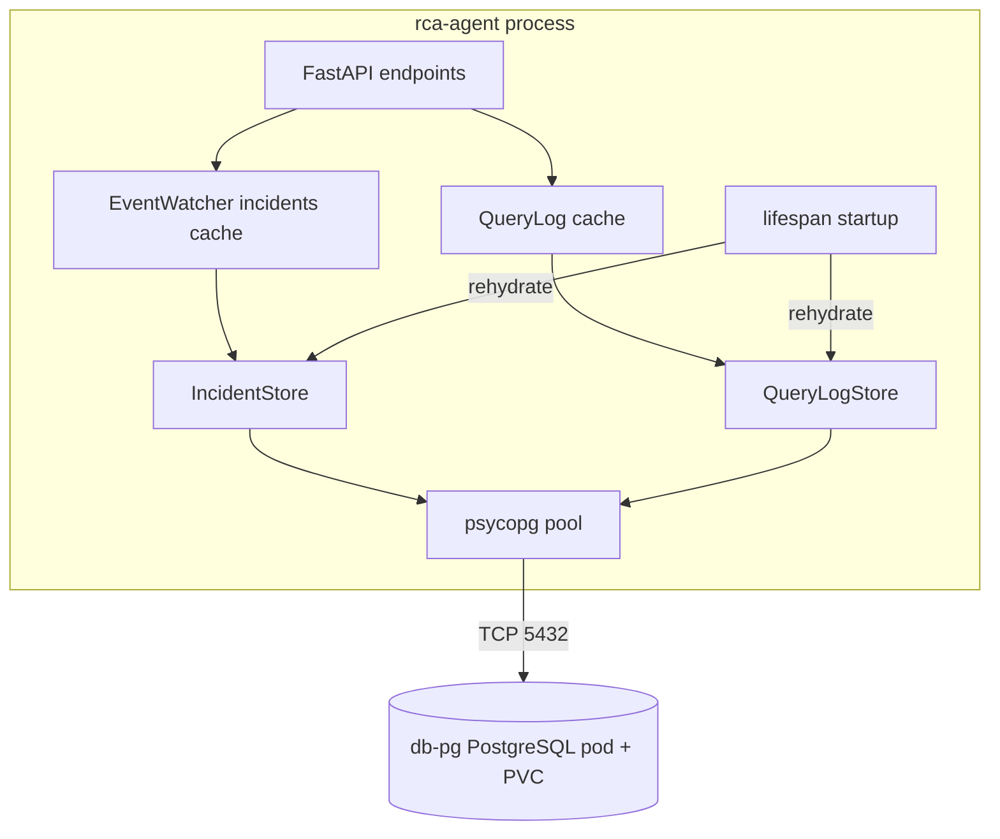

# Design Document

| Field | Value |
|-------|-------|
| Spec | `incident-persistence-postgres` |
| Phase | Design (requirements approved; tasks not yet written) |
| Baseline commit | `2f4774f` |
| Status | Draft - awaiting review before Tasks phase |
| Decisions | D1 mandatory DB; D2 psycopg v3 sync core dep; D3 retain while DB lasts; D4 one table/store + JSONB; D5 sync write-through off-loop; D6 docker PG automated |

## Overview

Incident history and the runbook query log currently live only in process memory
(`EventWatcher.incidents` list capped at 200; `QueryLog` deque), so a container
restart wipes them - confirmed in production (clean restart, exit 0, not OOM,
`/incidents?status=all` returned count 0). This design makes PostgreSQL the
mandatory backing store for both, with synchronous write-through on every
create/mutation and rehydration on startup, so the dashboard tabs, `/incidents`,
and `/runbook-queries` survive restarts.

The design introduces a thin persistence layer (a `store` package) that the
existing `EventWatcher` and `QueryLog` delegate to. It adds a separate `db-pg`
PostgreSQL pod to the Helm chart (with a PVC) and automates an equivalent
PostgreSQL container in `deploy-cobra.sh` (host-mounted volume). It does NOT
change detection, reasoning, correlation, scoring, or the read-only-toward-
Kubernetes posture: the database is the agent's own datastore, not a cluster write.

### Key design decisions (traceable to D1-D6)
- Mandatory, not opt-in (D1). `RCA_DATABASE_URL` is required; absent means fail
  fast at startup. No in-memory-only runtime mode. This removes the former
  zero-infra default on purpose, in exchange for durable history.
- `psycopg` v3, synchronous, core dependency (D2). Added to `requirements.txt`.
  Sync (not async) because the write path already runs in a worker thread via
  `asyncio.to_thread`, matching the existing blocking kube calls.
- Retain while the DB lasts (D3). No app-level pruning; bound is disk/PVC.
  In-memory caches stay capped (200 incidents; `runbook_query_log_max_entries`)
  for UI/perf; the DB holds full history and reads can page beyond the cache.
- One table per store + JSONB (D4). `incidents` and `runbook_query_log`, each
  with typed query columns plus a `payload` JSONB full record for round-trip.
- Synchronous write-through off the event loop (D5). Each create/mutation calls
  the store synchronously; in async contexts the call is wrapped in
  `asyncio.to_thread` so the poll loop / request handler is not blocked.
- Docker path automated (D6). `deploy-cobra.sh` starts a PostgreSQL container
  with a host-mounted volume and injects `RCA_DATABASE_URL` into the agent.

## Architecture

Write flow: a new/changed incident in `EventWatcher` calls `IncidentStore.upsert`
(INSERT ON CONFLICT (incident_id) DO UPDATE into `incidents`). A runbook retrieval
calls `QueryLog.record` which calls `QueryLogStore.append` (INSERT into
`runbook_query_log`). Both writes are synchronous (D5).

Startup read flow: `lifespan` calls `IncidentStore.load_recent(limit=200)` and
`QueryLogStore.load_recent(limit=runbook_query_log_max_entries)` to populate the
in-memory caches before the app serves traffic.

## Components and Interfaces

### New package: `src/rca_agent/store/`
A small persistence layer, cluster-free, importing only `psycopg` and the models.

| Module | Responsibility |
|--------|----------------|
| `store/__init__.py` | Re-export `Database`, `IncidentStore`, `QueryLogStore`, `init_store`. |
| `store/db.py` | `Database`: connection pool, `connect_with_retry`, `ensure_schema` (idempotent CREATE TABLE IF NOT EXISTS), health check. |
| `store/incident_store.py` | `IncidentStore`: `upsert(report)`, `load_recent(limit)`, `get(incident_id)`, `count()`. Serializes via `model_dump(mode=json)`; deserializes via `model_validate`. |
| `store/query_log_store.py` | `QueryLogStore`: `append(entry)`, `load_recent(limit)`, `clear()`, `stats()`. |

### Database (store/db.py)
- Reads `RCA_DATABASE_URL` from `Settings`. If unset, raise a clear
  ConfigurationError at construction (Req 4.3 fail-fast).
- Opens a small connection pool (e.g. min 1 / max 4). `connect_with_retry` uses
  bounded exponential backoff at startup (Req 5.1); `/readyz` consults a cached
  readiness flag, `/healthz` does not (Req 5.2).
- `ensure_schema()` runs CREATE TABLE IF NOT EXISTS for both tables + indexes
  (Req 4.4 idempotent init). Safe to call every startup.

### Integration with existing code (minimal, additive)
- `config.py`: add `database_url: str | None` (env `RCA_DATABASE_URL`) and a
  `get_store()` lru_cache singleton (mirrors `get_settings`/`get_query_log`).
- `EventWatcher` (detection/event_watcher.py): accept an optional incident store
  and persist from the existing write points - `_store`, and after mutation in
  `reconcile_status`, `_merge_into_open_anchor`, `_correlate`. Each call wrapped
  so a DB failure is logged and non-fatal (Req 5.3). The in-memory list and the
  200-cap behavior stay as-is (the DB is the durable superset).
- `QueryLog` (rag/query_log.py): accept an optional store and call `append(entry)`
  inside `record(...)`; `clear()` also clears DB rows (Req 9.5).
- `webhook/app.py` `_lifespan`: before `yield`, construct the store, call
  `ensure_schema()` and `connect_with_retry`, then rehydrate both caches
  (`EventWatcher.incidents` and the `QueryLog`) from the DB (Req 3, Req 9.3).
- `webhook/app.py` endpoints: `list_incidents` / `get_incident` MAY fall back to
  `IncidentStore` for ids/pages beyond the 200-item cache (Req 8.3); shapes
  unchanged (Req 7).

### Write-through off the event loop (D5)
Synchronous store calls inside async paths (lifespan, endpoints, event-watch loop)
are wrapped in `asyncio.to_thread(...)`, exactly like the existing
`asyncio.to_thread(_graph_builder.rebuild)` and `asyncio.to_thread(poll_once)`.
`poll_once` already runs in a thread, so its internal store writes are off-loop.

## Data Models

Two tables, each with typed columns for querying plus a `payload` JSONB full record.

### Table `incidents`
| Column | Type | Source |
|--------|------|--------|
| `incident_id` | text PRIMARY KEY | `IncidentReport.incident_id` |
| `created_at` | timestamptz NOT NULL | `IncidentReport.created_at` |
| `status` | text NOT NULL | `IncidentReport.status` (active/inactive) |
| `resolved_at` | timestamptz NULL | `IncidentReport.resolved_at` |
| `affected_resource` | text NULL | `IncidentReport.affected_resource` |
| `namespace` | text NULL | `IncidentReport.namespace` |
| `severity` | text NULL | `IncidentReport.severity` |
| `payload` | jsonb NOT NULL | full `model_dump(mode=json)` |
| `updated_at` | timestamptz NOT NULL DEFAULT now() | write-through timestamp |

Index: `(status, created_at DESC)` for the tab queries (newest-first filter).
Upsert key: `incident_id` (so mutations re-persist the same row).

### Table `runbook_query_log`
| Column | Type | Source |
|--------|------|--------|
| `id` | bigserial PRIMARY KEY | surrogate (entries are append-only) |
| `ts` | timestamptz NOT NULL | `QueryLogEntry.timestamp` |
| `query` | text NOT NULL | `QueryLogEntry.query` |
| `retriever` | text NOT NULL | `QueryLogEntry.retriever` |
| `hit_count` | integer NOT NULL | `QueryLogEntry.hit_count` |
| `payload` | jsonb NOT NULL | full entry incl. `hit_titles` (the response/hits) |

Index: `(ts DESC)` for newest-first listing. `stats()` computes total / positive
(`hit_count>0`) / negative (`hit_count=0`) via SQL counts. `clear()` = TRUNCATE
`runbook_query_log` (Req 9.5 durable clear).

Sensitivity (Req 6.2): both `payload` columns can hold real log lines, resource
names, and queries - treat the database as sensitive data at rest.

## Deployment

### Helm (deploy/helm/) - new `db-pg` pod (Req 1)
New templates under `deploy/helm/templates/`:
- `postgres-statefulset.yaml`: single-replica PostgreSQL `db-pg` with
  `volumeClaimTemplates` (PVC) mounting the PG data dir (Req 1.2 durable).
- `postgres-service.yaml`: ClusterIP service `db-pg`, reachable only in-namespace,
  not externally exposed (Req 6.3).
- `postgres-secret.yaml` (or reference an existing Secret): PG user/password; the
  agent Deployment reads `RCA_DATABASE_URL` from that Secret (Req 6.1).
- `values.yaml`: add a `postgres:` block (image, storage size, resources, secret
  name) and `agent.databaseUrlSecret`.
The agent ClusterRole stays get/list/watch only; the DB is not a cluster write (Req 1.5).

### Docker / Cobra (docker/deploy-cobra.sh) - automated (Req 1.4, D6)
Extend the script to:
- start a pinned PostgreSQL container named `rca-agent-db` on the same host
  network, with a host volume mount for the PG data dir and a password read from
  an env/file (not hardcoded - Req 6.1);
- wait for PG readiness (loop on pg_isready / TCP probe), then
- start the agent with `RCA_DATABASE_URL` pointing at 127.0.0.1:5432.
Mirrors how the script already waits on the LLM sidecar before starting the agent.

## Error Handling
- Missing `RCA_DATABASE_URL` -> fail fast at startup with a clear message (Req 4.3).
- DB unreachable at startup -> bounded-backoff retry; `/readyz` not-ready until
  connected; `/healthz` stays up so liveness does not restart-loop (Req 5.1-5.2).
- Runtime write failure -> log, keep the in-memory copy, repersist on the next
  mutation; never propagate to the poll loop or the HTTP caller (Req 5.3-5.4).
- Rehydration failure -> log and start with whatever loaded (possibly empty),
  rather than failing to start.

## Correctness Properties

### Property 1: Round-trip fidelity
For any `IncidentReport` r, `load(upsert(r))` equals r for every field. The same holds for `QueryLogEntry`.

**Validates: Requirements 2.5, 7.3, 9.2**

### Property 2: Memory/DB convergence
After a successful write-through, the in-memory record and its persisted row represent the same state; a failed write leaves memory authoritative and is re-applied on the next mutation.

**Validates: Requirements 2.1, 2.3, 2.4, 5.3**

### Property 3: Restart equivalence
The set and status (active/inactive) of incidents served after a restart equals the most-recent-N persisted set before it, up to the in-memory cache bound; older history remains queryable from the DB.

**Validates: Requirements 3.1, 3.2, 3.3, 8.1**

### Property 4: Durable clear
After `DELETE /runbook-queries` the query-log rows are gone and are not re-populated on the next restart.

**Validates: Requirements 9.5**

### Property 5: Availability under DB outage
`/healthz` stays up during a transient DB outage and the process does not crash-loop; `/readyz` reflects DB connectivity.

**Validates: Requirements 5.1, 5.2, 5.4**

## Testing Strategy
- Unit: `IncidentStore` / `QueryLogStore` round-trip (model to row to model equals
  original) against a disposable PostgreSQL (testcontainers or a CI service).
  Covers Req 2.5, 7.3, 9.2.
- Unit: schema init is idempotent (run `ensure_schema` twice) - Req 4.4.
- Integration (FastAPI TestClient): create incidents, simulate restart by building
  a fresh `EventWatcher` + rehydrate, assert `/incidents?status=inactive` returns
  the previously-inactive incident (Req 3.3, the exact failing scenario); same for
  `/runbook-queries` (Req 9.3) and durable DELETE (Req 9.5).
- Failure-mode: point at an unreachable DB -> `/healthz` ok, `/readyz` not-ready,
  process does not crash (Req 5).
- Existing suite (tests/test_webhook.py, detection/reasoning tests) stays green; a
  test DB fixture (or skip-if-no-DB marker) gates DB-backed tests so contributors
  without PG can still run the rest.

## Impact on existing specs (reconcile when code lands)
- `src/rca_agent/SPECS.md` (new `RCA_DATABASE_URL` setting + `store` subpackage).
- `src/rca_agent/detection/SPECS.md`, `src/rca_agent/rag/SPECS.md` (store delegation).
- `src/rca_agent/webhook/SPECS.md` (lifespan rehydrate; readiness depends on DB).
- `deploy/helm/SPECS.md`, `docker/SPECS.md` (new PG pod/container + secret + PVC).
- A new `src/rca_agent/store/SPECS.md`.
- `requirements.txt` (psycopg and psycopg_pool as core deps).

## Open points for review
- Exact PostgreSQL image/version to pin (Helm and docker).
- `db-pg` as StatefulSet (stable PVC) vs Deployment + standalone PVC - recommend
  StatefulSet for stable volume identity.
- Whether endpoints should page into the DB beyond the 200 cache now, or keep the
  cache as the serving set and add DB paging later (Req 8.3 allows either).

