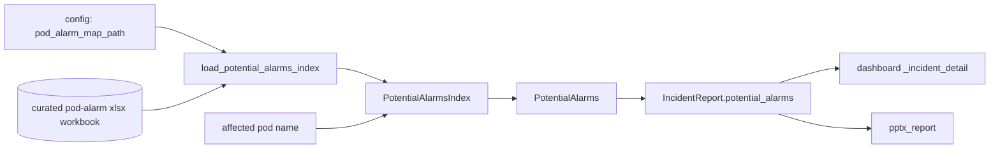

# Design Document

## Overview

The Potential Alarms feature adds a curated, read-only "candidate alarms" enrichment to each
incident. For the affected pod of an incident, it lists the alarms that *could have been
raised* for that pod, grounded entirely in the curated workbook
`docs/analysis/cobra-pods-alarm-to-pod-mapping.xlsx` (sheet **Pod Alarm Mapping**). These are
**candidate** associations from a reviewed mapping — not observed, confirmed, or active
alarms.

The design is a deliberate, near-exact structural clone of the shipped service-area impact
feature (`src/rca_agent/impact/`). Every structural decision — a four-file leaf sub-package, a
lazily-loaded workbook, an in-memory index keyed by exact pod name with a hash-stripped stem
fallback, a single `RCA_*` path gate, an inert-when-unconfigured posture, an additive and
defaulted field on `IncidentReport`, and a context-not-cause reasoning step that never touches
hypothesis ranking — mirrors a verified counterpart in the impact feature. Mirroring the
proven feature keeps the surface area small, the review cheap, and the invariants identical.

### Requirement → design element mapping

| Requirement | Design element(s) |
|-------------|-------------------|
| **R1** Load workbook once, keyed by exact pod name | `alarms/loader.py` (`load_workbook_alarms`, header-row scan, `_col`, `pod_stem` reuse, group-rows-by-pod); `alarms/index.py` (`PotentialAlarmsIndex`, `_by_exact`/`_by_stem`, `by_pod`, `load_potential_alarms_index`); resolved fresh per incident in `extractive.py` |
| **R2** Attach candidate alarms per affected pod | `reasoning/steps.py::build_potential_alarms` (resolve affected resource → first affected pod → `index.by_pod`); `PotentialAlarms` (ordered `alarms`, `summary_line()`); `is_direct` ordering (Direct before Conditional); one cited `Evidence` |
| **R3** UNKNOWN for unmapped pods, never guess | `PotentialAlarmsIndex.by_pod` returns `PotentialAlarms(pod=…, mapped=False, alarms=[])`; `summary_line()` UNKNOWN sentence; loader never fabricates rows |
| **R4** Cite every alarm; candidates, not confirmed | `CandidateAlarm.source_citation` surfaced verbatim; alarms with empty citation suppressed in surfacing; UI/PPTX label "candidate potential alarms that could have been raised"; `applicability` carried verbatim for Conditional entries; `scope`/`severity` surfaced verbatim |
| **R5** Context only, additive, backward-compatible | `IncidentReport.potential_alarms: PotentialAlarms | None = None`; `build_potential_alarms` never creates/removes/reweights a `Hypothesis`; feature-off serialization unchanged (`potential_alarms=None`) |
| **R6** Surface in dashboard + PPTX | `webhook/templates/_incident_detail.html` "Potential Alarms" section; `webhook/pptx_report.py` candidate-alarm block; section omitted when `potential_alarms is None` |
| **R7** Read-only, deterministic, no LLM/cluster mutation | Pure functions over workbook + pod name; no LLM call; no kube write; deterministic ordering preserved on every lookup |
| **R8** Degrade gracefully | `load_potential_alarms_index` returns `None` on unset/missing/unreadable/parse-fail; lazy `openpyxl` import so a missing extra never crashes startup; `build_potential_alarms` no-op when index is `None` |

### Research findings informing the design

Findings below were established by reading the shipped source directly; they are the contracts
the new feature parallels.

- **`impact/loader.py`** imports `openpyxl` *inside* `load_workbook_impacts`, documenting that
  the module is transitively imported by `models.incident` (and therefore the whole app), so a
  missing `openpyxl` must not crash startup. The new `alarms/loader.py` must keep the import
  equally lazy because `alarms.models.PotentialAlarms` will likewise be imported at the top of
  `models/incident.py`.
- **`impact/loader.py::_header_map`** assumes the header is on **row 1**. The pod-alarm
  workbook differs: row 1 is a title, row 2 a disclaimer, row 3 the real header. The new loader
  therefore adds a small **header-row scan** (find the row whose first cell lower-strips to
  `"pod name"`) before mapping columns by the same `_col(hmap, *needles)` substring approach.
- **`impact/loader.py::pod_stem`** strips the Kubernetes replicaset/pod hash (and statefulset
  ordinal) so a live pod whose hash has rolled still resolves. The new loader **reuses the same
  regex approach** (imported from a shared place, see Components) rather than duplicating it.
- **`impact/index.py::ServiceAreaIndex`** keeps `_by_exact` and `_by_stem` dicts, tries exact
  then stem in `by_pod`, returns an UNKNOWN record for a miss or empty name, and **never
  raises**. `load_service_area_index` returns `None` when the path is falsy or the file is
  missing/unreadable or parsing fails, logging at info/warning. The new index parallels this
  exactly.
- **`reasoning/steps.py::build_service_area`** resolves `affected_resource` then the first
  affected pod, attaches the impact plus exactly one cited `Evidence(category="impact")`, and
  is a no-op when the index is `None` or the pod is unmapped — never creating or reweighting a
  hypothesis. The new step `build_potential_alarms` mirrors this with `category="alarms"`.
- **`models/incident.py`** carries `service_area: ServiceAreaImpact | None = None` as an
  additive, defaulted, context-not-cause field. The new field `potential_alarms` is added the
  same way.

## Architecture

### New sub-package

A new leaf sub-package `src/rca_agent/alarms/` is created with four files that parallel
`src/rca_agent/impact/` symbol-for-symbol:

| New file | Parallels | Owns |
|----------|-----------|------|
| `alarms/models.py` | `impact/models.py` | `CandidateAlarm`, `PotentialAlarms` (+ `summary_line()`, `is_direct` helper) |
| `alarms/loader.py` | `impact/loader.py` | header-row scan, `_col`, `pod_stem` reuse, group-rows-by-pod, lazy `load_workbook_alarms` |
| `alarms/index.py` | `impact/index.py` | `PotentialAlarmsIndex` (`_by_exact`/`_by_stem`/`by_pod`), `load_potential_alarms_index` |
| `alarms/__init__.py` | `impact/__init__.py` | re-export public symbols |

### Dependency direction

`alarms/` is a **leaf**, consumed inward exactly like `impact/`. The dependency flow is:

- `models/incident.py` imports `alarms.models.PotentialAlarms` (the field type).
- `reasoning/extractive.py` imports `alarms.index.load_potential_alarms_index`.
- `reasoning/steps.py` imports `alarms.models` symbols (via the state/evidence path) and calls
  `index.by_pod`.
- `webhook/ui.py` + templates and `webhook/pptx_report.py` read the already-built
  `IncidentReport.potential_alarms` (no import of `alarms` internals required for rendering).
- `alarms/` itself imports only `config` indirectly (the path is passed in), `openpyxl`
  (lazily), and standard library — it never imports `reasoning`, `webhook`, `graph`, or
  `models.incident`, preserving the inward-only direction and avoiding an import cycle.

Because `models/incident.py` imports `alarms.models` at module top, `alarms.models` (and
through re-export, the `alarms` package) is transitively imported by the whole app. This is
precisely why `openpyxl` must be imported lazily *inside* `load_workbook_alarms` — importing
the package must never require the optional extra.

### Data-flow diagram

Paralleling the impact `SPECS.md` diagram:



### Resolution lifecycle

The index is resolved **fresh per incident** inside `ExtractivePipeline.run` (not cached on
`self`), exactly like `load_service_area_index`, so a re-supplied workbook takes effect on the
next incident lookup (R1 AC5). `load_potential_alarms_index` is cheap to call when the path is
unset (returns `None` immediately).

## Components and Interfaces

All signatures below are design targets, not code. Line length ≤ 100, pydantic `BaseModel`,
`from __future__ import annotations`, snake_case fields.

### `alarms/models.py`

```python
class CandidateAlarm(BaseModel):
    """One candidate alarm association for a pod, drawn from one row of the
    'Pod Alarm Mapping' sheet. A CANDIDATE that could have been raised -- never
    an observed/confirmed/active alarm."""
    alarm_name: str
    scope: str = ""              # "Individual pod" | "Workload (...)" | "Microservice/service"
    severity: str = ""
    raise_condition: str = ""
    clear_condition: str = ""
    applicability: str = ""      # applicability / qualification (verbatim)
    mapping_basis: str = ""      # "Exact pod name ..." (Direct) | "Conditional candidate ..."
    source_citation: str = ""    # the workbook 'Source in PDF' value, surfaced verbatim
    workload_key: str = ""       # 'Name-derived workload/service key' (optional)

    @property
    def is_direct(self) -> bool:
        """True when the mapping basis indicates an exact pod-name/direct
        mapping (basis contains 'Exact pod name'). Used only for Direct-before-
        Conditional ordering -- it does not change any value."""
        ...


class PotentialAlarms(BaseModel):
    """The per-pod answer: candidate alarms for a pod. ``mapped=False`` means the
    pod is not in the workbook (reported as UNKNOWN, never guessed)."""
    pod: str
    mapped: bool = False
    alarms: list[CandidateAlarm] = Field(default_factory=list)

    def summary_line(self) -> str:
        """One ASCII-safe sentence (<= 200 chars) for evidence/pptx/UI.
        mapped   -> "<pod> has N candidate potential alarm(s) [...]"
        unmapped -> "Potential alarms UNKNOWN for <pod> (pod not mapped in the
                     pod-alarm workbook)"."""
        ...
```

- `is_direct` is a derived read of `mapping_basis` ("Exact pod name" substring). It is the sole
  input to Direct-before-Conditional ordering (R2 AC6); it never mutates or reclassifies a
  value (R4 AC5).
- `summary_line()` returns a single ASCII-safe sentence capped at 200 characters (R2 AC7). When
  unmapped, it states UNKNOWN and the reason "pod not mapped in the pod-alarm workbook"
  (R3 AC2).

### `alarms/loader.py`

Parallels `impact/loader.py` with a header-row scan to handle the title+disclaimer rows.

```python
_ALARM_SHEET = "Pod Alarm Mapping"
_REFERENCE_SHEET = "Alarm Reference"   # definitions dictionary; OUT OF SCOPE (ignored)

from rca_agent.impact.loader import pod_stem   # REUSE the shipped stem logic

def _find_header_row(ws) -> int:
    """Return the 1-based row whose first cell lower-strips to 'pod name'.
    Scans from the top so a title row + disclaimer row above the header are
    skipped. Defaults to row 1 if no such row is found (mirrors impact's
    row-1 assumption as a fallback)."""
    ...

def _header_map(ws, header_row: int) -> dict[str, int]:
    """Map lowercased header text -> 1-based column index at the located
    header row (impact's _header_map hard-codes row 1; this takes the row)."""
    ...

def _col(hmap: dict[str, int], *needles: str) -> int | None:
    """First column whose lowered header contains all needles (verbatim reuse
    of impact's substring matcher)."""
    ...

def build_alarms(wb) -> list[PotentialAlarms]:
    """Group every data row (header_row+1 .. max_row) by the exact 'Pod name'
    value into one PotentialAlarms per pod. Rows with a blank Pod name are
    skipped (R1 AC3). Each row becomes one CandidateAlarm mapped by _col:
      Pod name                              -> group key (exact, stripped)
      Name-derived workload/service key     -> workload_key
      Alarm name                            -> alarm_name
      Alarm scope                           -> scope
      Severity in PDF                       -> severity
      Condition that raises alarm           -> raise_condition
      Clear/reset condition                 -> clear_condition
      Applicability / qualification         -> applicability
      Mapping basis                         -> mapping_basis
      Source in PDF                         -> source_citation
    Within each pod, alarms are ordered Direct-first then Conditional, stable
    within each group (R2 AC6). mapped=True for every grouped pod."""
    ...

def load_workbook_alarms(path: str) -> list[PotentialAlarms]:
    """Lazy openpyxl import INSIDE the function (so a missing extra never
    crashes startup/import), load read-only + data_only, build, then close."""
    from openpyxl import load_workbook
    ...
```

Notes:
- **Header-row scan** (R1 AC2): the workbook's real header is row 3 (`Pod name`,
  `Name-derived workload/service key`, `Alarm name`, `Alarm scope`, `Severity in PDF`,
  `Condition that raises alarm`, `Clear/reset condition`, `Applicability / qualification`,
  `Mapping basis`, `Source in PDF`). `_find_header_row` locates it instead of assuming row 1.
- **Group-rows-by-pod** (R2 AC4, R3 AC3): multiple rows share one `Pod name`; all are collected
  into one `PotentialAlarms.alarms` list.
- **`pod_stem` reuse** (R1 AC4): imported from `impact.loader` so the stem regex stays a single
  source of truth.
- **`Alarm Reference` sheet** is a definitions dictionary and is intentionally ignored for the
  per-pod lookup, the same way impact ignores "Alert mapping detail".

### `alarms/index.py`

```python
class PotentialAlarmsIndex:
    """Maps a pod name (exact or hash-stripped stem) to its PotentialAlarms."""
    def __init__(self, items: list[PotentialAlarms]) -> None:
        self._items = items
        self._by_exact: dict[str, PotentialAlarms] = {}
        self._by_stem: dict[str, PotentialAlarms] = {}
        # by_exact keyed on pod; by_stem.setdefault(pod_stem(pod), item)

    def by_pod(self, pod_name: str) -> PotentialAlarms:
        """Exact match, then stem match, else an UNKNOWN (unmapped) record.
        Never raises; never guesses. Empty/blank name -> unmapped record."""
        ...

    def all(self) -> list[PotentialAlarms]: ...
    def __len__(self) -> int: ...


def load_potential_alarms_index(path: str | None) -> PotentialAlarmsIndex | None:
    """None when path falsy, file missing/unreadable, or parse fails (logged
    info/warning). Mirrors load_service_area_index exactly."""
    ...
```

`by_pod` behavior (R1 AC4/6/7/8, R3):
- empty/blank `pod_name` → `PotentialAlarms(pod=pod_name or "", mapped=False, alarms=[])`.
- exact hit → stored record.
- stem hit → `record.model_copy(update={"pod": pod_name})` (carries the queried name, mirrors
  impact).
- miss → `PotentialAlarms(pod=pod_name, mapped=False, alarms=[])`.

### `alarms/__init__.py`

Re-exports `CandidateAlarm`, `PotentialAlarms`, `PotentialAlarmsIndex`,
`load_potential_alarms_index` (parallel to impact's `__all__`).

### `config.py` — new setting

Added in the `Settings` class next to `service_area_map_path`, same inert semantics and comment
style:

```python
# --- Potential alarms (scoped) ---
# Path to the curated pod->alarm mapping workbook (xlsx). When set AND the file
# exists, incidents gain a `potential_alarms` field listing candidate alarms
# that could have been raised for the affected pod. Unset/missing -> feature
# inert (no potential_alarms attached). Read-only.
pod_alarm_map_path: str | None = None   # env RCA_POD_ALARM_MAP_PATH
```

### `models/incident.py` — new field

```python
from rca_agent.alarms.models import PotentialAlarms  # top-level import (parallels impact)

class IncidentReport(BaseModel):
    ...
    # Scoped potential alarms: candidate alarms that COULD have been raised for
    # the affected pod, from the curated pod-alarm workbook. None when the
    # feature is off or the pod is unmapped. Additive and defaulted so existing
    # reports/serialization are unaffected. This is CONTEXT (what could fire),
    # NOT a cause -- it never changes hypothesis ranking.
    potential_alarms: PotentialAlarms | None = None
```

### `reasoning/state.py` — new field

```python
service_area: object = None       # ServiceAreaImpact | None (avoid import cycle)
potential_alarms: object = None   # PotentialAlarms | None (avoid import cycle)
```

### `reasoning/extractive.py` — wiring

- Add import: `from rca_agent.alarms.index import load_potential_alarms_index`.
- In `run`, after the existing `steps.build_service_area(...)` call, add a parallel call
  resolved fresh per incident:
  ```python
  steps.build_potential_alarms(
      state, load_potential_alarms_index(self.cfg.pod_alarm_map_path))
  ```
- In `_to_report`, add `potential_alarms=state.potential_alarms` alongside
  `service_area=state.service_area`.

### `reasoning/steps.py` — `build_potential_alarms`

Mirrors `build_service_area`:

```python
def build_potential_alarms(state: ReasoningState, index) -> ReasoningState:
    """Attach candidate potential alarms for the affected pod (scoped context).
    ``index`` is a PotentialAlarmsIndex or None (feature off). Resolves the
    affected resource -- falling back to the first affected pod -- and, if the
    pod is mapped, attaches the PotentialAlarms plus ONE cited evidence item.
    CONTEXT only: it never creates or reweights a hypothesis. No-op when the
    feature is off or the pod is unmapped (no fabricated alarms)."""
    if index is None:
        return state
    candidates = [state.affected_resource, *state.affected_pods]
    result = None
    for pod in candidates:
        if not pod:
            continue
        found = index.by_pod(pod)
        if found.mapped:
            result = found
            break
    if result is None:
        return state
    state.potential_alarms = result
    state.add_evidence(Evidence(
        category="alarms",
        summary=result.summary_line(),
        resource=result.pod,
        citations=[Citation(
            kind="alarms",
            source="pod-alarm mapping workbook",
            detail=f"{len(result.alarms)} candidate alarm(s)",
        )],
    ))
    return state
```

This adds exactly one cited evidence item for a mapped pod (R2 AC8), is a no-op for unmapped
pods or a `None` index (R3 AC1/4, R8), and never creates or reweights a `Hypothesis`
(R5 AC2/3).

### `webhook/ui.py` + templates — dashboard

A new "Potential Alarms" section is added to `_incident_detail.html`, modeled on the existing
`service_area` block:

- Wrapped in `` so the section is **omitted entirely** when the
  field is `None` (R6 AC5).
- When `pa.mapped` and `pa.alarms` is non-empty: render a section header labelled with text
  identifying these as **candidate potential alarms that could have been raised** (R4 AC3) —
  never "confirmed"/"active". Each `CandidateAlarm` renders alarm name, `scope`, `severity`,
  `mapping_basis`, and `source_citation` (R6 AC1). Conditional entries also render
  `applicability` verbatim (R4 AC4). Any missing field renders an explicit unknown indicator so
  the remaining entries still render without error (R6 AC2). Alarms whose `source_citation` is
  empty are not rendered (R4 AC2).
- When `not pa.mapped` (UNKNOWN): render the section with a single statement that potential
  alarms are unknown because the pod is not mapped, and no entries (R6 AC3).

### `webhook/pptx_report.py` — PPTX export

Modeled on the `service_area` block in slide 3: read
`pa = getattr(report, "potential_alarms", None)`; when `pa is not None and pa.mapped`, add a
"Potential Alarms (candidates)" field listing each `CandidateAlarm` paired with its
`source_citation` (R6 AC4). The label states these are candidate alarms, never confirmed/active
(R4 AC3).

## Data Models

### `CandidateAlarm`

| Field | Type | Default | Source column | Notes |
|-------|------|---------|---------------|-------|
| `alarm_name` | `str` | — | `Alarm name` | required string |
| `scope` | `str` | `""` | `Alarm scope` | verbatim (R4 AC5) |
| `severity` | `str` | `""` | `Severity in PDF` | verbatim (R4 AC5) |
| `raise_condition` | `str` | `""` | `Condition that raises alarm` | verbatim |
| `clear_condition` | `str` | `""` | `Clear/reset condition` | verbatim |
| `applicability` | `str` | `""` | `Applicability / qualification` | verbatim; shown for Conditional (R4 AC4) |
| `mapping_basis` | `str` | `""` | `Mapping basis` | drives `is_direct` ordering |
| `source_citation` | `str` | `""` | `Source in PDF` | surfaced verbatim (R4 AC1); empty → suppressed (R4 AC2) |
| `workload_key` | `str` | `""` | `Name-derived workload/service key` | optional |

Derived: `is_direct` (property) → `"exact pod name" in mapping_basis.lower()`.

### `PotentialAlarms`

| Field | Type | Default | Notes |
|-------|------|---------|-------|
| `pod` | `str` | — | queried pod name (carried through stem matches) |
| `mapped` | `bool` | `False` | `False` = UNKNOWN (not in workbook), distinct from mapped-with-zero (R3 AC5) |
| `alarms` | `list[CandidateAlarm]` | `[]` | ordered Direct-first, stable within group (R2 AC6) |

Method: `summary_line() -> str` — ASCII-safe, ≤ 200 chars (R2 AC7, R3 AC2).

### Workbook structure (verified)

Sheet **Pod Alarm Mapping**, 1065 rows: row 1 title ("Individual Pod → Alarm Mapping"), row 2
disclaimer, row 3 header (the 10 columns above, in order), data from row 4. Multiple rows per
`Pod name`. Sheet **Alarm Reference** is a definitions dictionary and is out of scope (unused
secondary sheet).

## Correctness Properties

*A property is a characteristic or behavior that should hold true across all valid executions
of a system — essentially, a formal statement about what the system should do. Properties serve
as the bridge between human-readable specifications and machine-verifiable correctness
guarantees.*

The acceptance criteria were analyzed for testability. Pure, deterministic components (the
loader grouping/ordering, the index lookup, the model value preservation and summary, and the
context-not-cause / backward-compat invariants) carry universal properties and are expressed
below. UI/PPTX rendering, pipeline wiring, and graceful-degradation paths are verified by
example and edge-case tests in the Testing Strategy instead (they assert specific scenarios,
not "for all inputs").

### Property 1: `by_pod` is total and never raises

*For any* string `pod_name` (including empty, whitespace, unicode, or very long values) and any
`PotentialAlarmsIndex`, `index.by_pod(pod_name)` returns a `PotentialAlarms` instance and never
raises an exception.

**Validates: Requirements 1.7, 1.8**

### Property 2: Exact-then-stem-then-UNKNOWN resolution

*For any* pod present in the workbook, `by_pod` of its exact name resolves it with `mapped=True`;
*for any* pod name that shares a hash-stripped stem with a workbook pod but is not an exact key,
`by_pod` resolves via the stem with `mapped=True` and the returned `pod` equals the queried
name; and *for any* pod name matching neither an exact key nor a stem, `by_pod` returns
`mapped=False`.

**Validates: Requirements 1.4**

### Property 3: Absent pods yield UNKNOWN with zero alarms and nothing is fabricated

*For any* pod name absent from the workbook, the result has `mapped=False` and exactly zero
`CandidateAlarm` entries; and *for any* pod name, every `CandidateAlarm` in the result
corresponds to a workbook row recorded for that pod (the result's alarms are a subset of the
workbook's rows for the queried pod — never inferred or generated).

**Validates: Requirements 3.1, 3.4, 7.1, 7.2, 7.6**

### Property 4: Grouping count equals matching workbook rows

*For any* pod present in the workbook with N non-blank data rows, the loaded `PotentialAlarms`
for that pod has `mapped=True` and exactly N `CandidateAlarm` entries, each carrying the alarm
name, scope, severity, raise condition, clear/reset condition, applicability, mapping basis, and
source citation from its row; rows with a blank `Pod name` contribute no entry.

**Validates: Requirements 1.3, 2.4, 3.3**

### Property 5: Direct-before-Conditional stable ordering

*For any* set of workbook rows for a single pod in any input order, the resulting `alarms` list
places every entry whose `is_direct` is true before every entry whose `is_direct` is false, and
preserves the original workbook relative order within each of those two groups (stable
partition).

**Validates: Requirements 2.6**

### Property 6: Field values are preserved verbatim

*For any* `CandidateAlarm` built from a workbook row, its `source_citation`, `scope`, and
`severity` values are character-for-character identical to the corresponding workbook cell
values, with no truncation, reformatting, normalization, or reclassification.

**Validates: Requirements 4.1, 4.5**

### Property 7: `summary_line()` is ASCII-safe and bounded

*For any* `PotentialAlarms` result (mapped or unmapped, with any pod name and any alarm count),
`summary_line()` returns a string that is ASCII-encodable and at most 200 characters long; when
`mapped` is false the string states that potential alarms are UNKNOWN for the pod and that the
reason is the pod is not mapped in the workbook.

**Validates: Requirements 2.7, 3.2**

### Property 8: Lookups are deterministic

*For any* pod name queried twice against the same `PotentialAlarmsIndex`, the two results are
equal in content and in alarm ordering.

**Validates: Requirements 7.5**

### Property 9: Attaching potential alarms never changes hypothesis ranking

*For any* incident input, the list of hypotheses produced with the Potential Alarms feature
enabled is identical — in count, identity, confidence value, and relative ordering — to the list
produced with the feature disabled.

**Validates: Requirements 5.2, 5.3**

### Property 10: Feature-off serialization is unchanged

*For any* `IncidentReport` produced with the feature off, the serialized report has
`potential_alarms` equal to `None` and is otherwise identical to the report's serialization
before the `potential_alarms` field existed (the field round-trips as `None`).

**Validates: Requirements 5.1, 5.4**

## Error Handling

The feature is inert on every failure path and never propagates an error to the reasoning
pipeline (R8, R5 AC5):

- **Path unset** → `load_potential_alarms_index(None | "")` returns `None`; `build_potential_alarms`
  sees `None` and no-ops. No `potential_alarms` attached. (R8 AC1)
- **File missing/unreadable** → factory logs one `info`/`warning` entry and returns `None`;
  pipeline completes. (R8 AC2)
- **Workbook present but unparsable** → the factory wraps `load_workbook_alarms` in
  `try/except Exception` (mirroring impact), logs one `warning`, returns `None`; pipeline
  completes. (R8 AC3)
- **`openpyxl` absent** → the import is lazy *inside* `load_workbook_alarms`; an `ImportError`
  is caught by the same `try/except` in the factory, which returns `None`. Importing the
  `alarms` package (transitively from `models.incident`) never requires `openpyxl`, so startup
  always completes. (R8 AC4)
- **`by_pod` never raises** → empty/blank name returns an UNKNOWN record; a miss returns an
  UNKNOWN record; exact/stem hits return the stored record. (R1 AC7/AC8)
- **Step-level failure** → if producing the result raises for any reason, the report completes
  with `potential_alarms=None`, hypotheses unchanged, and one log entry that potential-alarm
  context was unavailable. (R5 AC5)
- **Rendering robustness** → the UI renders a missing field as an explicit unknown indicator and
  continues rendering the remaining entries (R6 AC2); an empty `source_citation` suppresses just
  that entry (R4 AC2); a `None` field omits the whole section (R6 AC5).

### Explicit design constraints (invariants)

- **Context-not-cause:** `build_potential_alarms` MUST NOT create, remove, or reweight any
  `Hypothesis`, and MUST NOT alter confidence or ordering. It only sets `state.potential_alarms`
  and appends one `Evidence(category="alarms")`.
- **Backward-compatible:** `potential_alarms` is additive and defaulted to `None`; a feature-off
  report serializes exactly as before the field existed.
- **Read-only / deterministic / no LLM / no cluster mutation:** output is derived solely from
  the workbook and the queried pod name; no LLM is invoked and no Kubernetes write occurs.
- **Candidates, never confirmed:** all surfaced copy identifies entries as candidate alarms that
  *could have been* raised; the words "confirmed"/"active" are never used for entries.

## Testing Strategy

The suite is offline-first and mirrors the impact tests (`tests/test_impact_loader.py`,
`tests/test_impact_pipeline.py`). A small committed fixture
`tests/fixtures/pod_alarm_mapping_sample.xlsx` reproduces the real workbook's shape — a title
row, a disclaimer row, the row-3 header with all 10 columns, several pods with multiple alarm
rows (a mix of Direct and Conditional mapping bases), at least one row with a blank `Pod name`
to exercise skipping, and at least one row with an empty `Source in PDF`. A generator script
(`tests/fixtures/make_pod_alarm_fixture.py`, paralleling the impact fixture maker) builds it so
no live inventory is committed.

### Property-based tests (when PBT applies)

PBT is appropriate here because the loader grouping/ordering, the index lookup, and the model
value/summary logic are pure functions with large input spaces and clear universal properties.

- Use the standard Python PBT library **Hypothesis** (do not hand-roll generators/shrinking).
- Each property test runs a **minimum of 100 iterations** (`@settings(max_examples=100)` or
  higher).
- Each property test is tagged with a comment referencing its design property, in the format:
  **Feature: potential-alarms, Property {number}: {property_text}**.
- Each of Properties 1–10 is implemented by a **single** property-based test:
  - P1 — generate arbitrary strings (empty, whitespace, unicode, long); assert `by_pod` returns
    a `PotentialAlarms` and never raises.
  - P2 — generate mapped pods and rolled-hash variants and true misses; assert
    exact→stem→UNKNOWN precedence and that a stem hit carries the queried name.
  - P3 — generate pods absent from a known workbook; assert `mapped=False`, zero alarms, and
    that returned alarms are always a subset of the workbook's rows for that pod.
  - P4 — build workbooks with N rows per pod (including blank-`Pod name` rows); assert alarm
    count equals the non-blank matching-row count and fields populate.
  - P5 — generate mixed Direct/Conditional rows in random order; assert the stable Direct-first
    partition.
  - P6 — generate citation/scope/severity strings with punctuation, em-dashes, and quotes;
    assert the model returns them unchanged.
  - P7 — generate mapped/unmapped results with varying counts/pod names; assert `summary_line()`
    is ASCII-encodable, `len ≤ 200`, and the UNKNOWN sentence for unmapped.
  - P8 — query the same pod twice; assert equal content and ordering.
  - P9 — run the pipeline feature-off vs feature-on over generated incident inputs; assert the
    hypotheses list is identical (count, identity, confidence, order).
  - P10 — build feature-off reports; assert `model_dump()` has `potential_alarms is None` and
    round-trips unchanged.

### Example / edge-case unit tests

Mirroring `test_impact_loader.py` and `test_impact_pipeline.py`:

- **Loader example** (R1 AC2, 1.5): parse the sample fixture; assert the header-row scan skips
  the title+disclaimer rows and all 10 columns map; assert a re-supplied fixture is visible on
  the next load.
- **Index edge cases** (R1 AC7): `by_pod("")` and `by_pod("   ")` → `mapped=False`, no raise;
  exact, stem, and unmapped lookups over the fixture.
- **Pipeline example** (R2 AC1/2/3/8): mapped `affected_resource` attaches exactly one
  `PotentialAlarms` and exactly one `Evidence(category="alarms")`; empty resource falls back to
  the first affected pod; no affected pods → `potential_alarms` stays `None`.
- **Context-not-cause** (R5 AC2/3, Property 9 companion example): assert the hypotheses list is
  unchanged with the feature attached.
- **Serialization / backward-compat** (R5 AC1/4): feature off → `potential_alarms is None` and
  the dump matches the baseline shape.
- **Graceful degradation** (R8): factory returns `None` for unset path, missing file, and an
  unparsable workbook (one log each); a simulated missing `openpyxl` keeps startup and incidents
  identical to disabled; a step-level failure leaves `potential_alarms=None` with unchanged
  ranking (R5 AC5).
- **UNKNOWN distinctness** (R3 AC5): an unmapped result's `mapped=False` distinguishes it from
  any mapped result.

### Dashboard / PPTX tests

Paralleling `test_gui_service_area.py` and `test_pptx_report.py`:

- **GUI** (R6 AC1/2/3/5, R4 AC2/3/4): rendered fragment lists every candidate with name, scope,
  severity, mapping basis, and citation; the section label states these are candidate alarms
  that could have been raised and contains neither "confirmed" nor "active" for entries; a
  missing field renders an explicit unknown indicator; an empty citation suppresses that entry;
  an UNKNOWN result renders the single not-mapped statement with zero entries; a `None` field
  omits the section and the rest of the panel renders.
- **PPTX** (R6 AC4): the generated deck includes each candidate paired with its source citation.

### Read-only / no-LLM checks (smoke)

- Static/import check that the `alarms` path imports no LLM client and no Kubernetes write API
  (R7 AC3/AC4) — the feature is read-only by construction.

## Review and Approval

`requirements.md` exists and is approved. This design mirrors the shipped `impact/` feature
structurally; if any gap in the requirements is identified during review, I will offer to
return to requirements clarification before implementation planning.
