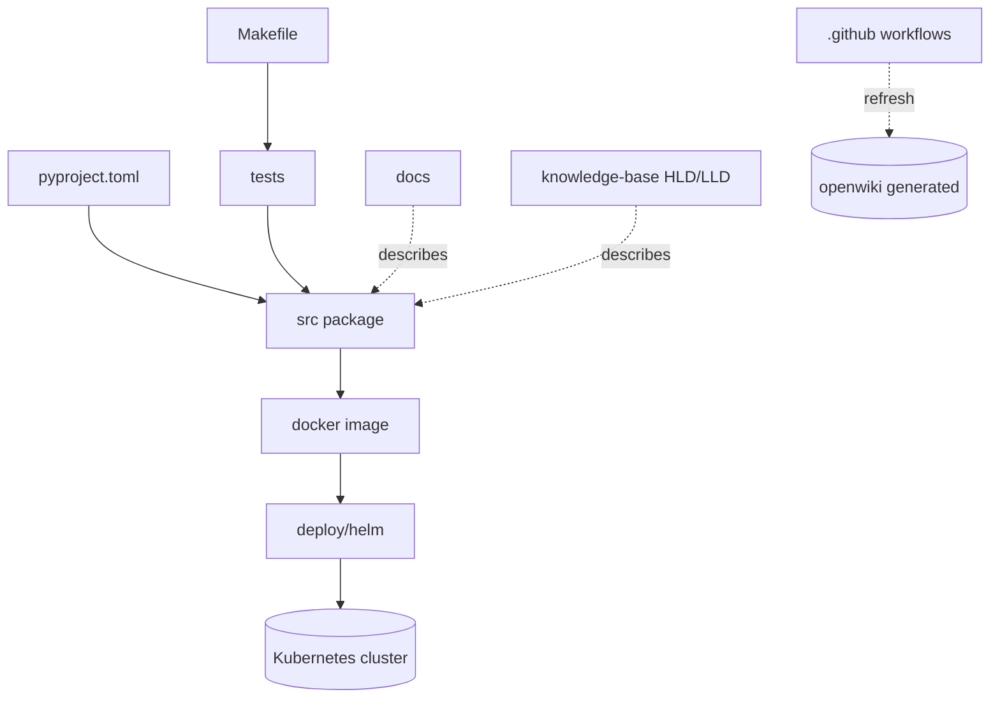

# Repository Root Folder Specification

| Field | Value |
|-------|-------|
| Specification identifier | SPEC-root |
| Repository-relative folder | `.` (repository root) |
| Role | Repository integration specification and master index for the read-only Kubernetes fault-detection and root-cause agent |
| Current commit | `2f4774f0476d5b47426ac1548c479f132c467332` |
| Generated/refreshed | 2026-11-03 |
| Status | Draft until maintainer review |
| Parent specification | (none — this is the root) |

Authority notice: the source code, tests, schemas, and build definitions in
this repository remain authoritative. This specification is derived, bounded
evidence and must be reconciled with source on any conflict. Generated OpenWiki
pages were not used as evidence and were not modified.

## 1. Intent and significance

This repository is a proof-of-concept read-only agent that detects faults in a
Kubernetes-hosted 5G core and explains their root cause without changing the
cluster. The pipeline is `detect → gather evidence → reason → report`. Its value
is GraphRAG-style reasoning over a live NetworkX dependency graph: deterministic
code gathers evidence and finds candidate causes, and an optional local LLM only
ranks and explains them. Safety is enforced by the platform (read-only RBAC and
the absence of any write tool), not by the prompt.

The root is the integration boundary. It owns the packaging and build
definitions, the container and deployment entry points, the design and diagram
documentation, and the test and evaluation harness, and it ties every subfolder
specification together through the index in Section 15.

## 2. Scope and contents

- Direct project-owned files include: [`README.md`](README.md),
  [`pyproject.toml`](pyproject.toml), [`requirements.txt`](requirements.txt),
  [`Makefile`](Makefile), [`Dockerfile`](Dockerfile), [`INSTALL.md`](INSTALL.md),
  [`PLAN.md`](PLAN.md), the `PLAN-*.md` and `NOTES-*.md` design notes,
  `SESSION-2026-10-27.md`, `TODO-llm-explanation-fix.md`,
  `TEST-CASES-runbook-rag.md`, the service-area implementation-map text files,
  `AGENTS.md`, `CLAUDE.md`, `.gitignore`, and `.openwikiignore`.
- In-scope immediate child folders: `.github/`, `deploy/`, `docker/`, `docs/`,
  `knowledge-base/`, `scripts/`, `src/`, `tests/`.
- Excluded at the root: `.git/`, `.aide/`, `.kiro/`, `openwiki/`, `.venv/`,
  `.pytest_cache/`, `.ruff_cache/`, and the AIDE-managed `prompt/`, `loops/`,
  and `assets/` directories (see Section 16). Several large binary/office files
  and live-data JSON/xlsx at the root are `.gitignore`d operational data.

## 3. Inputs

- Build/install inputs: [`pyproject.toml`](pyproject.toml),
  [`requirements.txt`](requirements.txt) (dependencies and optional extras).
- Runtime configuration: `RCA_*` environment variables and an optional `.env`
  (see [`src/rca_agent/SPECS.md`](src/rca_agent/SPECS.md)).
- Operational inputs at runtime: Alertmanager webhooks, Kubernetes events, and
  optional Prometheus metrics (via the application).

## 4. Outputs

- An installable Python package (`k8s-rca-agent`) exposing the `rca-agent`
  console script.
- A container image (root [`Dockerfile`](Dockerfile) + `docker/`) and a Helm
  chart (`deploy/helm/`) for deployment.
- Incident reports (JSON/HTML/PPTX) produced by the running agent.
- Accuracy evidence under `src/rca_agent/eval/results/`.

## 5. Contracts and models

### 5.1 Behavioral contracts

- Package metadata, dependencies, optional extras (`llm`, `cluster`, `viz`,
  `rag`, `rag-semantic`, `pptx`, `dev`), the `rca-agent` entry point, and tooling
  config (Ruff, pytest) are defined in [`pyproject.toml`](pyproject.toml).
- `make check` (= `lint` + `test`) is the pre-commit gate (see
  [`Makefile`](Makefile)).
- The agent is read-only toward Kubernetes by construction (RBAC + no write
  tool).

### 5.2 Declared models and callable surface

| Symbol | Kind | Source |
|--------|------|--------|
| `k8s-rca-agent` project | package metadata | [`pyproject.toml`](pyproject.toml) |
| `rca-agent` console script | entry point | [`pyproject.toml`](pyproject.toml) → `rca_agent.webhook.app:main` |
| make targets (`check`, `test`, `lint`, `fmt`, `eval`, `install`, `clean`) | build loops | [`Makefile`](Makefile) |

### 5.3 Required invariants

- The application stays read-only toward the cluster.
- Optional heavy features remain optional extras so the base install is light.
- `src`-layout is preserved (`packages.find where = ["src"]`).

## 6. Interaction points

| Direction | Folder | Type |
|-----------|--------|------|
| Children | `.github/`, `deploy/`, `docker/`, `docs/`, `knowledge-base/`, `scripts/`, `src/`, `tests/` | ownership |
| Outbound | [`src/`](src/SPECS.md) | the application package |
| Outbound | [`deploy/helm/`](deploy/helm/SPECS.md), [`docker/`](docker/SPECS.md) | packaging/deployment |
| Outbound | [`tests/`](tests/SPECS.md) | verification |

## 7. Exception and error handling

Build/lint/test failures surface through `make check`. The application's own
error handling (startup resilience, LLM fallback, graceful metric skipping) is
documented in the `src/rca_agent/` subfolder specifications. No repository-root
code declares runtime error handling.

## 8. Environment variables and configuration

The full `RCA_*` configuration surface is defined in
[`src/rca_agent/config.py`](src/rca_agent/config.py) and tabulated in
[`src/rca_agent/SPECS.md`](src/rca_agent/SPECS.md). The Helm chart and the Docker
entrypoint set a subset of these for deployment. `.gitignore` marks
secrets/operational data (`.env`, live JSON/xlsx, models) as never committed.

## 9. Storage, memory, and resource map

| Resource | Owner | Lifetime | Release |
|----------|-------|----------|---------|
| Installed package / wheel | build system | persistent | uninstall |
| Container image | Docker build | persistent (registry) | registry-managed |
| Runtime process resources | application (`src/rca_agent/`) | process lifetime | see subfolder specs |
| Eval results artifacts | `src/rca_agent/eval/results/` | persistent | overwritten per run |

## 10. Interaction diagram

## 11. Cross-cutting design considerations

- Safety: read-only by construction (RBAC + no write tool); untrusted log/alert
  text is fenced as data.
- Reproducibility: extractive, no-LLM default; deterministic evaluation harness.
- Deployment: single-process image; hardened pod; read-only root filesystem.
- Packaging: light base install with opt-in extras.
- Documentation maintenance: diagrams and HLD/LLD must track the source.

## 12. Spec-driven development protocol

Future work at the repository level must: (1) record the intended cross-cutting
contract delta here; (2) identify affected subfolder specifications (producers
and consumers); (3) define the smallest evidence or test that proves the change;
(4) implement without silently widening scope or adding a Kubernetes write
capability; (5) run `make check` (and `make eval` when reasoning/accuracy is
affected); (6) reconcile this specification and the affected subfolder specs.

Acceptance scenarios:

- SPEC-root-AC1 (valid): Given a clean checkout, When `make check` runs, Then
  Ruff and the pytest suite pass without a cluster or LLM.
- SPEC-root-AC2 (invalid): Given a change breaks a package/build contract, When
  the build runs, Then it fails before producing an artifact.
- SPEC-root-AC3 (compatibility/safety): Given a change to deployment or RBAC,
  When reviewed, Then the read-only guarantee is preserved.
- SPEC-root-AC4 (verification): Given `make eval`, When run, Then the
  fault-injection harness reports top-2 accuracy against the labeled library.

## 13. Verification strategy

`make check` is the authoritative repository gate (Ruff + pytest); `make eval`
proves reasoning accuracy. Chart validation (`helm template`/`lint`) and a
container smoke test cover deployment. No checks were executed for this
documentation task.

## 14. Evidence inventory

| File | Type | Bytes |
|------|------|-------|
| [`README.md`](README.md) | Markdown | ~3.4 KB |
| [`pyproject.toml`](pyproject.toml) | TOML | ~3.4 KB |
| [`requirements.txt`](requirements.txt) | text | ~0.7 KB |
| [`Makefile`](Makefile) | Makefile | ~1.1 KB |
| [`Dockerfile`](Dockerfile) | Dockerfile | ~2.7 KB |
| [`INSTALL.md`](INSTALL.md) | Markdown | ~5.3 KB |
| [`PLAN.md`](PLAN.md) | Markdown | ~28 KB |
| [`AGENTS.md`](AGENTS.md) | Markdown | ~0.6 KB |
| [`.gitignore`](.gitignore) | config | ~0.8 KB |

The table is capped to key integration files; additional root `PLAN-*.md`,
`NOTES-*.md`, and session/notes Markdown files exist as design context, and
several large binary/office and live-data files at the root are `.gitignore`d
operational data not treated as specification evidence.

## 15. Repository specification index

Sorted by repository-relative path. Each in-scope folder has exactly one
`SPECS.md`.

| Folder | Role | Specification |
|--------|------|---------------|
| `.` (root) | Repository integration + master index | [`SPECS.md`](SPECS.md) |
| `.github` | GitHub platform configuration | [`.github/SPECS.md`](.github/SPECS.md) |
| `.github/workflows` | GitHub Actions (OpenWiki update) | [`.github/workflows/SPECS.md`](.github/workflows/SPECS.md) |
| `deploy` | Deployment assets container | [`deploy/SPECS.md`](deploy/SPECS.md) |
| `deploy/helm` | Helm chart (read-only RBAC) | [`deploy/helm/SPECS.md`](deploy/helm/SPECS.md) |
| `deploy/helm/templates` | Helm templates (RBAC/Deployment/Service) | [`deploy/helm/templates/SPECS.md`](deploy/helm/templates/SPECS.md) |
| `docker` | Container entrypoint, sidecar, deploy helper | [`docker/SPECS.md`](docker/SPECS.md) |
| `docs` | Architecture diagrams + reasoning-rules docs | [`docs/SPECS.md`](docs/SPECS.md) |
| `docs/arch` | Numbered per-stage architecture diagrams | [`docs/arch/SPECS.md`](docs/arch/SPECS.md) |
| `knowledge-base` | HLD / LLD design documents | [`knowledge-base/SPECS.md`](knowledge-base/SPECS.md) |
| `scripts` | Developer and demo helper scripts | [`scripts/SPECS.md`](scripts/SPECS.md) |
| `src` | Source root (`src`-layout) | [`src/SPECS.md`](src/SPECS.md) |
| `src/rca_agent` | Application package + settings | [`src/rca_agent/SPECS.md`](src/rca_agent/SPECS.md) |
| `src/rca_agent/detection` | Automatic fault detection + incident store | [`src/rca_agent/detection/SPECS.md`](src/rca_agent/detection/SPECS.md) |
| `src/rca_agent/eval` | Fault-injection accuracy harness + capture | [`src/rca_agent/eval/SPECS.md`](src/rca_agent/eval/SPECS.md) |
| `src/rca_agent/eval/results` | Committed accuracy results | [`src/rca_agent/eval/results/SPECS.md`](src/rca_agent/eval/results/SPECS.md) |
| `src/rca_agent/graph` | Live NetworkX dependency graph + builder | [`src/rca_agent/graph/SPECS.md`](src/rca_agent/graph/SPECS.md) |
| `src/rca_agent/impact` | Scoped service-area impact | [`src/rca_agent/impact/SPECS.md`](src/rca_agent/impact/SPECS.md) |
| `src/rca_agent/models` | Input/output Pydantic schemas | [`src/rca_agent/models/SPECS.md`](src/rca_agent/models/SPECS.md) |
| `src/rca_agent/rag` | Runbook retrieval + store + query log | [`src/rca_agent/rag/SPECS.md`](src/rca_agent/rag/SPECS.md) |
| `src/rca_agent/reasoning` | Extractive pipeline + optional LLM re-rank | [`src/rca_agent/reasoning/SPECS.md`](src/rca_agent/reasoning/SPECS.md) |
| `src/rca_agent/store` | Durable PostgreSQL datastore (incidents + query log) | [`src/rca_agent/store/SPECS.md`](src/rca_agent/store/SPECS.md) |
| `src/rca_agent/tools` | Read-only query tools | [`src/rca_agent/tools/SPECS.md`](src/rca_agent/tools/SPECS.md) |
| `src/rca_agent/webhook` | FastAPI app + dashboard + PPTX | [`src/rca_agent/webhook/SPECS.md`](src/rca_agent/webhook/SPECS.md) |
| `src/rca_agent/webhook/static` | Vendored Bootstrap/HTMX assets | [`src/rca_agent/webhook/static/SPECS.md`](src/rca_agent/webhook/static/SPECS.md) |
| `src/rca_agent/webhook/templates` | Jinja2 + HTMX dashboard templates | [`src/rca_agent/webhook/templates/SPECS.md`](src/rca_agent/webhook/templates/SPECS.md) |
| `tests` | pytest unit/component suite | [`tests/SPECS.md`](tests/SPECS.md) |
| `tests/fixtures` | Sample payload + service-area workbook | [`tests/fixtures/SPECS.md`](tests/fixtures/SPECS.md) |

Total in-scope specifications: 28 (this root + 27 subfolders).

## 16. Unknowns and review items

- incident-persistence-postgres feature: a new `src/rca_agent/store/` package
  adds a mandatory PostgreSQL datastore (incidents + runbook query log) with
  write-through persistence and startup rehydration. The config
  (`RCA_DATABASE_URL`), detection, rag, webhook, `deploy/helm`, and `docker`
  specs were reconciled to reflect it, and the new `store/` spec was added to the
  Section 15 index. The `Current commit` fields across the affected specs are
  kept at `2f4774f` to match the siblings; their machine-generated sections note
  that they reflect the feature code. Re-verify byte sizes and commit metadata on
  the next full reconciliation pass.
- Reconciliation pass (commit `2f4774f`): every `src/rca_agent/` evidence
  inventory now carries exact byte sizes from file metadata, and each flagged
  file's module header/docstring was read and confirmed to match its spec's
  stated contract. The `src/rca_agent/reasoning/` folder was read in full and
  its spec's unknowns resolved. Full-body reads of the remaining large modules
  (`graph/builder.py`, `graph/visualize.py`, `tools/kube_client.py`,
  `detection/event_watcher.py`, `rag/local_store.py`/`semantic_store.py`,
  `impact/loader.py`, `webhook/app.py`/`ui.py`/`pptx_report.py`, and the `eval`
  scorer/fake_cluster/capture/report modules) remain a maintainer-review item;
  their per-folder specs keep explicit bounded-scan caveats where a full
  error-path or format confirmation is still outstanding.
- `scripts/` and `docker/` shell scripts (`release.sh`, `chaos-demo.sh`,
  `deploy-cobra.sh`) were not read in full; any cluster- or git-mutating
  behavior is a review item and an operator-run safety consideration.
- Version skew: Helm `Chart.yaml` `appVersion` `0.1.0` and default image tag
  `0.3.9` versus package version `0.10.1` — maintainer to confirm intended
  release alignment.
- Ownership boundary: the `prompt/`, `loops/`, and `assets/` directories are
  entirely AIDE-managed per `.aide/managed-files.json` and are excluded; the
  AIDE-managed `prompt/SPECS.md` is not a project specification and was not
  generated, refreshed, or indexed by this task. `.aide/`, `.kiro/`, and
  `openwiki/` are excluded as AIDE support or generated boundaries.
- Binary office/image/data files (`.pptx`, `.docx`, `.png`, `.svg`, `.xlsx`,
  large `.json`) were inventoried by name/size only; their contents are not
  specification evidence.
