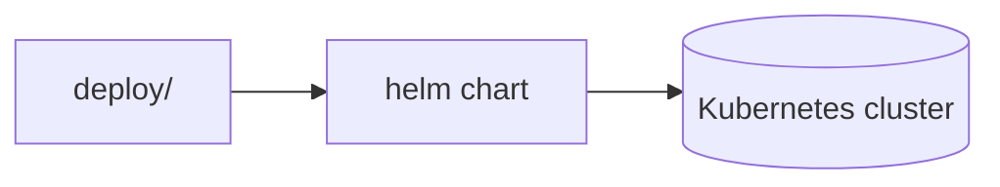

# deploy Folder Specification

| Field | Value |
|-------|-------|
| Specification identifier | SPEC-deploy |
| Repository-relative folder | `deploy/` |
| Role | Deployment — container for Kubernetes deployment assets (the Helm chart) |
| Current commit | `2f4774f0476d5b47426ac1548c479f132c467332` |
| Generated/refreshed | 2026-11-03 |
| Status | Draft until maintainer review |
| Parent specification | [`../SPECS.md`](../SPECS.md) |

Authority notice: the source files, tests, and build definitions in this
repository remain authoritative. This specification is derived, bounded
evidence and must be reconciled with source on any conflict.

## 1. Intent and significance

This folder groups the repository's Kubernetes deployment assets. At this commit
it contains the Helm chart that installs the agent with a read-only
ServiceAccount, ClusterRole, Deployment, and Service. It is a pure
aggregation/ancestor boundary holding the `helm/` chart.

## 2. Scope and contents

- Direct files: 0 project-owned. Immediate child folders: 1 (`helm/`).
- [`helm/`](helm/SPECS.md) — the `rca-agent` Helm chart.

## 3. Inputs

- None directly. The chart under `helm/` consumes Helm values at install time.

## 4. Outputs

- None directly. Delivers the Helm chart to operators via `helm/`.

## 5. Contracts and models

### 5.1 Behavioral contracts

- Deployment assets live under `deploy/`; the Helm chart is the install unit.

### 5.2 Declared models and callable surface

Not applicable — a container folder with no symbols.

### 5.3 Required invariants

- Deployment assets must preserve the read-only safety posture of the agent.

## 6. Interaction points

| Direction | Folder | Type |
|-----------|--------|------|
| Parent | [`../`](../SPECS.md) | containment |
| Child | [`helm/`](helm/SPECS.md) | ownership |

## 7. Exception and error handling

Not applicable — container folder.

## 8. Environment variables and configuration

None directly; configuration is expressed through Helm values in `helm/`.

## 9. Storage, memory, and resource map

| Resource | Owner | Lifetime | Release |
|----------|-------|----------|---------|
| Deployment assets | repository | persistent | n/a |

## 10. Interaction diagram

## 11. Cross-cutting design considerations

- Deployment/operations: this is the entry point for installing the agent.
- Security: the read-only RBAC posture is defined in the chart.

## 12. Spec-driven development protocol

Future work must: (1) record any new deployment asset here; (2) identify the
affected `helm/` and root specs; (3) validate manifests (e.g. `helm lint`/
`template`); (4) implement preserving read-only RBAC; (5) run chart validation;
(6) reconcile this spec.

Acceptance scenarios:

- SPEC-deploy-AC1 (valid): Given `deploy/helm`, When an operator installs the
  chart, Then the agent is deployed with read-only RBAC.
- SPEC-deploy-AC2 (invalid): Given a malformed chart value, When installed, Then
  Helm surfaces a template error before applying.
- SPEC-deploy-AC3 (compatibility): Given a new deployment asset is added, When
  placed under `deploy/`, Then it is documented and validated like the chart.
- SPEC-deploy-AC4 (verification): Given `helm template`, When run on the chart,
  Then the rendered manifests are valid Kubernetes objects.

## 13. Verification strategy

Chart validation (`helm lint`/`helm template`) under `helm/`. No checks were
executed for this documentation task.

## 14. Evidence inventory

| File | Type | Bytes |
|------|------|-------|
| (no direct project-owned files) | — | — |

The only direct child in scope is [`helm/`](helm/SPECS.md).

## 15. Unknowns and review items

- No standalone deployment manifests exist outside the Helm chart at this commit;
  confirm with the maintainer whether raw manifests are planned.
