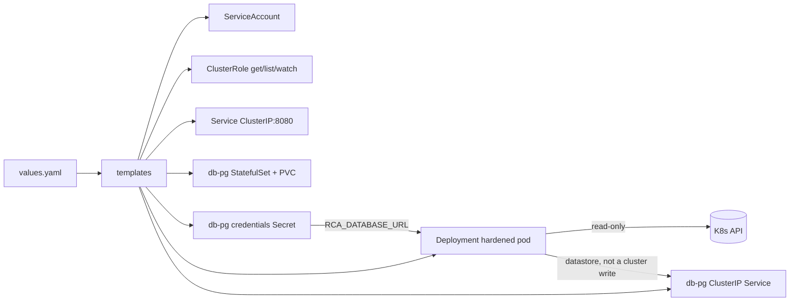

# deploy/helm Folder Specification

| Field | Value |
|-------|-------|
| Specification identifier | SPEC-deploy-helm |
| Repository-relative folder | `deploy/helm/` |
| Role | Deployment — the `rca-agent` Helm chart (read-only RBAC, hardened Deployment, Service) |
| Current commit | `2f4774f0476d5b47426ac1548c479f132c467332` |
| Generated/refreshed | 2026-11-03 (db-pg templates/values reflect the incident-persistence-postgres feature) |
| Status | Draft until maintainer review |
| Parent specification | [`../SPECS.md`](../SPECS.md) |

Authority notice: the source files, tests, and build definitions in this
repository remain authoritative. This specification is derived, bounded
evidence and must be reconciled with source on any conflict.

## 1. Intent and significance

This folder is the Helm chart that installs the agent into Kubernetes with its
safety posture enforced by the platform: a ServiceAccount bound to a ClusterRole
granting only `get`/`list`/`watch`, plus a hardened pod (non-root, read-only
root filesystem, no privilege escalation, all capabilities dropped). It also
provisions the agent's own durable datastore — a single-replica PostgreSQL
`db-pg` StatefulSet with a persistent volume (incident-persistence-postgres
feature) — which is the agent's datastore, not a Kubernetes write path, so the
read-only RBAC is unchanged. It is the primary deployment unit. It is an
aggregation boundary with one child folder (`templates`).

## 2. Scope and contents

- Direct files: 2. Immediate child folders: 1 (`templates/`).
- [`Chart.yaml`](Chart.yaml) — chart metadata (`name: rca-agent`, `version
  0.1.0`, `appVersion "0.1.0"`).
- [`values.yaml`](values.yaml) — default values (image, replica count,
  `monitorNamespace`, agent settings incl. `agent.databaseUrlSecret` /
  `agent.databaseUrlSecretKey`, a `postgres:` block for the db-pg
  StatefulSet/Service/Secret, service, RBAC, resources, securityContext).
- Child folder: [`templates/`](templates/SPECS.md) — now also includes
  `postgres-statefulset.yaml`, `postgres-service.yaml`, and
  `postgres-secret.yaml` for the db-pg datastore.

## 3. Inputs

- Helm values at install time (overriding [`values.yaml`](values.yaml)).
- The container image referenced by `image.repository`/`image.tag`.

## 4. Outputs

- Rendered Kubernetes objects: ServiceAccount, ClusterRole + ClusterRoleBinding,
  Deployment, Service, and (when `postgres.enabled`) the db-pg StatefulSet,
  ClusterIP Service, and credentials Secret.
- Direct consumer: the Kubernetes cluster (via `helm install`).

## 5. Contracts and models

### 5.1 Behavioral contracts

- RBAC is read-only: the ClusterRole grants only `get`/`list`/`watch` across
  core, apps, batch, and `metrics.k8s.io` resources (direct evidence
  [`templates/rbac.yaml`](templates/rbac.yaml)). No write verbs exist.
- The Deployment injects `RCA_*` environment variables from values
  (`RCA_PORT`, `RCA_REASONING_MODE`, `RCA_CLUSTER_ENABLED`, `RCA_NAMESPACE`,
  `RCA_LOG_LEVEL`, `RCA_RUNBOOK_RAG_URL`), and `RCA_DATABASE_URL` from a Secret
  key (`secretKeyRef`, default `<fullname>-db-pg` / key `database-url`) so the
  datastore credentials are never a committed plaintext value (Req 6.1).
- db-pg datastore (Req 1): when `postgres.enabled`, the chart renders a
  single-replica StatefulSet (`postgres-statefulset.yaml`) with a
  `volumeClaimTemplates` PVC so incident + query-log history survives pod
  restarts/rescheduling, a ClusterIP Service (`postgres-service.yaml`, in-cluster
  only — never NodePort/LoadBalancer, Req 6.3), and a Secret
  (`postgres-secret.yaml`) holding the PG password and the full `database-url`
  the agent consumes. RBAC is unchanged (still only `get`/`list`/`watch`): the
  database is the agent's own datastore, not a cluster write (Req 1.5).
- The pod is hardened: `runAsNonRoot`, `runAsUser 10001`,
  `readOnlyRootFilesystem`, `allowPrivilegeEscalation: false`, drop ALL
  capabilities (direct evidence [`values.yaml`](values.yaml),
  [`templates/deployment.yaml`](templates/deployment.yaml)).

### 5.2 Declared models and callable surface

| Symbol | Kind | Source |
|--------|------|--------|
| chart metadata | Helm chart | [`Chart.yaml`](Chart.yaml) |
| default values | values schema | [`values.yaml`](values.yaml) |
| templated manifests | k8s objects | [`templates/`](templates/SPECS.md) |

### 5.3 Required invariants

- The ClusterRole must never gain `create`/`update`/`patch`/`delete` verbs.
- The pod security context must stay hardened (non-root, read-only FS).
- `appVersion`/image tag should track the application release.

## 6. Interaction points

| Direction | Folder | Type |
|-----------|--------|------|
| Parent | [`../`](../SPECS.md) | containment |
| Child | [`templates/`](templates/SPECS.md) | ownership |
| Outbound | [`../../src/rca_agent/`](../../src/rca_agent/SPECS.md) | runs `webhook.app:app` via the image |
| Outbound | [`../../docker/`](../../docker/SPECS.md) | the image the Deployment runs |

## 7. Exception and error handling

Helm renders and validates templates before applying; a bad value surfaces a
template error. Liveness/readiness probes (`/healthz`, `/readyz`) gate pod
readiness (direct evidence in `deployment.yaml` comments; full probe block not
read in this bounded scan).

## 8. Environment variables and configuration

The Deployment sets the following container environment from values:
`RCA_PORT`, `RCA_REASONING_MODE`, `RCA_CLUSTER_ENABLED`, `RCA_NAMESPACE`
(from `monitorNamespace`), `RCA_LOG_LEVEL`, `RCA_RUNBOOK_RAG_URL`, and
`RCA_DATABASE_URL` (via `secretKeyRef` from the PG credentials Secret, default
name `<fullname>-db-pg`, key `database-url`). The `postgres:` values block
(`enabled`, `image`, `database`/`user`/`password`, `storage`, `resources`,
`securityContext.fsGroup`, credentials-secret references) drives the db-pg
StatefulSet/Service/Secret. These map to settings documented in
[`../../src/rca_agent/SPECS.md`](../../src/rca_agent/SPECS.md).

## 9. Storage, memory, and resource map

| Resource | Owner | Lifetime | Release |
|----------|-------|----------|---------|
| Pod (CPU/memory requests/limits) | Deployment | pod lifetime | reclaimed on delete |
| ServiceAccount token | ServiceAccount | pod lifetime | rotated/cluster-managed |
| Service (ClusterIP:8080) | Service | release lifetime | removed on uninstall |
| db-pg PVC (`volumeClaimTemplates`, default 1Gi) | StatefulSet | persists across pod restarts | retained per StatefulSet PVC policy |
| db-pg credentials Secret | Secret | release lifetime | removed on uninstall |

Resource requests/limits: cpu 100m/500m, memory 128Mi/512Mi (values default).
The db-pg PVC defaults to 1Gi (`postgres.storage.size`).

## 10. Interaction diagram

## 11. Cross-cutting design considerations

- Security: read-only RBAC + hardened pod is the platform-enforced safety model.
- Deployment: single-process image serves API + dashboard on one port.
- Compatibility: env var names must match `Settings` in the app.

## 12. Spec-driven development protocol

Future work must: (1) record any RBAC/values/template change here; (2) identify
affected templates, docker, and app specs; (3) validate with `helm lint`/
`helm template`; (4) implement preserving read-only RBAC and pod hardening;
(5) run chart validation; (6) reconcile this spec.

Acceptance scenarios:

- SPEC-deploy-helm-AC1 (valid): Given default values, When the chart is
  rendered, Then a ClusterRole with only `get`/`list`/`watch` and a hardened pod
  are produced.
- SPEC-deploy-helm-AC2 (invalid/safety): Given a change adds a write verb to the
  ClusterRole, When reviewed, Then it violates the read-only invariant and must
  be rejected.
- SPEC-deploy-helm-AC3 (compatibility): Given an app setting is renamed, When the
  Deployment env is updated, Then the chart and app stay in sync.
- SPEC-deploy-helm-AC4 (verification): Given `helm template`, When run, Then all
  rendered objects are valid Kubernetes manifests.

## 13. Verification strategy

`helm lint` and `helm template` are the cheapest validation. No checks were
executed for this documentation task.

## 14. Evidence inventory

| File | Type | Bytes |
|------|------|-------|
| [`Chart.yaml`](Chart.yaml) | YAML | see file |
| [`values.yaml`](values.yaml) | YAML | see file |

Templates are inventoried in [`templates/`](templates/SPECS.md).

## 15. Unknowns and review items

- `Chart.yaml` `appVersion` is `0.1.0` and the default image tag is `0.3.9`,
  while the Python package is `0.10.1`; maintainer should confirm the intended
  chart/image versioning alignment.
- The full liveness/readiness probe block in `deployment.yaml` was not read in
  this bounded scan.
