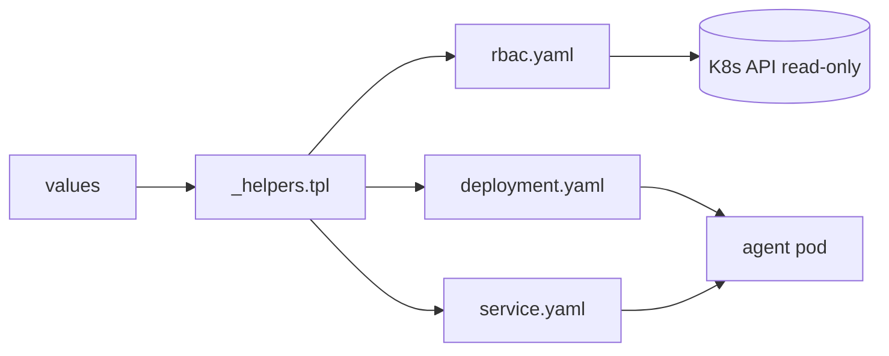

# deploy/helm/templates Folder Specification

| Field | Value |
|-------|-------|
| Specification identifier | SPEC-deploy-helm-templates |
| Repository-relative folder | `deploy/helm/templates/` |
| Role | Deployment — Helm templates rendering the agent's Kubernetes objects |
| Current commit | `2f4774f0476d5b47426ac1548c479f132c467332` |
| Generated/refreshed | 2026-11-03 |
| Status | Draft until maintainer review |
| Parent specification | [`../SPECS.md`](../SPECS.md) |

Authority notice: the source files, tests, and build definitions in this
repository remain authoritative. This specification is derived, bounded
evidence and must be reconciled with source on any conflict.

## 1. Intent and significance

This folder holds the Go-templated Kubernetes manifests the chart renders: the
read-only RBAC (ServiceAccount, ClusterRole, ClusterRoleBinding), the hardened
Deployment, the Service, and the shared helper definitions. It is the concrete
expression of the agent's platform-enforced read-only safety model. It is a leaf
directory.

## 2. Scope and contents

- Direct files: 4. Immediate child folders: 0.
- [`rbac.yaml`](rbac.yaml) — ServiceAccount, ClusterRole (`get`/`list`/`watch`
  only), ClusterRoleBinding.
- [`deployment.yaml`](deployment.yaml) — hardened Deployment with `RCA_*` env
  and probes.
- [`service.yaml`](service.yaml) — the Service exposing the HTTP port.
- [`_helpers.tpl`](_helpers.tpl) — shared template helpers (names, labels,
  selector labels, serviceAccountName).

## 3. Inputs

- Values from [`../values.yaml`](../values.yaml) and install-time overrides,
  plus the Helm release context (`.Release.Namespace`).

## 4. Outputs

- Rendered ServiceAccount, ClusterRole, ClusterRoleBinding, Deployment, and
  Service objects applied to the cluster.

## 5. Contracts and models

### 5.1 Behavioral contracts

- `rbac.yaml` grants only `get`/`list`/`watch` over pods, pods/log, services,
  endpoints, events, configmaps, secrets, pvcs, nodes, namespaces (core),
  deployments/replicasets/statefulsets/daemonsets (apps), jobs/cronjobs (batch),
  and pods/nodes (metrics.k8s.io). No write verbs (direct evidence).
- `deployment.yaml` sets the hardened pod security context and injects `RCA_*`
  environment variables from values.
- `_helpers.tpl` centralizes naming and labels used across the manifests.

### 5.2 Declared models and callable surface

| Symbol | Kind | Source |
|--------|------|--------|
| ServiceAccount / ClusterRole / ClusterRoleBinding | k8s objects | [`rbac.yaml`](rbac.yaml) |
| Deployment | k8s object | [`deployment.yaml`](deployment.yaml) |
| Service | k8s object | [`service.yaml`](service.yaml) |
| `rca-agent.*` template helpers | Helm named templates | [`_helpers.tpl`](_helpers.tpl) |

### 5.3 Required invariants

- The ClusterRole stays read-only (`get`/`list`/`watch` only).
- Conditional creation honors `rbac.create` and `serviceAccount.create`.
- Pod hardening (non-root, read-only FS, dropped capabilities) is preserved.

## 6. Interaction points

| Direction | Folder | Type |
|-----------|--------|------|
| Parent | [`../`](../SPECS.md) | containment |
| Outbound | [`../values.yaml`](../values.yaml) | value references |
| Outbound | [`../../../docker/`](../../../docker/SPECS.md) | the image the Deployment runs |

## 7. Exception and error handling

Rendering errors (missing values, bad indentation) surface at `helm
template`/`install` time. The `{{- if .Values... }}` guards prevent creating
RBAC/SA objects when disabled. Probe behavior is defined in `deployment.yaml`.

## 8. Environment variables and configuration

`deployment.yaml` sets container env `RCA_PORT`, `RCA_REASONING_MODE`,
`RCA_CLUSTER_ENABLED`, `RCA_NAMESPACE`, `RCA_LOG_LEVEL`, `RCA_RUNBOOK_RAG_URL`
from values (direct evidence).

## 9. Storage, memory, and resource map

| Resource | Owner | Lifetime | Release |
|----------|-------|----------|---------|
| RBAC objects (cluster-scoped) | ClusterRole/Binding | release lifetime | removed on uninstall |
| ServiceAccount (namespaced) | SA | release lifetime | removed on uninstall |
| Deployment pod | Deployment | pod lifetime | reclaimed on delete |
| Service endpoint | Service | release lifetime | removed on uninstall |

## 10. Interaction diagram

## 11. Cross-cutting design considerations

- Security: read-only ClusterRole is the core safety guarantee; cluster-scoped
  RBAC is a review-sensitive surface.
- Compatibility: env var names must match the app's `Settings`.
- Operability: probes and resources affect rollout health.

## 12. Spec-driven development protocol

Future work must: (1) record any manifest/RBAC change here; (2) identify
affected helm/docker/app specs; (3) validate with `helm template`; (4) implement
preserving read-only verbs and pod hardening; (5) run chart validation;
(6) reconcile this spec.

Acceptance scenarios:

- SPEC-deploy-helm-templates-AC1 (valid): Given `rbac.create` is true, When
  rendered, Then a ClusterRole with only `get`/`list`/`watch` is produced.
- SPEC-deploy-helm-templates-AC2 (invalid/safety): Given a write verb is added,
  When reviewed, Then the read-only invariant is violated and the change must be
  rejected.
- SPEC-deploy-helm-templates-AC3 (compatibility): Given `serviceAccount.create`
  is false, When rendered, Then the SA is not created and the configured name is
  referenced.
- SPEC-deploy-helm-templates-AC4 (verification): Given `helm template`, When run,
  Then all four manifests render as valid Kubernetes objects.

## 13. Verification strategy

`helm template`/`helm lint` validate rendering and object validity. No checks
were executed for this documentation task.

## 14. Evidence inventory

| File | Type | Bytes |
|------|------|-------|
| [`rbac.yaml`](rbac.yaml) | Helm YAML | see file |
| [`deployment.yaml`](deployment.yaml) | Helm YAML | see file |
| [`service.yaml`](service.yaml) | Helm YAML | see file |
| [`_helpers.tpl`](_helpers.tpl) | Helm template | see file |

## 15. Unknowns and review items

- `service.yaml` and `_helpers.tpl` were not fully read in this bounded scan;
  confirm the exact Service port mapping and helper definitions before marking
  this spec reviewed.
- The full `deployment.yaml` probe block was not read; confirm the
  liveness/readiness probe paths and thresholds.
