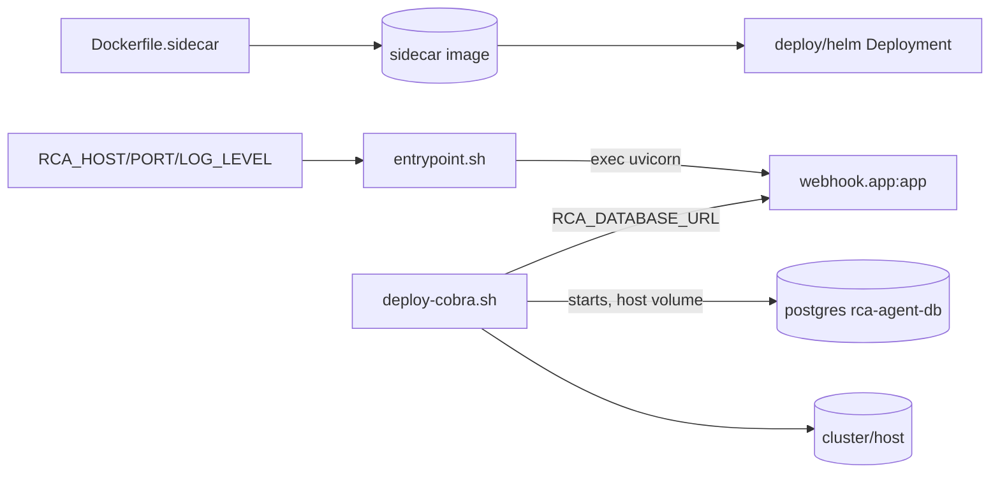

# docker Folder Specification

| Field | Value |
|-------|-------|
| Specification identifier | SPEC-docker |
| Repository-relative folder | `docker/` |
| Role | Build / packaging / deployment — container entrypoint, sidecar Dockerfile, and a cluster deploy helper |
| Current commit | `2f4774f0476d5b47426ac1548c479f132c467332` |
| Generated/refreshed | 2026-11-03 (deploy-cobra PostgreSQL notes reflect the incident-persistence-postgres feature) |
| Status | Draft until maintainer review |
| Parent specification | [`../SPECS.md`](../SPECS.md) |

Authority notice: the source files, tests, and build definitions in this
repository remain authoritative. This specification is derived, bounded
evidence and must be reconciled with source on any conflict.

## 1. Intent and significance

This folder holds container runtime and deployment support: the single-process
`uvicorn` entrypoint, a sidecar Dockerfile and its documentation, and a
cluster deploy helper script. The entrypoint launches one process that serves
both the read-only API and the HTML dashboard. It is a leaf directory and
complements the root [`Dockerfile`](../Dockerfile) and the Helm chart.

## 2. Scope and contents

- Direct files: 4. Immediate child folders: 0.
- [`entrypoint.sh`](entrypoint.sh) — launches `uvicorn rca_agent.webhook.app:app`
  on `$RCA_HOST`/`$RCA_PORT` with `$RCA_LOG_LEVEL`.
- [`Dockerfile.sidecar`](Dockerfile.sidecar) — sidecar image build.
- [`SIDECAR.md`](SIDECAR.md) — sidecar documentation.
- [`deploy-cobra.sh`](deploy-cobra.sh) — a cluster/host deploy helper script.
  It now also starts a pinned PostgreSQL container (`rca-agent-db`, default
  `postgres:16`) with a host-mounted data volume before the agent, and injects
  the resulting `RCA_DATABASE_URL` into the agent run (incident-persistence-postgres
  feature).

## 3. Inputs

- Environment variables `RCA_HOST` (default `0.0.0.0`), `RCA_PORT` (default
  `8080`), `RCA_LOG_LEVEL` (default `info`, lowercased) read by the entrypoint.
- Build context and the application package for the Dockerfile.

## 4. Outputs

- A running `uvicorn` process serving the ASGI app.
- A built sidecar container image.
- Cluster/host deployment side effects from the helper script (operator-driven),
  now including a running PostgreSQL datastore container with a host-mounted
  data volume so incident + runbook-query-log history survives container
  restarts.
- Direct consumer: [`../deploy/helm/`](../deploy/helm/SPECS.md) (the image the
  Deployment runs).

## 5. Contracts and models

### 5.1 Behavioral contracts

- `entrypoint.sh` runs under `set -euo pipefail` and `exec`s a single `uvicorn`
  process (post-0.5.0 single-process model; no Streamlit).
- Log level is lowercased before being passed to `uvicorn`.
- The app served is exactly `rca_agent.webhook.app:app`.
- `deploy-cobra.sh` startup ordering is: optional LLM sidecar → PostgreSQL →
  agent. It starts a pinned PG container (`PG_IMAGE`, default `postgres:16`) with
  a host-mounted data volume (`PG_DATA_HOST`), waits for readiness via
  `pg_isready`, then builds `RCA_DATABASE_URL=postgresql://…@127.0.0.1:5432/…`
  (loopback, `--network host`) and injects it into the agent `docker run`. The
  PG password comes from `PG_PASSWORD` (env) or is generated at runtime, never
  hardcoded (Req 6.1). The host-mounted volume makes the datastore survive
  container restarts (Req 1.3–1.4, D6).

### 5.2 Declared models and callable surface

| Symbol | Kind | Source |
|--------|------|--------|
| entrypoint | shell script | [`entrypoint.sh`](entrypoint.sh) |
| sidecar image | Dockerfile | [`Dockerfile.sidecar`](Dockerfile.sidecar) |
| deploy helper | shell script | [`deploy-cobra.sh`](deploy-cobra.sh) |

### 5.3 Required invariants

- A single process serves both API and dashboard on one port.
- The entrypoint remains read-only toward Kubernetes (it only starts the app).

## 6. Interaction points

| Direction | Folder | Type |
|-----------|--------|------|
| Parent | [`../`](../SPECS.md) | containment |
| Outbound | [`../src/rca_agent/webhook/`](../src/rca_agent/webhook/SPECS.md) | runs `webhook.app:app` |
| Inbound | [`../deploy/helm/`](../deploy/helm/SPECS.md) | runs the built image |

The root [`Dockerfile`](../Dockerfile) and [`../pyproject.toml`](../pyproject.toml)
console script (`rca-agent`) are related build artifacts.

## 7. Exception and error handling

`set -euo pipefail` makes the entrypoint fail fast on an unset variable or a
failed command. `exec` replaces the shell so signals reach `uvicorn` directly.
`deploy-cobra.sh` error handling was not read in this bounded scan (operator
script — see unknowns and safety note).

## 8. Environment variables and configuration

Direct evidence (`entrypoint.sh`): `RCA_HOST`, `RCA_PORT`, `RCA_LOG_LEVEL`
(defaults `0.0.0.0` / `8080` / `info`). The app itself reads the full `RCA_*`
surface (see [`../src/rca_agent/SPECS.md`](../src/rca_agent/SPECS.md)).

## 9. Storage, memory, and resource map

| Resource | Owner | Lifetime | Release |
|----------|-------|----------|---------|
| `uvicorn` process | entrypoint `exec` | container lifetime | exits with container |
| Listening socket | `uvicorn` | container lifetime | closed on exit |
| Container image | build | persistent (registry) | registry-managed |
| PostgreSQL container + host-mounted data volume (`deploy-cobra.sh`) | deploy helper | survives container restarts | host volume retained until removed |

## 10. Interaction diagram

## 11. Cross-cutting design considerations

- Deployment: single-process model restores `/healthz` and `/readyz` visibility.
- Security: hardened pod expectations (read-only FS) are satisfied because the
  app writes only to configured local paths.
- Safety: `deploy-cobra.sh` performs cluster operations; treat it as an
  operator-run, potentially high-impact script (confirm before running).

## 12. Spec-driven development protocol

Future work must: (1) record any entrypoint/image/deploy-script change here;
(2) identify affected webhook and helm specs; (3) validate the image builds and
the app starts; (4) implement preserving the single-process, read-only model;
(5) build and smoke-test the container; (6) reconcile this spec.

Acceptance scenarios:

- SPEC-docker-AC1 (valid): Given the container starts, When `entrypoint.sh`
  runs, Then one `uvicorn` process serves the app on `$RCA_PORT`.
- SPEC-docker-AC2 (invalid): Given a required variable is unset under `set -u`,
  When the entrypoint runs, Then it fails fast rather than starting misconfigured.
- SPEC-docker-AC3 (compatibility): Given the app module path changes, When the
  entrypoint is updated, Then the served target stays correct.
- SPEC-docker-AC4 (verification): Given the image is built and run, When
  `/healthz` is probed, Then it responds (single-process model).

## 13. Verification strategy

Build the image and smoke-test `/healthz`/`/readyz`. No checks were executed for
this documentation task.

## 14. Evidence inventory

| File | Type | Bytes |
|------|------|-------|
| [`entrypoint.sh`](entrypoint.sh) | Bash | ~0.5 KB |
| [`Dockerfile.sidecar`](Dockerfile.sidecar) | Dockerfile | ~2.3 KB |
| [`SIDECAR.md`](SIDECAR.md) | Markdown | ~3.5 KB |
| [`deploy-cobra.sh`](deploy-cobra.sh) | Bash | ~11.2 KB |

## 15. Unknowns and review items

- `Dockerfile.sidecar`, `SIDECAR.md`, and `deploy-cobra.sh` were not read in this
  bounded scan; the sidecar build stages and the deploy helper's exact cluster
  operations (and whether any are mutating) need a complete read before this
  spec is marked reviewed.
- Confirm how `docker/Dockerfile.sidecar` relates to the root
  [`Dockerfile`](../Dockerfile).
