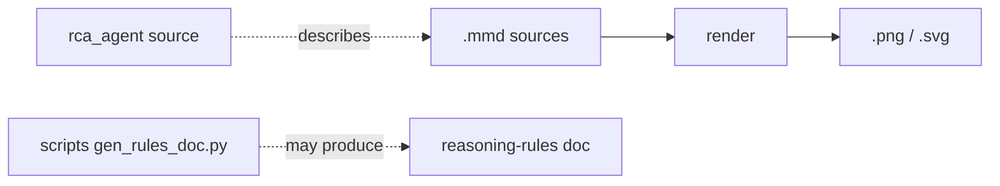

# docs Folder Specification

| Field | Value |
|-------|-------|
| Specification identifier | SPEC-docs |
| Repository-relative folder | `docs/` |
| Role | Documentation / static asset — architecture diagrams and the reasoning-rules deck/document |
| Current commit | `2f4774f0476d5b47426ac1548c479f132c467332` |
| Generated/refreshed | 2026-11-03 |
| Status | Draft until maintainer review |
| Parent specification | [`../SPECS.md`](../SPECS.md) |

Authority notice: the source files, tests, and build definitions in this
repository remain authoritative. This specification is derived, bounded
evidence and must be reconciled with source on any conflict.

## 1. Intent and significance

This folder holds the repository's maintained architecture diagrams (Mermaid
sources with rendered PNG/SVG) and the reasoning-rules deck/document. The
landscape and top-level architecture diagrams give readers a visual map of the
agent's components and flow. It is an aggregation boundary with one child folder
(`arch`).

## 2. Scope and contents

- Direct files: 8 (plus a transient Office lock file not in scope). Immediate
  child folders: 1 (`arch/`).
- Architecture (top-level): [`architecture.mmd`](architecture.mmd),
  [`architecture.png`](architecture.png), [`architecture.svg`](architecture.svg).
- Landscape: [`architecture-landscape.mmd`](architecture-landscape.mmd),
  [`architecture-landscape.png`](architecture-landscape.png),
  [`architecture-landscape.svg`](architecture-landscape.svg).
- Reasoning rules: [`reasoning-rules.docx`](reasoning-rules.docx),
  [`reasoning-rules.pptx`](reasoning-rules.pptx).
- Child folder: [`arch/`](arch/SPECS.md) (numbered component diagrams).
- Note: `~$asoning-rules.docx` is a transient Office lock file (excluded).

## 3. Inputs

- Mermaid sources (`.mmd`) authored by maintainers; renders (`.png`/`.svg`)
  produced from them.
- The reasoning-rules document may be produced by
  [`../scripts/gen_rules_doc.py`](../scripts/SPECS.md) (verify).

## 4. Outputs

- Human-facing diagrams and documents. No runtime consumer.

## 5. Contracts and models

### 5.1 Behavioral contracts

- Each `.mmd` source should correspond to its rendered `.png`/`.svg` pair.
- The reasoning-rules deck/document explains the deterministic reasoning rules
  used by [`../src/rca_agent/reasoning/`](../src/rca_agent/reasoning/SPECS.md).

### 5.2 Declared models and callable surface

Not applicable — documentation assets with no code symbols.

### 5.3 Required invariants

- Rendered images should stay consistent with their Mermaid sources.
- Diagrams should reflect the current architecture, not a superseded design.

## 6. Interaction points

| Direction | Folder | Type |
|-----------|--------|------|
| Parent | [`../`](../SPECS.md) | containment |
| Child | [`arch/`](arch/SPECS.md) | ownership |
| Outbound | [`../src/rca_agent/`](../src/rca_agent/SPECS.md) | subject matter the diagrams describe |
| Inbound | [`../scripts/`](../scripts/SPECS.md) | possible generator of reasoning-rules doc |

## 7. Exception and error handling

Not applicable — static assets. A stale render (source changed, image not
regenerated) is a documentation drift risk rather than a runtime error.

## 8. Environment variables and configuration

None. Rendering is a manual/generator step outside the runtime.

## 9. Storage, memory, and resource map

| Resource | Owner | Lifetime | Release |
|----------|-------|----------|---------|
| Diagram sources and renders | repository | persistent | overwritten on regen |
| Reasoning-rules deck/document | repository | persistent | overwritten on regen |

## 10. Interaction diagram

## 11. Cross-cutting design considerations

- Documentation maintenance: keep renders in sync with sources and architecture.
- Portability: SVG + PNG cover vector and raster consumers.

## 12. Spec-driven development protocol

Future work must: (1) record any diagram/document change here; (2) identify the
affected `arch/` and source specs; (3) regenerate renders from the updated
`.mmd` sources; (4) implement without leaving stale images; (5) visually review
the renders; (6) reconcile this spec.

Acceptance scenarios:

- SPEC-docs-AC1 (valid): Given an updated `.mmd` source, When re-rendered, Then
  the `.png`/`.svg` pair matches the source.
- SPEC-docs-AC2 (invalid/drift): Given the architecture changes but a diagram is
  not updated, When reviewed, Then the drift is flagged as a review item.
- SPEC-docs-AC3 (compatibility): Given a consumer needs vector output, When the
  SVG is used, Then it renders at any scale.
- SPEC-docs-AC4 (verification): Given the reasoning rules change, When the
  reasoning-rules document is regenerated, Then it reflects the new rules.

## 13. Verification strategy

Visual review of renders and Mermaid-source validity (lint/render). No checks
were executed for this documentation task.

## 14. Evidence inventory

| File | Type | Bytes |
|------|------|-------|
| [`architecture.mmd`](architecture.mmd) | Mermaid | ~3.7 KB |
| [`architecture.png`](architecture.png) | PNG | ~364 KB |
| [`architecture.svg`](architecture.svg) | SVG | ~57 KB |
| [`architecture-landscape.mmd`](architecture-landscape.mmd) | Mermaid | ~3.7 KB |
| [`architecture-landscape.png`](architecture-landscape.png) | PNG | ~94 KB |
| [`architecture-landscape.svg`](architecture-landscape.svg) | SVG | ~57 KB |
| [`reasoning-rules.docx`](reasoning-rules.docx) | Word | ~39 KB |
| [`reasoning-rules.pptx`](reasoning-rules.pptx) | PowerPoint | ~29 KB |

## 15. Unknowns and review items

- Whether the committed `reasoning-rules.*` artifacts are generated by
  [`../scripts/gen_rules_doc.py`](../scripts/SPECS.md) or hand-authored was not
  confirmed in this bounded scan.
- Binary diagram/document contents were not parsed; the `.mmd` sources are the
  readable evidence.
