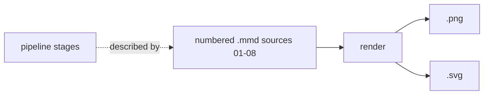

# docs/arch Folder Specification

| Field | Value |
|-------|-------|
| Specification identifier | SPEC-docs-arch |
| Repository-relative folder | `docs/arch/` |
| Role | Documentation / static asset — numbered per-stage architecture diagrams (Mermaid + PNG + SVG) |
| Current commit | `2f4774f0476d5b47426ac1548c479f132c467332` |
| Generated/refreshed | 2026-11-03 |
| Status | Draft until maintainer review |
| Parent specification | [`../SPECS.md`](../SPECS.md) |

Authority notice: the source files, tests, and build definitions in this
repository remain authoritative. This specification is derived, bounded
evidence and must be reconciled with source on any conflict.

## 1. Intent and significance

This folder holds the numbered, per-stage architecture diagrams that walk
through the agent's pipeline: components, high level, detection, graph,
reasoning, runbook RAG, LLM re-rank, and service area. Each is kept as a Mermaid
source with rendered PNG and SVG. It is the detailed visual companion to the
top-level diagrams in [`../`](../SPECS.md). It is a leaf directory.

## 2. Scope and contents

- Direct files: 24 (8 diagrams × 3 formats). Immediate child folders: 0.
- Diagram sets (`.mmd` + `.png` + `.svg` each):
  [`01-components`](01-components.mmd), [`02-highlevel`](02-highlevel.mmd),
  [`03-detection`](03-detection.mmd), [`04-graph`](04-graph.mmd),
  [`05-reasoning`](05-reasoning.mmd), [`06-runbook-rag`](06-runbook-rag.mmd),
  [`07-llm-rerank`](07-llm-rerank.mmd), [`08-service-area`](08-service-area.mmd).

## 3. Inputs

- Mermaid sources authored by maintainers; renders produced from them.

## 4. Outputs

- Human-facing per-stage diagrams. No runtime consumer.

## 5. Contracts and models

### 5.1 Behavioral contracts

- Each numbered stage's `.mmd` source should match its `.png`/`.svg` renders.
- The numbering (01–08) maps to the pipeline stages implemented under
  [`../../src/rca_agent/`](../../src/rca_agent/SPECS.md).

### 5.2 Declared models and callable surface

Not applicable — documentation assets with no code symbols.

### 5.3 Required invariants

- Renders stay consistent with their Mermaid sources.
- Each diagram number maps to the corresponding runtime stage it illustrates.

## 6. Interaction points

| Direction | Folder | Type |
|-----------|--------|------|
| Parent | [`../`](../SPECS.md) | containment |
| Outbound | [`../../src/rca_agent/detection/`](../../src/rca_agent/detection/SPECS.md) | diagram 03 subject |
| Outbound | [`../../src/rca_agent/graph/`](../../src/rca_agent/graph/SPECS.md) | diagram 04 subject |
| Outbound | [`../../src/rca_agent/reasoning/`](../../src/rca_agent/reasoning/SPECS.md) | diagrams 05/07 subject |
| Outbound | [`../../src/rca_agent/rag/`](../../src/rca_agent/rag/SPECS.md) | diagram 06 subject |
| Outbound | [`../../src/rca_agent/impact/`](../../src/rca_agent/impact/SPECS.md) | diagram 08 subject |

## 7. Exception and error handling

Not applicable — static assets. Stale renders are a documentation-drift risk,
not a runtime error.

## 8. Environment variables and configuration

None. Rendering is a manual/generator step outside the runtime.

## 9. Storage, memory, and resource map

| Resource | Owner | Lifetime | Release |
|----------|-------|----------|---------|
| Diagram sources and renders | repository | persistent | overwritten on regen |

## 10. Interaction diagram

## 11. Cross-cutting design considerations

- Documentation maintenance: keep per-stage renders in sync with sources and the
  implemented pipeline.
- Portability: SVG + PNG cover vector and raster consumers.

## 12. Spec-driven development protocol

Future work must: (1) record any stage-diagram change here; (2) identify the
affected parent docs and source-stage specs; (3) regenerate the render pair from
the `.mmd` source; (4) implement without leaving stale images; (5) visually
review; (6) reconcile this spec.

Acceptance scenarios:

- SPEC-docs-arch-AC1 (valid): Given a stage `.mmd` source is updated, When
  re-rendered, Then its `.png`/`.svg` pair matches.
- SPEC-docs-arch-AC2 (invalid/drift): Given a pipeline stage changes but its
  diagram does not, When reviewed, Then the drift is flagged.
- SPEC-docs-arch-AC3 (compatibility): Given a consumer needs vector output, When
  the SVG is used, Then it renders at any scale.
- SPEC-docs-arch-AC4 (verification): Given all eight `.mmd` sources, When
  validated, Then each is syntactically valid Mermaid.

## 13. Verification strategy

Mermaid-source validity and visual render review. No checks were executed for
this documentation task.

## 14. Evidence inventory

| File | Type | Bytes |
|------|------|-------|
| [`01-components.mmd`](01-components.mmd) + `.png` + `.svg` | Mermaid/PNG/SVG | see files |
| [`02-highlevel.mmd`](02-highlevel.mmd) + `.png` + `.svg` | Mermaid/PNG/SVG | see files |
| [`03-detection.mmd`](03-detection.mmd) + `.png` + `.svg` | Mermaid/PNG/SVG | see files |
| [`04-graph.mmd`](04-graph.mmd) + `.png` + `.svg` | Mermaid/PNG/SVG | see files |
| [`05-reasoning.mmd`](05-reasoning.mmd) + `.png` + `.svg` | Mermaid/PNG/SVG | see files |
| [`06-runbook-rag.mmd`](06-runbook-rag.mmd) + `.png` + `.svg` | Mermaid/PNG/SVG | see files |
| [`07-llm-rerank.mmd`](07-llm-rerank.mmd) + `.png` + `.svg` | Mermaid/PNG/SVG | see files |
| [`08-service-area.mmd`](08-service-area.mmd) + `.png` + `.svg` | Mermaid/PNG/SVG | see files |

Total: 24 files (8 diagrams × 3 formats).

## 15. Unknowns and review items

- Binary PNG/SVG contents were not parsed; the `.mmd` sources are the readable
  evidence. Confirm renders are current against their sources.
