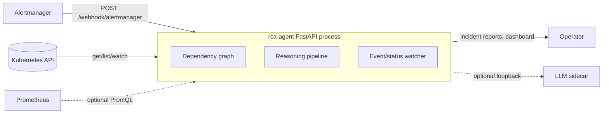
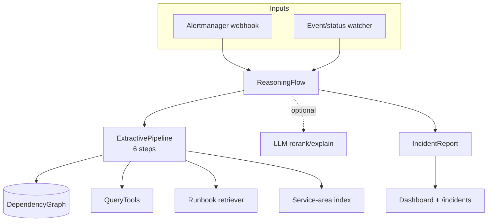
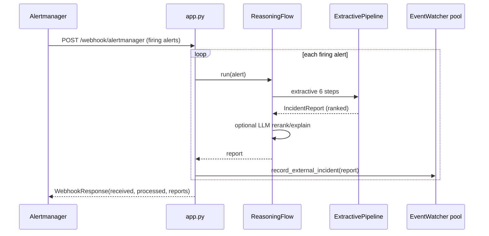

# High-Level Design — Kubernetes Fault Detection & Root-Cause Agent

## 1. Document control and evidence convention

| Field | Value |
| --- | --- |
| Title | High-Level Design (HLD) |
| System | `k8s-rca-agent` — read-only Kubernetes fault detection & root-cause agent for a 5G core |
| Package version | `0.11.0` (`src/rca_agent/__init__.py`, `pyproject.toml`) |
| Repository revision | branch `main`, release `0.11.0`, working tree ahead of commit `2f4774f` (uncommitted `alarms/`, `store/`, `prompt/` specs) (`.git/HEAD`) |
| Prepared | 2026-11-03 (refreshed for the potential-alarms and incident-persistence-postgres features) |
| Audience | Engineers new to the repository; operators deploying or running the agent |
| Authority order | 1) current source and tests, 2) `AGENTS.md` / build & deploy artifacts, 3) `knowledge-base/` and `openwiki/` as draft navigation aids only |
| Draft status | Draft — evidence-based, not operator-approved |

Evidence labels used throughout:

- **Direct evidence** — stated by current source, tests, configuration, or build/deploy artifacts.
- **Inference** — a reasonable conclusion drawn from evidence, marked where used.
- **Deployment-dependent** — behavior that depends on runtime environment, configuration, or the cluster, which the repository alone cannot prove.
- **Review required** — a gap or question a human must resolve.

Terms used verbatim from the domain: NF (Network Function), UPF (User Plane Function), SMF (Session Management Function), PFCP (Packet Forwarding Control Protocol), RBAC (Role-Based Access Control), RAG (Retrieval-Augmented Generation), TF-IDF (Term Frequency–Inverse Document Frequency), OTel (OpenTelemetry).

## 2. Executive summary

**Direct evidence.** The system is a FastAPI service that detects faults in a Kubernetes-hosted 5G core and explains their likely root cause as an incident report. It never changes the cluster. The pipeline is `detect → gather evidence → reason → report` (`README.md`; `src/rca_agent/reasoning/extractive.py`).

Its principal execution model is a single long-running web process (`rca_agent.webhook.app:app`, console script `rca-agent` in `pyproject.toml`) that:

- builds a NetworkX dependency graph of one application in one namespace, refreshed on a timer (`src/rca_agent/graph/builder.py`, `webhook/app.py::_refresh_loop`);
- accepts fault signals from two inputs — an Alertmanager webhook (`POST /webhook/alertmanager`) and a background Kubernetes event/status watcher (`src/rca_agent/detection/event_watcher.py`);
- runs a deterministic six-step reasoning pipeline that gathers evidence, walks the graph, correlates recent changes, and ranks candidate causes (`src/rca_agent/reasoning/steps.py`);
- optionally re-ranks and explains those causes with a local LLM sidecar, falling back transparently to the deterministic order (`src/rca_agent/reasoning/llm_rerank.py`);
- serves a server-rendered HTML dashboard and read-only query/graph endpoints from the same process (`src/rca_agent/webhook/app.py`, `webhook/ui.py`).

**Primary consumers:** Prometheus Alertmanager (webhook producer), operators viewing the dashboard and incident endpoints, and — optionally — a local LLM sidecar and a Prometheus metrics endpoint.

**Key design constraints (Direct evidence):**

- Read-only by construction: the only cluster access is through `get`/`list`/`read` calls; no write tool exists and the Helm `ClusterRole` grants only `get`/`list`/`watch` (`src/rca_agent/tools/query_tools.py`, `tools/kube_client.py`, `deploy/helm/templates/rbac.yaml`).
- Rules first, LLM second: deterministic code finds candidate causes; the LLM may only reorder and explain them (`src/rca_agent/reasoning/flow.py`, `llm_rerank.py`).
- Runs out-of-the-box with no cluster and no LLM via a demo graph and stub query tools (`config.py`, `graph/builder.py::build_demo_graph`, `tools/query_tools.py::StubQueryTools`).

**Most important evidence gaps:** the HTTP runbook retriever is declared but unbuilt (a TODO), runtime LLM/cluster behavior is deployment-dependent and not exercised by the offline test suite, and several heuristics (`calls`-edge detection, incident correlation) deliberately do not claim verified causal links.

## 3. Scope, boundaries, and context

**In scope (this document):** the Python package `src/rca_agent`, its HTTP interfaces, the reasoning pipeline, the dependency graph model, the runbook RAG and service-area impact features, the Helm chart and Dockerfile, and the offline evaluation harness.

**Out of scope / not covered:** the actual 5G core workloads being monitored; the external Prometheus/Alertmanager stack; the LLM sidecar implementation itself; and the many planning/notes documents and binary artifacts at the repository root (`PLAN*.md`, `*.pptx`, `*.docx`, `*.xlsx`, `dist/`), which are not part of the running service.

| Actor / system | Relationship | Repository evidence |
| --- | --- | --- |
| Prometheus Alertmanager | Posts firing alerts to `POST /webhook/alertmanager` | `src/rca_agent/webhook/app.py`, `models/alert.py` |
| Kubernetes API server | Source of pods/events/logs/changes, read-only | `src/rca_agent/tools/kube_client.py`, `graph/builder.py` |
| Operator (human) | Views dashboard, incidents, uploads runbooks | `src/rca_agent/webhook/ui.py`, `app.py` runbook endpoints |
| LLM sidecar (llama.cpp, loopback) | Optional rerank/explain + runbook synthesis | `src/rca_agent/reasoning/llm_rerank.py`, `runbook_synth.py` |
| Prometheus query endpoint | Optional PromQL metrics source | `src/rca_agent/tools/query_tools.py::KubeQueryTools.metrics` |

**Trust boundaries (Direct evidence):** log lines and alert annotations are treated as untrusted data and fenced before ever reaching the LLM (`reasoning/steps.py::fence`, `llm_rerank.py` fence markers). The LLM sidecar is reached over loopback only (`config.py::llm_base_url` default `http://127.0.0.1:8090`). Cluster access is bounded by RBAC outside the repository.

Interpretation: a single process consumes alerts and read-only cluster state, reasons over an in-memory graph, and emits reports; the LLM and Prometheus are optional, deployment-dependent dependencies.

## 4. Architectural drivers and decisions

| Driver | Decision | Evidence | Rationale | Consequence / condition |
| --- | --- | --- | --- | --- |
| Safety (no cluster mutation) | Read-only tools + no write capability + read-only RBAC | `tools/query_tools.py`, `deploy/helm/templates/rbac.yaml` | Safety enforced by platform, not prompt (`README.md`) | Even a confused LLM cannot write; actions are suggestions only |
| Reproducibility | Deterministic extractive pipeline is the default mode | `config.py::reasoning_mode="extractive"`, `reasoning/extractive.py` | Rules-first results are cheap and hard to hallucinate | LLM is strictly additive rerank/explain |
| Runs anywhere | Demo graph + stub tools when `cluster_enabled` is False | `graph/builder.py::build_demo_graph`, `tools/query_tools.py::StubQueryTools` | Lets CI/demo run with no cluster or LLM | No real signals in demo mode |
| Availability on startup | Cluster graph build runs in a background thread, not before `yield` | `webhook/app.py::_lifespan`, `_initial_build` | A large-namespace walk must not block `/healthz` | Readiness reflects background build (`/readyz`) |
| Honesty over coverage | Heuristics never fabricate causes; absence of a match = absence of an edge | `graph/builder.py` module docstring, `event_watcher.py::_correlate` | Avoids unsupported claims about NF-to-NF topology | Correlation flags patterns, never names a shared cause |
| Resilience to partial permissions | `_safe_list` tolerates 403/API errors and degrades | `graph/builder.py::_safe_list`, `tools/query_tools.py::_safe_list` | A single forbidden resource must not blank the graph | Graph may be partial; builds still complete |

## 5. Logical architecture and repository map

**Direct evidence.** The package is organized into cohesive sub-packages under `src/rca_agent/`.

| Component | Responsibility | Owned state | Key dependencies | Implementation anchor |
| --- | --- | --- | --- | --- |
| `webhook/app.py` | FastAPI app, endpoints, lifespan, shared singletons, background loops | app instance, module-level graph builder / flow / watcher | graph, detection, reasoning, rag, models | `src/rca_agent/webhook/app.py` |
| `webhook/ui.py` | Server-rendered dashboard (Jinja2 + Bootstrap + HTMX) | rendered templates | shared graph/watcher/store objects | `src/rca_agent/webhook/ui.py`, `webhook/templates/` |
| `webhook/pptx_report.py` | Per-incident RCA PPTX export (lazy `python-pptx`) | none | report model | `src/rca_agent/webhook/pptx_report.py` |
| `config.py` | Env-driven settings (`RCA_` prefix), cached | `Settings` singleton | pydantic-settings | `src/rca_agent/config.py` |
| `graph/builder.py` | Build/refresh graph from cluster or demo | current `DependencyGraph` | kube client, dependency_graph | `src/rca_agent/graph/builder.py` |
| `graph/dependency_graph.py` | NetworkX multigraph, health rollup, traversal, anchors | nodes/edges, change log | networkx | `src/rca_agent/graph/dependency_graph.py` |
| `graph/visualize.py` | Interactive HTML graph (pyvis) | none | graph | `src/rca_agent/graph/visualize.py` |
| `detection/event_watcher.py` | Poll events + status, dedup, correlate, store incidents | `incidents`, seen-UIDs, streaks | graph, reasoning flow, capture | `src/rca_agent/detection/event_watcher.py` |
| `tools/query_tools.py` | Read-only pod status/events/logs/metrics/changes | none | kube client, prometheus | `src/rca_agent/tools/query_tools.py` |
| `tools/kube_client.py` | Load kube config (in-cluster/local/auto) | typed API clients | kubernetes (lazy) | `src/rca_agent/tools/kube_client.py` |
| `reasoning/extractive.py` | Deterministic six-step pipeline → report | per-incident state | steps, tools, graph, rag, impact | `src/rca_agent/reasoning/extractive.py` |
| `reasoning/steps.py` | The six reasoning steps + scoring | mutates `ReasoningState` | graph, tools, rag | `src/rca_agent/reasoning/steps.py` |
| `reasoning/flow.py` | Entry point: extractive, then optional LLM | none | extractive, llm_rerank | `src/rca_agent/reasoning/flow.py` |
| `reasoning/llm_rerank.py` | Sidecar rerank/explain with guardrails | none | httpx (lazy) | `src/rca_agent/reasoning/llm_rerank.py` |
| `reasoning/runbook_synth.py` | Grounded next-step synthesis via sidecar | none | llm sidecar | `src/rca_agent/reasoning/runbook_synth.py` |
| `rag/runbook_retriever.py` | Retriever interface + factory (TF-IDF, semantic, null) | none | local_store, semantic_store | `src/rca_agent/rag/runbook_retriever.py` |
| `rag/local_store.py` | Uploaded-runbook store + extraction | on-disk JSON store, assets | pymupdf/pypdf (lazy) | `src/rca_agent/rag/local_store.py` |
| `rag/semantic_store.py` | Opt-in embeddings retriever | in-memory Chroma index | fastembed/chromadb (lazy) | `src/rca_agent/rag/semantic_store.py` |
| `rag/query_log.py` | Runbook-retrieval attempt log | bounded in-memory log | — | `src/rca_agent/rag/query_log.py` |
| `impact/` | Service-area mapping from a workbook | parsed index | openpyxl (lazy) | `src/rca_agent/impact/loader.py`, `index.py`, `models.py` |
| `alarms/` | Scoped potential-alarms: map an affected pod to the candidate alarms it could have raised (read-only, cited, UNKNOWN when unmapped, context-not-cause) | parsed index | openpyxl (lazy) | `src/rca_agent/alarms/loader.py`, `index.py`, `models.py` |
| `store/` | Durable PostgreSQL datastore for incidents and the runbook query log (write-through; rehydrated at startup) | connection pool | psycopg v3 + psycopg_pool | `src/rca_agent/store/db.py`, `incident_store.py`, `query_log_store.py`, `factory.py` |
| `models/` | Input (`Alert`/`KubeEvent`) and output (`IncidentReport`) schemas | none | pydantic | `src/rca_agent/models/alert.py`, `incident.py` |
| `eval/` | Offline fault-injection accuracy harness | results files | fake cluster | `src/rca_agent/eval/` |

Interpretation: both inputs converge on one `ReasoningFlow`; the extractive pipeline reads the graph, query tools, runbooks, and the service-area index; the LLM stage is optional and additive.

## 6. Interfaces and integration boundaries

### 6.1 HTTP API (Direct evidence — `src/rca_agent/webhook/app.py`)

| Endpoint | Method | Purpose | Failure behavior |
| --- | --- | --- | --- |
| `/healthz` | GET | Liveness; returns version | — |
| `/readyz` | GET | Readiness; reflects background graph build | reports `starting` until flow ready |
| `/graph/stats` | GET | Graph node/edge/kind counts | — |
| `/graph/pods`, `/graph/nodes` | GET | Picker node lists | `400` on invalid `kind` |
| `/graph/neighborhood/{node_id}` | GET | Subgraph summary | empty subgraph if node absent |
| `/graph/view`, `/graph/view/{node_id}` | GET | Interactive HTML graph | `404` if node not found |
| `/incidents` | GET | Incident summaries by `status` | `400` on invalid `status` |
| `/incidents/{id}` | GET | Full `IncidentReport` | `404` if not found |
| `/webhook/alertmanager` | POST | Alertmanager v4 payload → reports | pydantic validation error on bad body |
| `/runbooks` | POST/GET/DELETE | Upload/list/delete runbook docs | `400` on no extractable text; `404` on delete miss |
| `/runbook-queries` | GET/DELETE | Retrieval attempt log | — |
| `/debug/detection` | GET | Per-cycle detection gate counters | — |

The webhook consumes the Alertmanager v4 schema via aliased pydantic fields (`models/alert.py::AlertmanagerPayload`); only `status == "firing"` alerts are processed (`app.py::alertmanager_webhook`). Each report is also recorded into the shared incident pool so manual and auto-detected incidents share one timeline (`event_watcher.py::record_external_incident`).

### 6.2 Kubernetes read interface (Direct evidence)

`QueryTools` is an abstract read-only interface (`pod_status`, `recent_events`, `logs`, `metrics`, `recent_changes`) with two implementations: `StubQueryTools` (deterministic demo data) and `KubeQueryTools` (real `get`/`list`/`read` calls). Change detection reads `managedFields` to attribute edits to a human vs. automation actor and excludes HA-bookkeeping objects (`tools/query_tools.py::recent_changes`, `_managed_fields_actor`, `_is_ha_bookkeeping`). All list calls are wrapped by `_safe_list` so permission errors degrade gracefully.

### 6.3 LLM sidecar interface (Deployment-dependent)

`llm_rerank.py` POSTs an OpenAI-compatible chat completion to `llm_base_url + /v1/chat/completions`; `sidecar_available` probes `GET /health` then `/v1/models`. Both are active only when `reasoning_mode == "llm"` and the sidecar is reachable. Any error returns the extractive report unchanged.

### 6.4 Prometheus metrics (Deployment-dependent)

`KubeQueryTools.metrics` queries `prometheus_url/api/v1/query` when configured; otherwise returns a well-formed empty result (`tools/query_tools.py`).

### 6.5 Human-operational interfaces

The dashboard (`webhook/ui.py`) and the PPTX export (`webhook/pptx_report.py`) are read surfaces for operators. **Inference:** these are presentation layers over the same shared objects the API uses.

## 7. Key end-to-end flows

### 7.1 Alertmanager-triggered incident (Direct evidence)

Trigger: a firing alert is posted. `alertmanager_webhook` filters firing alerts and runs `ReasoningFlow.run` per alert, then records each report into the shared pool.

The six steps (`reasoning/extractive.py::run`, `reasoning/steps.py`): `triage` (resolve affected resource + time window) → `gather_evidence` (pod status, events, error log lines, all fenced) → `graph_walk` (service-anchored resolution, unhealthy upstream = candidate causes, downstream = blast radius) → `change_correlation` (recent changes scoped to mounted config) → `hypothesize_and_rank` (weighted deterministic scoring) → `build_next_steps` (runbook RAG) and `build_service_area` (scoped impact).

### 7.2 Automatic detection (Direct evidence — `detection/event_watcher.py`)

Two detectors run each poll cycle (only when `cluster_enabled`):

- **Event-based:** list namespace events, keep only `KubeEvent.FAULT_REASONS`, drop stale (older than `event_max_age_minutes`) and out-of-scope (not a graph node) events, dedup by event UID, then run the same `ReasoningFlow`.
- **Status-based:** a pod unhealthy across `status_unhealthy_rebuilds` consecutive graph rebuilds raises an incident even with no fresh event, surviving Kubernetes aging events out.

Sibling pods failing identically are merged into one anchor incident (`_merge_into_open_anchor`); different anchors with the same failure signature are linked as a pattern via `_correlate` (never a claimed shared cause).

### 7.3 Initialization and refresh (Direct evidence — `webhook/app.py`)

At import, the demo graph builds eagerly only when there is no cluster. The lifespan starts three background tasks: `_initial_build` (cluster build in a thread, then rebuilds `_flow`), `_refresh_loop` (periodic graph rebuild, atomic swap), and `_event_watch_loop`. Tasks are cancelled on shutdown.

### 7.4 Recovery / lifecycle (Direct evidence)

`reconcile_status` flips an active incident to `inactive` (setting `resolved_at`) only when every pod in `affected_pods` is healthy again — strict recovery (`event_watcher.py`, `models/incident.py`).

### 7.5 Error handling (Direct evidence)

Per-alert and per-poll reasoning is wrapped so one failure is logged and skipped, not fatal (`event_watcher.py::poll_once`, `_refresh_loop`). Graph build failures serve an empty graph and retry in the background (`app.py::_safe_rebuild`).

## 8. Data, state, and resource architecture

| State | Owner | Model | Lifecycle / cleanup | Evidence |
| --- | --- | --- | --- | --- |
| Dependency graph | `GraphBuilder` | NetworkX `MultiDiGraph`, timestamped nodes/edges + change log | Rebuilt on timer; swapped atomically; in-memory only | `graph/dependency_graph.py`, `builder.py` |
| Incident pool | `EventWatcher.incidents` | list of `IncidentReport`, bounded to 200 | FIFO eviction; in-memory | `detection/event_watcher.py` (`_MAX_STORED_INCIDENTS`) |
| Seen-event UIDs | `EventWatcher` | bounded `OrderedDict` (2000) | LRU eviction | `event_watcher.py` (`_MAX_SEEN_UIDS`) |
| Runbook store | `LocalRunbookStore` | JSON file at `runbook_store_path` + extracted images under `runbook_asset_dir` | Overwrite per filename; disk, wiped on redeploy (`emptyDir`) | `rag/local_store.py`, `deploy/helm/templates/deployment.yaml` |
| Semantic index | `SemanticRunbookRetriever` | in-memory ChromaDB (no on-disk sqlite) | Rebuilt from store on startup | `rag/semantic_store.py`, `pyproject.toml` comments |
| Runbook query log | `QueryLog` | bounded in-memory log | Cleared via endpoint | `rag/query_log.py` |
| Incident capture (optional) | `IncidentCaptureWriter` | JSONL records, rolling cap | OFF unless `incident_capture_path` set | `eval/capture.py`, `config.py` |
| Service-area index | `ServiceAreaIndex` | parsed from `.xlsx` | Loaded per incident when configured | `impact/index.py`, `loader.py` |
| Potential-alarms index | `PotentialAlarmsIndex` | parsed from `.xlsx` | Loaded per incident when `pod_alarm_map_path` configured; inert otherwise | `alarms/index.py`, `loader.py` |
| Durable incident + query-log datastore | `Store` (`IncidentStore`, `QueryLogStore`) | PostgreSQL `incidents` and `runbook_query_log` tables (typed columns + JSONB `payload`) | DB-backed; pool opened at lifespan startup, closed on shutdown; rehydrated into in-memory caches at startup | `store/db.py`, `incident_store.py`, `query_log_store.py`, `factory.py` |

**Direct evidence.** Operational caches (graph, incident pool, seen-event UIDs, semantic index, query log) are in-memory, and the uploaded-runbook store is local disk. The agent additionally depends on one **external PostgreSQL datastore** (`store/`, connection string `RCA_DATABASE_URL`) that durably persists incidents and the runbook query log; it is mandatory at runtime (construction fails fast when the URL is unset) and is the agent's own datastore, never a Kubernetes write path. Health is rolled up from pods to workloads and services (`dependency_graph.py::roll_up_health`, `roll_up_service_health`).

## 9. Configuration and environment

**Direct evidence.** Configuration is environment-driven via pydantic-settings with prefix `RCA_` and an optional `.env` file (`config.py`). Defaults make the agent run in extractive, no-cluster mode out of the box.

| Setting (env `RCA_*`) | Default | Effect |
| --- | --- | --- |
| `database_url` | unset (mandatory at runtime) | PostgreSQL datastore connection string (`store/`); construction fails fast if unset. Sourced from a Secret in deployment |
| `reasoning_mode` | `extractive` | `extractive` or `llm` |
| `cluster_enabled` | `false` | Use read-only kube client vs. demo/stub |
| `kubeconfig_mode` | `auto` | `auto`/`incluster`/`local` |
| `namespace` | `open5gs` | Monitored namespace |
| `nf_selector` | `""` | Label selector; empty = whole namespace |
| `graph_rebuild_interval_seconds` | `60` | Graph refresh cadence |
| `event_watch_enabled` / `event_watch_interval_seconds` | `true` / `15` | Event watcher |
| `event_max_age_minutes` | `90` | Stale-event cutoff |
| `status_detection_enabled` / `status_unhealthy_rebuilds` | `true` / `2` | Status-based detection |
| `incident_correlation_window_minutes` | `10` | Correlation window |
| `change_correlation_window_minutes` / `log_tail_lines` | `15` / `200` | Evidence gathering |
| `prometheus_url` | unset | Optional metrics source |
| `runbook_rag_url` | unset | HTTP retriever (unbuilt) |
| `runbook_store_path` / `runbook_asset_dir` | `/tmp/runbooks/...` | Local runbook store |
| `runbook_rag_semantic` / `runbook_rag_embed_model` | `false` / `BAAI/bge-small-en-v1.5` | Opt-in semantic RAG |
| `service_area_map_path` | unset | Service-area workbook |
| `pod_alarm_map_path` | unset | Pod→alarm workbook for potential-alarms; unset = feature inert |
| `incident_capture_path` (+ redact/include/max) | unset | Optional labeling capture |
| `llm_*` (provider/model/base_url/timeout/...) | sidecar defaults, loopback | LLM sidecar |

The Helm chart maps a subset of these to container env (`deploy/helm/templates/deployment.yaml`): `RCA_PORT`, `RCA_REASONING_MODE`, `RCA_CLUSTER_ENABLED`, `RCA_NAMESPACE`, `RCA_LOG_LEVEL`, `RCA_RUNBOOK_RAG_URL`, and `RCA_DATABASE_URL` (injected from the PG credentials Secret via `secretKeyRef`, default `<fullname>-db-pg` / key `database-url`). The Dockerfile sets `RCA_HOST`/`RCA_PORT` and pre-caches the embedding model (`Dockerfile`).

**Direct evidence.** Secrets handling — the agent requires one secret input, the datastore connection string `RCA_DATABASE_URL`, injected from a Kubernetes Secret (`deploy/helm/templates/postgres-secret.yaml`, `deployment.yaml`) and never committed as plaintext. **Review required:** incident-capture records and the persisted `payload` rows in PostgreSQL may contain real log lines and object names and are marked sensitive in `config.py` and the `store/` spec.

## 10. Extension and customization design

**Direct evidence.**

- **Runbook retriever factory** (`rag/runbook_retriever.py::get_runbook_retriever`) selects, in priority order: semantic (only when opt-in + deps + live sidecar + documents present) → local TF-IDF → HTTP (TODO, unbuilt) → null. Any semantic build failure falls back to extractive.
- **Query tools factory** (`tools/query_tools.py::get_query_tools`) swaps stub vs. real kube tools by `cluster_enabled` and allows an injected client (used by tests).
- **Reasoning mode** toggles the LLM rerank stage (`reasoning/flow.py`).
- **Optional dependency extras** (`pyproject.toml`: `llm`, `cluster`, `viz`, `rag`, `rag-semantic`, `pptx`) gate features; missing extras degrade to the lighter path rather than failing.

Selection and failure isolation are explicit in each factory; privilege/compatibility concerns are handled by lazy imports so absent extras never crash the default path.

## 11. Security architecture

**Direct evidence.**

- **Read-only by construction:** no write/patch/delete tool exists; `QueryTools` exposes only reads (`tools/query_tools.py`). The Helm `ClusterRole` grants only `get`/`list`/`watch` (plus `metrics.k8s.io` `get`/`list`) across the listed resources (`deploy/helm/templates/rbac.yaml`).
- **Prompt-injection defense:** untrusted log/alert text is fenced before reaching the LLM (`reasoning/steps.py::fence`, `llm_rerank.py`); the LLM may reference only given hypothesis ids and its output is validated as a permutation, else the original order is kept (`llm_rerank.py::_validate_order`).
- **Loopback-only LLM:** `llm_base_url` defaults to `127.0.0.1` with a note that this matters on a shared `--network host` host (`config.py`).
- **Pod hardening:** `runAsNonRoot`, non-root uid 10001, `readOnlyRootFilesystem`, `allowPrivilegeEscalation: false`, drop all capabilities (`deploy/helm/values.yaml`, `templates/deployment.yaml`, `Dockerfile`).
- **Secret handling in graph build:** secret existence is recorded for `mounts` edges, but secret values are deliberately never read or scanned (`graph/builder.py::_add_config_objects`).

**Residual risks / Review required:** RBAC enforcement, network policy, and sidecar isolation are deployment-dependent and cannot be proven from the repository. The `ClusterRole` includes `secrets` with `get`/`list`/`watch`; **Inference:** this grants the ability to read secret metadata/values at the API level even though the code chooses not to read secret values — an operator should confirm this is acceptable.

## 12. Reliability, failure handling, and recovery

| Trigger | Detection | Propagation | Impact | Recovery / guarantee not provided |
| --- | --- | --- | --- | --- |
| Cluster/kubeconfig unavailable at startup | exception in `_safe_rebuild` | logged, empty graph served | reduced accuracy until retry | background retry; **not** a guaranteed reconnect SLA |
| Resource list forbidden (403) | `_safe_list` catches | warning, empty list for that type | partial graph | graph still builds; missing nodes possible |
| Reasoning error for one alert/event | try/except in loops | logged, skipped | that incident missing | other incidents unaffected |
| Graph refresh failure | try/except in `_refresh_loop` | logged, previous graph kept | stale graph | last good graph retained |
| Event list 403 | `_safe_list` sets `_EVENT_LIST_403` | surfaced in `/debug/detection` | no event-based detection | status-based detection may still fire |
| LLM sidecar error/timeout | caught in `_call_sidecar` | fall back to extractive order | no explanations | extractive order guaranteed |
| Semantic RAG deps/build failure | caught in `_try_semantic` | fall back to TF-IDF | lower retrieval quality | retriever still returns |
| Runbook upload with no text | `extract_document` raises | `400` to caller | upload rejected | — |

**Direct evidence** for all rows above in `webhook/app.py`, `graph/builder.py`, `detection/event_watcher.py`, `reasoning/llm_rerank.py`, and `rag/runbook_retriever.py`.

## 13. Observability and operations

**Direct evidence.**

- **Logging:** standard `logging` under the `rca_agent*` logger hierarchy; level from `log_level` (`app.py`, `config.py`).
- **Health/readiness:** `/healthz` and `/readyz`, wired to Kubernetes liveness/readiness probes (`deploy/helm/templates/deployment.yaml`).
- **Self-diagnosis:** `/debug/detection` exposes per-cycle gate counters (events seen, 403, matched, stale, out-of-scope, deduped, incidents, unhealthy pods) (`app.py::debug_detection`, `event_watcher.last_diag`).
- **Graph stats:** `/graph/stats`, `/readyz` include node/edge/kind counts.
- **Audit/labeling:** optional incident-capture JSONL for offline precision/recall work (`eval/capture.py`).
- **Operational scripts:** `scripts/` (release, chaos demo), `docker/deploy-cobra.sh`, `Makefile` targets (`check`, `test`, `lint`, `eval`, `install`).

**Not found / Review required:** no metrics/tracing exporter for the agent itself is defined in the repository; capacity and performance figures are not documented and must not be invented.

## 14. Build, packaging, deployment, and verification

**Direct evidence.**

- **Build/packaging:** setuptools project (`pyproject.toml`), console script `rca-agent`, package data for dashboard templates/static assets. Optional extras as listed in §10.
- **Container:** `python:3.12-slim` image installing `.[cluster,viz,rag,rag-semantic,pptx]`, non-root uid 10001, single uvicorn process via `docker/entrypoint.sh` (`Dockerfile`).
- **Deployment:** Helm chart with read-only RBAC, Deployment (probes, security context, writable `/tmp` `emptyDir`), a Service, and — when `postgres.enabled` — the agent's own single-replica `db-pg` PostgreSQL StatefulSet (+ PVC), ClusterIP Service, and credentials Secret for the durable datastore (`deploy/helm/`).
- **Verification:** 259 test functions across 44 files under `tests/` (counted from current source). `Makefile check` runs ruff + pytest. The offline eval harness (`python -m rca_agent.eval`) gates on top-2 accuracy (default 0.80) and can fail CI (`eval/__main__.py`).

| Verification type | Where | Risk covered |
| --- | --- | --- |
| Unit / pipeline | `tests/test_reasoning.py`, `test_pipeline_cluster.py`, `test_cluster_graph.py` | reasoning + graph correctness |
| Interface / webhook | `tests/test_webhook.py`, `test_query_tools.py` | API + read tools |
| Detection | `tests/test_event_watcher.py`, `test_detection_fixes_0_6_1.py`, `test_anchor_phase*.py` | event/status detection, anchoring |
| RAG | `tests/test_runbook_rag.py`, `test_semantic_rag.py`, `test_runbook_synth.py` | retrieval + synthesis |
| LLM rerank | `tests/test_llm_rerank.py` | guardrails + fallback |
| Impact | `tests/test_impact_loader.py`, `test_impact_pipeline.py` | service-area mapping |
| Potential alarms | `tests/test_alarms_*.py`, `test_gui_potential_alarms.py`, `test_pptx_potential_alarms.py`, `test_incident_serialization_p10.py` | pod→candidate-alarm mapping, property invariants P1–P10, UI/PPTX surfacing, context-not-cause |
| Persistence | `tests/` store round-trip, schema idempotency, restart-survival, and failure-mode tests (skip-if-no-DB marker) | durable incident + query-log datastore |
| Eval / report | `tests/test_eval_harness.py`, `test_pptx_report.py` | accuracy harness + export |
| Safety | `tests/test_ascii_safety.py` | ASCII-safe output |

**Inference:** the test suite is offline — it uses a fake kube client (`tests/fake_kube.py`) and mocked sidecar, so real cluster and real LLM behavior are not exercised here.

## 15. Constraints, traceability, glossary, and open questions

### 15.1 Constraints

Direct constraints: read-only cluster access; extractive default; Python ≥ 3.10 (`pyproject.toml`); single-process service; bounded in-memory graph and incident/query-log caches backed by a mandatory external PostgreSQL datastore (`store/`, `RCA_DATABASE_URL`) that durably persists incidents and the query log. Inferred constraints: single-namespace/single-application scope limits cross-NF reasoning (the graph intentionally has no NF-to-NF `calls` topology beyond grounded env/ConfigMap matches).

### 15.2 Traceability matrix

| Conclusion | Primary evidence |
| --- | --- |
| Read-only by construction | `tools/query_tools.py`, `deploy/helm/templates/rbac.yaml` |
| Rules-first, LLM rerank only | `reasoning/flow.py`, `llm_rerank.py` |
| Two detection inputs, one pipeline | `webhook/app.py`, `detection/event_watcher.py` |
| Service-anchored incidents | `graph/dependency_graph.py::anchor_of`, `reasoning/steps.py::graph_walk` |
| Transparent degradation | `_safe_list`, `_try_semantic`, `_call_sidecar` |
| Runs with no cluster/LLM | `graph/builder.py::build_demo_graph`, `tools/query_tools.py::StubQueryTools` |

### 15.3 Glossary

- **Anchor** — the stable entity a fault is attributed to: service > owning workload > pod (`dependency_graph.py::anchor_of`).
- **Blast radius** — downstream dependents of the affected resource (`steps.py::graph_walk`).
- **`calls` edge** — a cited dependency inferred from literal env/ConfigMap values matching a service name (`graph/builder.py`).
- **Correlation** — a pattern flag linking different anchors with the same failure signature; never a claimed shared cause (`event_watcher.py::_correlate`).
- **Extractive mode** — deterministic, no-LLM reasoning (default).

### 15.4 Open questions (by owner)

- **Operator / platform:** confirm whether `secrets` read access in the `ClusterRole` is acceptable given the code never reads secret values. **Review required.**
- **Operator:** metrics/tracing export for the agent is not present — is one required? **Review required.**
- **Engineering:** the HTTP runbook retriever is a declared TODO; is it in scope to build? (`rag/runbook_retriever.py`). **Review required.**
- **Engineering:** runtime LLM-mode and real-cluster behavior are not covered by the offline suite — is additional integration verification planned? **Review required.**
