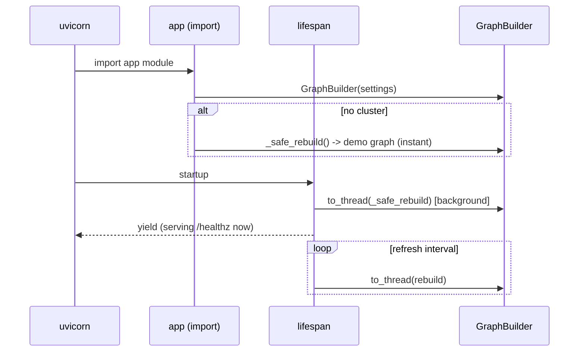
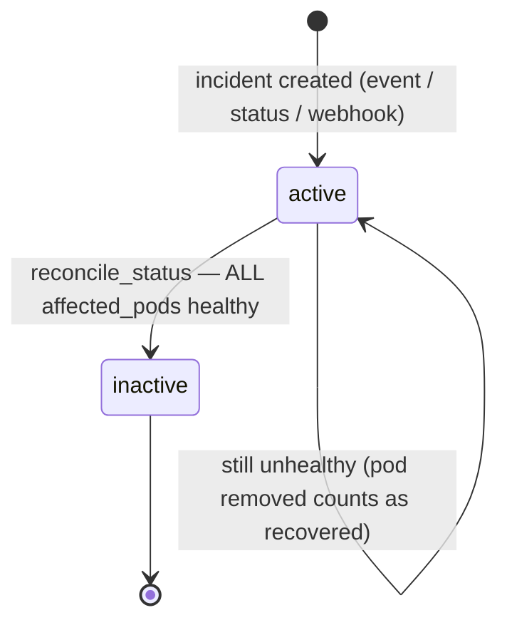
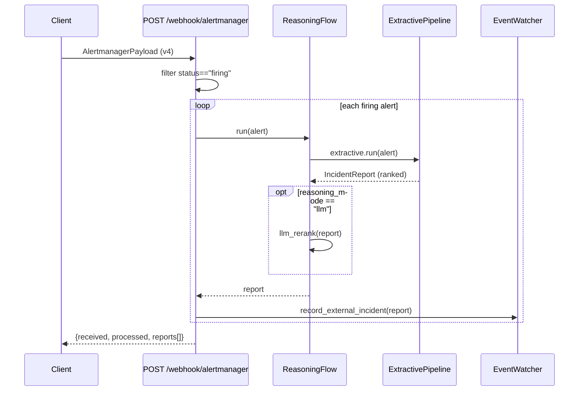

# Low-Level Design — Kubernetes Fault Detection & Root-Cause Agent

## 1. Document control, scope, and evidence convention

| Field | Value |
| --- | --- |
| System | `k8s-rca-agent` — read-only Kubernetes fault detection & root-cause agent for a 5G core |
| Package version | `0.10.1` (from [`pyproject.toml`](../pyproject.toml) and [`src/rca_agent/__init__.py`](../src/rca_agent/__init__.py)) |
| Commit / date | Working tree as read on 2026-11-03; no VCS revision was captured during this read-only pass |
| Audience | Engineers who will trace, debug, test, and safely change the agent |
| Relationship to HLD | This LLD refines [`knowledge-base/HLD.md`](HLD.md). On any conflict, current source and tests win. |
| Authority order | 1) source + schemas + tests; 2) this LLD; 3) HLD; 4) OpenWiki / other notes |
| Draft status | Draft — review required by the module owners listed in §14 |

Scope: the Python application under [`src/rca_agent/`](../src/rca_agent), its
HTTP surface, reasoning pipeline, dependency graph, detection loop, runbook RAG,
service-area impact feature, and the Helm deployment contract that enforces
read-only access. Non-goals: the `.aide/` tooling, `.kiro/` steering/skills, the
`docs/` diagram sources, binary office documents, and the evaluation datasets
beyond the code paths that read them.

Evidence labels used throughout:

- **Direct evidence** — stated by current source, schema, or a test.
- **Inference** — reasoned from the code but not asserted verbatim.
- **Deployment-dependent** — governed by environment/config at run time.
- **Review required** — an owner must confirm; a likely gap or ambiguity.

## 2. Implementation map and ownership

**Direct evidence.** Package layout under [`src/rca_agent/`](../src/rca_agent):

| Package | Responsibility | Key modules |
| --- | --- | --- |
| `webhook/` | HTTP app, endpoints, server-rendered dashboard, PPTX export | [`app.py`](../src/rca_agent/webhook/app.py), [`ui.py`](../src/rca_agent/webhook/ui.py), [`pptx_report.py`](../src/rca_agent/webhook/pptx_report.py) |
| `detection/` | Automatic fault detection; in-memory incident store; correlation | [`event_watcher.py`](../src/rca_agent/detection/event_watcher.py) |
| `graph/` | Timestamped NetworkX dependency graph + builders + visualization | [`dependency_graph.py`](../src/rca_agent/graph/dependency_graph.py), [`builder.py`](../src/rca_agent/graph/builder.py), [`visualize.py`](../src/rca_agent/graph/visualize.py) |
| `reasoning/` | Extractive pipeline, six steps, optional LLM rerank/synthesis | [`extractive.py`](../src/rca_agent/reasoning/extractive.py), [`steps.py`](../src/rca_agent/reasoning/steps.py), [`flow.py`](../src/rca_agent/reasoning/flow.py), [`llm_rerank.py`](../src/rca_agent/reasoning/llm_rerank.py), [`runbook_synth.py`](../src/rca_agent/reasoning/runbook_synth.py), [`state.py`](../src/rca_agent/reasoning/state.py) |
| `tools/` | Read-only cluster query tools + kube client bootstrap | [`query_tools.py`](../src/rca_agent/tools/query_tools.py), [`kube_client.py`](../src/rca_agent/tools/kube_client.py) |
| `rag/` | Runbook retriever interface, local store, semantic store, query log | [`runbook_retriever.py`](../src/rca_agent/rag/runbook_retriever.py), [`local_store.py`](../src/rca_agent/rag/local_store.py), [`semantic_store.py`](../src/rca_agent/rag/semantic_store.py), [`query_log.py`](../src/rca_agent/rag/query_log.py) |
| `impact/` | Service-area mapping workbook parse + queryable index | [`loader.py`](../src/rca_agent/impact/loader.py), [`index.py`](../src/rca_agent/impact/index.py), [`models.py`](../src/rca_agent/impact/models.py) |
| `models/` | Pydantic input/output schemas | [`alert.py`](../src/rca_agent/models/alert.py), [`incident.py`](../src/rca_agent/models/incident.py) |
| `eval/` | Offline precision/recall harness + incident capture | [`capture.py`](../src/rca_agent/eval/capture.py), `runner.py`, `scorer.py`, `cases.py` |
| (root) | Env-driven settings | [`config.py`](../src/rca_agent/config.py) |

**Direct evidence — dependency direction.** Imports flow inward toward
`models` and `config`; nothing in `models`/`config` imports the service layers.

```mermaid
graph TD
  app["webhook/app.py"] --> flow["reasoning/flow.py"]
  app --> watcher["detection/event_watcher.py"]
  app --> builder["graph/builder.py"]
  app --> ui["webhook/ui.py"]
  watcher --> flow
  watcher --> capture["eval/capture.py"]
  flow --> extractive["reasoning/extractive.py"]
  flow --> rerank["reasoning/llm_rerank.py"]
  extractive --> steps["reasoning/steps.py"]
  extractive --> tools["tools/query_tools.py"]
  extractive --> graph["graph/dependency_graph.py"]
  extractive --> retr["rag/runbook_retriever.py"]
  extractive --> idx["impact/index.py"]
  builder --> graph
  builder --> kube["tools/kube_client.py"]
  tools --> kube
  steps --> models["models/incident.py"]
  retr --> store["rag/local_store.py"]
```

Interpretation: the webhook app is the composition root. It owns the long-lived
`GraphBuilder`, `EventWatcher`, `ReasoningFlow`, local runbook store, and query
log, and wires them together ([`app.py`](../src/rca_agent/webhook/app.py), module
scope). `models` and `config` are leaf dependencies.

**Stable interfaces vs. implementations (Direct evidence):**

- `QueryTools` (ABC) with `StubQueryTools` and `KubeQueryTools`
  ([`query_tools.py`](../src/rca_agent/tools/query_tools.py)); factory
  `get_query_tools(cluster_enabled, ...)`.
- `RunbookRetriever` (ABC) with `StubRunbookRetriever`,
  `LocalRunbookRetriever`, `NullRunbookRetriever`, and (opt-in) a
  `SemanticRunbookRetriever`; factory `get_runbook_retriever(...)`
  ([`runbook_retriever.py`](../src/rca_agent/rag/runbook_retriever.py)).
- Process-wide singletons via `@lru_cache`: `get_settings()`
  ([`config.py`](../src/rca_agent/config.py)), `get_local_store(path)`
  ([`local_store.py`](../src/rca_agent/rag/local_store.py)),
  `get_query_log(max_entries)` ([`query_log.py`](../src/rca_agent/rag/query_log.py)).

**Ownership of major state:**

| State | Owner | Lifetime |
| --- | --- | --- |
| Dependency graph | `GraphBuilder._graph` (swapped atomically on `rebuild()`) | Process; rebuilt on an interval |
| Incident list + correlation pool | `EventWatcher.incidents` (bounded list) | Process; in-memory, lost on restart |
| Seen-event UIDs (dedup) | `EventWatcher._seen_uids` (bounded `OrderedDict`) | Process |
| Runbook documents/chunks | `LocalRunbookStore` (JSON file on disk) | Disk; wiped on redeploy (emptyDir `/tmp`) |
| Runbook query log | `QueryLog` (bounded `deque`, thread-safe) | Process |

## 3. Concrete contracts and data models

### 3.1 Input — Alertmanager payload (**Direct evidence**, [`models/alert.py`](../src/rca_agent/models/alert.py))

`AlertmanagerPayload` (v4 subset) with `populate_by_name=True`, so both camelCase
aliases and snake_case names deserialize.

| Field | Type | Alias | Notes |
| --- | --- | --- | --- |
| `version` | `str` | — | default `"4"` |
| `status` | `str` | — | default `"firing"` |
| `alerts` | `list[Alert]` | — | only `status == "firing"` alerts are processed |
| `group_key` / `group_labels` / ... | optional | `groupKey`, `groupLabels` | metadata only |

`Alert` fields: `status`, `labels: dict`, `annotations: dict`, `starts_at`
(alias `startsAt`), `ends_at`, `generator_url`, `fingerprint`. Derived
properties:

- `name` → `labels["alertname"]`, else `"UnknownAlert"`.
- `namespace` → `labels["namespace"]`.
- `target` → first present of `pod, deployment, statefulset, service, job,
  instance` (ordered preference). This is the affected-resource anchor.

### 3.2 Input — `KubeEvent` (**Direct evidence**, same file)

Normalized Kubernetes event. Class-level `FAULT_REASONS` tuple is the fixed
trigger set: `CrashLoopBackOff, OOMKilled, ImagePullBackOff, ErrImagePull,
FailedScheduling, Unhealthy, FailedMount, NodeNotReady, Evicted`. Property
`is_fault_signal` is true when `reason` is in that set OR `event_type ==
"Warning"`.

### 3.3 Output — `IncidentReport` (**Direct evidence**, [`models/incident.py`](../src/rca_agent/models/incident.py))

| Field | Type | Default | Meaning |
| --- | --- | --- | --- |
| `incident_id` | `str` | `uuid4().hex[:12]` | identity used across endpoints |
| `created_at` | `datetime` | now(UTC) | newest-first ordering key |
| `symptom` | `str` | required | `"<alertname> on <resource>"` |
| `affected_resource` | `str \| None` | — | backward-compat anchor display/pod |
| `affected_anchor` / `anchor_kind` | `str \| None` | — | service-anchored model (service/deployment/pod) |
| `affected_pods` | `list[str]` | `[]` | evidence pods behind the anchor |
| `severity` | `Severity` enum | `warning` | `critical` if alert label `severity == "critical"` |
| `status` | `str` | `"active"` | flips to `"inactive"` on strict recovery |
| `resolved_at` | `datetime \| None` | — | set when status flips |
| `hypotheses` | `list[Hypothesis]` | `[]` | ranked by confidence desc |
| `blast_radius` | `list[str]` | `[]` | downstream dependents |
| `upstream_unhealthy` | `list[str]` | `[]` | unhealthy upstream deps (candidate causes) |
| `evidence` | `list[Evidence]` | `[]` | all gathered structured evidence |
| `suggested_next_steps` | `list[str]` | `[]` | runbook hits / neutral note / correlation note |
| `service_area` | `ServiceAreaImpact \| None` | `None` | scoped impact, never a cause |
| `related_incidents` | `list[str]` | `[]` | same-signature pattern links |
| `reasoning_mode` | `str` | `"extractive"` | provenance label |

Sub-models: `Hypothesis(cause, evidence_chain, confidence 0..1,
supporting_evidence, citations)`; `Evidence(category, summary, resource,
timestamp, citations)`; `Citation(kind, source, detail, timestamp, actor,
actor_source, is_automation)`.

Helpers: `top_hypothesis` property returns `hypotheses[0]` or `None`; `ranked()`
sorts hypotheses by confidence descending in place and returns self.

**Compatibility note (Inference).** New fields (`affected_anchor`,
`service_area`, `related_incidents`, etc.) are all defaulted, so older JSON and
existing serialization callers remain valid. The module docstrings state this
intent explicitly.

### 3.4 Service-area models (**Direct evidence**, [`impact/models.py`](../src/rca_agent/impact/models.py))

`ServiceArea(section, service, components, direct_pods)` and
`ServiceAreaImpact(pod, mapped, component, service_area, section,
relationship_type, confidence, component_sibling_count,
service_area_pod_count)`. `mapped=False` means the pod is not in the workbook —
reported as UNKNOWN, never guessed. `summary_line()` renders one ASCII-safe
sentence.

## 4. Initialization and lifecycle

**Direct evidence** ([`app.py`](../src/rca_agent/webhook/app.py)).

Import-time (module scope, before any request):
1. `settings = get_settings()` (cached).
2. `_graph_builder = GraphBuilder(settings)`.
3. If `not settings.cluster_enabled`: `_safe_rebuild()` runs immediately,
   producing the instant demo graph so the `TestClient`/CI see a populated
   graph. A real-cluster build is deliberately NOT run here.
4. `_flow = ReasoningFlow(settings, graph=..., builder=...)`.
5. `_event_watcher = EventWatcher(settings, _graph_builder, flow_factory=lambda:
   _flow)` — the lambda re-reads module-level `_flow` each poll because it is
   reassigned on rebuild.
6. `_local_store` and `_query_log` singletons resolved.
7. `_ui.init(app, ...)` mounts static files and the dashboard router.

Lifespan (`_lifespan`, on startup) kicks off three background tasks WITHOUT
blocking `yield`:
- `_initial_build()` → `asyncio.to_thread(_safe_rebuild)` then reassigns global
  `_flow`. This keeps a slow large-namespace build off the startup path so
  `/healthz` answers immediately (guarded by
  `test_startup_does_not_block_on_graph_build`,
  [`tests/test_webhook.py`](../tests/test_webhook.py)).
- `_refresh_loop()` → every `max(5, graph_rebuild_interval_seconds)` seconds,
  rebuild in a thread; errors logged, previous graph kept.
- `_event_watch_loop()` → no-op unless `cluster_enabled and
  event_watch_enabled`; otherwise polls `poll_once()` every `max(5,
  event_watch_interval_seconds)` seconds.

Shutdown: all three tasks are cancelled and awaited with
`contextlib.suppress(asyncio.CancelledError)`.

**Deployment-dependent.** The container entrypoint runs a single uvicorn
process ([`docker/entrypoint.sh`](../docker/entrypoint.sh)) honoring `RCA_HOST`,
`RCA_PORT`, `RCA_LOG_LEVEL`.



Interpretation: readiness (`/readyz`) reports graph stats; the demo path makes
the graph non-empty at import, while the cluster path fills it asynchronously.

## 5. Core processing algorithms and state machines

### 5.1 Extractive pipeline (**Direct evidence**, [`reasoning/extractive.py`](../src/rca_agent/reasoning/extractive.py), [`steps.py`](../src/rca_agent/reasoning/steps.py))

`ExtractivePipeline.run(alert)` threads one `ReasoningState`
([`state.py`](../src/rca_agent/reasoning/state.py)) through six ordered steps,
then builds the report. Order matters:

1. `triage` — resolve `affected_resource` from `alert.target`; compute the
   change-correlation window `[end - change_correlation_window_minutes, end]`;
   add the "alert fired" event evidence.
2. `gather_evidence` — `pod_status`, `recent_events` (30 min), and `logs`
   (tail `log_tail_lines`); only error/fatal log lines are kept (max 5) and
   each is fenced via `fence()` (prompt-injection defense).
3. `graph_walk` — resolve the anchor (`anchor_of`), its pods
   (`pods_of_anchor`), then union upstream (`unhealthy_upstream`) and
   downstream (`downstream`) across the anchor, the resource, and all its pods.
   Upstream edges are cited with the concrete `calls`-edge evidence when a
   direct edge exists (`calls_edge_evidence`).
4. `change_correlation` — list recent changes; config/secret changes are kept
   only if the affected pod mounts them (`mounted_config`), else marked
   `correlated=False`; rollouts naming the resource are correlated.
5. `hypothesize_and_rank` — deterministic scoring (see table below).
6. `build_next_steps` — resolve the runbook retriever fresh per incident, build
   an enriched query, retrieve top-k, record to the query log, and emit next
   steps (or the neutral `NO_RUNBOOK_SOURCE_NOTE`).

Then `build_service_area` attaches scoped impact when configured, and
`_to_report` assembles and `ranked()`s the `IncidentReport`.

**Scoring weights (Direct evidence, `hypothesize_and_rank`):**

| Signal | Weight | Source |
| --- | --- | --- |
| Fault event (OOMKilled/CrashLoopBackOff/ImagePullBackOff/ErrImagePull/Evicted) | +0.45 | pod_status/event evidence |
| Readiness/liveness probe failure | +0.50 | `_detect_probe_failure` |
| Recent change the pod consumes (`correlated=True`) | +0.30 | `change_correlation` |
| Recent change not mounted by the pod | +0.05 | — |
| Unhealthy upstream dependency (cascade) | +0.20 | graph walk |
| Error/fatal log lines present | +0.15 | log evidence (applied to all candidates) |
| Correlated change linked to a fault on the pod | +0.10 bonus | `_link_change_to_fault` |

Each confidence is clamped to `0.99`. Every chain is prefixed with
`"symptom: <alertname> on <resource>"`. A hypothesis is only ever created when
tied to evidence (no fabricated causes) — asserted by
`test_report_has_citations` ([`tests/test_reasoning.py`](../tests/test_reasoning.py)).

### 5.2 Incident lifecycle state machine (**Direct evidence**, [`event_watcher.py`](../src/rca_agent/detection/event_watcher.py))



Transition table:

| From | Trigger | Guard | Effect |
| --- | --- | --- | --- |
| (none) | fault event / persistent-unhealthy / webhook | passes scope + dedup gates | create `active` report, store, correlate |
| active | `reconcile_status` each poll | every pod in `affected_pods` healthy (missing = recovered) | set `inactive`, `resolved_at=now`, clear status latches |
| active | re-break after resolve | status detector latch cleared on resolve | can re-fire |

Recovery is STRICT: `reconcile_status` keeps an incident active if ANY affected
pod is still unhealthy. A pod missing from the graph is treated as recovered
(`_pod_is_unhealthy` returns False).

### 5.3 Detection gates (**Direct evidence**, `poll_once`)

Per cycle, ordered gates with diagnostic counters exposed at `/debug/detection`:
`events_seen` → `matched_fault_reason` (reason in `FAULT_REASONS`) →
`dropped_stale` (older than `event_max_age_minutes`) → `out_of_scope` (not a
current graph node) → `already_seen` (UID in `_seen_uids`). Survivors become
alerts and run the flow. Anchor dedup (`_merge_into_open_anchor`) merges sibling
pods into one open anchor incident. Status-based detection
(`_detect_from_status`) raises an incident for a pod unhealthy across
`status_unhealthy_rebuilds` consecutive rebuilds even with no fresh event.

## 6. End-to-end execution sequences

### 6.1 Alertmanager webhook (success) — **Direct evidence** ([`app.py`](../src/rca_agent/webhook/app.py))



Interpretation: each firing alert yields one report; manually posted incidents
join the same `/incidents` pool and correlation window as auto-detected ones
(guarded by `test_manually_posted_incident_shows_up_in_incidents_list`).

### 6.2 Automatic detection (cluster) — **Direct evidence** (`event_watch_loop` → `poll_once`)

The refresh loop keeps the graph fresh; the watch loop calls `poll_once()`,
which lists namespaced events, applies the §5.3 gates, runs the flow for each
survivor, performs anchor dedup, runs status-based detection, then
`reconcile_status`. All kube list calls are wrapped in `_safe_list` so a 403
degrades to an empty list rather than crashing the loop.

### 6.3 Degraded paths (**Direct evidence**)

- No cluster: `GraphBuilder.rebuild()` returns `build_demo_graph()`; query tools
  are `StubQueryTools`; event watcher is inert.
- Initial cluster build fails: `_safe_rebuild` logs and serves an empty graph;
  the refresh loop retries.
- LLM sidecar unreachable: `llm_rerank`/`sidecar_available` return the report
  unchanged with a `reasoning_mode` fallback label.

## 7. Concurrency, communication, and ordering

**Direct evidence.**

- Three asyncio tasks (initial build, refresh, event watch) created in the
  lifespan; blocking kube work is offloaded with `asyncio.to_thread` to keep the
  event loop responsive.
- `GraphBuilder.rebuild()` constructs a brand-new `DependencyGraph` and assigns
  it to `self._graph` as the last step, so readers never observe a half-built
  graph (atomic swap — **Inference** from the single-assignment pattern).
- `QueryLog` guards its `deque` with a `threading.Lock`
  ([`query_log.py`](../src/rca_agent/rag/query_log.py)); `LocalRunbookStore`
  guards mutations with a `threading.Lock` and writes atomically via
  `os.replace` of a temp file ([`local_store.py`](../src/rca_agent/rag/local_store.py)).
- Dedup/history bounds: `_MAX_SEEN_UIDS = 2000`, `_MAX_STORED_INCIDENTS = 200`
  (list trimmed from the front); query log bounded by `deque(maxlen=...)`.

**Review required.** `EventWatcher.incidents` and its streak/latch dicts are
mutated from the event-watch thread and read from request handlers without an
explicit lock. In CPython this is usually safe for simple list/dict operations
but is not a documented guarantee; an owner should confirm whether a lock is
warranted under load.

## 8. Persistence, files, caches, and resource lifetime

**Direct evidence.**

| Resource | Owner | Format | Lifecycle / cleanup |
| --- | --- | --- | --- |
| Runbook store | `LocalRunbookStore` | single JSON file at `runbook_store_path` (default `/tmp/runbooks/store.json`) | atomic temp-file replace on write; wiped on redeploy (`/tmp` is an emptyDir) |
| Extracted runbook images | upload path | PNG under `runbook_asset_dir` (`/tmp/runbooks/assets/<doc>`) | written on upload; decorative images <64px skipped; wiped with `/tmp` |
| Incident capture JSONL | `IncidentCaptureWriter` | append-only JSONL at `incident_capture_path` | OFF unless path set; rolling cap `incident_capture_max_records`; atomic rewrite on cap; best-effort, never raises |
| Prometheus HTTP | `KubeQueryTools.metrics` | `GET /api/v1/query` | 5s timeout; empty well-formed result when unset |
| Semantic index | `SemanticRunbookRetriever` | in-memory ChromaDB (no on-disk sqlite) | rebuilt from the local store on startup; opt-in only |

**Deployment-dependent / sensitive.** Capture records include real log lines and
object names from the monitored namespace. `incident_capture_redact_logs`
replaces log bodies with `<redacted log line>`. Treat the capture file as
sensitive.

## 9. Configuration and extension implementation

**Direct evidence** ([`config.py`](../src/rca_agent/config.py)). All settings use
env prefix `RCA_` and an optional `.env`; unknown env keys are ignored
(`extra="ignore"`). Defaults make the agent run with no cluster and no LLM.

| Setting | Default | Consumer |
| --- | --- | --- |
| `reasoning_mode` | `extractive` | `ReasoningFlow.run` chooses LLM rerank when `llm` |
| `cluster_enabled` | `False` | `GraphBuilder.rebuild`, `get_query_tools`, watch loop gate |
| `kubeconfig_mode` | `auto` | `build_kube_client` (`auto`/`incluster`/`local`) |
| `namespace` / `nf_selector` | `open5gs` / `""` | graph builder scope |
| `graph_rebuild_interval_seconds` | `60` | refresh loop (floored at 5) |
| `event_watch_enabled` / `event_watch_interval_seconds` | `True` / `15` | watch loop |
| `event_max_age_minutes` | `90` | stale-event gate |
| `status_detection_enabled` / `status_unhealthy_rebuilds` | `True` / `2` | status detection |
| `incident_correlation_window_minutes` | `10` | correlation + anchor dedup window |
| `log_tail_lines` / `change_correlation_window_minutes` | `200` / `15` | evidence gathering |
| `prometheus_url` | `None` | metrics tool (optional) |
| `runbook_rag_url` | `None` | HTTP retriever (unbuilt TODO) |
| `runbook_store_path` / `runbook_asset_dir` | `/tmp/runbooks/...` | local retriever |
| `runbook_rag_semantic` / `runbook_rag_embed_model` | `False` / `bge-small-en-v1.5` | semantic gating |
| `service_area_map_path` | `None` | service-area index |
| `llm_provider/model/base_url/timeout/max_tokens/temperature` | `none` / qwen / `http://127.0.0.1:8090` / 30s / 512 / 0.1 | LLM sidecar |
| `incident_capture_path` (+ redact/include_graph/max_records/graph_radius) | `None` | capture writer |

**Extension seams (Direct evidence):**

- Query-tools factory and runbook-retriever factory select implementations by
  config; new backends slot in behind the ABCs without touching callers.
- The six reasoning steps are plain functions over `ReasoningState`, reusable by
  any orchestrator.

**Review required.** `reasoning/__init__.py` and several docstrings describe a
"LangGraph flow", and `[llm]` extras include `langgraph`/`langchain-core`. The
current `flow.py` is a plain class that calls the extractive pipeline and an
optional HTTP rerank — there is no LangGraph graph object in the read source.
An owner should confirm whether LangGraph is still intended or the docstring is
stale.

## 10. Boundary-specific implementation

### 10.1 HTTP API (**Direct evidence**, [`app.py`](../src/rca_agent/webhook/app.py))

| Method & path | Purpose | Error behavior |
| --- | --- | --- |
| `GET /healthz` | liveness `{status, version}` | — |
| `GET /readyz` | readiness + graph stats | — |
| `GET /graph/stats`, `/graph/pods`, `/graph/nodes?kind=`, `/graph/neighborhood/{id}` | graph inspection | `/graph/nodes` 400 on bad `kind` |
| `GET /graph/view`, `/graph/view/{id}` | HTML visualization | `/graph/view/{id}` 404 on unknown node |
| `GET /incidents?status=&limit=` | incident summaries (active/inactive/all) | 400 on bad status |
| `GET /incidents/{id}` | full report (`response_model=IncidentReport`) | 404 when absent |
| `POST /webhook/alertmanager` | process firing alerts → reports | pydantic 422 on bad body |
| `GET/POST/DELETE /runbooks[...]` | local runbook CRUD (own store only) | 400 no text / 404 missing |
| `GET/DELETE /runbook-queries` | query-log view/clear | — |
| `GET /debug/detection` | last-cycle gate counters | — |

Dashboard routes live under `/` and `/ui/*` ([`ui.py`](../src/rca_agent/webhook/ui.py)),
rendering Jinja2 templates and HTMX partials from the shared in-process objects.
`GET /ui/incidents/{id}/pptx` returns a PPTX attachment, or 501 when
`python-pptx` is not installed.

### 10.2 Kubernetes (**Direct evidence**, [`kube_client.py`](../src/rca_agent/tools/kube_client.py), [`query_tools.py`](../src/rca_agent/tools/query_tools.py))

Only `list_*`/`read_*` calls are made. `build_kube_client(mode)` loads in-cluster
or local config and returns `CoreV1Api` + `AppsV1Api`. `_safe_list` paginates
(`limit`/`_continue`, page size 500) with a `(5, 30)`-second request timeout and
tolerates 403/connection errors. The `kubernetes` dependency is in the
`[cluster]` extra and imported lazily.

### 10.3 LLM sidecar (**Direct evidence**, [`llm_rerank.py`](../src/rca_agent/reasoning/llm_rerank.py))

OpenAI-compatible `POST /v1/chat/completions` over loopback (`llm_base_url`);
`sidecar_available` probes `GET /health` then `/v1/models`. Guardrails enforced
in code: the model may only reorder given hypothesis ids (`_validate_order`
requires a permutation of `0..n-1`), cannot add/remove causes, echo-only
explanations are dropped (`_is_echo`), untrusted evidence is fenced, and any
failure returns the extractive order.

## 11. Failure handling, recovery, and security implementation

**Direct evidence.** Failure matrix:

| Failure class | Detection | Observable result | State mutation | Recovery owner |
| --- | --- | --- | --- | --- |
| Bad webhook body | pydantic validation | HTTP 422 | none | client |
| Unknown incident/node | explicit check | HTTP 404 | none | client |
| Kube 403 / list error | `_safe_list` try/except | empty list, warning log | none | operator (RBAC) |
| Initial graph build failure | `_safe_rebuild` | empty graph served | none | background retry |
| Refresh failure | `_refresh_loop` try/except | previous graph kept | none | next cycle |
| Event poll failure | `_event_watch_loop` try/except | cycle skipped | none | next cycle |
| LLM error/timeout/invalid | `llm_rerank` fallbacks | extractive order, labeled mode | none | automatic |
| Runbook synth failure | `synthesize_next_step` returns None | raw hits kept | none | automatic |
| Capture failure | best-effort try/except | warning only | none | automatic |
| PDF parse failure | `_extract_pdf_markdown` → pypdf fallback | degraded extraction or 400 | none | uploader |

**Security controls (Direct evidence):**

- Read-only by construction: no write/patch/delete query tool exists; the Helm
  `ClusterRole` grants only `get/list/watch` (plus `metrics.k8s.io` get/list)
  ([`deploy/helm/templates/rbac.yaml`](../deploy/helm/templates/rbac.yaml)).
- Pod hardening ([`deploy/helm/values.yaml`](../deploy/helm/values.yaml),
  [`deployment.yaml`](../deploy/helm/templates/deployment.yaml)): `runAsNonRoot`,
  `runAsUser: 10001`, `allowPrivilegeEscalation: false`,
  `readOnlyRootFilesystem: true`, `capabilities.drop: [ALL]`, writable `/tmp`
  emptyDir only.
- Prompt-injection defense: untrusted logs/evidence are fenced before reaching
  the model (`fence()` in steps; `<<UNTRUSTED_EVIDENCE>>` fences in rerank/synth).
- Secret values are never read into the graph — only secret existence drives
  `mounts` edges ([`builder.py`](../src/rca_agent/graph/builder.py),
  `_add_config_objects`).

**Residual risks (Review required):** the `secrets` resource is listable per the
ClusterRole; the code only lists names, but the RBAC grant itself allows reading
secret contents. Confirm whether that grant should be narrowed.

## 12. Observability, build, and verification traceability

**Direct evidence.** Logging via the `rca_agent*` logger hierarchy; readiness at
`/readyz`; detection self-diagnosis at `/debug/detection`; runbook retrieval
attempts recorded to the query log (zero-hit = "write a runbook" signal).

Build/test: [`pyproject.toml`](../pyproject.toml) defines `k8s-rca-agent`,
console script `rca-agent`, extras `[llm] [cluster] [viz] [rag] [rag-semantic]
[pptx] [dev]`, ruff (line length 100, py310), and pytest (`pythonpath=src`,
`testpaths=tests`). Tests live in [`tests/`](../tests) (24 `test_*.py` files)
with a `FakeKubeClient` ([`tests/fake_kube.py`](../tests/fake_kube.py)).

Invariant → test mapping:

| Invariant | Test | Level |
| --- | --- | --- |
| Demo graph is pod-centric, no `calls` edges | `test_demo_graph_is_pod_centric` | unit |
| Pod edges + health rollup (2/3 ready → degraded) | `test_demo_graph_pod_edges_and_rollup` | unit |
| OOMKilled + ConfigMap change ranks first | `test_extractive_pipeline_ranks_root_cause` | unit |
| Every hypothesis chain starts with `symptom:` | `test_report_has_citations` | unit |
| Webhook produces ranked report + next steps | `test_alertmanager_webhook_produces_report` | api |
| Manual post joins `/incidents` pool | `test_manually_posted_incident_shows_up_in_incidents_list` | api |
| Startup does not block on graph build | `test_startup_does_not_block_on_graph_build` | api |
| Event → incident, deduped; correlation links | `tests/test_event_watcher.py` | unit |

**Verification not run.** This LLD pass was read-only; no build or tests were
executed. Running `pytest` requires the dev extra.

## 13. Change-impact review aids

Before changing a module, check:

- **Contract:** adding an `IncidentReport` field — keep it defaulted (serialization
  and `/incidents/{id}` consumers rely on backward compatibility).
- **Scoring:** editing weights in `hypothesize_and_rank` affects ordering and the
  `test_extractive_pipeline_ranks_root_cause` guard.
- **Detection gates:** changing `FAULT_REASONS`, `event_max_age_minutes`, or scope
  checks changes which events become incidents; update `/debug/detection`
  expectations.
- **Graph edges:** `calls`-edge detection is literal text matching only; never
  introduce a guessed edge (project invariant in `builder.py`).
- **Config precedence:** env `RCA_*` overrides defaults; floors (`max(5, ...)`)
  bound intervals.
- **Concurrency:** anything touching `EventWatcher.incidents` from a request path
  — confirm the §7 review-required locking question first.

## 14. Glossary, unresolved questions, and review record

Glossary: **NF** network function (5G core component); **anchor** the stable
entity a fault is attributed to (service > workload > pod); **blast radius**
downstream dependents; **RAG** retrieval-augmented generation (runbook lookup);
**extractive mode** deterministic no-LLM reasoning; **managedFields** Kubernetes
server-side-apply actor/time metadata used for change attribution.

Unresolved questions / review required:

1. **LangGraph** — docstrings/extras reference it, but no LangGraph graph exists
   in `flow.py`. Confirm intent vs. stale doc. (Owner: reasoning.)
2. **Duplicate `_signature`** — `event_watcher.py` defines `_signature` twice;
   the second definition shadows the first. Confirm the intended version.
   (Owner: detection.)
3. **Locking** — `EventWatcher` shared state read without a lock from request
   handlers (§7). Confirm whether a lock is required. (Owner: detection.)
4. **Secrets RBAC** — the ClusterRole lists `secrets`; code reads names only.
   Confirm whether the grant should be removed/narrowed. (Owner: platform.)
5. **Helm image tag** — `values.yaml` pins `tag: "0.3.9"` while the package is
   `0.10.1`. Confirm the intended release image. (Owner: release.)

Absence of evidence above is recorded as a gap, not a requirement.
