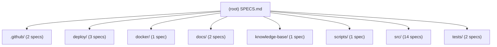

# Repository Folder Specification Relationship Map

| Field | Value |
|-------|-------|
| Artifact path | `knowledge-base/SPECS-RELATIONSHIP-MAP.md` |
| Current commit | `2f4774f0476d5b47426ac1548c479f132c467332` |
| Workspace specification baseline | 27 in-scope `SPECS.md` files at this commit |
| Generated | 2026-11-03 |
| Specification nodes | 27 |
| Structural edges | 26 |
| Normalized dependency edges | 50 |
| Status | Draft until maintainer review |

Authority and static-analysis caveat: the repository source code, tests, schemas, and build definitions remain authoritative. This map is derived solely from the parsed `SPECS.md` folder specifications and records only **declared** structural and dependency relationships. A declared dependency edge does not prove a specific runtime call, execution order, data format, or deployment topology. Absence from the map means "not declared by the parsed specification set," not "cannot exist at runtime." Generated OpenWiki pages were not used as evidence and were not modified.

## 1. Purpose and scope

This map is a single navigation and impact-analysis artifact over every project-owned folder specification. It lets an engineer locate any specification from one catalog, trace its structural parent and children, trace the specifications it declares a dependency on and those that declare it as a consumer, discover aggregators/hubs/leaves/isolated nodes, and estimate the specification impact radius before changing a folder contract.

Included: the root specification and every project-owned subfolder `SPECS.md` under source, tests, deployment, packaging, workflows, docs, configuration, and fixtures. Excluded: `.git/`, AIDE-managed paths from `.aide/managed-files.json`, and the `.aide/`, `.kiro/`, and `openwiki/` boundaries (their installed specifications document the AIDE support plane, not the target application, and do not affect any count here).

## 2. Relationship semantics

| Relationship | Meaning | Evidence | Direction rule |
|--------------|---------|----------|----------------|
| Structural parent | Physical containing folder with a `SPECS.md` | Repository path | Exactly one per non-root node |
| Structural child | Immediate contained folder with a `SPECS.md` | Repository path | Reverse of parent |
| Outbound dependency | Declaring spec records a dependency on a target spec | Section 6 `Outbound` row | A -> B as declared |
| Inbound consumer | Target spec records a consumer spec | Section 6 `Inbound` row | Reversed to consumer -> target |
| Normalized edge | Deduplicated source/target spec pair | Union of both perspectives | Keyed by canonical folder pair |
| Perspective | Which endpoint(s) declared the edge | `Outbound only` / `Inbound only` / `Both perspectives` | One-sided edges retained |

Only Section 6 rows whose target resolves to an in-scope `SPECS.md` become edges. Outbound rows that point to a non-spec file (for example a module `config.py`) or to a generated boundary are intentionally not edges.

## 3. Repository-level hierarchy diagram

The diagram shows the root and each top-level area with its specification count. The complete node-by-node hierarchy is in Section 7.

## 4. Top-level area summary

| Area | Specifications | Structural leaves | Outbound edges | Inbound edges |
|------|----------------|-------------------|----------------|---------------|
| [`(root)`](../SPECS.md) | 1 | 0 | 3 | 0 |
| [`.github/`](../.github/SPECS.md) | 2 | 1 | 0 | 0 |
| [`deploy/`](../deploy/SPECS.md) | 3 | 1 | 4 | 1 |
| [`docker/`](../docker/SPECS.md) | 1 | 1 | 2 | 2 |
| [`docs/`](../docs/SPECS.md) | 2 | 1 | 6 | 2 |
| [`knowledge-base/`](SPECS.md) | 1 | 1 | 2 | 0 |
| [`scripts/`](../scripts/SPECS.md) | 1 | 1 | 2 | 0 |
| [`src/`](../src/SPECS.md) | 14 | 10 | 26 | 43 |
| [`tests/`](../tests/SPECS.md) | 2 | 1 | 5 | 2 |

## 5. Cross-area dependency rollup

| Source area | Target area | Normalized edges |
|-------------|-------------|------------------|
| `src/` | `src/` | 26 |
| `docs/` | `src/` | 6 |
| `tests/` | `src/` | 4 |
| `deploy/` | `docker/` | 2 |
| `deploy/` | `src/` | 2 |
| `docker/` | `src/` | 2 |
| `(root)` | `deploy/` | 1 |
| `(root)` | `src/` | 1 |
| `(root)` | `tests/` | 1 |
| `knowledge-base/` | `docs/` | 1 |
| `knowledge-base/` | `src/` | 1 |
| `scripts/` | `docs/` | 1 |
| `scripts/` | `src/` | 1 |
| `tests/` | `tests/` | 1 |

## 6. Dependency and hierarchy hubs

### 6.1 Highest dependency-degree specifications (top 30)

| Specification | Identifier | Outbound | Inbound | Total degree |
|---------------|------------|----------|---------|--------------|
| [`src/rca_agent/webhook/`](../src/rca_agent/webhook/SPECS.md) | SPEC-src-rca_agent-webhook | 8 | 2 | 10 |
| [`src/rca_agent/reasoning/`](../src/rca_agent/reasoning/SPECS.md) | SPEC-src-rca_agent-reasoning | 5 | 4 | 9 |
| [`src/rca_agent/detection/`](../src/rca_agent/detection/SPECS.md) | SPEC-src-rca_agent-detection | 5 | 2 | 7 |
| [`src/rca_agent/models/`](../src/rca_agent/models/SPECS.md) | SPEC-src-rca_agent-models | 1 | 6 | 7 |
| [`src/rca_agent/`](../src/rca_agent/SPECS.md) | SPEC-src-rca_agent | 0 | 6 | 6 |
| [`src/rca_agent/graph/`](../src/rca_agent/graph/SPECS.md) | SPEC-src-rca_agent-graph | 1 | 5 | 6 |
| [`docs/arch/`](../docs/arch/SPECS.md) | SPEC-docs-arch | 5 | 0 | 5 |
| [`src/rca_agent/eval/`](../src/rca_agent/eval/SPECS.md) | SPEC-src-rca_agent-eval | 4 | 1 | 5 |
| [`src/rca_agent/impact/`](../src/rca_agent/impact/SPECS.md) | SPEC-src-rca_agent-impact | 0 | 5 | 5 |
| [`deploy/helm/`](../deploy/helm/SPECS.md) | SPEC-deploy-helm | 3 | 1 | 4 |
| [`docker/`](../docker/SPECS.md) | SPEC-docker | 2 | 2 | 4 |
| [`src/rca_agent/tools/`](../src/rca_agent/tools/SPECS.md) | SPEC-src-rca_agent-tools | 1 | 3 | 4 |
| [`tests/`](../tests/SPECS.md) | SPEC-tests | 3 | 1 | 4 |
| [`(root)`](../SPECS.md) | SPEC-root | 3 | 0 | 3 |
| [`docs/`](../docs/SPECS.md) | SPEC-docs | 1 | 2 | 3 |
| [`src/rca_agent/rag/`](../src/rca_agent/rag/SPECS.md) | SPEC-src-rca_agent-rag | 0 | 3 | 3 |
| [`tests/fixtures/`](../tests/fixtures/SPECS.md) | SPEC-tests-fixtures | 2 | 1 | 3 |
| [`knowledge-base/`](SPECS.md) | SPEC-knowledge-base | 2 | 0 | 2 |
| [`scripts/`](../scripts/SPECS.md) | SPEC-scripts | 2 | 0 | 2 |
| [`src/`](../src/SPECS.md) | SPEC-src | 0 | 2 | 2 |
| [`src/rca_agent/webhook/static/`](../src/rca_agent/webhook/static/SPECS.md) | SPEC-src-rca_agent-webhook-static | 0 | 2 | 2 |
| [`src/rca_agent/webhook/templates/`](../src/rca_agent/webhook/templates/SPECS.md) | SPEC-src-rca_agent-webhook-templates | 1 | 1 | 2 |
| [`deploy/helm/templates/`](../deploy/helm/templates/SPECS.md) | SPEC-deploy-helm-templates | 1 | 0 | 1 |
| [`src/rca_agent/eval/results/`](../src/rca_agent/eval/results/SPECS.md) | SPEC-src-rca_agent-eval-results | 0 | 1 | 1 |
| [`.github/`](../.github/SPECS.md) | SPEC-dotgithub | 0 | 0 | 0 |
| [`.github/workflows/`](../.github/workflows/SPECS.md) | SPEC-dotgithub-workflows | 0 | 0 | 0 |
| [`deploy/`](../deploy/SPECS.md) | SPEC-deploy | 0 | 0 | 0 |

### 6.2 Largest structural aggregators (top 30)

| Specification | Identifier | Immediate children |
|---------------|------------|--------------------|
| [`src/rca_agent/`](../src/rca_agent/SPECS.md) | SPEC-src-rca_agent | 9 |
| [`(root)`](../SPECS.md) | SPEC-root | 8 |
| [`src/rca_agent/webhook/`](../src/rca_agent/webhook/SPECS.md) | SPEC-src-rca_agent-webhook | 2 |
| [`.github/`](../.github/SPECS.md) | SPEC-dotgithub | 1 |
| [`deploy/`](../deploy/SPECS.md) | SPEC-deploy | 1 |
| [`deploy/helm/`](../deploy/helm/SPECS.md) | SPEC-deploy-helm | 1 |
| [`docs/`](../docs/SPECS.md) | SPEC-docs | 1 |
| [`src/`](../src/SPECS.md) | SPEC-src | 1 |
| [`src/rca_agent/eval/`](../src/rca_agent/eval/SPECS.md) | SPEC-src-rca_agent-eval | 1 |
| [`tests/`](../tests/SPECS.md) | SPEC-tests | 1 |
| [`.github/workflows/`](../.github/workflows/SPECS.md) | SPEC-dotgithub-workflows | 0 |
| [`deploy/helm/templates/`](../deploy/helm/templates/SPECS.md) | SPEC-deploy-helm-templates | 0 |
| [`docker/`](../docker/SPECS.md) | SPEC-docker | 0 |
| [`docs/arch/`](../docs/arch/SPECS.md) | SPEC-docs-arch | 0 |
| [`knowledge-base/`](SPECS.md) | SPEC-knowledge-base | 0 |
| [`scripts/`](../scripts/SPECS.md) | SPEC-scripts | 0 |
| [`src/rca_agent/detection/`](../src/rca_agent/detection/SPECS.md) | SPEC-src-rca_agent-detection | 0 |
| [`src/rca_agent/eval/results/`](../src/rca_agent/eval/results/SPECS.md) | SPEC-src-rca_agent-eval-results | 0 |
| [`src/rca_agent/graph/`](../src/rca_agent/graph/SPECS.md) | SPEC-src-rca_agent-graph | 0 |
| [`src/rca_agent/impact/`](../src/rca_agent/impact/SPECS.md) | SPEC-src-rca_agent-impact | 0 |
| [`src/rca_agent/models/`](../src/rca_agent/models/SPECS.md) | SPEC-src-rca_agent-models | 0 |
| [`src/rca_agent/rag/`](../src/rca_agent/rag/SPECS.md) | SPEC-src-rca_agent-rag | 0 |
| [`src/rca_agent/reasoning/`](../src/rca_agent/reasoning/SPECS.md) | SPEC-src-rca_agent-reasoning | 0 |
| [`src/rca_agent/tools/`](../src/rca_agent/tools/SPECS.md) | SPEC-src-rca_agent-tools | 0 |
| [`src/rca_agent/webhook/static/`](../src/rca_agent/webhook/static/SPECS.md) | SPEC-src-rca_agent-webhook-static | 0 |
| [`src/rca_agent/webhook/templates/`](../src/rca_agent/webhook/templates/SPECS.md) | SPEC-src-rca_agent-webhook-templates | 0 |
| [`tests/fixtures/`](../tests/fixtures/SPECS.md) | SPEC-tests-fixtures | 0 |

## 7. Complete specification hierarchy

- [`(root)`](../SPECS.md) - `SPEC-root` - Repository integration specification and master index for the read-only Kubernetes fault-detection and root-cause agent
  - [`.github/`](../.github/SPECS.md) - `SPEC-dotgithub` - Workflow / automation — GitHub platform configuration (Actions workflows)
    - [`.github/workflows/`](../.github/workflows/SPECS.md) - `SPEC-dotgithub-workflows` - Workflow / automation — GitHub Actions workflow that refreshes the OpenWiki documentation
  - [`deploy/`](../deploy/SPECS.md) - `SPEC-deploy` - Deployment — container for Kubernetes deployment assets (the Helm chart)
    - [`deploy/helm/`](../deploy/helm/SPECS.md) - `SPEC-deploy-helm` - Deployment — the `rca-agent` Helm chart (read-only RBAC, hardened Deployment, Service)
      - [`deploy/helm/templates/`](../deploy/helm/templates/SPECS.md) - `SPEC-deploy-helm-templates` - Deployment — Helm templates rendering the agent's Kubernetes objects
  - [`docker/`](../docker/SPECS.md) - `SPEC-docker` - Build / packaging / deployment — container entrypoint, sidecar Dockerfile, and a cluster deploy helper
  - [`docs/`](../docs/SPECS.md) - `SPEC-docs` - Documentation / static asset — architecture diagrams and the reasoning-rules deck/document
    - [`docs/arch/`](../docs/arch/SPECS.md) - `SPEC-docs-arch` - Documentation / static asset — numbered per-stage architecture diagrams (Mermaid + PNG + SVG)
  - [`knowledge-base/`](SPECS.md) - `SPEC-knowledge-base` - Documentation — authoritative high- and low-level design documents (HLD, LLD) and the folder-specification relationship map
  - [`scripts/`](../scripts/SPECS.md) - `SPEC-scripts` - Workflow / automation — developer and demo helper scripts (release, git push, chaos demo, doc/data generators)
  - [`src/`](../src/SPECS.md) - `SPEC-src` - Source root — the `src`-layout package container for the application
    - [`src/rca_agent/`](../src/rca_agent/SPECS.md) - `SPEC-src-rca_agent` - Production runtime — the `rca_agent` Python package (application root), plus shared settings
      - [`src/rca_agent/detection/`](../src/rca_agent/detection/SPECS.md) - `SPEC-src-rca_agent-detection` - Production runtime — automatic fault detection (K8s event watcher), in-memory incident store, correlation
      - [`src/rca_agent/eval/`](../src/rca_agent/eval/SPECS.md) - `SPEC-src-rca_agent-eval` - Test / evaluation — synthetic fault-injection accuracy harness + incident capture for offline labeling
        - [`src/rca_agent/eval/results/`](../src/rca_agent/eval/results/SPECS.md) - `SPEC-src-rca_agent-eval-results` - Test / evaluation output — committed accuracy results table (Markdown + CSV) from the fault-injection harness
      - [`src/rca_agent/graph/`](../src/rca_agent/graph/SPECS.md) - `SPEC-src-rca_agent-graph` - Production runtime — live NetworkX dependency graph of the 5G core, plus the cluster/demo builder
      - [`src/rca_agent/impact/`](../src/rca_agent/impact/SPECS.md) - `SPEC-src-rca_agent-impact` - Production runtime — scoped service-area impact: map an unhealthy pod to its curated service area
      - [`src/rca_agent/models/`](../src/rca_agent/models/SPECS.md) - `SPEC-src-rca_agent-models` - Data model / schema — input (alert/event) and output (incident report) Pydantic schemas
      - [`src/rca_agent/rag/`](../src/rca_agent/rag/SPECS.md) - `SPEC-src-rca_agent-rag` - Production runtime — runbook retrieval (local TF-IDF + opt-in semantic), document store, query log
      - [`src/rca_agent/reasoning/`](../src/rca_agent/reasoning/SPECS.md) - `SPEC-src-rca_agent-reasoning` - Production runtime — reasoning entry point: deterministic extractive pipeline + optional LLM re-rank
      - [`src/rca_agent/tools/`](../src/rca_agent/tools/SPECS.md) - `SPEC-src-rca_agent-tools` - Production runtime — read-only query tools over cluster state (pods, events, logs, metrics, changes)
      - [`src/rca_agent/webhook/`](../src/rca_agent/webhook/SPECS.md) - `SPEC-src-rca_agent-webhook` - Production runtime — FastAPI app (Alertmanager webhook, health, incidents, runbooks, dashboard, PPTX export)
        - [`src/rca_agent/webhook/static/`](../src/rca_agent/webhook/static/SPECS.md) - `SPEC-src-rca_agent-webhook-static` - Documentation / static asset — vendored front-end libraries (Bootstrap CSS, HTMX JS) served offline
        - [`src/rca_agent/webhook/templates/`](../src/rca_agent/webhook/templates/SPECS.md) - `SPEC-src-rca_agent-webhook-templates` - Documentation / static asset — server-rendered Jinja2 + HTMX dashboard templates
  - [`tests/`](../tests/SPECS.md) - `SPEC-tests` - Test — pytest unit/component suite for the agent, plus a fake Kubernetes client
    - [`tests/fixtures/`](../tests/fixtures/SPECS.md) - `SPEC-tests-fixtures` - Test fixture — sample payloads and a service-area mapping workbook used by the suite

## 8. Complete specification node catalog

| # | Specification | Identifier | Role | Structural parent | Children | Direct files | Outbound | Inbound |
|---|---------------|------------|------|-------------------|----------|--------------|----------|---------|
| 1 | [`(root)`](../SPECS.md) | SPEC-root | Repository integration specification and master index for the read-only Kubernetes fault-detection and root-cause agent | (root) | 8 | - | 3 | 0 |
| 2 | [`.github/`](../.github/SPECS.md) | SPEC-dotgithub | Workflow / automation — GitHub platform configuration (Actions workflows) | [`(root)`](../SPECS.md) | 1 | 0 | 0 | 0 |
| 3 | [`.github/workflows/`](../.github/workflows/SPECS.md) | SPEC-dotgithub-workflows | Workflow / automation — GitHub Actions workflow that refreshes the OpenWiki documentation | [`.github/`](../.github/SPECS.md) | 0 | 1 | 0 | 0 |
| 4 | [`deploy/`](../deploy/SPECS.md) | SPEC-deploy | Deployment — container for Kubernetes deployment assets (the Helm chart) | [`(root)`](../SPECS.md) | 1 | 0 | 0 | 0 |
| 5 | [`deploy/helm/`](../deploy/helm/SPECS.md) | SPEC-deploy-helm | Deployment — the `rca-agent` Helm chart (read-only RBAC, hardened Deployment, Service) | [`deploy/`](../deploy/SPECS.md) | 1 | 2 | 3 | 1 |
| 6 | [`deploy/helm/templates/`](../deploy/helm/templates/SPECS.md) | SPEC-deploy-helm-templates | Deployment — Helm templates rendering the agent's Kubernetes objects | [`deploy/helm/`](../deploy/helm/SPECS.md) | 0 | 4 | 1 | 0 |
| 7 | [`docker/`](../docker/SPECS.md) | SPEC-docker | Build / packaging / deployment — container entrypoint, sidecar Dockerfile, and a cluster deploy helper | [`(root)`](../SPECS.md) | 0 | 4 | 2 | 2 |
| 8 | [`docs/`](../docs/SPECS.md) | SPEC-docs | Documentation / static asset — architecture diagrams and the reasoning-rules deck/document | [`(root)`](../SPECS.md) | 1 | 8 | 1 | 2 |
| 9 | [`docs/arch/`](../docs/arch/SPECS.md) | SPEC-docs-arch | Documentation / static asset — numbered per-stage architecture diagrams (Mermaid + PNG + SVG) | [`docs/`](../docs/SPECS.md) | 0 | 24 | 5 | 0 |
| 10 | [`knowledge-base/`](SPECS.md) | SPEC-knowledge-base | Documentation — authoritative high- and low-level design documents (HLD, LLD) and the folder-specification relationship map | [`(root)`](../SPECS.md) | 0 | 4 | 2 | 0 |
| 11 | [`scripts/`](../scripts/SPECS.md) | SPEC-scripts | Workflow / automation — developer and demo helper scripts (release, git push, chaos demo, doc/data generators) | [`(root)`](../SPECS.md) | 0 | 6 | 2 | 0 |
| 12 | [`src/`](../src/SPECS.md) | SPEC-src | Source root — the `src`-layout package container for the application | [`(root)`](../SPECS.md) | 1 | 0 | 0 | 2 |
| 13 | [`src/rca_agent/`](../src/rca_agent/SPECS.md) | SPEC-src-rca_agent | Production runtime — the `rca_agent` Python package (application root), plus shared settings | [`src/`](../src/SPECS.md) | 9 | 2 | 0 | 6 |
| 14 | [`src/rca_agent/detection/`](../src/rca_agent/detection/SPECS.md) | SPEC-src-rca_agent-detection | Production runtime — automatic fault detection (K8s event watcher), in-memory incident store, correlation | [`src/rca_agent/`](../src/rca_agent/SPECS.md) | 0 | 2 | 5 | 2 |
| 15 | [`src/rca_agent/eval/`](../src/rca_agent/eval/SPECS.md) | SPEC-src-rca_agent-eval | Test / evaluation — synthetic fault-injection accuracy harness + incident capture for offline labeling | [`src/rca_agent/`](../src/rca_agent/SPECS.md) | 1 | 9 | 4 | 1 |
| 16 | [`src/rca_agent/eval/results/`](../src/rca_agent/eval/results/SPECS.md) | SPEC-src-rca_agent-eval-results | Test / evaluation output — committed accuracy results table (Markdown + CSV) from the fault-injection harness | [`src/rca_agent/eval/`](../src/rca_agent/eval/SPECS.md) | 0 | 2 | 0 | 1 |
| 17 | [`src/rca_agent/graph/`](../src/rca_agent/graph/SPECS.md) | SPEC-src-rca_agent-graph | Production runtime — live NetworkX dependency graph of the 5G core, plus the cluster/demo builder | [`src/rca_agent/`](../src/rca_agent/SPECS.md) | 0 | 4 | 1 | 5 |
| 18 | [`src/rca_agent/impact/`](../src/rca_agent/impact/SPECS.md) | SPEC-src-rca_agent-impact | Production runtime — scoped service-area impact: map an unhealthy pod to its curated service area | [`src/rca_agent/`](../src/rca_agent/SPECS.md) | 0 | 4 | 0 | 5 |
| 19 | [`src/rca_agent/models/`](../src/rca_agent/models/SPECS.md) | SPEC-src-rca_agent-models | Data model / schema — input (alert/event) and output (incident report) Pydantic schemas | [`src/rca_agent/`](../src/rca_agent/SPECS.md) | 0 | 3 | 1 | 6 |
| 20 | [`src/rca_agent/rag/`](../src/rca_agent/rag/SPECS.md) | SPEC-src-rca_agent-rag | Production runtime — runbook retrieval (local TF-IDF + opt-in semantic), document store, query log | [`src/rca_agent/`](../src/rca_agent/SPECS.md) | 0 | 5 | 0 | 3 |
| 21 | [`src/rca_agent/reasoning/`](../src/rca_agent/reasoning/SPECS.md) | SPEC-src-rca_agent-reasoning | Production runtime — reasoning entry point: deterministic extractive pipeline + optional LLM re-rank | [`src/rca_agent/`](../src/rca_agent/SPECS.md) | 0 | 7 | 5 | 4 |
| 22 | [`src/rca_agent/tools/`](../src/rca_agent/tools/SPECS.md) | SPEC-src-rca_agent-tools | Production runtime — read-only query tools over cluster state (pods, events, logs, metrics, changes) | [`src/rca_agent/`](../src/rca_agent/SPECS.md) | 0 | 3 | 1 | 3 |
| 23 | [`src/rca_agent/webhook/`](../src/rca_agent/webhook/SPECS.md) | SPEC-src-rca_agent-webhook | Production runtime — FastAPI app (Alertmanager webhook, health, incidents, runbooks, dashboard, PPTX export) | [`src/rca_agent/`](../src/rca_agent/SPECS.md) | 2 | 4 | 8 | 2 |
| 24 | [`src/rca_agent/webhook/static/`](../src/rca_agent/webhook/static/SPECS.md) | SPEC-src-rca_agent-webhook-static | Documentation / static asset — vendored front-end libraries (Bootstrap CSS, HTMX JS) served offline | [`src/rca_agent/webhook/`](../src/rca_agent/webhook/SPECS.md) | 0 | 2 | 0 | 2 |
| 25 | [`src/rca_agent/webhook/templates/`](../src/rca_agent/webhook/templates/SPECS.md) | SPEC-src-rca_agent-webhook-templates | Documentation / static asset — server-rendered Jinja2 + HTMX dashboard templates | [`src/rca_agent/webhook/`](../src/rca_agent/webhook/SPECS.md) | 0 | 13 | 1 | 1 |
| 26 | [`tests/`](../tests/SPECS.md) | SPEC-tests | Test — pytest unit/component suite for the agent, plus a fake Kubernetes client | [`(root)`](../SPECS.md) | 1 | 25 | 3 | 1 |
| 27 | [`tests/fixtures/`](../tests/fixtures/SPECS.md) | SPEC-tests-fixtures | Test fixture — sample payloads and a service-area mapping workbook used by the suite | [`tests/`](../tests/SPECS.md) | 0 | 3 | 2 | 1 |

## 9. Complete structural edge catalog

| # | Parent specification | Child specification |
|---|----------------------|---------------------|
| 1 | [`(root)`](../SPECS.md) | [`.github/`](../.github/SPECS.md) |
| 2 | [`.github/`](../.github/SPECS.md) | [`.github/workflows/`](../.github/workflows/SPECS.md) |
| 3 | [`(root)`](../SPECS.md) | [`deploy/`](../deploy/SPECS.md) |
| 4 | [`deploy/`](../deploy/SPECS.md) | [`deploy/helm/`](../deploy/helm/SPECS.md) |
| 5 | [`deploy/helm/`](../deploy/helm/SPECS.md) | [`deploy/helm/templates/`](../deploy/helm/templates/SPECS.md) |
| 6 | [`(root)`](../SPECS.md) | [`docker/`](../docker/SPECS.md) |
| 7 | [`(root)`](../SPECS.md) | [`docs/`](../docs/SPECS.md) |
| 8 | [`docs/`](../docs/SPECS.md) | [`docs/arch/`](../docs/arch/SPECS.md) |
| 9 | [`(root)`](../SPECS.md) | [`knowledge-base/`](SPECS.md) |
| 10 | [`(root)`](../SPECS.md) | [`scripts/`](../scripts/SPECS.md) |
| 11 | [`(root)`](../SPECS.md) | [`src/`](../src/SPECS.md) |
| 12 | [`src/`](../src/SPECS.md) | [`src/rca_agent/`](../src/rca_agent/SPECS.md) |
| 13 | [`src/rca_agent/`](../src/rca_agent/SPECS.md) | [`src/rca_agent/detection/`](../src/rca_agent/detection/SPECS.md) |
| 14 | [`src/rca_agent/`](../src/rca_agent/SPECS.md) | [`src/rca_agent/eval/`](../src/rca_agent/eval/SPECS.md) |
| 15 | [`src/rca_agent/eval/`](../src/rca_agent/eval/SPECS.md) | [`src/rca_agent/eval/results/`](../src/rca_agent/eval/results/SPECS.md) |
| 16 | [`src/rca_agent/`](../src/rca_agent/SPECS.md) | [`src/rca_agent/graph/`](../src/rca_agent/graph/SPECS.md) |
| 17 | [`src/rca_agent/`](../src/rca_agent/SPECS.md) | [`src/rca_agent/impact/`](../src/rca_agent/impact/SPECS.md) |
| 18 | [`src/rca_agent/`](../src/rca_agent/SPECS.md) | [`src/rca_agent/models/`](../src/rca_agent/models/SPECS.md) |
| 19 | [`src/rca_agent/`](../src/rca_agent/SPECS.md) | [`src/rca_agent/rag/`](../src/rca_agent/rag/SPECS.md) |
| 20 | [`src/rca_agent/`](../src/rca_agent/SPECS.md) | [`src/rca_agent/reasoning/`](../src/rca_agent/reasoning/SPECS.md) |
| 21 | [`src/rca_agent/`](../src/rca_agent/SPECS.md) | [`src/rca_agent/tools/`](../src/rca_agent/tools/SPECS.md) |
| 22 | [`src/rca_agent/`](../src/rca_agent/SPECS.md) | [`src/rca_agent/webhook/`](../src/rca_agent/webhook/SPECS.md) |
| 23 | [`src/rca_agent/webhook/`](../src/rca_agent/webhook/SPECS.md) | [`src/rca_agent/webhook/static/`](../src/rca_agent/webhook/static/SPECS.md) |
| 24 | [`src/rca_agent/webhook/`](../src/rca_agent/webhook/SPECS.md) | [`src/rca_agent/webhook/templates/`](../src/rca_agent/webhook/templates/SPECS.md) |
| 25 | [`(root)`](../SPECS.md) | [`tests/`](../tests/SPECS.md) |
| 26 | [`tests/`](../tests/SPECS.md) | [`tests/fixtures/`](../tests/fixtures/SPECS.md) |

## 10. Complete normalized dependency edge catalog

| # | Source specification | Target specification | Perspective | Declared by |
|---|----------------------|----------------------|-------------|-------------|
| 1 | [`(root)`](../SPECS.md) | [`deploy/helm/`](../deploy/helm/SPECS.md) | Outbound only | [`(root)`](../SPECS.md) |
| 2 | [`(root)`](../SPECS.md) | [`src/`](../src/SPECS.md) | Outbound only | [`(root)`](../SPECS.md) |
| 3 | [`(root)`](../SPECS.md) | [`tests/`](../tests/SPECS.md) | Outbound only | [`(root)`](../SPECS.md) |
| 4 | [`deploy/helm/`](../deploy/helm/SPECS.md) | [`docker/`](../docker/SPECS.md) | Both perspectives | [`deploy/helm/`](../deploy/helm/SPECS.md), [`docker/`](../docker/SPECS.md) |
| 5 | [`deploy/helm/`](../deploy/helm/SPECS.md) | [`src/rca_agent/`](../src/rca_agent/SPECS.md) | Outbound only | [`deploy/helm/`](../deploy/helm/SPECS.md) |
| 6 | [`deploy/helm/`](../deploy/helm/SPECS.md) | [`src/rca_agent/webhook/`](../src/rca_agent/webhook/SPECS.md) | Inbound only | [`src/rca_agent/webhook/`](../src/rca_agent/webhook/SPECS.md) |
| 7 | [`deploy/helm/templates/`](../deploy/helm/templates/SPECS.md) | [`docker/`](../docker/SPECS.md) | Outbound only | [`deploy/helm/templates/`](../deploy/helm/templates/SPECS.md) |
| 8 | [`docker/`](../docker/SPECS.md) | [`src/rca_agent/`](../src/rca_agent/SPECS.md) | Inbound only | [`src/rca_agent/`](../src/rca_agent/SPECS.md) |
| 9 | [`docker/`](../docker/SPECS.md) | [`src/rca_agent/webhook/`](../src/rca_agent/webhook/SPECS.md) | Both perspectives | [`docker/`](../docker/SPECS.md), [`src/rca_agent/webhook/`](../src/rca_agent/webhook/SPECS.md) |
| 10 | [`docs/`](../docs/SPECS.md) | [`src/rca_agent/`](../src/rca_agent/SPECS.md) | Outbound only | [`docs/`](../docs/SPECS.md) |
| 11 | [`docs/arch/`](../docs/arch/SPECS.md) | [`src/rca_agent/detection/`](../src/rca_agent/detection/SPECS.md) | Outbound only | [`docs/arch/`](../docs/arch/SPECS.md) |
| 12 | [`docs/arch/`](../docs/arch/SPECS.md) | [`src/rca_agent/graph/`](../src/rca_agent/graph/SPECS.md) | Outbound only | [`docs/arch/`](../docs/arch/SPECS.md) |
| 13 | [`docs/arch/`](../docs/arch/SPECS.md) | [`src/rca_agent/impact/`](../src/rca_agent/impact/SPECS.md) | Outbound only | [`docs/arch/`](../docs/arch/SPECS.md) |
| 14 | [`docs/arch/`](../docs/arch/SPECS.md) | [`src/rca_agent/rag/`](../src/rca_agent/rag/SPECS.md) | Outbound only | [`docs/arch/`](../docs/arch/SPECS.md) |
| 15 | [`docs/arch/`](../docs/arch/SPECS.md) | [`src/rca_agent/reasoning/`](../src/rca_agent/reasoning/SPECS.md) | Outbound only | [`docs/arch/`](../docs/arch/SPECS.md) |
| 16 | [`knowledge-base/`](SPECS.md) | [`docs/`](../docs/SPECS.md) | Outbound only | [`knowledge-base/`](SPECS.md) |
| 17 | [`knowledge-base/`](SPECS.md) | [`src/rca_agent/`](../src/rca_agent/SPECS.md) | Outbound only | [`knowledge-base/`](SPECS.md) |
| 18 | [`scripts/`](../scripts/SPECS.md) | [`docs/`](../docs/SPECS.md) | Both perspectives | [`docs/`](../docs/SPECS.md), [`scripts/`](../scripts/SPECS.md) |
| 19 | [`scripts/`](../scripts/SPECS.md) | [`src/rca_agent/`](../src/rca_agent/SPECS.md) | Outbound only | [`scripts/`](../scripts/SPECS.md) |
| 20 | [`src/rca_agent/detection/`](../src/rca_agent/detection/SPECS.md) | [`src/rca_agent/eval/`](../src/rca_agent/eval/SPECS.md) | Both perspectives | [`src/rca_agent/detection/`](../src/rca_agent/detection/SPECS.md), [`src/rca_agent/eval/`](../src/rca_agent/eval/SPECS.md) |
| 21 | [`src/rca_agent/detection/`](../src/rca_agent/detection/SPECS.md) | [`src/rca_agent/graph/`](../src/rca_agent/graph/SPECS.md) | Both perspectives | [`src/rca_agent/detection/`](../src/rca_agent/detection/SPECS.md), [`src/rca_agent/graph/`](../src/rca_agent/graph/SPECS.md) |
| 22 | [`src/rca_agent/detection/`](../src/rca_agent/detection/SPECS.md) | [`src/rca_agent/models/`](../src/rca_agent/models/SPECS.md) | Both perspectives | [`src/rca_agent/detection/`](../src/rca_agent/detection/SPECS.md), [`src/rca_agent/models/`](../src/rca_agent/models/SPECS.md) |
| 23 | [`src/rca_agent/detection/`](../src/rca_agent/detection/SPECS.md) | [`src/rca_agent/reasoning/`](../src/rca_agent/reasoning/SPECS.md) | Both perspectives | [`src/rca_agent/detection/`](../src/rca_agent/detection/SPECS.md), [`src/rca_agent/reasoning/`](../src/rca_agent/reasoning/SPECS.md) |
| 24 | [`src/rca_agent/detection/`](../src/rca_agent/detection/SPECS.md) | [`src/rca_agent/tools/`](../src/rca_agent/tools/SPECS.md) | Inbound only | [`src/rca_agent/tools/`](../src/rca_agent/tools/SPECS.md) |
| 25 | [`src/rca_agent/eval/`](../src/rca_agent/eval/SPECS.md) | [`src/rca_agent/eval/results/`](../src/rca_agent/eval/results/SPECS.md) | Inbound only | [`src/rca_agent/eval/results/`](../src/rca_agent/eval/results/SPECS.md) |
| 26 | [`src/rca_agent/eval/`](../src/rca_agent/eval/SPECS.md) | [`src/rca_agent/graph/`](../src/rca_agent/graph/SPECS.md) | Outbound only | [`src/rca_agent/eval/`](../src/rca_agent/eval/SPECS.md) |
| 27 | [`src/rca_agent/eval/`](../src/rca_agent/eval/SPECS.md) | [`src/rca_agent/models/`](../src/rca_agent/models/SPECS.md) | Both perspectives | [`src/rca_agent/eval/`](../src/rca_agent/eval/SPECS.md), [`src/rca_agent/models/`](../src/rca_agent/models/SPECS.md) |
| 28 | [`src/rca_agent/eval/`](../src/rca_agent/eval/SPECS.md) | [`src/rca_agent/reasoning/`](../src/rca_agent/reasoning/SPECS.md) | Outbound only | [`src/rca_agent/eval/`](../src/rca_agent/eval/SPECS.md) |
| 29 | [`src/rca_agent/graph/`](../src/rca_agent/graph/SPECS.md) | [`src/rca_agent/tools/`](../src/rca_agent/tools/SPECS.md) | Both perspectives | [`src/rca_agent/graph/`](../src/rca_agent/graph/SPECS.md), [`src/rca_agent/tools/`](../src/rca_agent/tools/SPECS.md) |
| 30 | [`src/rca_agent/models/`](../src/rca_agent/models/SPECS.md) | [`src/rca_agent/impact/`](../src/rca_agent/impact/SPECS.md) | Both perspectives | [`src/rca_agent/impact/`](../src/rca_agent/impact/SPECS.md), [`src/rca_agent/models/`](../src/rca_agent/models/SPECS.md) |
| 31 | [`src/rca_agent/reasoning/`](../src/rca_agent/reasoning/SPECS.md) | [`src/rca_agent/graph/`](../src/rca_agent/graph/SPECS.md) | Both perspectives | [`src/rca_agent/graph/`](../src/rca_agent/graph/SPECS.md), [`src/rca_agent/reasoning/`](../src/rca_agent/reasoning/SPECS.md) |
| 32 | [`src/rca_agent/reasoning/`](../src/rca_agent/reasoning/SPECS.md) | [`src/rca_agent/impact/`](../src/rca_agent/impact/SPECS.md) | Inbound only | [`src/rca_agent/impact/`](../src/rca_agent/impact/SPECS.md) |
| 33 | [`src/rca_agent/reasoning/`](../src/rca_agent/reasoning/SPECS.md) | [`src/rca_agent/models/`](../src/rca_agent/models/SPECS.md) | Both perspectives | [`src/rca_agent/models/`](../src/rca_agent/models/SPECS.md), [`src/rca_agent/reasoning/`](../src/rca_agent/reasoning/SPECS.md) |
| 34 | [`src/rca_agent/reasoning/`](../src/rca_agent/reasoning/SPECS.md) | [`src/rca_agent/rag/`](../src/rca_agent/rag/SPECS.md) | Both perspectives | [`src/rca_agent/rag/`](../src/rca_agent/rag/SPECS.md), [`src/rca_agent/reasoning/`](../src/rca_agent/reasoning/SPECS.md) |
| 35 | [`src/rca_agent/reasoning/`](../src/rca_agent/reasoning/SPECS.md) | [`src/rca_agent/tools/`](../src/rca_agent/tools/SPECS.md) | Both perspectives | [`src/rca_agent/reasoning/`](../src/rca_agent/reasoning/SPECS.md), [`src/rca_agent/tools/`](../src/rca_agent/tools/SPECS.md) |
| 36 | [`src/rca_agent/tools/`](../src/rca_agent/tools/SPECS.md) | [`src/rca_agent/models/`](../src/rca_agent/models/SPECS.md) | Both perspectives | [`src/rca_agent/models/`](../src/rca_agent/models/SPECS.md), [`src/rca_agent/tools/`](../src/rca_agent/tools/SPECS.md) |
| 37 | [`src/rca_agent/webhook/`](../src/rca_agent/webhook/SPECS.md) | [`src/rca_agent/detection/`](../src/rca_agent/detection/SPECS.md) | Both perspectives | [`src/rca_agent/detection/`](../src/rca_agent/detection/SPECS.md), [`src/rca_agent/webhook/`](../src/rca_agent/webhook/SPECS.md) |
| 38 | [`src/rca_agent/webhook/`](../src/rca_agent/webhook/SPECS.md) | [`src/rca_agent/graph/`](../src/rca_agent/graph/SPECS.md) | Both perspectives | [`src/rca_agent/graph/`](../src/rca_agent/graph/SPECS.md), [`src/rca_agent/webhook/`](../src/rca_agent/webhook/SPECS.md) |
| 39 | [`src/rca_agent/webhook/`](../src/rca_agent/webhook/SPECS.md) | [`src/rca_agent/impact/`](../src/rca_agent/impact/SPECS.md) | Inbound only | [`src/rca_agent/impact/`](../src/rca_agent/impact/SPECS.md) |
| 40 | [`src/rca_agent/webhook/`](../src/rca_agent/webhook/SPECS.md) | [`src/rca_agent/models/`](../src/rca_agent/models/SPECS.md) | Both perspectives | [`src/rca_agent/models/`](../src/rca_agent/models/SPECS.md), [`src/rca_agent/webhook/`](../src/rca_agent/webhook/SPECS.md) |
| 41 | [`src/rca_agent/webhook/`](../src/rca_agent/webhook/SPECS.md) | [`src/rca_agent/rag/`](../src/rca_agent/rag/SPECS.md) | Both perspectives | [`src/rca_agent/rag/`](../src/rca_agent/rag/SPECS.md), [`src/rca_agent/webhook/`](../src/rca_agent/webhook/SPECS.md) |
| 42 | [`src/rca_agent/webhook/`](../src/rca_agent/webhook/SPECS.md) | [`src/rca_agent/reasoning/`](../src/rca_agent/reasoning/SPECS.md) | Both perspectives | [`src/rca_agent/reasoning/`](../src/rca_agent/reasoning/SPECS.md), [`src/rca_agent/webhook/`](../src/rca_agent/webhook/SPECS.md) |
| 43 | [`src/rca_agent/webhook/`](../src/rca_agent/webhook/SPECS.md) | [`src/rca_agent/webhook/static/`](../src/rca_agent/webhook/static/SPECS.md) | Inbound only | [`src/rca_agent/webhook/static/`](../src/rca_agent/webhook/static/SPECS.md) |
| 44 | [`src/rca_agent/webhook/`](../src/rca_agent/webhook/SPECS.md) | [`src/rca_agent/webhook/templates/`](../src/rca_agent/webhook/templates/SPECS.md) | Inbound only | [`src/rca_agent/webhook/templates/`](../src/rca_agent/webhook/templates/SPECS.md) |
| 45 | [`src/rca_agent/webhook/templates/`](../src/rca_agent/webhook/templates/SPECS.md) | [`src/rca_agent/webhook/static/`](../src/rca_agent/webhook/static/SPECS.md) | Both perspectives | [`src/rca_agent/webhook/static/`](../src/rca_agent/webhook/static/SPECS.md), [`src/rca_agent/webhook/templates/`](../src/rca_agent/webhook/templates/SPECS.md) |
| 46 | [`tests/`](../tests/SPECS.md) | [`src/`](../src/SPECS.md) | Inbound only | [`src/`](../src/SPECS.md) |
| 47 | [`tests/`](../tests/SPECS.md) | [`src/rca_agent/`](../src/rca_agent/SPECS.md) | Both perspectives | [`src/rca_agent/`](../src/rca_agent/SPECS.md), [`tests/`](../tests/SPECS.md) |
| 48 | [`tests/`](../tests/SPECS.md) | [`tests/fixtures/`](../tests/fixtures/SPECS.md) | Inbound only | [`tests/fixtures/`](../tests/fixtures/SPECS.md) |
| 49 | [`tests/fixtures/`](../tests/fixtures/SPECS.md) | [`src/rca_agent/impact/`](../src/rca_agent/impact/SPECS.md) | Outbound only | [`tests/fixtures/`](../tests/fixtures/SPECS.md) |
| 50 | [`tests/fixtures/`](../tests/fixtures/SPECS.md) | [`src/rca_agent/models/`](../src/rca_agent/models/SPECS.md) | Outbound only | [`tests/fixtures/`](../tests/fixtures/SPECS.md) |

## 11. Integrity observations

- Structural leaves (no child specification): **17**.
- Dependency-isolated nodes (no declared inbound or outbound edge): **3** -> [`.github/`](../.github/SPECS.md), [`.github/workflows/`](../.github/workflows/SPECS.md), [`deploy/`](../deploy/SPECS.md).
- Self-reference edges: **0**.
- Maximum hierarchy depth: **4** (root = 0).
- Declaration perspectives: **22 both-perspective**, **18 outbound-only**, **10 inbound-only** (sum = 50 = total normalized edges).

A one-sided declaration (outbound-only or inbound-only) is a **review signal, not an automatic defect**: inbound consumer scans can be capped, and some relationships are dynamic (for example a background task or a loopback HTTP call) that a static section-6 heuristic on one endpoint may record while the other does not.

## 12. Generation and validation record

| Metric | Value |
|--------|-------|
| Specification nodes | 27 |
| Root nodes | 1 |
| Subfolder nodes | 26 |
| Structural edges | 26 (expected 26) |
| Normalized dependency edges | 50 |
| Declared Parent rows | 26 |
| Declared Child rows | 7 |
| Declared Outbound rows | 50 |
| Declared Inbound rows | 35 |
| Both-perspective edges | 22 |
| Outbound-only edges | 18 |
| Inbound-only edges | 10 |
| Self-reference edges | 0 |
| Structural leaves | 17 |
| Dependency-isolated nodes | 3 |
| Maximum hierarchy depth | 4 |
| Outbound rows to non-spec/boundary targets (no edge) | 13 |
| Unresolved dependency targets | 0 |

Declared `Child` rows (7) are fewer than the 26 physical structural edges because the physical hierarchy - not the generated section-6 `Child` rows - is authoritative for containment; several parent specifications summarize children in prose rather than enumerating a `Child` row per subfolder. The hierarchy in Sections 7 and 9 is derived from physical paths and is complete.

One Section 6 `Outbound` row (in `.github/workflows/SPECS.md`) names repository root files and the generated `openwiki/` boundary with a descriptive, non-linked target; it correctly produces no specification edge and is counted under non-spec/boundary targets, not as a resolved edge.

## 13. Spec-driven impact-analysis procedure

Before changing a folder's contract:

1. Open the folder's specification from Section 8 and read its current contract (Section 5 of that spec).
2. From Section 9 of this map, note the **structural parent** and **children**: a contract change usually requires updating the parent's aggregation statement and may ripple into child specifications.
3. From Section 10, list the node's **outbound** targets (specs it depends on) and **inbound** sources (specs that consume it). The inbound set is the first-order impact radius of a breaking change.
4. Expand transitively one more hop for any contract that is widely consumed (see the hubs in Section 6).
5. Update every affected specification together with the change, define the smallest verification evidence that proves the new behavior, and re-run this map's generator so the relationship model stays accurate.

## 14. Unknowns and review items

- **Dynamic / deployment-only relationships**: edges such as the reasoning LLM loopback call, the detection background poll loop, and container/Helm runtime wiring are declared in prose or as runtime caveats in the source specs; this map records only the section-6 rows and does not assert their runtime call semantics.
- **One-sided edges to review**: 18 outbound-only and 10 inbound-only edges. Maintainers should confirm whether each missing reverse declaration is a bounded-scan gap or an intentionally one-directional relationship.
- **Dependency-isolated nodes**: [`.github/`](../.github/SPECS.md), [`.github/workflows/`](../.github/workflows/SPECS.md), [`deploy/`](../deploy/SPECS.md) declare no section-6 outbound/inbound spec edge (they are documentation, fixture, or results folders whose relationships are structural only).
- **Child-row vs physical hierarchy**: parent specs under-declare `Child` rows relative to physical containment; the physical hierarchy is authoritative here. Maintainers may optionally backfill `Child` rows.
- **Refresh triggers**: regenerate this map whenever a `SPECS.md` is added, removed, or has its Section 6 interaction points changed.

