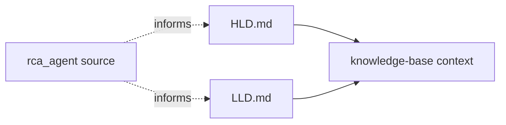

# knowledge-base Folder Specification

| Field | Value |
|-------|-------|
| Specification identifier | SPEC-knowledge-base |
| Repository-relative folder | `knowledge-base/` |
| Role | Documentation — authoritative high- and low-level design documents (HLD, LLD) and the folder-specification relationship map |
| Current commit | `2f4774f0476d5b47426ac1548c479f132c467332` |
| Generated/refreshed | 2026-11-03 |
| Status | Draft until maintainer review |
| Parent specification | [`../SPECS.md`](../SPECS.md) |

Authority notice: the source files, tests, and build definitions in this
repository remain authoritative. This specification is derived, bounded
evidence and must be reconciled with source on any conflict.

## 1. Intent and significance

This folder holds the project's maintained design documentation: the High-Level
Design (HLD) and Low-Level Design (LLD). These are human-authored knowledge
artifacts that describe the agent's intended architecture and detailed design,
and serve as primary knowledge-base context for spec-driven work. A `.gitkeep`
marker ensures the folder is tracked even when otherwise empty. It is a leaf
directory.

## 2. Scope and contents

- Direct files: 4. Immediate child folders: 0.
- [`HLD.md`](HLD.md) — High-Level Design.
- [`LLD.md`](LLD.md) — Low-Level Design.
- [`SPECS-RELATIONSHIP-MAP.md`](SPECS-RELATIONSHIP-MAP.md) — source-linked
  navigation and impact-analysis map of every project-owned folder
  specification (structural hierarchy + normalized declared dependency edges).
- [`.gitkeep`](.gitkeep) — placeholder keeping the folder tracked.
- Format: Markdown. The HLD/LLD here are project-owned (distinct from the
  AIDE-managed `.aide/full/scas/knowledge-base/` templates, which are out of
  scope).

## 3. Inputs

- Human authorship; may be informed by the source under
  [`../src/rca_agent/`](../src/rca_agent/SPECS.md) and the diagrams in
  [`../docs/`](../docs/SPECS.md).

## 4. Outputs

- Design knowledge consumed by readers and by spec-driven tooling as
  knowledge-base context. No runtime consumer.

## 5. Contracts and models

### 5.1 Behavioral contracts

- HLD describes the system at a high level; LLD describes detailed design.
- These documents are knowledge context; source and tests remain authoritative
  on any conflict (authority notice above).

### 5.2 Declared models and callable surface

Not applicable — documentation with no code symbols.

### 5.3 Required invariants

- The documents should reflect the current design; material divergence from
  source should be reconciled or flagged.

## 6. Interaction points

| Direction | Folder | Type |
|-----------|--------|------|
| Parent | [`../`](../SPECS.md) | containment |
| Outbound | [`../src/rca_agent/`](../src/rca_agent/SPECS.md) | subject matter described |
| Outbound | [`../docs/`](../docs/SPECS.md) | related diagrams |

## 7. Exception and error handling

Not applicable — documentation. Divergence from source is a reconciliation item,
not a runtime error.

## 8. Environment variables and configuration

None.

## 9. Storage, memory, and resource map

| Resource | Owner | Lifetime | Release |
|----------|-------|----------|---------|
| HLD/LLD Markdown | repository | persistent | edited in place |
| `.gitkeep` | repository | persistent | n/a |

## 10. Interaction diagram

## 11. Cross-cutting design considerations

- Documentation maintenance: keep HLD/LLD aligned with the implemented design.
- Knowledge provenance: these are project-owned docs, not generated OpenWiki.

## 12. Spec-driven development protocol

Future work must: (1) record the intended design change here or in the HLD/LLD;
(2) identify affected source specs; (3) keep the design docs consistent with the
implementation; (4) implement without silently diverging from the documented
design; (5) review for accuracy; (6) reconcile this spec.

Acceptance scenarios:

- SPEC-knowledge-base-AC1 (valid): Given a design change is implemented, When the
  HLD/LLD are updated, Then they describe the current design accurately.
- SPEC-knowledge-base-AC2 (invalid/divergence): Given the LLD contradicts the
  source, When reviewed, Then the divergence is flagged for reconciliation.
- SPEC-knowledge-base-AC3 (compatibility): Given a new component is added, When
  documented, Then the HLD reflects it at the appropriate level.
- SPEC-knowledge-base-AC4 (verification): Given a reader follows the LLD, When
  compared with the source, Then the described interfaces exist in the code.

## 13. Verification strategy

Human review comparing the HLD/LLD against the current source. No automated
checks apply; none were executed for this documentation task.

## 14. Evidence inventory

| File | Type | Bytes |
|------|------|-------|
| [`HLD.md`](HLD.md) | Markdown | ~31 KB |
| [`LLD.md`](LLD.md) | Markdown | ~33 KB |
| [`SPECS-RELATIONSHIP-MAP.md`](SPECS-RELATIONSHIP-MAP.md) | Markdown | ~38 KB (39,090) |
| [`.gitkeep`](.gitkeep) | marker | ~2 B |

## 15. Unknowns and review items

- The HLD/LLD contents were not read in this bounded scan; a maintainer should
  confirm they match the current source before this spec is marked reviewed.
- Confirm these project-owned documents are not confused with the AIDE-managed
  SCAS knowledge-base templates (which are excluded from this specification
  scope).
