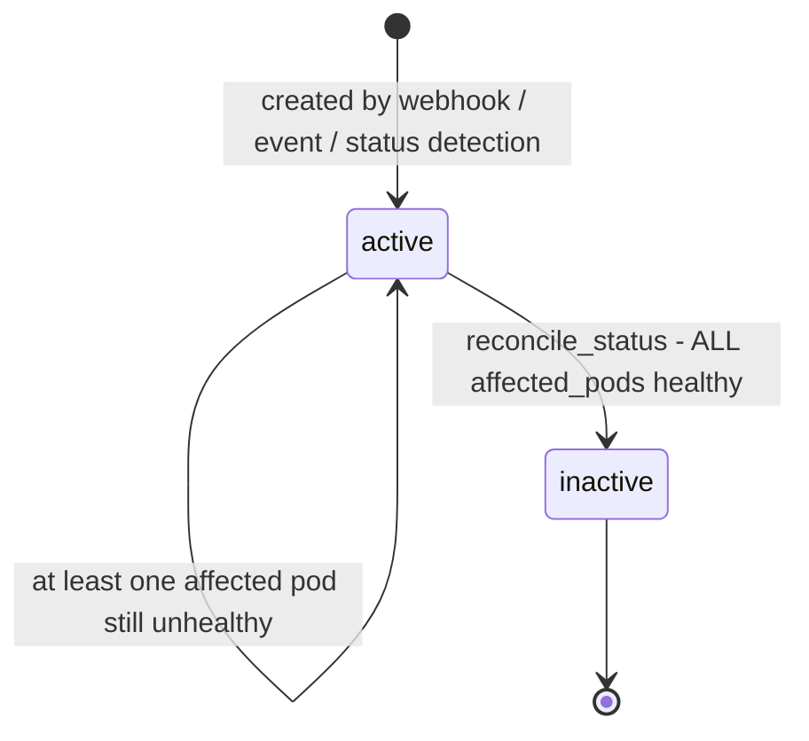

# Concept: Service Anchoring and the Incident Model

> Draft pending subject-matter expert (SME) review.

This page explains the agent's output shape and how a fault is attributed to a
stable entity rather than to a single short-lived pod. The schema lives in
`src/rca_agent/models/incident.py`; the input alert schema lives in
`src/rca_agent/models/alert.py`.

## The incident report schema

`IncidentReport` is the agent's complete output for one detected fault. Its
fields (from `src/rca_agent/models/incident.py`) include:

- `symptom`, `affected_resource`, `namespace`, `severity`, `detected_at` - what
  fired, where, and when.
- `hypotheses` - a list of candidate root causes.
- `blast_radius` and `upstream_unhealthy` - the impact side and the cause side
  of the graph walk (explained below).
- `evidence` - the structured evidence gathered deterministically.
- `suggested_next_steps` - runbook-derived guidance for a human.
- `reasoning_mode` - provenance: `extractive` or an LLM-rerank label.

Supporting schemas:

- `Hypothesis` - a candidate root cause with a `cause`, an `evidence_chain`
  (human-readable chain of reasoning), a `confidence` score from 0.0 to 1.0, and
  supporting evidence and citations.
- `Evidence` - one structured piece of evidence with a `category`
  (`pod_status`, `event`, `log`, `metric`, `change`, or `graph`), a summary, and
  citations.
- `Citation` - a pointer to the primary evidence behind a claim (a log line, a
  Prometheus Query Language (PromQL) query, a Kubernetes event, a runbook page,
  a graph node, or a change), optionally naming the actor who made a change.

## Service-anchored resolution

Introduced in version 0.7.0, the service-anchored model attributes a fault to a
stable entity instead of a transient pod. The anchor is resolved in priority
order: a fronting **service**, else the owning **workload** (Deployment), else
the **pod** itself. The affected pods behind that anchor are recorded in
`affected_pods`, and `affected_resource` stays set to the anchor's display name
for backward compatibility.

This resolution is implemented in the `graph_walk` step in
`src/rca_agent/reasoning/steps.py` (calling `anchor_of` and `pods_of_anchor` on
the graph) and verified by `tests/test_anchor_phase1.py`, which asserts that the
anchor prefers the service, falls back to the workload, then to the pod.

## Blast radius vs upstream causes

The two directions of the graph walk carry different meaning:

- `upstream_unhealthy` - resources this one depends on (via `calls` edges) that
  are themselves unhealthy. This is the **candidate-cause** side.
- `blast_radius` - affected downstream services. This is the **impact** side.

## The incident lifecycle

An incident is **created `active`** whichever way it is raised - an Alertmanager
webhook, the automatic event watcher, or status-based detection all produce an
`IncidentReport` with `status = "active"` (`src/rca_agent/models/incident.py`
defaults `status` to `"active"`).

Each poll cycle, `reconcile_status` in
`src/rca_agent/detection/event_watcher.py` checks every active incident and
flips it to **`inactive`** (setting `resolved_at`) only when the fault has fully
cleared. Recovery is **strict**: an incident becomes inactive only when
**every** pod in `affected_pods` is healthy again in the current graph. If any
one affected pod is still unhealthy, the incident stays active. A pod that has
disappeared from the graph (rolled out or deleted) counts as recovered, because
it is no longer a live fault signal (`_pod_is_unhealthy` returns `False` for a
missing node).

When an incident resolves, `reconcile_status` also clears the status-detection
latches for its pods (it discards each pod from `_status_incident_open` and
removes its `_unhealthy_streak` entry). This lets the same pod re-fire a fresh
incident if it breaks again, rather than staying silently latched as
already-reported.

## Anchor dedup versus correlation

The agent has two distinct mechanisms for grouping related faults, and they
operate on **different** relationships. Both live in
`src/rca_agent/detection/event_watcher.py`.

- **Anchor dedup (same anchor).** `_merge_into_open_anchor` merges sibling pods
  that share the **same** service or workload anchor into one open incident,
  extending its `affected_pods` instead of creating a duplicate. So 12 pods
  behind one Service all failing the same way become **one** anchored incident
  listing all 12 pods. It applies only to service/workload anchors; a
  pod-anchored incident (for example a bare Job) has no siblings to merge.
- **Correlation (different anchors).** `_correlate` links **different** anchors
  that share an identical failure *signature* - the top hypothesis text with
  the resource, anchor, and pod names blanked out - on a different resource
  within `incident_correlation_window_minutes`. Because same-anchor siblings are
  already merged by anchor dedup, correlation now links genuinely different
  services failing the same way, not double-counted siblings.

## Correlation is a pattern flag, not a claimed cause

`related_incidents` lists the other incidents correlation linked. The field
comment is explicit: this is a deterministic pattern flag, **not** a claimed
root cause. The graph has no NF-to-NF `calls` edges to name or verify a shared
upstream dependency, so correlation never changes a hypothesis's confidence and
never invents what the shared cause is. It exists so that, for example, "12 pods
failed identically at once" appears as one linked pattern instead of 12
unrelated-looking incidents, with a next-step note that explicitly tells the
reader to investigate shared dependencies by hand rather than treating the
pattern as a verified cause.

## Related pages

- [Concept: The Dependency Graph](concepts-dependency-graph.md)
- [Reasoning: Extractive Pipeline and LLM Rerank](reasoning-pipeline.md)
- [Workflow: Fault Detection](workflow-detection.md)
- [Request Lifecycle and Representation Transitions](request-lifecycle.md)
- [Glossary](glossary.md)
