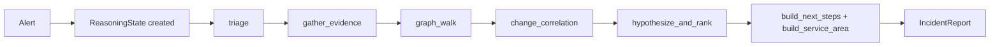

# Request Lifecycle and Representation Transitions

> Draft pending subject-matter expert (SME) review.

A single fault does not travel through the system as one unchanging object. It
is represented by three different objects in turn - an input `Alert`, a mutable
in-flight `ReasoningState`, and an output `IncidentReport` - and a different
component owns each one. Making those transitions explicit is the clearest way
to understand what the reasoning code is actually doing.

## The three representations

| Stage | Representation | Defined in | Role |
| --- | --- | --- | --- |
| Input | `Alert` | `src/rca_agent/models/alert.py` | the fault signal that triggered reasoning |
| In flight | `ReasoningState` | `src/rca_agent/reasoning/state.py` | mutable working memory for one incident |
| Output | `IncidentReport` | `src/rca_agent/models/incident.py` | the finished, ranked report |

## Stage 1 - the input Alert

An `Alert` arrives one of two ways: a client posts an Alertmanager payload to
`POST /webhook/alertmanager`, or the event watcher synthesizes an `Alert` from a
fault-signal Kubernetes event or a persistently-unhealthy pod. Either way the
`Alert` is the input representation.

`Alert.target` picks the affected resource from the alert's labels in a fixed
priority order - `pod`, then `deployment`, `statefulset`, `service`, `job`,
`instance` - and `Alert.name` reads `labels["alertname"]`
(`src/rca_agent/models/alert.py`). These derived values seed the next stage.

**Owner:** the webhook handler (`alertmanager_webhook` in
`src/rca_agent/webhook/app.py`) or the `EventWatcher` creates the `Alert`.

## Stage 2 - the in-flight ReasoningState

`ReasoningFlow.run` (`src/rca_agent/reasoning/flow.py`) hands the `Alert` to
`ExtractivePipeline.run` (`src/rca_agent/reasoning/extractive.py`). That method
creates **one** `ReasoningState`, seeding `affected_resource` from
`alert.target`, and threads that single state object through the six
deterministic steps in order:

Each step reads and mutates the same `ReasoningState`. Two transitions are worth
naming:

- `triage` (`src/rca_agent/reasoning/steps.py`) confirms
  `affected_resource = alert.target` and computes the change-correlation time
  window onto the state.
- `graph_walk` (`src/rca_agent/reasoning/steps.py`) resolves the stable anchor
  (`anchor_of`) and the pods behind it (`pods_of_anchor`) and writes
  `anchor_id`, `anchor_kind`, `anchor_display`, and `affected_pods` onto the
  state, plus the upstream candidate causes and downstream blast radius.

**Owner:** the `ExtractivePipeline` owns the `ReasoningState` for the duration
of one `run` call. It is working memory, not stored anywhere after the run.

## Stage 3 - the output IncidentReport

When the steps finish, `ExtractivePipeline._to_report`
(`src/rca_agent/reasoning/extractive.py`) builds a **new** `IncidentReport`,
copying the accumulated fields off the `ReasoningState`: the symptom
(`<alertname> on <resource>`), `affected_resource`, the anchor fields,
`affected_pods`, the ranked `hypotheses`, `blast_radius`, `upstream_unhealthy`,
`evidence`, `suggested_next_steps`, and `service_area`. It stamps
`reasoning_mode = "extractive"` and returns `report.ranked()`.

So the `ReasoningState` is not returned to the caller; it is the scaffolding
from which the final `IncidentReport` is assembled.

*Deployment-dependent:* when `reasoning_mode == "llm"`, `ReasoningFlow.run` then
passes this `IncidentReport` to the optional LLM rerank stage, which can reorder
and explain the existing hypotheses but cannot add or remove a cause. Whether
that stage runs at all depends on configuration and a reachable sidecar - see
[Reasoning: Extractive Pipeline and LLM Rerank](reasoning-pipeline.md).

## After the run - who keeps the report

The `IncidentReport` returned by `ReasoningFlow.run` is recorded into the shared
incident pool so the API and dashboard can serve it later:

- For a webhook alert, `alertmanager_webhook` filters to firing alerts, runs the
  flow per alert, and calls `record_external_incident(report)` for each
  (`src/rca_agent/webhook/app.py`).
- For an auto-detected fault, the event watcher stores the report through its
  internal `_store` path.

Both paths land the report in `EventWatcher.incidents`
(`src/rca_agent/detection/event_watcher.py`), so manual and auto-detected
incidents share one timeline and one correlation pool.

**Owner:** the `EventWatcher.incidents` pool owns the `IncidentReport` after it
is recorded. Its in-memory lifetime and bounds are described on the
[Concurrency, State Ownership, and Resource Lifetime](concurrency-state-ownership.md)
page.

## Related pages

- [Architecture and Components](architecture.md)
- [Reasoning: Extractive Pipeline and LLM Rerank](reasoning-pipeline.md)
- [Concept: Service Anchoring and the Incident Model](concepts-service-anchoring.md)
- [Workflow: Fault Detection](workflow-detection.md)
- [Concurrency, State Ownership, and Resource Lifetime](concurrency-state-ownership.md)
