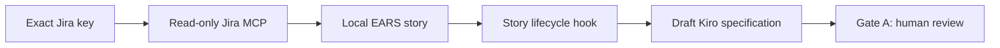

# Prompt Catalogue Specification

## Purpose

The `catalog/prompts/` directory contains reusable, repository-neutral Kiro
prompts. The installer copies these files to `prompt/` without executing
them. The prompts support architecture documentation, folder specifications,
OpenWiki, project steering, Jira-to-EARS intake, Kiro specification generation,
Neo4j knowledge ingestion, Graphiti semantic retrieval, and temporal-memory
verification. Shared-plane prompts also verify deterministic service,
interface, and event relationships across repositories.

## Required invariants

- Source code, tests, schemas, and current configuration remain authoritative.
- Prompts discover the target repository's languages, frameworks, topology, and
  domain before selecting examples or document sections.
- Prompts distinguish direct evidence, requested behavior, inference, graph
  leads, and unknowns.
- No prompt embeds credentials, private endpoints, machine-specific paths, or a
  target repository name.
- Jira intake reads only the exact issue requested by the user and never mutates
  Jira.
- Neo4j-only operations stay separate from Graphiti semantic operations.
- Graphiti validation begins with `spec_brain_graphiti_status`, requires
  read-only operation, and uses the reported project group.
- Ingestion prompts require an explicit write mode and a reviewed target.
  Sanity prompts remain read-only.
- Shared-plane records use project-prefixed repository IDs and plane-prefixed
  topology IDs. Cross-service edges require a reviewed descriptor.
- Specification generation stops at Gate A for human review and does not
  authorize implementation.
- Automated folder-specification and relationship-map prompts subtract paths
  recorded in `.aide/managed-files.json`, exclude the AIDE support plane, and
  resolve safe preservation choices without blocking the checkpointed workflow.
- OpenWiki is secondary navigation context; graph results never override current
  source or tests.

## Installed inventory

The directory contains 22 reusable prompts plus this specification:

- six repository documentation and steering prompts;
- three Jira, EARS, and Kiro specification prompts;
- three Neo4j/Graphiti setup, local-model configuration, and ingestion prompts;
- four Neo4j/Graphiti sanity, shared-plane, and temporal-memory prompts;
- two Azure CLI observability and plan-bound change prompts;
- two Kubernetes observability and plan-bound change prompts;
- one specification template; and
- one OpenWiki initialization prompt.

Ten concise launch prompts in `catalog/kiro-prompts/` are installed
separately under `.kiro/prompts/`.

## Lifecycle

For Jira-driven specification work:

For graph engineering, the packaged Spec Brain runtime can create
project-namespaced deterministic Neo4j records and Graphiti episodes when the
operator explicitly enables a write workflow. Related repositories can share
plane-scoped service, interface, event, and Graphiti identifiers while their
repository evidence remains project-scoped. Its workspace MCP surface is
read-only.

## Verification

- Validate every Markdown link and referenced installed path.
- Confirm the catalogue contains 22 prompt files besides `SPECS.md`.
- Confirm prompts and installed MCP templates contain no credentials or
  machine-specific absolute paths.
- Run the baseline installer suite to verify copying, ownership, idempotency,
  and full-to-minimal cleanup.
- Run the Spec Brain unit suite and Ruff checks without contacting live
  services.
