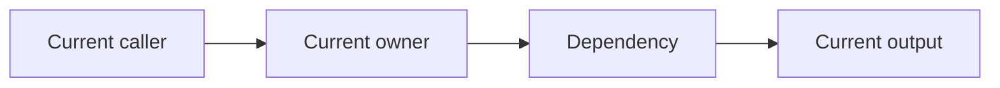
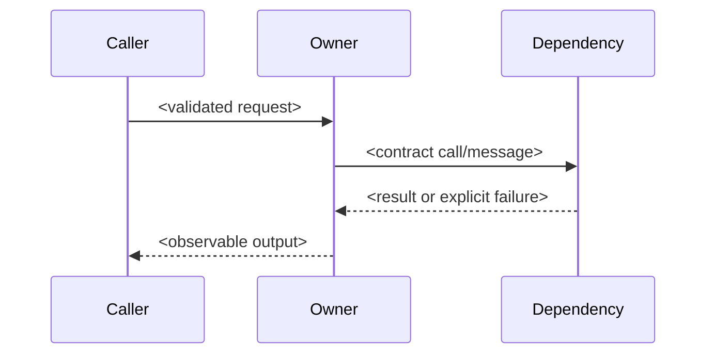

# Kiro Specification Template: Knowledge Base Primary, OpenWiki Secondary

Use this template when creating a Kiro specification for a feature, behavior
change, defect correction, interface change, operational change, or internal
refactoring in this repository.

The template deliberately separates three concepts:

1. **Intended behavior** comes from the user, approved requirements, and
   reviewed engineering decisions.
2. **Primary design context** comes from `knowledge-base/`, relevant folder
   `SPECS.md` files, and reviewed specifications.
3. **Secondary implementation navigation** comes from `openwiki/`; important
   statements discovered there must be verified in current source, schemas,
   build definitions, or focused tests.

Source and tests remain authoritative for what the current checkout actually
implements. The knowledge base is primary for architectural interpretation and
design intent. OpenWiki is secondary and must not become the sole evidence for
a normative requirement.

## How to use this template

1. Copy the specification body below into the Kiro specification location
   chosen by the repository, such as `.kiro/specs/<specification-slug>/`.
2. Replace every `<placeholder>`.
3. Delete sections that genuinely do not apply; do not write filler merely to
   keep every heading.
4. Preserve an explicit evidence label on important factual statements.
5. Split the completed material into Kiro `requirements.md`, `design.md`, and
   `tasks.md` files when that is the active workspace convention.
6. Keep unresolved questions visible. Never convert a missing fact into an
   assumption without documenting and approving the assumption.

## Evidence labels

Use these labels consistently:

| Label | Meaning | Can establish a normative requirement? |
|---|---|---|
| `[REQ]` | User, product, regulatory, or approved business requirement | Yes, when its owner and approval are recorded |
| `[DECISION]` | Reviewed engineering or architecture decision | Yes, within the approved scope |
| `[KB]` | Primary design context from `knowledge-base/` | Only after review; otherwise it remains draft context |
| `[FSPEC]` | Relevant folder-level `SPECS.md` contract | Only after review; generated specifications are drafts |
| `[SRC]` | Current source, schema, configuration, or build evidence | Establishes current implementation behavior |
| `[TEST]` | Focused test assertion and result | Establishes only the executed and asserted scenario |
| `[OW]` | Secondary discovery from `openwiki/` | No; verify material claims in source or tests |
| `[INFERENCE]` | Conclusion connecting multiple evidence items | No, unless reviewed and converted into a decision |
| `[ASSUMPTION]` | Temporary proposition adopted to make progress | Only when owner, risk, and validation date are recorded |
| `[UNKNOWN]` | Unresolved fact or missing evidence | No |

## Conflict-resolution rule

When artifacts disagree, do not silently merge them. Record the conflict in the
specification and apply this decision order:

```text
approved requirement or reviewed decision
    → current source, schemas, build definitions, and focused tests
        → reviewed knowledge-base and reviewed folder specifications
            → unreviewed knowledge-base and generated folder specifications
                → OpenWiki pages
                    → relationship-map summaries
```

Interpretation:

- Approved requirements and decisions establish the desired result.
- Source and focused tests establish the current result.
- A difference between desired and current behavior is the change to design and
  verify; it is not an error to hide.
- `knowledge-base/` is the primary architectural context for explaining the
  design and locating intended boundaries.
- `openwiki/` is a secondary implementation index. Use its source links to find
  evidence, then cite the underlying source or tests.
- The relationship map helps find impact but is not a runtime call graph.

---

# Specification: `<short specification title>`

## 0. Document control

| Field | Value |
|---|---|
| Specification ID | `<stable identifier, for example KSPEC-AREA-001>` |
| Status | `Draft / In Review / Approved / Implemented / Superseded` |
| Change type | `Feature / Defect / Contract / Refactoring / Operations / Documentation` |
| Owner | `<accountable human or team>` |
| Reviewers | `<architecture, module, test, security, operations, product>` |
| Created | `<YYYY-MM-DD>` |
| Last updated | `<YYYY-MM-DD>` |
| Target release | `<release, milestone, or not scheduled>` |
| Primary knowledge baseline | `<knowledge-base files and revision>` |
| Folder-specification baseline | `<relevant SPECS.md files and revision>` |
| Implementation baseline | `<commit or workspace revision>` |
| OpenWiki baseline | `<run timestamp/revision if useful; secondary only>` |
| Decision record | `<ADR or decision link, if applicable>` |

> **Authority statement:** `knowledge-base/` is the primary design context for
> this specification. `openwiki/` is secondary navigation. Current behavior is
> verified in source and focused tests. Desired behavior comes from approved
> requirements and recorded engineering decisions.

## 1. Executive summary

### 1.1 Intent

`[REQ]` `<In simple English, state the problem to solve and why it matters.>`

### 1.2 Desired outcome

`[REQ]` `<State the observable result after implementation.>`

### 1.3 Significance

`[KB]` `<Explain the affected architecture capability, system boundary, or
business/engineering value. Cite an exact knowledge-base path and section.>`

### 1.4 Success statement

The change is successful when `<observable result>` is produced for
`<supported inputs or scenarios>`, focused validation proves the acceptance
criteria, compatibility decisions are satisfied, and owned resources are
released on both success and failure.

## 2. Problem statement

### 2.1 Current behavior

Describe only verified current behavior:

- `[SRC]` `<Current behavior>` — `<path:line or symbol>`
- `[TEST]` `<Currently tested behavior>` — `<test path and test name>`
- `[OW]` `<OpenWiki discovery that led to the source>` — `<OpenWiki page>`;
  verified by `<source/test path>`

### 2.2 Problem or gap

`[REQ]` `<Describe the difference between current behavior and desired
behavior. Include affected users, operators, callers, or maintainers.>`

### 2.3 Evidence of the problem

| Evidence | Observation | Confidence | Limitation |
|---|---|---|---|
| `<issue, test, log, source, approved requirement>` | `<what it proves>` | `High/Medium/Low` | `<what it does not prove>` |

Do not include credentials, personal information, production payloads, or large
log/source extracts.

## 3. Goals and non-goals

### 3.1 Goals

- `[REQ]` `<Goal 1>`
- `[REQ]` `<Goal 2>`
- `[DECISION]` `<Engineering goal or constraint>`

### 3.2 Non-goals

- `<Explicitly excluded behavior, component, interface, deployment, migration,
  modernization, or optimization>`
- `<Adjacent problem intentionally deferred>`

### 3.3 Scope boundaries

| Boundary | In scope | Out of scope | Evidence/decision |
|---|---|---|---|
| Module | `<folders or packages>` | `<nearby folders>` | `<REQ/KB/FSPEC/DECISION>` |
| Interface | `<methods, messages, files, schemas>` | `<unchanged interfaces>` | `<evidence>` |
| Runtime topology | `<supported topology>` | `<unverified topology>` | `<evidence>` |
| Platform/model | `<supported set>` | `<not covered>` | `<evidence>` |

## 4. Primary knowledge-base context

Read the relevant knowledge-base artifacts before OpenWiki.

### 4.1 High-Level Design context

Source: `knowledge-base/HLD.md`

- `[KB]` Affected system boundary: `<section and concise interpretation>`
- `[KB]` Affected component responsibilities: `<section>`
- `[KB]` External actors or systems: `<section or UNKNOWN>`
- `[KB]` Quality attributes and constraints: `<section>`
- `[KB]` Relevant unresolved findings: `<section>`

### 4.2 Low-Level Design context

Source: `knowledge-base/LLD.md`

- `[KB]` Affected internal types/contracts: `<section>`
- `[KB]` Ownership and lifecycle: `<section>`
- `[KB]` Concurrency and process boundary: `<section>`
- `[KB]` Error and cleanup behavior: `<section>`
- `[KB]` Memory/cache/resource behavior: `<section>`
- `[KB]` Test seams: `<section>`

### 4.3 Specification relationship context

Source: `knowledge-base/SPECS-RELATIONSHIP-MAP.md`

| Relationship | Folder specification | Why it is relevant | Confirmed in source? |
|---|---|---|---|
| Owning scope | `<path>/SPECS.md` | `<ownership>` | `Yes/No/Not applicable` |
| Parent | `<path>/SPECS.md` | `<aggregate contract>` | `<result>` |
| Child | `<path>/SPECS.md` | `<delegated responsibility>` | `<result>` |
| Outbound dependency | `<path>/SPECS.md` | `<assumption consumed>` | `<result>` |
| Inbound consumer | `<path>/SPECS.md` | `<compatibility impact>` | `<result>` |

One-sided dependency declarations are review signals, not automatic defects.
Verify dynamic imports, registries, plugins, callbacks, generated bindings, and
deployment-only edges separately.

### 4.4 Knowledge-base review status

| Knowledge statement used | Draft or reviewed? | Reviewer/owner | Required action |
|---|---|---|---|
| `<statement>` | `<status>` | `<owner>` | `Use / Verify / Resolve before implementation` |

## 5. Secondary OpenWiki context

Start at `openwiki/index.md`, then read only pages relevant to the change.

| OpenWiki page | Discovery value | Underlying verification | Result |
|---|---|---|---|
| `openwiki/<page>.md` | `<flow, component, source path, terminology>` | `<source/test path>` | `Confirmed / Stale / Inferred / Unresolved` |

Rules:

- Never copy an OpenWiki statement into a normative requirement without
  verifying it.
- Prefer the source paths referenced by OpenWiki over the generated prose.
- If OpenWiki conflicts with current source, treat OpenWiki as stale and record
  the discrepancy.
- Do not hand-edit `openwiki/.claims/` or generated OpenWiki control files while
  authoring this specification.
- Do not run OpenWiki generation merely to complete this template unless that
  is a separately authorized task.

## 6. Current-state architecture

### 6.1 Components and responsibilities

| Component/folder | Current responsibility | Input | Output | Evidence |
|---|---|---|---|---|
| `<component>` | `<responsibility>` | `<input>` | `<output>` | `[SRC] <path>` |

### 6.2 Current flow

Use a diagram only when it clarifies at least three components or dependent
steps.



Describe each edge and label topology-dependent or inferred edges.

### 6.3 Current limitations

- `[SRC]` `<Implementation limitation>`
- `[TEST]` `<Verification gap>`
- `[UNKNOWN]` `<Deployment or ownership question>`

## 7. Functional requirements

Use observable, testable requirements. EARS means Easy Approach to Requirements
Syntax and can be used where helpful.

### REQ-001 — `<short requirement name>`

- **Statement:** `[REQ]` WHEN `<trigger>`, THE SYSTEM SHALL `<observable
  response>`.
- **Rationale:** `<why this is needed>`
- **Inputs:** `<values, types, ranges, source>`
- **Outputs:** `<values, types, ordering, destination>`
- **Preconditions:** `<required state>`
- **Postconditions:** `<state after success>`
- **Failure result:** `<exception, status, error body, return code, cleanup>`
- **Compatibility:** `<preserved or deliberately changed behavior>`
- **Evidence:** `<requirement or decision source>`
- **Verification:** `<test level and observable assertion>`

### REQ-002 — `<short requirement name>`

- **Statement:** `[REQ]` IF `<exceptional condition>`, THEN THE SYSTEM SHALL
  `<explicit failure and cleanup behavior>`.
- **Rationale:** `<why>`
- **Verification:** `<focused negative-path test>`

Repeat as needed. Each requirement must have a unique identifier and at least
one acceptance criterion or verification method.

## 8. Non-functional requirements

Include only applicable and measurable requirements.

| ID | Quality attribute | Requirement | Measurement/limit | Evidence/decision |
|---|---|---|---|---|
| NFR-001 | Correctness | `<requirement>` | `<assertion/invariant>` | `<source>` |
| NFR-002 | Performance | `<requirement>` | `<baseline and threshold>` | `<approved benchmark>` |
| NFR-003 | Reliability | `<requirement>` | `<failure/recovery condition>` | `<decision>` |
| NFR-004 | Security/privacy | `<requirement>` | `<validation/control>` | `<policy>` |
| NFR-005 | Operability | `<requirement>` | `<signal/runbook behavior>` | `<decision>` |

Do not invent a performance target or Service Level Objective (SLO). Record it
as `[UNKNOWN]` until an owner approves it.

## 9. Proposed design

### 9.1 Design summary

`[DECISION]` `<Describe the smallest design that satisfies the requirements and
fits the documented architecture.>`

### 9.2 Responsibility changes

| Component/folder | Current responsibility | Proposed responsibility | Why this owner? |
|---|---|---|---|
| `<component>` | `<current>` | `<proposed>` | `<KB/FSPEC/DECISION evidence>` |

### 9.3 Proposed flow



Mark new edges, unchanged edges, asynchronous boundaries, process boundaries,
and inferred deployment edges explicitly in the accompanying prose.

### 9.4 Design alternatives

| Alternative | Advantages | Disadvantages | Evidence | Decision |
|---|---|---|---|---|
| `<option>` | `<benefits>` | `<costs/risks>` | `<evidence>` | `Selected/Rejected/Deferred` |

Reject an alternative for a concrete contract, risk, complexity, evidence, or
scope reason—not merely preference.

## 10. Contracts and models

### 10.1 Interface contract

| Contract | Current | Proposed | Compatibility rule | Owner |
|---|---|---|---|---|
| Function/method | `<signature>` | `<signature>` | `<rule>` | `<folder>` |
| Message/schema | `<fields>` | `<fields>` | `<version/default>` | `<folder>` |
| File/artifact | `<format>` | `<format>` | `<reader/writer behavior>` | `<folder>` |
| Configuration | `<name/default>` | `<name/default>` | `<parser/fallback>` | `<folder>` |

### 10.2 Data model

For every changed field, record:

| Field | Type/shape | Required? | Default | Validation | Ownership/lifetime | Sensitive? |
|---|---|---|---|---|---|---|
| `<field>` | `<type>` | `<yes/no>` | `<value>` | `<rules>` | `<owner/release>` | `<classification>` |

### 10.3 Invariants

- INV-001: `<condition that must remain true>` — verified by `<test/evidence>`.
- INV-002: `<ownership, ordering, idempotency, compatibility, or resource
  invariant>` — verified by `<test/evidence>`.

## 11. Interaction and impact map

### 11.1 Affected folder specifications

| Folder specification | Impact | Required spec change | Verification owner |
|---|---|---|---|
| `<path>/SPECS.md` | `Owner / Producer / Consumer / Parent / Child / Test` | `<change>` | `<owner>` |

### 11.2 External interfaces

| Interface/system | Direction | Contract | Change | Evidence/status |
|---|---|---|---|---|
| `<API, file, queue, service, plugin>` | `Inbound/Outbound` | `<contract>` | `<none/change>` | `<confirmed/unknown>` |

Do not invent an external interface because an architecture diagram has an
unresolved boundary.

## 12. Exception and error handling

| Failure point | Trigger | Detection | External result | Cleanup | Retry/idempotency | Verification |
|---|---|---|---|---|---|---|
| `<stage>` | `<condition>` | `<exception/status>` | `<observable result>` | `<owned resources>` | `<rule>` | `<test>` |

State:

- which layer validates each input;
- which layer translates internal errors into public results;
- whether original diagnostic context is preserved;
- what happens to partial state;
- how cancellation is propagated;
- how waiting tasks, futures, collectors, or queues are completed on failure;
- whether rollback, retry, or idempotency exists; and
- what remains unresolved.

## 13. Environment variables and configuration

| Name | Owner/parser | Type | Default | Validation | Security impact | Test |
|---|---|---|---|---|---|---|
| `<exact name>` | `<path/symbol>` | `<type>` | `<default>` | `<rules>` | `<impact>` | `<test>` |

If none are used, write: “No new or changed environment-variable dependency is
introduced by this specification.” Do not copy secret values.

## 14. Memory, cache, concurrency, and resource map

| Resource | Address space/device | Owner | Allocation | Lifetime | Release on success | Release on failure | Bound |
|---|---|---|---|---|---|---|---|
| `<object/tensor/cache/task/socket/file>` | `<process/device>` | `<owner>` | `<where>` | `<scope>` | `<path>` | `<path>` | `<size/count/timeout>` |

Document as applicable:

- copy versus shared ownership;
- mutable versus immutable state;
- process and thread boundaries;
- event-loop ownership;
- locks, queues, futures, tasks, streams, and cancellation;
- host/device transfers and synchronization;
- cache keys, validity, eviction, reset, and reference release;
- file or socket lifecycle;
- backpressure and bounded/unbounded queues; and
- cleanup during initialization failure and shutdown.

## 15. Security, privacy, and data handling

- Input trust boundary: `<boundary>`
- Validation and sanitization: `<controls>`
- Authentication/authorization impact: `<none or change>`
- Secret handling: `<none or controls>`
- Personal/production data handling: `<none or controls>`
- Logging and observability exposure: `<controls>`
- Supply-chain/plugin impact: `<none or review>`

Use the repository security instructions when this section is in scope.

## 16. Compatibility and migration

| Surface | Existing consumers | Compatibility decision | Migration/deprecation | Verification |
|---|---|---|---|---|
| `<API/schema/config/file/model behavior>` | `<consumers>` | `<preserve/version/break>` | `<plan>` | `<tests>` |

Explicitly cover defaults, serialization, ordering, error types, registry keys,
command-line options, environment variables, model/platform variants, and
public symbols when applicable.

If no migration is required, explain why existing stored or in-flight state is
unaffected.

## 17. Acceptance criteria

Write acceptance criteria in observable Given/When/Then form.

### AC-001 — Normal path

- **Given** `<valid initial state and input>`
- **When** `<action>`
- **Then** `<observable result and state>`
- **Evidence:** `<REQ/DECISION>`
- **Verification:** `<test name or level>`

### AC-002 — Invalid input

- **Given** `<invalid input>`
- **When** `<action>`
- **Then** `<explicit error, no invalid state, cleanup>`

### AC-003 — Dependency failure or cancellation

- **Given** `<failure/cancellation timing>`
- **When** `<action>`
- **Then** `<propagation, terminal result, cleanup>`

### AC-004 — Compatibility

- **Given** `<existing supported consumer or artifact>`
- **When** `<new implementation is used>`
- **Then** `<preserved or deliberately versioned behavior>`

## 18. Verification strategy

Answer these questions before defining tasks:

1. What responsibility is changing?
2. What are its input and output contracts?
3. What failure or regression must the test catch?
4. What is the cheapest level that proves it: unit, integration, end-to-end,
   model evaluation, benchmark, or manual operational verification?

| Requirement/invariant | Test location | Level | Setup | Assertion | Negative path | Command |
|---|---|---|---|---|---|---|
| `<ID>` | `<existing preferred file>` | `<level>` | `<minimal setup>` | `<observable outcome>` | `<failure>` | `<approved command>` |

Reuse nearby test files, fixtures, and helpers before creating new ones. Do not
claim validation was run until the exact command and result are recorded.

### Validation record

| Command/evaluation | Result | Environment | Date | Notes |
|---|---|---|---|---|
| `<command>` | `Not run / Pass / Fail` | `<platform/model>` | `<date>` | `<diagnostic or limitation>` |

## 19. Implementation task plan

Each task must trace to at least one requirement or invariant.

- [ ] **TASK-001 — Update intended contracts**
  - Requirements: `<IDs>`
  - Files: `<knowledge-base, reviewed spec, affected SPECS.md>`
  - Completion evidence: `<review approval>`
- [ ] **TASK-002 — Add or update focused verification**
  - Requirements: `<IDs>`
  - Files: `<test files>`
  - Completion evidence: `<failing-before/passing-after or approved method>`
- [ ] **TASK-003 — Implement the smallest source change**
  - Requirements: `<IDs>`
  - Files: `<source files>`
  - Completion evidence: `<focused validation>`
- [ ] **TASK-004 — Reconcile documentation and specifications**
  - Requirements: `<IDs>`
  - Files: `<affected specs/docs>`
  - Completion evidence: `<links, identifiers, relationship map, review>`
- [ ] **TASK-005 — Run final scoped validation**
  - Requirements: `<IDs>`
  - Commands: `<commands>`
  - Completion evidence: `<results>`

Do not make “refresh OpenWiki” an automatic implementation task unless the
repository workflow or user explicitly requires it. OpenWiki has its own
managed lifecycle.

## 20. Risks, assumptions, and unresolved questions

### 20.1 Risks

| ID | Risk | Likelihood | Impact | Mitigation | Owner |
|---|---|---|---|---|---|
| RISK-001 | `<risk>` | `<L/M/H>` | `<L/M/H>` | `<mitigation>` | `<owner>` |

### 20.2 Assumptions

| ID | Assumption | Evidence | Risk if false | Owner | Validate by |
|---|---|---|---|---|---|
| ASM-001 | `<assumption>` | `<evidence or none>` | `<impact>` | `<owner>` | `<date/milestone>` |

### 20.3 Unresolved questions

| ID | Question | Why it matters | Evidence checked | Decision owner | Blocks implementation? |
|---|---|---|---|---|---|
| Q-001 | `<question>` | `<impact>` | `<KB/OW/source/tests>` | `<owner>` | `Yes/No` |

## 21. Traceability matrix

| Requirement | Design section | Source task | Test/verification | Affected specification | Status |
|---|---|---|---|---|---|
| REQ-001 | `<section>` | TASK-003 | `<test>` | `<SPECS.md>` | `Draft` |

No normative requirement should be left without a design owner and verification
method. No implementation task should exist without a requirement, invariant,
defect reproduction, or approved operational need.

## 22. Review and approval

| Review | Reviewer | Result | Date | Notes |
|---|---|---|---|---|
| Requirement owner | `<name/team>` | `Pending/Approved/Changes requested` | `<date>` | `<notes>` |
| Architecture | `<name/team>` | `<result>` | `<date>` | `<notes>` |
| Module owner | `<name/team>` | `<result>` | `<date>` | `<notes>` |
| Test/quality | `<name/team>` | `<result>` | `<date>` | `<notes>` |
| Security/operations | `<if applicable>` | `<result>` | `<date>` | `<notes>` |

Approval means reviewers understand the requirement, design, affected
contracts, failure behavior, resources, compatibility, and verification plan.
It does not mean generated drafts override contradictory source without an
explicit implementation task.

## 23. Completion checklist

- [ ] User requirement and decision owner are recorded.
- [ ] Relevant HLD and LLD sections were read first.
- [ ] Owning and affected folder specifications were identified.
- [ ] OpenWiki was used only as secondary navigation.
- [ ] Every material OpenWiki discovery was verified in source or focused tests.
- [ ] Current behavior and desired behavior are separated.
- [ ] Direct evidence, inference, assumptions, and unknowns are labelled.
- [ ] Inputs, outputs, contracts, models, and interaction points are documented.
- [ ] Normal, invalid, failure, cancellation, and shutdown behavior is covered as
  applicable.
- [ ] Environment/configuration changes are explicit.
- [ ] Memory, cache, concurrency, and resource ownership are explicit.
- [ ] Compatibility and migration decisions are explicit.
- [ ] Acceptance criteria are observable and traceable.
- [ ] Verification uses the narrowest sufficient test level.
- [ ] Affected specifications and relationship declarations will be reconciled.
- [ ] Required human reviews are complete.
- [ ] No secret, credential, personal data, production record, or large source
  block is reproduced.

---

## Optional Kiro instruction wrapper

Paste the following instruction above a copy of the template when asking Kiro
to create a specification:

> Create a Kiro specification for `<requested change>`. Treat `knowledge-base/`
> as the primary architectural and design context. Read the relevant HLD, LLD,
> relationship-map, and folder `SPECS.md` sections before consulting OpenWiki.
> Use `openwiki/index.md` and relevant pages only as secondary discovery aids,
> and verify every material OpenWiki statement against current source, schemas,
> build definitions, or focused tests. Separate current behavior from desired
> behavior. Label direct evidence, inference, assumptions, conflicts, and
> unresolved questions. Do not invent contracts, runtime flows, deployment
> details, environment variables, interfaces, business rules, or customer
> behavior. Produce requirements, design, tasks, acceptance criteria,
> traceability, failure behavior, resource ownership, compatibility analysis,
> and a verification plan using the template below. Do not implement the change
> until the specification is reviewed and implementation is explicitly
> requested.

