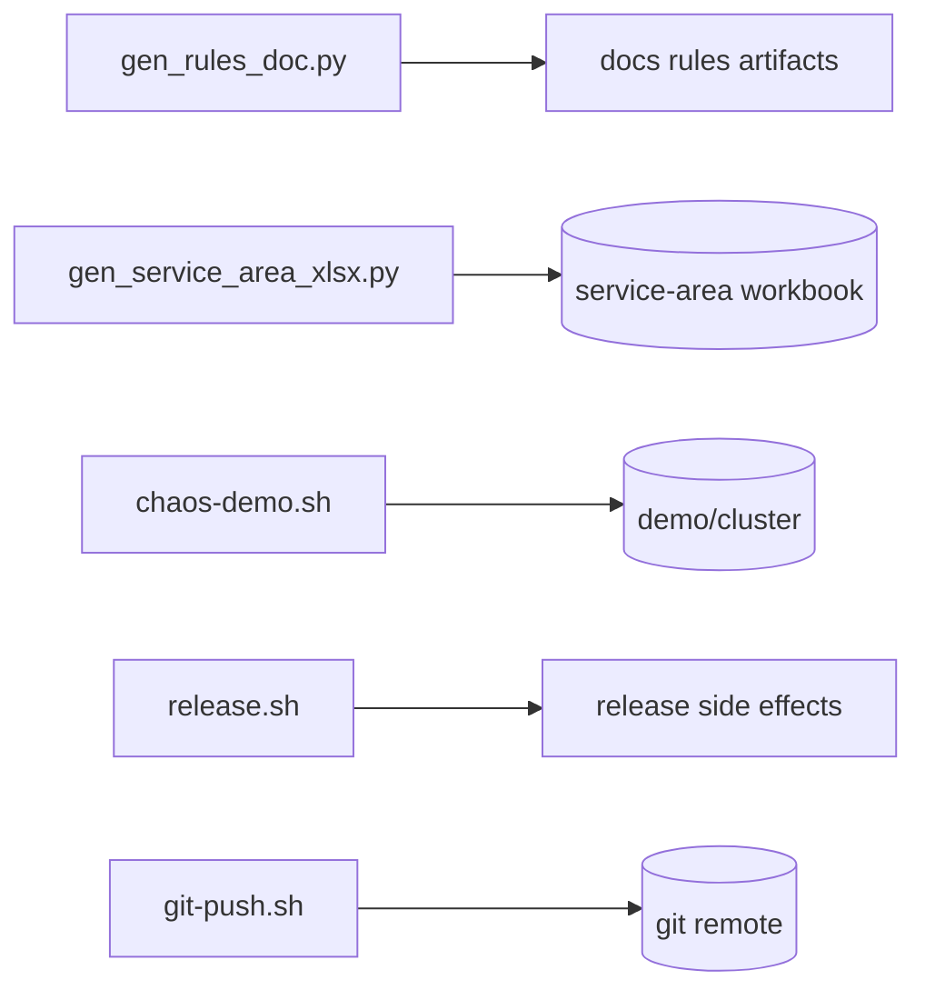

# scripts Folder Specification

| Field | Value |
|-------|-------|
| Specification identifier | SPEC-scripts |
| Repository-relative folder | `scripts/` |
| Role | Workflow / automation — developer and demo helper scripts (release, git push, chaos demo, doc/data generators) |
| Current commit | `2f4774f0476d5b47426ac1548c479f132c467332` |
| Generated/refreshed | 2026-11-03 |
| Status | Draft until maintainer review |
| Parent specification | [`../SPECS.md`](../SPECS.md) |

Authority notice: the source files, tests, and build definitions in this
repository remain authoritative. This specification is derived, bounded
evidence and must be reconciled with source on any conflict.

## 1. Intent and significance

This folder holds developer and demonstration automation that is not part of the
runtime service: release automation, a git push helper, a chaos/fault-injection
demo, and generators for the reasoning-rules document and the service-area
spreadsheet. These support development, demos, and artifact generation. It is a
leaf directory.

## 2. Scope and contents

- Direct files: 6. Immediate child folders: 0.
- [`release.sh`](release.sh) — release automation (Bash).
- [`git-push.sh`](git-push.sh) — git push helper (Bash).
- [`chaos-demo.sh`](chaos-demo.sh) — chaos/fault-injection demo (Bash).
- [`CHAOS-DEMO.md`](CHAOS-DEMO.md) — chaos demo documentation.
- [`gen_rules_doc.py`](gen_rules_doc.py) — generates the reasoning-rules document.
- [`gen_service_area_xlsx.py`](gen_service_area_xlsx.py) — generates a
  service-area spreadsheet.

## 3. Inputs

- Shell/environment and repository state (for `release.sh`, `git-push.sh`).
- Cluster/demo targets for `chaos-demo.sh` (operator-driven).
- Source rules / mapping data for the Python generators.

## 4. Outputs

- Release and git side effects (operator-run).
- A chaos demo run against a demo/cluster environment.
- Generated documents/spreadsheets (e.g. under [`../docs/`](../docs/SPECS.md)
  and data workbooks).

## 5. Contracts and models

### 5.1 Behavioral contracts

- Scripts are invoked manually by developers/operators; they are not imported by
  the runtime package.
- The Python generators produce documentation/data artifacts from source inputs.

### 5.2 Declared models and callable surface

| Symbol | Kind | Source |
|--------|------|--------|
| release automation | shell script | [`release.sh`](release.sh) |
| git push helper | shell script | [`git-push.sh`](git-push.sh) |
| chaos demo | shell script | [`chaos-demo.sh`](chaos-demo.sh) |
| rules-doc generator | Python script | [`gen_rules_doc.py`](gen_rules_doc.py) |
| service-area xlsx generator | Python script | [`gen_service_area_xlsx.py`](gen_service_area_xlsx.py) |

### 5.3 Required invariants

- Scripts must not be required by the runtime service to function.
- Any cluster-affecting script (`chaos-demo.sh`, parts of `release.sh`) is an
  operator-run action and must preserve the project's safety expectations.

## 6. Interaction points

| Direction | Folder | Type |
|-----------|--------|------|
| Parent | [`../`](../SPECS.md) | containment |
| Outbound | [`../docs/`](../docs/SPECS.md) | generated rules documentation target |
| Outbound | [`../src/rca_agent/`](../src/rca_agent/SPECS.md) | generators may read app rules/data (verify) |

## 7. Exception and error handling

Bash scripts' error handling (e.g. `set -euo pipefail`) and the generators'
error paths were not read in this bounded scan. `git-push.sh` and `release.sh`
perform git/release operations; per repository git policy, git operations are
run through Git Bash and destructive operations require explicit permission.

## 8. Environment variables and configuration

Not enumerated in this bounded scan. Scripts likely read shell environment and
repository configuration; confirm per script.

## 9. Storage, memory, and resource map

| Resource | Owner | Lifetime | Release |
|----------|-------|----------|---------|
| Generated documents/spreadsheets | generators | persistent | overwritten on regen |
| Git/release side effects | shell scripts | operator action | n/a |
| Demo cluster resources | `chaos-demo.sh` | demo lifetime | operator cleanup |

## 10. Interaction diagram

## 11. Cross-cutting design considerations

- Safety: cluster- and git-affecting scripts are high-impact and operator-run;
  they must be reviewed before execution.
- Maintainability: generators keep documentation/data artifacts reproducible.
- Separation: these scripts are outside the runtime service boundary.

## 12. Spec-driven development protocol

Future work must: (1) record any script behavior change here; (2) identify
affected docs/app specs for generators; (3) validate the script runs safely in a
non-destructive mode first; (4) implement preserving safety for cluster/git
actions; (5) run or dry-run the script; (6) reconcile this spec.

Acceptance scenarios:

- SPEC-scripts-AC1 (valid): Given `gen_rules_doc.py` runs, When it completes,
  Then the reasoning-rules document artifact is produced.
- SPEC-scripts-AC2 (invalid/safety): Given a destructive git operation, When
  requested, Then it requires explicit permission per repository git policy.
- SPEC-scripts-AC3 (compatibility): Given the app rules change, When the
  generator re-runs, Then the generated document reflects the new rules.
- SPEC-scripts-AC4 (verification): Given `gen_service_area_xlsx.py` runs, When
  it completes, Then a valid workbook is written.

## 13. Verification strategy

Run each generator and confirm the output artifact; dry-run shell scripts before
real execution. No checks were executed for this documentation task.

## 14. Evidence inventory

| File | Type | Bytes |
|------|------|-------|
| [`release.sh`](release.sh) | Bash | ~6.0 KB |
| [`git-push.sh`](git-push.sh) | Bash | ~5.5 KB |
| [`chaos-demo.sh`](chaos-demo.sh) | Bash | ~8.4 KB |
| [`CHAOS-DEMO.md`](CHAOS-DEMO.md) | Markdown | ~2.9 KB |
| [`gen_rules_doc.py`](gen_rules_doc.py) | Python | ~10.9 KB |
| [`gen_service_area_xlsx.py`](gen_service_area_xlsx.py) | Python | ~7.2 KB |

## 15. Unknowns and review items

- None of these scripts were read in full in this bounded scan; their exact
  inputs, outputs, environment variables, and (for `chaos-demo.sh`/`release.sh`)
  any mutating operations need a complete read before this spec is marked
  reviewed.
- Confirm which generator outputs correspond to the committed artifacts in
  [`../docs/`](../docs/SPECS.md) and the root data workbooks.
