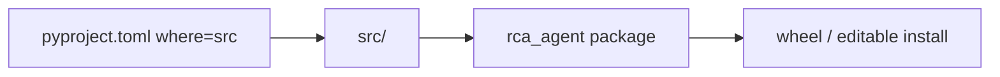

# src Folder Specification

| Field | Value |
|-------|-------|
| Specification identifier | SPEC-src |
| Repository-relative folder | `src/` |
| Role | Source root — the `src`-layout package container for the application |
| Current commit | `2f4774f0476d5b47426ac1548c479f132c467332` |
| Generated/refreshed | 2026-11-03 |
| Status | Draft until maintainer review |
| Parent specification | [`../SPECS.md`](../SPECS.md) |

Authority notice: the source files, tests, and build definitions in this
repository remain authoritative. This specification is derived, bounded
evidence and must be reconciled with source on any conflict.

## 1. Intent and significance

This folder is the `src`-layout source root. It exists so the installable
package (`rca_agent`) is importable only after installation rather than from the
checkout root, which is the convention declared in
[`../pyproject.toml`](../pyproject.toml) (`[tool.setuptools.packages.find]
where = ["src"]`, and `pythonpath = ["src"]` for pytest). It is a pure
aggregation/ancestor boundary holding one package.

## 2. Scope and contents

- Direct files: 0 project-owned. Immediate child folders: 1 in scope
  (`rca_agent/`).
- [`rca_agent/`](rca_agent/SPECS.md) — the application package.
- `src/k8s_rca_agent.egg-info/` exists as generated editable-install metadata and
  is excluded from the specification scope (generated build output).

## 3. Inputs

- None directly. The build system treats `src/` as the package search root.

## 4. Outputs

- None directly. It exposes the `rca_agent` package to the build/install and to
  tests via `pythonpath`.

## 5. Contracts and models

### 5.1 Behavioral contracts

- `src/` is the declared package root; `rca_agent` is discovered beneath it.

### 5.2 Declared models and callable surface

Not applicable — this folder declares no symbols. Its contract is the
`src`-layout convention wired in [`../pyproject.toml`](../pyproject.toml).

### 5.3 Required invariants

- The package stays under `src/rca_agent/` to match `packages.find where`.

## 6. Interaction points

| Direction | Folder | Type |
|-----------|--------|------|
| Parent | [`../`](../SPECS.md) | containment |
| Child | [`rca_agent/`](rca_agent/SPECS.md) | ownership |
| Inbound | [`../pyproject.toml`](../pyproject.toml) | build/test path config |
| Inbound | [`../tests/`](../tests/SPECS.md) | import target via `pythonpath` |

## 7. Exception and error handling

Not applicable — a container folder with no logic.

## 8. Environment variables and configuration

None. Build/test tooling resolves this path via `pyproject.toml`.

## 9. Storage, memory, and resource map

| Resource | Owner | Lifetime | Release |
|----------|-------|----------|---------|
| Package source tree | repository | persistent | n/a |

## 10. Interaction diagram

## 11. Cross-cutting design considerations

- Packaging: `src`-layout avoids accidental imports of the uninstalled package
  from the repository root.

## 12. Spec-driven development protocol

Future work must: (1) record any change to the source layout here; (2) identify
the affected root and `rca_agent` specs; (3) confirm the build still discovers
the package; (4) implement without breaking `src`-layout; (5) run `make check`;
(6) reconcile this spec.

Acceptance scenarios:

- SPEC-src-AC1 (valid): Given the `src`-layout, When the package is installed,
  Then `rca_agent` is importable from the environment.
- SPEC-src-AC2 (invalid): Given a module is placed outside `src/`, When the
  build runs, Then it is not discovered by `packages.find`.
- SPEC-src-AC3 (compatibility): Given tests run, When `pythonpath=["src"]` is
  honored, Then `rca_agent` imports without an editable install.
- SPEC-src-AC4 (verification): Given `make check`, When it runs, Then the suite
  imports the package from `src/`.

## 13. Verification strategy

Verified implicitly by any successful build/install and by the pytest
configuration in [`../pyproject.toml`](../pyproject.toml). No checks were
executed for this documentation task.

## 14. Evidence inventory

| File | Type | Bytes |
|------|------|-------|
| (no direct project-owned files) | — | — |

The only direct child in scope is [`rca_agent/`](rca_agent/SPECS.md).

## 15. Unknowns and review items

- `src/k8s_rca_agent.egg-info/` is generated editable-install metadata and is
  excluded; confirm it is not tracked long-term if the maintainer prefers it
  removed from the working tree.
