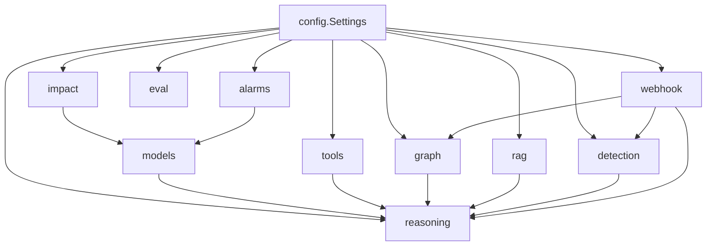

# src/rca_agent Folder Specification

| Field | Value |
|-------|-------|
| Specification identifier | SPEC-src-rca_agent |
| Repository-relative folder | `src/rca_agent/` |
| Role | Production runtime — the `rca_agent` Python package (application root), plus shared settings |
| Current commit | `2f4774f0476d5b47426ac1548c479f132c467332` |
| Generated/refreshed | 2026-11-03 (section 8 + contents reflect the incident-persistence-postgres feature) |
| Status | Draft until maintainer review |
| Parent specification | [`../SPECS.md`](../SPECS.md) |

Authority notice: the source files, tests, and build definitions in this
repository remain authoritative. This specification is derived, bounded
evidence and must be reconciled with source on any conflict.

## 1. Intent and significance

This folder is the installable Python package for the read-only Kubernetes
fault detection and root-cause agent. It owns the application version, the
env-driven settings module, and the ten runtime sub-packages that implement
the `detect → gather evidence → reason → report` pipeline (plus a durable
PostgreSQL datastore). It is an aggregation boundary; each child folder refines
a stage of the contract.

## 2. Scope and contents

- Direct files: 2 Python files. Immediate child folders: 10.
- [`__init__.py`](__init__.py) — package docstring and `__version__` (`0.10.1`).
- [`config.py`](config.py) — `Settings` (Pydantic-settings, `RCA_` prefix) and
  cached `get_settings()`.
- Child folders: [`alarms/`](alarms/SPECS.md), [`detection/`](detection/SPECS.md),
  [`eval/`](eval/SPECS.md), [`graph/`](graph/SPECS.md),
  [`impact/`](impact/SPECS.md), [`models/`](models/SPECS.md),
  [`rag/`](rag/SPECS.md), [`reasoning/`](reasoning/SPECS.md),
  [`store/`](store/SPECS.md), [`tools/`](tools/SPECS.md),
  [`webhook/`](webhook/SPECS.md).

## 3. Inputs

- Environment variables (`RCA_*`) and an optional `.env` file, read by
  `Settings`.
- HTTP requests and Kubernetes/Prometheus data, routed through child folders.

## 4. Outputs

- A cached `Settings` object shared across the package.
- `__version__` consumed by the webhook app.
- The assembled application behavior delivered via [`webhook/`](webhook/SPECS.md).

## 5. Contracts and models

### 5.1 Behavioral contracts

- All configuration is read from `RCA_`-prefixed env vars or `.env`; defaults run
  the agent out-of-the-box in no-LLM extractive mode without a cluster
  (`cluster_enabled=False`, `reasoning_mode="extractive"`).
- `get_settings()` is `lru_cache`d — one `Settings` instance per process.

### 5.2 Declared models and callable surface

| Symbol | Kind | Source |
|--------|------|--------|
| `__version__` | constant | [`__init__.py`](__init__.py) |
| `Settings` | pydantic-settings model | [`config.py`](config.py) |
| `get_settings` | cached factory | [`config.py`](config.py) |

`Settings` groups: service, persistence (PostgreSQL datastore), reasoning mode,
cluster access, graph, event watcher, status detection, incident correlation,
evidence gathering, RAG, LLM, and incident capture (see Section 8).

### 5.3 Required invariants

- Safe-by-default: unset configuration yields a runnable, cluster-free,
  LLM-free agent.
- The package never provides a Kubernetes write capability (enforced across
  child folders and by RBAC in [`../../deploy/helm/`](../../deploy/helm/SPECS.md)).

## 6. Interaction points

| Direction | Folder | Type |
|-----------|--------|------|
| Parent | [`../`](../SPECS.md) | containment |
| Children | all 10 sub-packages (incl. [`alarms/`](alarms/SPECS.md), [`store/`](store/SPECS.md)) | ownership |
| Inbound | [`../../tests/`](../../tests/SPECS.md) | imports package modules |
| Inbound | [`../../docker/`](../../docker/SPECS.md), [`../../deploy/helm/`](../../deploy/helm/SPECS.md) | run `webhook.app:app` |

`store/` is the durable PostgreSQL datastore added by the
incident-persistence-postgres feature; it reads `database_url` from
`config.Settings` and is wired into detection, rag, and webhook (see
[`store/SPECS.md`](store/SPECS.md)).

`alarms/` is the scoped potential-alarms feature added by the potential-alarms
feature; it is a leaf consumed inward exactly like `impact/`, reading
`pod_alarm_map_path` from `config.Settings` (via the caller) and surfaced through
`models`, `reasoning`, and `webhook` (see [`alarms/SPECS.md`](alarms/SPECS.md)).

`config.Settings` is imported by nearly every child folder (verified via the
`from rca_agent.config import` imports in graph, tools, detection, reasoning,
rag, impact, eval, webhook).

## 7. Exception and error handling

`Settings` validation errors are raised by pydantic-settings when env values
fail type coercion (inferred from pydantic-settings). Per-stage error handling
lives in the child folders. `extra="ignore"` means unknown env vars are
tolerated.

## 8. Environment variables and configuration

Direct evidence from [`config.py`](config.py) (prefix `RCA_`; defaults shown):

| Variable | Purpose | Default |
|----------|---------|---------|
| `RCA_APP_NAME` / `RCA_HOST` / `RCA_PORT` / `RCA_LOG_LEVEL` | service | `k8s-rca-agent` / `0.0.0.0` / `8080` / `INFO` |
| `RCA_DATABASE_URL` | durable PostgreSQL datastore connection string (mandatory at runtime, D1; sourced from a Secret) | unset (`None`) |
| `RCA_REASONING_MODE` | extractive vs llm | `extractive` |
| `RCA_CLUSTER_ENABLED` / `RCA_KUBECONFIG_MODE` / `RCA_NAMESPACE` / `RCA_NF_SELECTOR` | cluster access | `False` / `auto` / `open5gs` / `""` |
| `RCA_GRAPH_REBUILD_INTERVAL_SECONDS` / `RCA_GRAPH_HISTORY_WINDOW_MINUTES` | graph | `60` / `120` |
| `RCA_EVENT_WATCH_ENABLED` / `_INTERVAL_SECONDS` / `RCA_EVENT_MAX_AGE_MINUTES` | event watcher | `True` / `15` / `90` |
| `RCA_STATUS_DETECTION_ENABLED` / `RCA_STATUS_UNHEALTHY_REBUILDS` | status detection | `True` / `2` |
| `RCA_INCIDENT_CORRELATION_WINDOW_MINUTES` | correlation | `10` |
| `RCA_LOG_TAIL_LINES` / `RCA_CHANGE_CORRELATION_WINDOW_MINUTES` / `RCA_PROMETHEUS_URL` | evidence | `200` / `15` / unset |
| `RCA_RUNBOOK_RAG_URL` / `_TOP_K` / `RCA_RUNBOOK_STORE_PATH` / `_ASSET_DIR` | runbook RAG | unset / `3` / `/tmp/runbooks/store.json` / `/tmp/runbooks/assets` |
| `RCA_RUNBOOK_RAG_SEMANTIC` / `_EMBED_MODEL` | semantic RAG | `False` / `BAAI/bge-small-en-v1.5` |
| `RCA_SERVICE_AREA_MAP_PATH` | service-area impact | unset |
| `RCA_RUNBOOK_QUERY_LOG_MAX_ENTRIES` | query log | `1000` |
| `RCA_LLM_PROVIDER` / `_MODEL` / `_BASE_URL` / `_TIMEOUT_SECONDS` / `_MAX_TOKENS` / `_TEMPERATURE` | LLM sidecar | `none` / `qwen2.5-1.5b-instruct` / `http://127.0.0.1:8090` / `30.0` / `512` / `0.1` |
| `RCA_INCIDENT_CAPTURE_PATH` / `_REDACT_LOGS` / `_INCLUDE_GRAPH` / `_MAX_RECORDS` / `_GRAPH_RADIUS` | capture | unset / `False` / `True` / `5000` / `2` |

Security-sensitive: `RCA_INCIDENT_CAPTURE_PATH` output includes real log lines
and object names; `RCA_LLM_BASE_URL` is bound to loopback for a shared host;
`RCA_DATABASE_URL` carries datastore credentials and must come only from a
Secret/env (never committed) — the persisted rows also hold real log/object
text (see [`store/SPECS.md`](store/SPECS.md)).

## 9. Storage, memory, and resource map

| Resource | Owner | Lifetime | Release |
|----------|-------|----------|---------|
| Cached `Settings` | `get_settings` lru_cache | process lifetime | process exit |
| `.env` file read | pydantic-settings | at first `get_settings()` | closed after read |

Child folders own the remaining process resources (graph, watcher task,
sockets, stores).

## 10. Interaction diagram

## 11. Cross-cutting design considerations

- Safety: read-only by construction, enforced across folders and by RBAC.
- Reproducibility: extractive default; LLM is strictly optional.
- Configurability: a single typed settings surface for the whole app.
- Security: capture output and LLM endpoint handling.

## 12. Spec-driven development protocol

Future work must: (1) record new settings or cross-folder contract changes here;
(2) identify affected child and consumer specs; (3) add the smallest test
(settings or integration); (4) implement preserving safe defaults and the
read-only guarantee; (5) run `make check` (lint + tests); (6) reconcile this
spec.

Acceptance scenarios:

- SPEC-src-rca_agent-AC1 (valid): Given no environment variables are set, When
  `get_settings()` runs, Then the agent is configured for cluster-free,
  LLM-free extractive operation.
- SPEC-src-rca_agent-AC2 (invalid): Given `RCA_PORT` is set to a non-integer,
  When settings load, Then a validation error is raised.
- SPEC-src-rca_agent-AC3 (compatibility): Given a new setting is added with a
  safe default, When existing deployments start, Then behavior is unchanged.
- SPEC-src-rca_agent-AC4 (verification): Given `make check`, When it runs, Then
  Ruff and the pytest suite pass across the package.

## 13. Verification strategy

`make check` (Ruff + pytest) is the package-level gate. The
[`../../tests/`](../../tests/SPECS.md) suite exercises each sub-package. No
checks were executed for this documentation task.

## 14. Evidence inventory

| File | Type | Bytes |
|------|------|-------|
| [`__init__.py`](__init__.py) | Python | ~0.6 KB |
| [`config.py`](config.py) | Python | ~10.2 KB (10,206) |

(Child-folder files are inventoried in their own specifications.)

## 15. Unknowns and review items

- `config.py` is authoritative for env-var names and defaults; the table above
  should be re-verified on any settings change.
- `k8s_rca_agent.egg-info/` is generated build metadata and is intentionally
  excluded from the specification scope.
