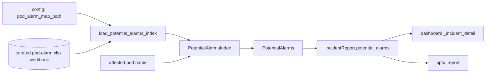

# src/rca_agent/alarms Folder Specification

| Field | Value |
|-------|-------|
| Specification identifier | SPEC-src-rca_agent-alarms |
| Repository-relative folder | `src/rca_agent/alarms/` |
| Role | Production runtime — scoped potential alarms: map an affected pod to the candidate alarms it could have raised |
| Current commit | `2f4774f0476d5b47426ac1548c479f132c467332` |
| Generated/refreshed | 2026-11-03 |
| Status | Draft until maintainer review |
| Parent specification | [`../SPECS.md`](../SPECS.md) |

Authority notice: the source files, tests, and build definitions in this
repository remain authoritative. This specification is derived, bounded
evidence and must be reconciled with source on any conflict.

## 1. Intent and significance

This folder owns the scoped, high-confidence potential-alarms feature. Given an
affected pod, it reports only what the curated pod-alarm mapping workbook
supports directly: the candidate alarms that *could have been* raised for that
pod, each with its scope, severity, raise/clear condition, applicability,
mapping basis, and source citation. These are **candidate** associations from a
reviewed mapping — never observed, confirmed, or active alarms. It deliberately
does not infer which alarm actually fired, severity rollups, blast radius, or a
cause. It is read-only and deterministic (curated data, never an LLM guess), and
every surfaced claim cites the workbook. It is a leaf directory and is inert
when no mapping is configured. The design is a deliberate near-exact structural
clone of the shipped service-area impact feature ([`../impact/`](../impact/SPECS.md)).

## 2. Scope and contents

- Direct files: 4 Python files. Immediate child folders: 0.
- [`models.py`](models.py) — `CandidateAlarm` (+ `is_direct`), `PotentialAlarms`
  (+ `summary_line`).
- [`index.py`](index.py) — `PotentialAlarmsIndex`, `load_potential_alarms_index`.
- [`loader.py`](loader.py) — workbook (xlsx) loading/parsing with a header-row
  scan; reuses `pod_stem` from [`../impact/loader.py`](../impact/loader.py).
- [`__init__.py`](__init__.py) — re-exports `CandidateAlarm`, `PotentialAlarms`,
  `PotentialAlarmsIndex`, `load_potential_alarms_index`.
- Language: Python 3.10+; xlsx parsing via `openpyxl` (core dependency),
  imported lazily inside `load_workbook_alarms`.

## 3. Inputs

- A curated pod→alarm mapping workbook (`.xlsx`, sheet **Pod Alarm Mapping**) at
  `pod_alarm_map_path` (from [`../config.py`](../config.py)). Row 1 is a title,
  row 2 a disclaimer, row 3 the header, data from row 4; a header-row scan
  locates the header.
- A pod name to look up (exact or hash-stripped stem).
- Test fixture: [`../../../tests/fixtures/pod_alarm_mapping_sample.xlsx`](../../../tests/fixtures/pod_alarm_mapping_sample.xlsx).

## 4. Outputs

- `PotentialAlarms` (per-pod answer with `mapped` and an ordered `alarms` list of
  `CandidateAlarm`) and a `summary_line()` ASCII-safe sentence.
- Embedded into `IncidentReport.potential_alarms` by [`../models/`](../models/SPECS.md).
- Direct consumers: [`../reasoning/`](../reasoning/SPECS.md),
  [`../webhook/`](../webhook/SPECS.md).

## 5. Contracts and models

### 5.1 Behavioral contracts

- When no mapping is configured or the file is missing/unreadable, the feature is
  inert and no `potential_alarms` is attached (documented).
- `mapped=False` means the pod is not in the workbook — reported as UNKNOWN,
  never guessed; distinct from a mapped pod with zero rows.
- Candidate alarms are context (what could have fired), not a cause — the step
  never creates, removes, or reweights a hypothesis (documented invariant).
- Entries are always labelled as candidate alarms that *could have been* raised;
  the words "confirmed"/"active" are never used for entries.

### 5.2 Declared models and callable surface

| Symbol | Kind | Source |
|--------|------|--------|
| `CandidateAlarm` (+ `is_direct`) | model | [`models.py`](models.py) |
| `PotentialAlarms` (+ `summary_line`) | model | [`models.py`](models.py) |
| `PotentialAlarmsIndex` | class | [`index.py`](index.py) |
| `load_potential_alarms_index` | function | [`index.py`](index.py) |
| `build_alarms`, `load_workbook_alarms` (workbook loader) | functions | [`loader.py`](loader.py) |

`is_direct` is a derived read of `mapping_basis` (`"exact pod name"` substring)
and drives Direct-before-Conditional ordering only; it never changes a value.

### 5.3 Required invariants

- Read-only and deterministic; every surfaced alarm cites the workbook, and a
  lookup repeated against the same index returns equal content and ordering.
- Within a pod, alarms are ordered Direct-first then Conditional, stable within
  each group.
- `summary_line()` is ASCII-encodable and ≤ 200 characters for any pod name or
  alarm count.
- Additive, defaulted `IncidentReport.potential_alarms` field keeps existing
  report serialization unaffected.

## 6. Interaction points

| Direction | Folder | Type |
|-----------|--------|------|
| Parent | [`../`](../SPECS.md) | containment |
| Outbound | [`../config.py`](../config.py) | import (`Settings`, `pod_alarm_map_path`) |
| Outbound | [`../impact/`](../impact/SPECS.md) | import (`pod_stem` — single source of truth) |
| Inbound | [`../models/`](../models/SPECS.md) | import (`PotentialAlarms`) |
| Inbound | [`../reasoning/`](../reasoning/SPECS.md) | attaches potential alarms to report |
| Inbound | [`../webhook/`](../webhook/SPECS.md) | surfaces candidate alarms in UI/report/PPTX |

## 7. Exception and error handling

A missing/unset mapping path makes the feature inert rather than erroring; the
factory returns `None` and logs at info. A present-but-unparsable workbook (or an
absent `openpyxl`, caught as an `ImportError`) is wrapped in `try/except` in
`load_potential_alarms_index`, logged at warning, and also returns `None`.
`by_pod` never raises: an empty/blank name or a miss returns an UNKNOWN record.

## 8. Environment variables and configuration

No direct `os.environ` access. Driven by `Settings.pod_alarm_map_path`
(`RCA_POD_ALARM_MAP_PATH`). Unset/missing → feature inert.

## 9. Storage, memory, and resource map

| Resource | Owner | Lifetime | Release |
|----------|-------|----------|---------|
| Loaded alarms index | `PotentialAlarmsIndex` | resolved fresh per incident | GC |
| Workbook file handle | `loader.py` (openpyxl, read-only) | per load | closed after read |
| `PotentialAlarms` / `CandidateAlarm` instances | caller | per incident | GC |

## 10. Interaction diagram

## 11. Cross-cutting design considerations

- Data integrity: curated source, cited claims, UNKNOWN when unmapped, candidates
  never presented as confirmed/active.
- Separation of concerns: alarm context is kept strictly out of cause ranking.
- Reuse: the pod-name stem regex is imported from `impact/loader` (single source
  of truth) rather than duplicated.
- Portability: `openpyxl` is a core dependency imported lazily, so importing the
  package never requires the extra and the feature degrades gracefully.

## 12. Spec-driven development protocol

Future work must: (1) record any change to the mapping schema or the per-pod
answer here; (2) identify affected models/reasoning/webhook specs; (3) add an
alarms unit/property test (see `tests/test_potential_alarms_*`); (4) implement
keeping candidate alarms out of cause ranking and labelled as candidates;
(5) run `make check` (lint + tests); (6) reconcile this spec.

Acceptance scenarios:

- SPEC-src-rca_agent-alarms-AC1 (valid): Given a mapped pod and a configured
  workbook, When looked up, Then a `PotentialAlarms` with `mapped=True` and the
  grouped candidate alarms (Direct-first, each cited) is returned.
- SPEC-src-rca_agent-alarms-AC2 (invalid/unmapped): Given a pod not in the
  workbook, When looked up, Then `mapped=False`, zero alarms, and the summary
  reports UNKNOWN.
- SPEC-src-rca_agent-alarms-AC3 (compatibility): Given no workbook is configured,
  When an incident is produced, Then `potential_alarms` is `None` and
  serialization is unchanged.
- SPEC-src-rca_agent-alarms-AC4 (verification): Given potential alarms are
  attached, When hypotheses are ranked, Then the ranking is unchanged by the
  alarm context.

## 13. Verification strategy

Unit and property-based tests (Hypothesis) over workbook loading, grouping and
Direct-before-Conditional ordering, per-pod index lookup, value preservation, and
the context-not-cause / backward-compat invariants. No tests were executed for
this documentation task.

## 14. Evidence inventory

| File | Type | Bytes |
|------|------|-------|
| [`models.py`](models.py) | Python | ~2.9 KB |
| [`index.py`](index.py) | Python | ~2.8 KB |
| [`loader.py`](loader.py) | Python | ~4.9 KB |
| [`__init__.py`](__init__.py) | Python | ~0.8 KB |

## 15. Unknowns and review items

- Pipeline wiring (`reasoning/extractive.py`, `reasoning/steps.py`), the
  `config.pod_alarm_map_path` setting, the `IncidentReport.potential_alarms`
  field, and the webhook/PPTX surfaces are described in the design document and
  owned by their respective specs; this spec covers the `alarms/` leaf only and
  must be reconciled once those consumer specs are refreshed.
- The exact committed test and fixture file names (`tests/fixtures/
  pod_alarm_mapping_sample.xlsx`, test modules) should be re-verified against the
  tests spec when that package is reconciled.
