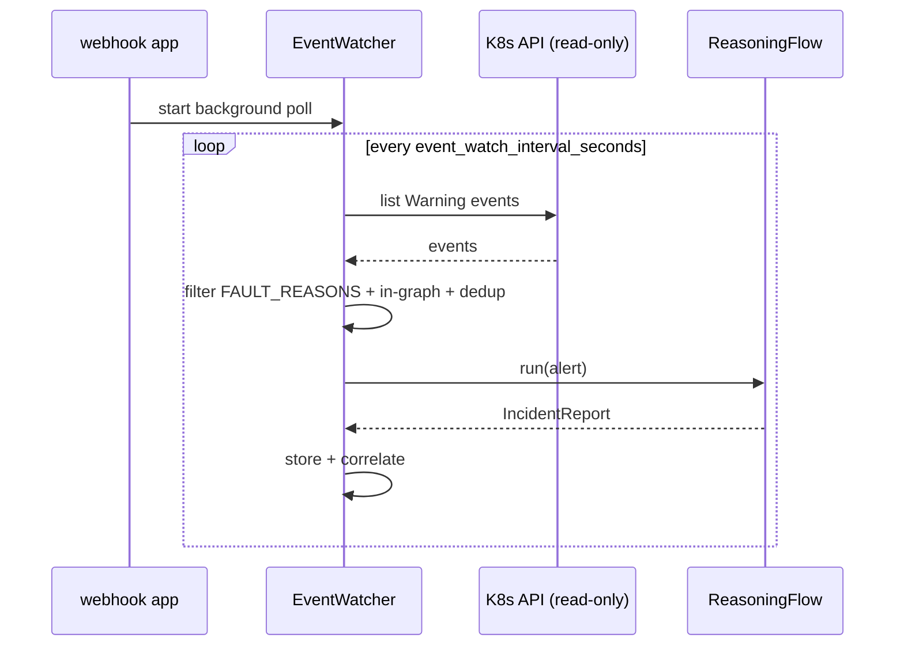

# src/rca_agent/detection Folder Specification

| Field | Value |
|-------|-------|
| Specification identifier | SPEC-src-rca_agent-detection |
| Repository-relative folder | `src/rca_agent/detection/` |
| Role | Production runtime — automatic fault detection (K8s event watcher), in-memory incident store, correlation |
| Current commit | `2f4774f0476d5b47426ac1548c479f132c467332` |
| Generated/refreshed | 2026-11-03 (persistence notes reflect the incident-persistence-postgres feature) |
| Status | Draft until maintainer review |
| Parent specification | [`../SPECS.md`](../SPECS.md) |

Authority notice: the source files, tests, and build definitions in this
repository remain authoritative. This specification is derived, bounded
evidence and must be reconciled with source on any conflict.

## 1. Intent and significance

This folder owns automatic fault detection so an incident report is produced
without a human hand-crafting an Alertmanager payload. It polls the read-only
Kubernetes client for recent Warning events, feeds recognized fault reasons
through the same `ReasoningFlow` entry point the webhook uses, and acts as the
in-memory incident store for incidents created any way (auto-detected or
webhook-posted). It also deterministically correlates incidents that share an
identical failure signature on different resources. It is a leaf directory and
a central runtime coordinator.

## 2. Scope and contents

- Direct files: 2 Python files. Immediate child folders: 0.
- [`event_watcher.py`](event_watcher.py) — `EventWatcher` (poll loop, incident
  store, `record_external_incident`, `reconcile_status`, `_correlate`).
- [`__init__.py`](__init__.py) — package marker.
- Language: Python 3.10+; uses `collections.OrderedDict` for bounded dedup.

## 3. Inputs

- Kubernetes Warning events via the graph builder's read-only client.
- `Settings` (`event_watch_enabled`, `event_watch_interval_seconds`,
  `event_max_age_minutes`, `status_detection_enabled`,
  `status_unhealthy_rebuilds`, `incident_correlation_window_minutes`).
- Externally posted incidents from [`../webhook/`](../webhook/SPECS.md) via
  `record_external_incident`.
- The current `DependencyGraph` (only events naming an existing graph node act).

## 4. Outputs

- `IncidentReport` objects stored in `self.incidents` (bounded to 200) with
  `related_incidents` links.
- Status reconciliation flips incidents between `active`/`inactive`.
- Optional incident-capture JSONL records via `IncidentCaptureWriter`
  (see [`../eval/`](../eval/SPECS.md)).
- Direct consumers: [`../webhook/`](../webhook/SPECS.md) (reads the store for
  `/incidents` endpoints).

## 5. Contracts and models

### 5.1 Behavioral contracts

- Scope: only events whose `involvedObject` names a node already in the current
  graph are acted on (piggybacks on `nf_selector`/namespace scoping).
- Trigger: only reasons in `KubeEvent.FAULT_REASONS`, not any Warning.
- Dedup: seen event UIDs are remembered in a bounded set (`_MAX_SEEN_UIDS`,
  2000) so a recurring event is not re-diagnosed each poll.
- Correlation: `_correlate` links incidents with an identical signature
  (hypothesis text with the resource name blanked) on a different resource
  within `incident_correlation_window_minutes`. It never claims a shared cause
  and never changes confidence (documented).
- Status-based detection raises an incident when a pod stays unhealthy across
  `status_unhealthy_rebuilds` consecutive rebuilds even with no fresh event.
- Write-through persistence: when an optional incident store is wired in
  (`_incident_store`, injected by the webhook lifespan), `EventWatcher`
  upserts each incident to the durable store after every mutation
  (`reconcile_status`, `_merge_into_open_anchor`, `_correlate`, and
  `record_external_incident`). The synchronous write runs on a thread when on
  the event loop. Persistence is non-fatal: a write failure is logged, the
  in-memory copy is kept, and the incident is re-persisted on the next mutation
  (it never raises into the poll loop or a request). See
  [`../store/`](../store/SPECS.md).

### 5.2 Declared models and callable surface

| Symbol | Kind | Source |
|--------|------|--------|
| `EventWatcher` | class | [`event_watcher.py`](event_watcher.py) |
| `record_external_incident` | method | [`event_watcher.py`](event_watcher.py) |
| `reconcile_status` | method | [`event_watcher.py`](event_watcher.py) |
| `_correlate` | internal function/method | [`event_watcher.py`](event_watcher.py) |
| `_MAX_SEEN_UIDS`, `_MAX_STORED_INCIDENTS` | module constants | [`event_watcher.py`](event_watcher.py) |

### 5.3 Required invariants

- Incident store is bounded (`_MAX_STORED_INCIDENTS` = 200).
- Strict recovery: an incident becomes `inactive` only when all `affected_pods`
  are healthy again (documented invariant).
- Correlation is a pattern flag only — it must not fabricate a named shared
  cause (the graph has no NF-to-NF `calls` edges to verify one).

## 6. Interaction points

| Direction | Folder | Type |
|-----------|--------|------|
| Parent | [`../`](../SPECS.md) | containment |
| Outbound | [`../config.py`](../config.py) | import (`Settings`) |
| Outbound | [`../graph/`](../graph/SPECS.md) | import (`GraphBuilder`) |
| Outbound | [`../models/`](../models/SPECS.md) | import (`Alert`, `KubeEvent`, `IncidentReport`) |
| Outbound | [`../reasoning/`](../reasoning/SPECS.md) | import (`ReasoningFlow`) |
| Outbound | [`../eval/`](../eval/SPECS.md) | import (`IncidentCaptureWriter`) |
| Outbound | [`../store/`](../store/SPECS.md) | write-through `upsert` of incidents (optional `_incident_store`, non-fatal) |
| Inbound | [`../webhook/`](../webhook/SPECS.md) | instantiates `EventWatcher`, injects the incident store, reads store |

The poll loop is a runtime/dynamic relationship driven by an async background
task in the webhook app; it only runs when `cluster_enabled` is True.

## 7. Exception and error handling

The poll loop is designed to survive cluster errors and continue (documented as
conservative/read-only). Bounded dedup and incident sets prevent unbounded
growth. Exact try/except placement around the poll cycle needs a full read of
`event_watcher.py` (bounded scan — see unknowns).

## 8. Environment variables and configuration

No direct `os.environ` access. Configuration arrives via `Settings`
(`RCA_EVENT_WATCH_*`, `RCA_STATUS_DETECTION_*`,
`RCA_INCIDENT_CORRELATION_WINDOW_MINUTES`, and incident-capture settings).

## 9. Storage, memory, and resource map

| Resource | Owner | Lifetime | Release |
|----------|-------|----------|---------|
| `self.incidents` | `EventWatcher` | process lifetime | bounded to 200, oldest evicted |
| seen-UID set (`OrderedDict`) | `EventWatcher` | process lifetime | bounded to 2000 |
| async poll task | webhook app | process lifetime | cancelled on shutdown |
| capture JSONL file | `IncidentCaptureWriter` | persistent when enabled | rolling cap |

## 10. Interaction diagram

## 11. Cross-cutting design considerations

- Safety: read-only, rules-first, hard to spam; conservative trigger set.
- Observability: one shared timeline/correlation pool for all incident sources.
- Compatibility: shares the exact reasoning entry point with the webhook so both
  paths produce identical report shapes.

## 12. Spec-driven development protocol

Future work must: (1) record any change to trigger reasons, dedup, or
correlation semantics here; (2) identify affected webhook/reasoning/models
specs; (3) add a detection unit test (see `tests/test_event_watcher.py`);
(4) implement without widening scope or fabricating a shared cause; (5) run
`pytest -q`; (6) reconcile this spec.

Acceptance scenarios:

- SPEC-src-rca_agent-detection-AC1 (valid): Given a `CrashLoopBackOff` event for
  a pod present in the graph, When a poll cycle runs, Then an incident report is
  produced via `ReasoningFlow` and stored.
- SPEC-src-rca_agent-detection-AC2 (invalid/noise): Given a transient Warning
  with a reason not in `FAULT_REASONS`, When polled, Then no incident is created.
- SPEC-src-rca_agent-detection-AC3 (dedup/compatibility): Given the same event
  UID recurs across polls, When processed again, Then it is not re-diagnosed.
- SPEC-src-rca_agent-detection-AC4 (verification): Given 12 pods fail with an
  identical signature within the window, When correlated, Then they are linked
  via `related_incidents` without a fabricated shared cause or confidence change.

## 13. Verification strategy

Unit tests over the poll filter, dedup, status detection, correlation, and
recovery. Related tests:
[`../../../tests/test_event_watcher.py`](../../../tests/test_event_watcher.py),
[`../../../tests/test_detection_fixes_0_6_1.py`](../../../tests/test_detection_fixes_0_6_1.py),
[`../../../tests/test_incident_capture.py`](../../../tests/test_incident_capture.py).
No tests were executed for this documentation task.

## 14. Evidence inventory

| File | Type | Bytes |
|------|------|-------|
| [`event_watcher.py`](event_watcher.py) | Python | ~24.5 KB (24,516) |
| [`__init__.py`](__init__.py) | Python | ~0.1 KB |

## 15. Unknowns and review items

- Only the module header of `event_watcher.py` was read in this bounded scan;
  the full poll loop, status-detection counter logic, and recovery
  reconciliation need a complete review before this spec is marked reviewed.
- Interaction with `IncidentCaptureWriter` redaction options should be confirmed
  against [`../config.py`](../config.py) capture settings.
