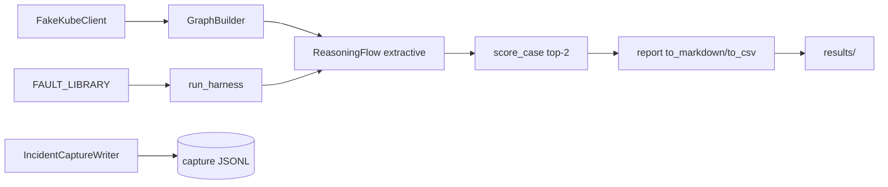

# src/rca_agent/eval Folder Specification

| Field | Value |
|-------|-------|
| Specification identifier | SPEC-src-rca_agent-eval |
| Repository-relative folder | `src/rca_agent/eval/` |
| Role | Test / evaluation — synthetic fault-injection accuracy harness + incident capture for offline labeling |
| Current commit | `2f4774f0476d5b47426ac1548c479f132c467332` |
| Generated/refreshed | 2026-11-03 |
| Status | Draft until maintainer review |
| Parent specification | [`../SPECS.md`](../SPECS.md) |

Authority notice: the source files, tests, and build definitions in this
repository remain authoritative. This specification is derived, bounded
evidence and must be reconciled with source on any conflict.

## 1. Intent and significance

This folder owns the offline, cluster-free accuracy harness that makes the
dependency-graph, change-correlation, and time-aware capabilities provable
rather than asserted. Each labeled fault case builds a fake-kube fixture with a
known ground-truth cause, runs the real extractive pipeline, and scores whether
the ground truth appears in the top-2 hypotheses. It also provides the incident
capture writer that appends inputs/outputs as JSONL for later precision/recall
labeling. It is an aggregation boundary with one child folder (`results`) and
has a CLI entrypoint.

## 2. Scope and contents

- Direct files: 9 Python + Markdown. Immediate child folders: 1 (`results`).
- [`cases.py`](cases.py) — `FaultCase`, `FAULT_LIBRARY` (labeled synthetic cases).
- [`runner.py`](runner.py) — `run_harness`, `CaseResult`, `HarnessReport`.
- [`scorer.py`](scorer.py) — `score_case`, `Score`.
- [`fake_cluster.py`](fake_cluster.py) — `FakeKubeClient` fixtures.
- [`capture.py`](capture.py) — `IncidentCaptureWriter` (JSONL incident capture).
- [`report.py`](report.py) — `to_markdown`, `to_csv` output writers.
- [`__main__.py`](__main__.py) — CLI (`python -m rca_agent.eval`, gates on `--min-top2`).
- [`LABELING.md`](LABELING.md), [`README.md`](README.md) — documentation.
- [`__init__.py`](__init__.py) — re-exports harness symbols.
- Child folder: [`results/`](results/SPECS.md).

## 3. Inputs

- The labeled `FAULT_LIBRARY` cases (in-folder data).
- The real `GraphBuilder` and `ReasoningFlow` (extractive, no LLM, no network).
- `Settings` (and incident-capture settings for the writer).
- CLI arguments (`--min-top2`, output options).

## 4. Outputs

- A `HarnessReport` with per-case `CaseResult` rows and top-1/top-2 accuracy.
- Results written as Markdown + CSV under [`results/`](results/SPECS.md).
- A non-zero process exit when top-2 accuracy falls below the threshold (CI gate).
- JSONL incident-capture records (when capture is configured) consumed offline
  for labeling.
- Direct consumer of the writer: [`../detection/`](../detection/SPECS.md)
  (`IncidentCaptureWriter`).

## 5. Contracts and models

### 5.1 Behavioral contracts

- Accuracy metric is top-2: the known cause must be among the top two
  hypotheses.
- Cause-string formats the matchers key on are produced by
  [`../reasoning/`](../reasoning/SPECS.md) (`steps.py`) and documented in
  `cases.py` (e.g. "<pod> OOMKilled", "recent <type> to <object>").
- The harness is deterministic and CI-safe (no cluster, no LLM, no network).
- `python -m rca_agent.eval` exits non-zero when top-2 is below `--min-top2`
  (default 0.80).

### 5.2 Declared models and callable surface

| Symbol | Kind | Source |
|--------|------|--------|
| `FaultCase` / `FAULT_LIBRARY` | dataclass / data | [`cases.py`](cases.py) |
| `run_harness` / `CaseResult` / `HarnessReport` | function / dataclasses | [`runner.py`](runner.py) |
| `score_case` / `Score` | function / dataclass | [`scorer.py`](scorer.py) |
| `FakeKubeClient` | class | [`fake_cluster.py`](fake_cluster.py) |
| `IncidentCaptureWriter` | class | [`capture.py`](capture.py) |
| `to_markdown` / `to_csv` | functions | [`report.py`](report.py) |
| `main` | CLI entrypoint | [`__main__.py`](__main__.py) |

### 5.3 Required invariants

- Runs against the REAL pipeline, not a mock reasoner (so results are evidence).
- Capture records include real log lines/object names — treat JSONL as sensitive
  (redaction/graph toggles in [`../config.py`](../config.py)).

## 6. Interaction points

| Direction | Folder | Type |
|-----------|--------|------|
| Parent | [`../`](../SPECS.md) | containment |
| Child | [`results/`](results/SPECS.md) | ownership (output) |
| Outbound | [`../config.py`](../config.py) | import (`Settings`) |
| Outbound | [`../graph/`](../graph/SPECS.md) | import (`GraphBuilder`) |
| Outbound | [`../reasoning/`](../reasoning/SPECS.md) | import (`ReasoningFlow`) |
| Outbound | [`../models/`](../models/SPECS.md) | import (`Alert`, `Hypothesis`) |
| Inbound | [`../detection/`](../detection/SPECS.md) | import (`IncidentCaptureWriter`) |
| Inbound | [`../../../Makefile`](../../../Makefile) | `make eval` runs the harness |

## 7. Exception and error handling

The CLI exits non-zero on an accuracy threshold miss (direct evidence,
`__main__.py`). Capture writing is bounded by a rolling cap. Full error handling
in `runner.py`/`capture.py` needs a complete read (bounded scan — see unknowns).

## 8. Environment variables and configuration

No direct `os.environ` access observed. Capture behavior is driven by `Settings`
(`RCA_INCIDENT_CAPTURE_PATH`, `_REDACT_LOGS`, `_INCLUDE_GRAPH`, `_MAX_RECORDS`,
`_GRAPH_RADIUS`). CLI options configure thresholds and output.

## 9. Storage, memory, and resource map

| Resource | Owner | Lifetime | Release |
|----------|-------|----------|---------|
| Fake-kube fixtures | `FakeKubeClient` | per case | GC |
| Results Markdown/CSV | `report.py` | persistent (repo results dir) | overwritten per run |
| Capture JSONL | `IncidentCaptureWriter` | persistent when enabled | rolling cap |

## 10. Interaction diagram

## 11. Cross-cutting design considerations

- Testability/reproducibility: deterministic, cluster-free, LLM-free.
- Security: capture records are sensitive; redaction is available.
- Observability: results tables provide the accuracy evidence baseline.

## 12. Spec-driven development protocol

Future work must: (1) record new fault cases or scoring-contract changes here;
(2) identify affected reasoning/detection/results specs; (3) add/extend a harness
test (see `tests/test_eval_harness.py`); (4) implement keeping the harness
deterministic; (5) run `pytest -q` and/or `make eval`; (6) reconcile this spec.

Acceptance scenarios:

- SPEC-src-rca_agent-eval-AC1 (valid): Given the OOMKilled case, When the harness
  runs the real pipeline, Then the known cause is scored within the top-2.
- SPEC-src-rca_agent-eval-AC2 (failure/gate): Given top-2 accuracy falls below
  `--min-top2`, When the CLI finishes, Then it exits non-zero to gate CI.
- SPEC-src-rca_agent-eval-AC3 (compatibility): Given `reasoning/steps.py` changes
  a cause-string format, When matchers run, Then the `cases.py` matchers must be
  updated in the same change.
- SPEC-src-rca_agent-eval-AC4 (verification): Given capture is enabled, When an
  incident is produced, Then a JSONL record with inputs, outputs, and an empty
  labels block is appended.

## 13. Verification strategy

Unit test of the harness plus the `make eval` CLI run. Related test:
[`../../../tests/test_eval_harness.py`](../../../tests/test_eval_harness.py). No
tests were executed for this documentation task.

## 14. Evidence inventory

| File | Type | Bytes |
|------|------|-------|
| [`cases.py`](cases.py) | Python | ~12.7 KB (12,662) |
| [`runner.py`](runner.py) | Python | ~3.4 KB (3,393) |
| [`scorer.py`](scorer.py) | Python | ~1.2 KB (1,245) |
| [`fake_cluster.py`](fake_cluster.py) | Python | ~7.3 KB (7,323) |
| [`capture.py`](capture.py) | Python | ~7.2 KB (7,248) |
| [`report.py`](report.py) | Python | ~2.6 KB (2,659) |
| [`__main__.py`](__main__.py) | Python | ~2.5 KB (2,488) |
| [`LABELING.md`](LABELING.md) | Markdown | see file |
| [`README.md`](README.md) | Markdown | see file |
| [`__init__.py`](__init__.py) | Python | ~0.4 KB |

## 15. Unknowns and review items

- `scorer.py`, `fake_cluster.py`, `capture.py`, and `report.py` were not fully
  read in this bounded scan; the exact scoring matcher mechanics, fake-client
  surface, and JSONL schema need a complete read before this spec is marked
  reviewed.
- The results table in [`results/`](results/SPECS.md) reports 8 cases with 100%
  top-2 at the time of capture; confirm it reflects the current `FAULT_LIBRARY`.
