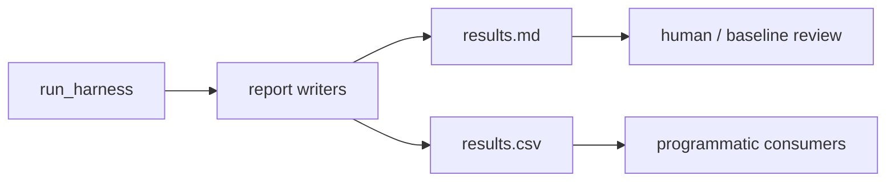

# src/rca_agent/eval/results Folder Specification

| Field | Value |
|-------|-------|
| Specification identifier | SPEC-src-rca_agent-eval-results |
| Repository-relative folder | `src/rca_agent/eval/results/` |
| Role | Test / evaluation output — committed accuracy results table (Markdown + CSV) from the fault-injection harness |
| Current commit | `2f4774f0476d5b47426ac1548c479f132c467332` |
| Generated/refreshed | 2026-11-03 |
| Status | Draft until maintainer review |
| Parent specification | [`../SPECS.md`](../SPECS.md) |

Authority notice: the source files, tests, and build definitions in this
repository remain authoritative. This specification is derived, bounded
evidence and must be reconciled with source on any conflict.

## 1. Intent and significance

This folder holds the committed output of the fault-injection accuracy harness:
a human-readable Markdown table and a machine-readable CSV of per-case scoring.
It is the published evidence that the reasoning pipeline ranks the known cause
within the top-2 for the labeled fault library. It is a leaf directory of
generated-but-committed artifacts.

## 2. Scope and contents

- Direct files: 2. Immediate child folders: 0.
- [`results.md`](results.md) — Markdown accuracy table (per-case results, top-1
  and top-2 accuracy).
- [`results.csv`](results.csv) — the same results in CSV form.
- Format: Markdown and CSV, written by [`../report.py`](../report.py).

## 3. Inputs

- Written by the harness runner/report writer in [`../`](../SPECS.md)
  (`run_harness` → `to_markdown`/`to_csv`) when `python -m rca_agent.eval` or
  `make eval` runs.

## 4. Outputs

- Documentation artifacts read by humans and by downstream reporting/baseline
  comparison. No runtime consumer; these are evidence files.

## 5. Contracts and models

### 5.1 Behavioral contracts

- The table reports case id, fault type, expected cause, top hypothesis, rank,
  and top-1/top-2 pass columns (direct evidence from `results.md`).
- The CSV mirrors the Markdown rows for programmatic consumption.

### 5.2 Declared models and callable surface

Not applicable — data artifacts with no declared symbols. The effective schema
is the table columns written by [`../report.py`](../report.py).

### 5.3 Required invariants

- Rows correspond to cases in `FAULT_LIBRARY` at generation time.
- The two files represent the same run (Markdown and CSV stay consistent).

## 6. Interaction points

| Direction | Folder | Type |
|-----------|--------|------|
| Parent | [`../`](../SPECS.md) | containment |
| Inbound | [`../`](../SPECS.md) (`report.py`) | write (regeneration) |

## 7. Exception and error handling

Not applicable — static data files. Regeneration overwrites them; a failed
harness run exits non-zero before overwriting (see [`../`](../SPECS.md)).

## 8. Environment variables and configuration

None directly. Regeneration is driven by the harness CLI options.

## 9. Storage, memory, and resource map

| Resource | Owner | Lifetime | Release |
|----------|-------|----------|---------|
| `results.md` / `results.csv` | repository (harness output) | persistent | overwritten per run |

## 10. Interaction diagram

## 11. Cross-cutting design considerations

- Observability: a committed, versioned record of accuracy over time.
- Data integrity: the two formats must stay in sync (same run).

## 12. Spec-driven development protocol

Future work must: (1) record any results-schema (column) change here;
(2) identify the affected eval and report specs; (3) regenerate both files
together; (4) implement without hand-editing the generated tables; (5) run
`make eval`; (6) reconcile this spec.

Acceptance scenarios:

- SPEC-src-rca_agent-eval-results-AC1 (valid): Given the harness runs
  successfully, When it writes output, Then `results.md` and `results.csv`
  contain one row per case with top-1/top-2 columns.
- SPEC-src-rca_agent-eval-results-AC2 (invalid): Given the harness fails the
  accuracy gate, When it exits non-zero, Then stale results are not silently
  presented as current (regeneration did not complete).
- SPEC-src-rca_agent-eval-results-AC3 (compatibility): Given a new column is
  added by `report.py`, When regenerated, Then both Markdown and CSV include it.
- SPEC-src-rca_agent-eval-results-AC4 (verification): Given a case is added to
  `FAULT_LIBRARY`, When regenerated, Then a matching row appears in both files.

## 13. Verification strategy

Verified indirectly by regenerating via `make eval` and by the harness unit test
([`../../../../tests/test_eval_harness.py`](../../../../tests/test_eval_harness.py)).
No checks were executed for this documentation task.

## 14. Evidence inventory

| File | Type | Bytes |
|------|------|-------|
| [`results.md`](results.md) | Markdown | see file |
| [`results.csv`](results.csv) | CSV | see file |

## 15. Unknowns and review items

- These files are generated output; confirm they reflect the current
  `FAULT_LIBRARY` rather than a prior run before treating the figures as
  authoritative.
