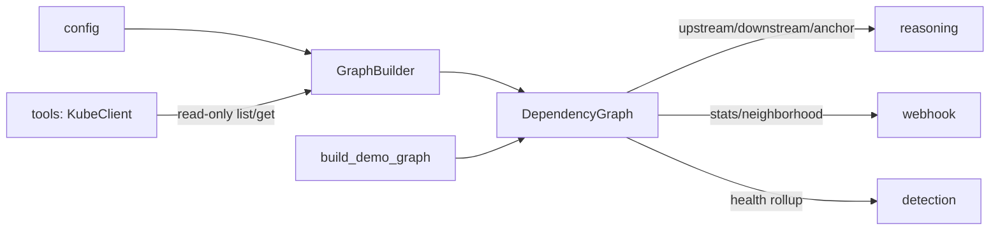

# src/rca_agent/graph Folder Specification

| Field | Value |
|-------|-------|
| Specification identifier | SPEC-src-rca_agent-graph |
| Repository-relative folder | `src/rca_agent/graph/` |
| Role | Production runtime — live NetworkX dependency graph of the 5G core, plus the cluster/demo builder |
| Current commit | `2f4774f0476d5b47426ac1548c479f132c467332` |
| Generated/refreshed | 2026-11-03 |
| Status | Draft until maintainer review |
| Parent specification | [`../SPECS.md`](../SPECS.md) |

Authority notice: the source files, tests, and build definitions in this
repository remain authoritative. This specification is derived, bounded
evidence and must be reconciled with source on any conflict.

## 1. Intent and significance

This folder owns the timestamped, directed dependency graph that the agent
reasons over. Nodes model network functions (NFs), services, pods, nodes,
ConfigMaps, Secrets, PersistentVolumeClaims (PVCs), deployments, and
ReplicaSets; edges model `calls`, `runs_on`, `mounts`, `managed_by`, and
`selects` relationships. It is the structural core of the GraphRAG reasoning:
upstream traversal finds candidate causes, downstream traversal finds blast
radius, and timestamped change records enable time-aware correlation. It is a
leaf directory that aggregates the graph data model and its builder.

## 2. Scope and contents

- Direct files: 4 Python files. Immediate child folders: 0.
- [`dependency_graph.py`](dependency_graph.py) — `DependencyGraph`, enums `NodeKind`/`EdgeKind`/`Health`, `ChangeRecord`, and `build_demo_graph`.
- [`builder.py`](builder.py) — `GraphBuilder`, builds/refreshes the graph from a read-only cluster client or the demo graph.
- [`visualize.py`](visualize.py) — graph visualization helper (pyvis, optional `viz` extra).
- [`__init__.py`](__init__.py) — re-exports public symbols.
- Language: Python 3.10+; dependency on `networkx` (`MultiDiGraph`).

## 3. Inputs

- Read-only Kubernetes object listings (pods, services, deployments,
  replicasets, configmaps, secrets, pvcs, nodes) via an injected or
  internally built client. Direct producer: [`../tools/`](../tools/SPECS.md) (`KubeClient`).
- `Settings` from [`../config.py`](../config.py) (`cluster_enabled`,
  `namespace`, `nf_selector`, graph interval/window settings).
- When `cluster_enabled` is False, `build_demo_graph()` supplies in-memory data.

## 4. Outputs

- A populated `DependencyGraph` object queried by reasoning and the webhook UI.
- Query results: `upstream`, `downstream`, `unhealthy_upstream`, `neighborhood`,
  `anchor_of`, `pods_of_anchor`, `node_summaries`, `stats`, and change windows.
- Direct consumers: [`../reasoning/`](../reasoning/SPECS.md),
  [`../detection/`](../detection/SPECS.md), [`../webhook/`](../webhook/SPECS.md).

## 5. Contracts and models

### 5.1 Behavioral contracts

- Edge direction: `A --calls--> B` means A depends on B (B is upstream of A and
  a candidate cause). `upstream()` follows `calls` out-edges; `downstream()`
  follows them in reverse.
- Health roll-up: all pods ready → `healthy`; none ready → `down`; mixed →
  `degraded`; no pods → `unknown` (direct evidence `_rollup_from_pods`).
- `anchor_of(pod)` resolves attribution priority: fronting Service (`selects`) >
  owning workload (`managed_by`) > the pod itself.
- `calls` edges are created only from grounded signals (literal env var /
  ConfigMap values matching another Service name); absence of a match means
  absence of an edge, never a guess (direct evidence, `builder.py` docstring).
- Every mutation appends a `ChangeRecord`; `changes_between(start, end)` returns
  the change-correlation input.

### 5.2 Declared models and callable surface

| Symbol | Kind | Source |
|--------|------|--------|
| `DependencyGraph` | class | [`dependency_graph.py`](dependency_graph.py) |
| `NodeKind` | enum | [`dependency_graph.py`](dependency_graph.py) |
| `EdgeKind` | enum | [`dependency_graph.py`](dependency_graph.py) |
| `Health` | enum | [`dependency_graph.py`](dependency_graph.py) |
| `ChangeRecord` | dataclass | [`dependency_graph.py`](dependency_graph.py) |
| `build_demo_graph` | function | [`dependency_graph.py`](dependency_graph.py) |
| `GraphBuilder` | class | [`builder.py`](builder.py) |

Key `DependencyGraph` methods (capped selection): `upsert_node`, `upsert_edge`,
`set_health_state`, `roll_up_health`, `roll_up_service_health`, `upstream`,
`downstream`, `unhealthy_upstream`, `anchor_of`, `pods_of_anchor`,
`mounted_config`, `calls_edge_evidence`, `neighborhood`, `changes_between`,
`stats`.

### 5.3 Required invariants

- `NodeKind` and `EdgeKind` string values are compatibility-sensitive (stored as
  node/edge attributes and surfaced to the UI).
- `build_demo_graph()` mirrors exactly what `GraphBuilder` produces from a
  cluster, so no-cluster and real-cluster views are structurally identical
  (documented invariant).
- Mutation is performed only by builders, never by an LLM (documented).

## 6. Interaction points

| Direction | Folder | Type |
|-----------|--------|------|
| Parent | [`../`](../SPECS.md) | containment |
| Outbound | [`../config.py`](../config.py) | import (`Settings`) |
| Outbound | [`../tools/`](../tools/SPECS.md) | read-only cluster client (runtime, when enabled) |
| Inbound | [`../reasoning/`](../reasoning/SPECS.md) | import (`DependencyGraph`) |
| Inbound | [`../detection/`](../detection/SPECS.md) | import (`GraphBuilder`) |
| Inbound | [`../webhook/`](../webhook/SPECS.md) | import (`GraphBuilder`) |

The cluster-client relationship is runtime/dynamic and only active when
`cluster_enabled` is True; a static scan cannot prove the live call path.

## 7. Exception and error handling

Query methods guard missing nodes with `has_node`/`dict.get` and return empty
results rather than raising (e.g. `upstream`, `neighborhood`, `owners`).
`upsert_node` backfills a missing `kind` via `setdefault` to tolerate NetworkX
implicitly creating edge endpoints. Builder-side cluster error handling is in
`builder.py` (bounded scan; verify in source for the full retry/fallback path).

## 8. Environment variables and configuration

No direct `os.environ` access. All configuration arrives as a typed `Settings`
object from [`../config.py`](../config.py) (`RCA_CLUSTER_ENABLED`,
`RCA_NAMESPACE`, `RCA_NF_SELECTOR`, `RCA_GRAPH_*`).

## 9. Storage, memory, and resource map

| Resource | Owner | Lifetime | Release |
|----------|-------|----------|---------|
| `nx.MultiDiGraph` | `DependencyGraph._g` | process lifetime, rebuilt periodically | replaced on rebuild / GC |
| `changes` list of `ChangeRecord` | `DependencyGraph` | process lifetime | unbounded within process (see unknowns) |
| `last_rebuilt` timestamp | `DependencyGraph` | per rebuild | overwritten |

All in-process host memory. No persistent storage, sockets, or threads owned
here; the rebuild cadence is driven by the webhook/detection loops.

## 10. Interaction diagram

## 11. Cross-cutting design considerations

- Observability: `stats`, `node_breakdown`, `edge_breakdown` expose graph size.
- Portability: pure NetworkX + stdlib; `visualize.py` needs the optional `viz`
  extra (pyvis).
- Data integrity: timestamped change history underpins time-aware reasoning.
- Safety: read-only by construction — no write to the cluster from this folder.

## 12. Spec-driven development protocol

Future work must: (1) record the node/edge/health contract delta here;
(2) identify affected reasoning, detection, and webhook specs; (3) add a graph
unit test (see `tests/test_cluster_graph.py`); (4) implement without widening
scope; (5) run `pytest -q`; (6) reconcile this spec.

Acceptance scenarios:

- SPEC-src-rca_agent-graph-AC1 (valid): Given a demo graph with one OOMKilled
  pod of three, When workload health rolls up, Then the workload is `degraded`.
- SPEC-src-rca_agent-graph-AC2 (invalid/missing): Given `upstream()` is called
  for a node not in the graph, When traversed, Then an empty list is returned
  and no exception is raised.
- SPEC-src-rca_agent-graph-AC3 (compatibility): Given `NodeKind`/`EdgeKind`
  string values are consumed by the UI, When a value is changed, Then the UI
  contract and tests must be updated in the same change.
- SPEC-src-rca_agent-graph-AC4 (verification): Given a pod with a Service
  `selects` edge, When `anchor_of()` runs, Then the Service is returned as the
  anchor over the owning workload and the pod.

## 13. Verification strategy

Unit tests are the cheapest boundary: traversal, health roll-up, anchor
resolution, and change windows. Related tests:
[`../../../tests/test_cluster_graph.py`](../../../tests/test_cluster_graph.py).
No tests were executed for this documentation task.

## 14. Evidence inventory

| File | Type | Bytes |
|------|------|-------|
| [`dependency_graph.py`](dependency_graph.py) | Python | ~16 KB |
| [`builder.py`](builder.py) | Python | ~24.1 KB (24,110) |
| [`visualize.py`](visualize.py) | Python | ~20.4 KB (20,366) |
| [`__init__.py`](__init__.py) | Python | ~0.4 KB |

## 15. Unknowns and review items

- `DependencyGraph.changes` grows per mutation; the eviction/bound policy was
  not confirmed in this bounded scan — maintainer should confirm whether it is
  pruned on rebuild.
- `builder.py` and `visualize.py` were read only in part (header/first lines);
  full cluster error-handling and visualization output contract need a complete
  review before this spec is marked reviewed.
- The `calls`-edge env/ConfigMap matching heuristic is documented as grounded
  but is still a heuristic; it proves a configured reference, not a verified
  runtime call.
