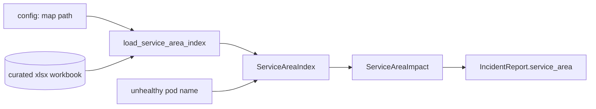

# src/rca_agent/impact Folder Specification

| Field | Value |
|-------|-------|
| Specification identifier | SPEC-src-rca_agent-impact |
| Repository-relative folder | `src/rca_agent/impact/` |
| Role | Production runtime — scoped service-area impact: map an unhealthy pod to its curated service area |
| Current commit | `2f4774f0476d5b47426ac1548c479f132c467332` |
| Generated/refreshed | 2026-11-03 |
| Status | Draft until maintainer review |
| Parent specification | [`../SPECS.md`](../SPECS.md) |

Authority notice: the source files, tests, and build definitions in this
repository remain authoritative. This specification is derived, bounded
evidence and must be reconciled with source on any conflict.

## 1. Intent and significance

This folder owns the scoped, high-confidence service-area impact feature. Given
an unhealthy pod, it reports only what the curated mapping workbook supports
directly: the service area/component the pod belongs to, the PDF section, the
mapping confidence, and factual redundancy counts. It deliberately does not
infer alerts, severity, downstream blast radius, or a full-vs-partial outage
verdict. It is read-only and deterministic (curated data, never an LLM guess),
and every surfaced claim cites the workbook. It is a leaf directory and is inert
when no mapping is configured.

## 2. Scope and contents

- Direct files: 4 Python files. Immediate child folders: 0.
- [`models.py`](models.py) — `ServiceArea`, `ServiceAreaImpact` (+ `summary_line`).
- [`index.py`](index.py) — `ServiceAreaIndex`, `load_service_area_index`.
- [`loader.py`](loader.py) — workbook (xlsx) loading/parsing.
- [`__init__.py`](__init__.py) — re-exports `ServiceArea`, `ServiceAreaImpact`,
  `ServiceAreaIndex`, `load_service_area_index`.
- Language: Python 3.10+; xlsx parsing via `openpyxl` (core dependency).

## 3. Inputs

- A curated pod→service-area mapping workbook (`.xlsx`) at
  `service_area_map_path` (from [`../config.py`](../config.py)).
- A pod name to look up.
- Test fixture: [`../../../tests/fixtures/service_area_mapping_sample.xlsx`](../../../tests/fixtures/service_area_mapping_sample.xlsx).

## 4. Outputs

- `ServiceAreaImpact` (per-pod answer with `mapped`, `component`,
  `service_area`, `section`, `relationship_type`, `confidence`, and sibling /
  service-area pod counts) and `summary_line()` ASCII-safe sentence.
- Embedded into `IncidentReport.service_area` by [`../models/`](../models/SPECS.md).
- Direct consumers: [`../reasoning/`](../reasoning/SPECS.md),
  [`../webhook/`](../webhook/SPECS.md).

## 5. Contracts and models

### 5.1 Behavioral contracts

- When no mapping is configured or the file is missing, the feature is inert and
  no `service_area` is attached (documented).
- `mapped=False` means the pod is not in the workbook — reported as UNKNOWN,
  never guessed.
- Impact is context (which area is affected), not a cause — it never changes
  hypothesis ranking (documented invariant).

### 5.2 Declared models and callable surface

| Symbol | Kind | Source |
|--------|------|--------|
| `ServiceArea` | model | [`models.py`](models.py) |
| `ServiceAreaImpact` (+ `summary_line`) | model | [`models.py`](models.py) |
| `ServiceAreaIndex` | class | [`index.py`](index.py) |
| `load_service_area_index` | function | [`index.py`](index.py) |
| (workbook loader) | functions | [`loader.py`](loader.py) |

`confidence` takes documented values High / Medium / Low / Unknown.

### 5.3 Required invariants

- Read-only and deterministic; every surfaced claim cites the workbook.
- Additive, defaulted `ServiceAreaImpact` fields keep existing report
  serialization unaffected.

## 6. Interaction points

| Direction | Folder | Type |
|-----------|--------|------|
| Parent | [`../`](../SPECS.md) | containment |
| Outbound | [`../config.py`](../config.py) | import (`Settings`, `service_area_map_path`) |
| Inbound | [`../models/`](../models/SPECS.md) | import (`ServiceAreaImpact`) |
| Inbound | [`../reasoning/`](../reasoning/SPECS.md) | attaches impact to report |
| Inbound | [`../webhook/`](../webhook/SPECS.md) | surfaces impact in UI/report |

## 7. Exception and error handling

A missing/unset mapping path makes the feature inert rather than erroring
(documented). Workbook parse-error handling is in `index.py`/`loader.py` and
needs a full read (bounded scan — see unknowns).

## 8. Environment variables and configuration

No direct `os.environ` access. Driven by `Settings.service_area_map_path`
(`RCA_SERVICE_AREA_MAP_PATH`).

## 9. Storage, memory, and resource map

| Resource | Owner | Lifetime | Release |
|----------|-------|----------|---------|
| Loaded mapping index | `ServiceAreaIndex` | process lifetime (loaded once) | GC |
| Workbook file handle | `loader.py` (openpyxl) | per load | closed after read |
| `ServiceAreaImpact` instances | caller | per incident | GC |

## 10. Interaction diagram

## 11. Cross-cutting design considerations

- Data integrity: curated source, cited claims, UNKNOWN when unmapped.
- Separation of concerns: impact context is kept strictly out of cause ranking.
- Portability: `openpyxl` is a core dependency, so the feature works in the base
  install when a workbook is provided.

## 12. Spec-driven development protocol

Future work must: (1) record any change to the mapping schema or the per-pod
answer here; (2) identify affected models/reasoning/webhook specs; (3) add an
impact unit test (see `tests/test_impact_loader.py`,
`tests/test_impact_pipeline.py`); (4) implement keeping impact out of cause
ranking; (5) run `pytest -q`; (6) reconcile this spec.

Acceptance scenarios:

- SPEC-src-rca_agent-impact-AC1 (valid): Given a mapped pod and a configured
  workbook, When looked up, Then a `ServiceAreaImpact` with `mapped=True`,
  component, section, and counts is returned.
- SPEC-src-rca_agent-impact-AC2 (invalid/unmapped): Given a pod not in the
  workbook, When looked up, Then `mapped=False` and the summary reports UNKNOWN.
- SPEC-src-rca_agent-impact-AC3 (compatibility): Given no workbook is configured,
  When an incident is produced, Then `service_area` is `None` and serialization
  is unchanged.
- SPEC-src-rca_agent-impact-AC4 (verification): Given impact is attached, When
  hypotheses are ranked, Then the ranking is unchanged by the impact context.

## 13. Verification strategy

Unit tests over workbook loading and per-pod mapping. Related tests:
[`../../../tests/test_impact_loader.py`](../../../tests/test_impact_loader.py),
[`../../../tests/test_impact_pipeline.py`](../../../tests/test_impact_pipeline.py).
No tests were executed for this documentation task.

## 14. Evidence inventory

| File | Type | Bytes |
|------|------|-------|
| [`models.py`](models.py) | Python | ~1.6 KB |
| [`index.py`](index.py) | Python | ~2.5 KB (2,525) |
| [`loader.py`](loader.py) | Python | ~6.9 KB (6,938) |
| [`__init__.py`](__init__.py) | Python | ~0.4 KB |

## 15. Unknowns and review items

- `index.py` and `loader.py` were not fully read in this bounded scan; the exact
  workbook column schema, sibling/area count computation, and parse-error
  handling need a complete read before this spec is marked reviewed.
