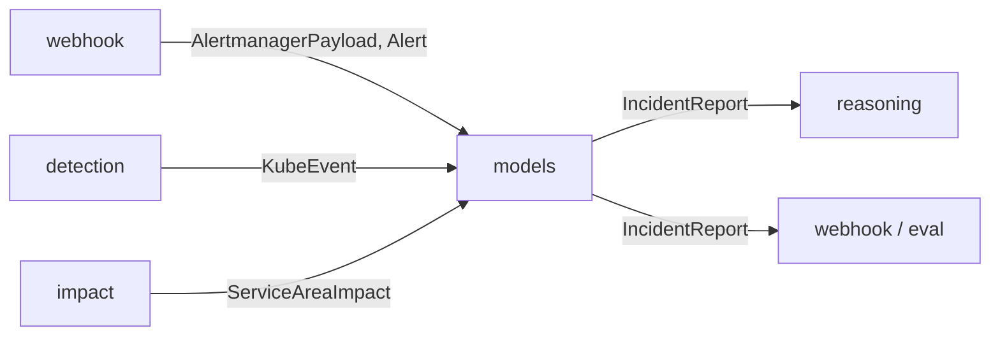

# src/rca_agent/models Folder Specification

| Field | Value |
|-------|-------|
| Specification identifier | SPEC-src-rca_agent-models |
| Repository-relative folder | `src/rca_agent/models/` |
| Role | Data model / schema — input (alert/event) and output (incident report) Pydantic schemas |
| Current commit | `2f4774f0476d5b47426ac1548c479f132c467332` |
| Generated/refreshed | 2026-11-03 |
| Status | Draft until maintainer review |
| Parent specification | [`../SPECS.md`](../SPECS.md) |

Authority notice: the source files, tests, and build definitions in this
repository remain authoritative. This specification is derived, bounded
evidence and must be reconciled with source on any conflict.

## 1. Intent and significance

This folder owns the typed boundary schemas of the agent. It defines the input
contracts (an Alertmanager webhook payload, a single alert, and a normalized
Kubernetes event) and the output contract (the incident report with ranked
root-cause hypotheses, evidence, citations, and blast radius). Every other
runtime folder depends on these shapes, so this is a stable aggregation
boundary for the system's data contracts rather than a leaf of behavior. It is
a leaf in the directory tree (no child folders).

## 2. Scope and contents

- Direct files: 3 Python files. Immediate child folders: 0.
- [`alert.py`](alert.py) — input schemas: `Alert`, `AlertmanagerPayload`, `KubeEvent`.
- [`incident.py`](incident.py) — output schemas: `Severity`, `Citation`, `Evidence`, `Hypothesis`, `IncidentReport`.
- [`__init__.py`](__init__.py) — re-exports the public symbols via `__all__`.
- Language/format: Python 3.10+ using Pydantic v2 `BaseModel` and `Enum`.
- No executable entrypoint; this is a library package.

## 3. Inputs

- `AlertmanagerPayload` / `Alert` are populated from JSON posted to the webhook
  (field aliases such as `startsAt`, `groupLabels` map the Alertmanager v4 wire
  names). Direct producer: [`../webhook/`](../webhook/SPECS.md).
- `KubeEvent` is populated from Kubernetes Warning events. Direct producer:
  [`../detection/`](../detection/SPECS.md) and [`../tools/`](../tools/SPECS.md).
- `IncidentReport` embeds `ServiceAreaImpact` from [`../impact/`](../impact/SPECS.md).

## 4. Outputs

- Validated Python objects consumed across the agent.
- `IncidentReport` is serialized to JSON for the API, the dashboard, and the
  incident-capture JSONL records. Direct consumers: [`../reasoning/`](../reasoning/SPECS.md),
  [`../webhook/`](../webhook/SPECS.md), [`../eval/`](../eval/SPECS.md).

## 5. Contracts and models

### 5.1 Behavioral contracts

- `Alert.target` resolves the affected resource by a fixed label priority:
  `pod > deployment > statefulset > service > job > instance` (direct evidence,
  `alert.py`).
- `KubeEvent.is_fault_signal` is True when `reason` is in `FAULT_REASONS` or the
  event type is `Warning`.
- `IncidentReport.ranked()` sorts `hypotheses` by `confidence` descending and
  returns self; `top_hypothesis` returns the first or `None`.
- `AlertmanagerPayload`/`Alert` set `populate_by_name=True`, so both wire aliases
  and field names are accepted.

### 5.2 Declared models and callable surface

| Symbol | Kind | Source |
|--------|------|--------|
| `Alert` | model | [`alert.py`](alert.py) |
| `AlertmanagerPayload` | model | [`alert.py`](alert.py) |
| `KubeEvent` (+ `FAULT_REASONS`, `is_fault_signal`) | model | [`alert.py`](alert.py) |
| `Severity` | enum | [`incident.py`](incident.py) |
| `Citation` | model | [`incident.py`](incident.py) |
| `Evidence` | model | [`incident.py`](incident.py) |
| `Hypothesis` | model | [`incident.py`](incident.py) |
| `IncidentReport` (+ `top_hypothesis`, `ranked`) | model | [`incident.py`](incident.py) |

`FAULT_REASONS` is a compatibility-sensitive tuple: `CrashLoopBackOff`,
`OOMKilled`, `ImagePullBackOff`, `ErrImagePull`, `FailedScheduling`, `Unhealthy`,
`FailedMount`, `NodeNotReady`, `Evicted`.

### 5.3 Required invariants

- `IncidentReport.status` is `"active"` or `"inactive"`; `resolved_at` is set
  only on recovery (documented invariant in source).
- Additive fields (`service_area`, `related_incidents`, `affected_anchor`,
  `anchor_kind`) default to `None`/empty so existing serialization is
  backward-compatible.
- `confidence` is a float in the range 0.0–1.0 (documented range; not enforced
  by a validator — see unknowns).

## 6. Interaction points

| Direction | Folder | Type |
|-----------|--------|------|
| Parent | [`../`](../SPECS.md) | containment |
| Outbound | [`../impact/`](../impact/SPECS.md) | import (`ServiceAreaImpact`) |
| Inbound | [`../webhook/`](../webhook/SPECS.md) | import (payload + report) |
| Inbound | [`../detection/`](../detection/SPECS.md) | import (`Alert`, `KubeEvent`, `IncidentReport`) |
| Inbound | [`../reasoning/`](../reasoning/SPECS.md) | import (`Alert`, `IncidentReport`) |
| Inbound | [`../tools/`](../tools/SPECS.md) | import (`KubeEvent`) |
| Inbound | [`../eval/`](../eval/SPECS.md) | import (report) |

Static import evidence proves dependency edges, not full runtime call sequences.

## 7. Exception and error handling

No explicit `raise` or `try` blocks in these files. Validation errors are
raised by Pydantic when input fails a type/alias contract (inferred from
Pydantic `BaseModel` usage, not a local mechanism). Property accessors use safe
`dict.get` with defaults (`UnknownAlert`, `None`).

## 8. Environment variables and configuration

No direct environment-variable access in this folder. Configuration reaches the
system through [`../config.py`](../config.py); these models carry no settings.

## 9. Storage, memory, and resource map

| Resource | Owner | Lifetime | Release |
|----------|-------|----------|---------|
| Model instances | caller | per request / per incident | garbage collected |
| `incident_id` (uuid4 hex[:12]) | `IncidentReport` factory | per report | n/a |

All objects are in-process host memory only. No files, sockets, or threads are
owned here.

## 10. Interaction diagram

## 11. Cross-cutting design considerations

- Compatibility: additive, defaulted fields protect serialized consumers.
- Data integrity: Pydantic enforces types at the boundary.
- Security: `Citation`/`Evidence` can carry real log text; treat serialized
  reports as sensitive (see [`../config.py`](../config.py) capture redaction).

## 12. Spec-driven development protocol

Future work in this folder must: (1) record the intended contract delta here;
(2) identify affected parent and consumer specs (webhook, reasoning, detection,
impact, eval); (3) add the smallest test that proves the new field/behavior;
(4) implement without widening scope; (5) run `pytest -q`; (6) reconcile this
spec with the final code.

Acceptance scenarios:

- SPEC-src-rca_agent-models-AC1 (valid): Given an Alertmanager v4 JSON body,
  When parsed into `AlertmanagerPayload`, Then aliases map correctly and
  `Alert.target` returns the highest-priority resource label.
- SPEC-src-rca_agent-models-AC2 (invalid): Given a payload missing required
  fields or with wrong types, When parsed, Then Pydantic raises a validation
  error and no partial model is used downstream.
- SPEC-src-rca_agent-models-AC3 (compatibility): Given a new optional field is
  added to `IncidentReport`, When an older serialized report is loaded, Then it
  still parses because the field is defaulted.
- SPEC-src-rca_agent-models-AC4 (verification): Given a set of hypotheses with
  mixed confidence, When `ranked()` runs, Then hypotheses are ordered by
  descending confidence and `top_hypothesis` is the maximum.

## 13. Verification strategy

Cheapest boundary is unit testing of model parsing and `ranked()`/`target`
behavior. Model shapes are exercised indirectly by
[`../../../tests/test_webhook.py`](../../../tests/test_webhook.py) and the
reasoning/detection tests. No tests were executed for this documentation task.

## 14. Evidence inventory

| File | Type | Bytes |
|------|------|-------|
| [`alert.py`](alert.py) | Python | ~2.5 KB |
| [`incident.py`](incident.py) | Python | ~4.8 KB |
| [`__init__.py`](__init__.py) | Python | ~0.4 KB |

## 15. Unknowns and review items

- `Hypothesis.confidence` has a documented 0.0–1.0 range but no runtime
  validator; maintainer should confirm whether enforcement is intended.
- Static imports prove dependency edges only; exact runtime call frequency is
  not captured by this bounded scan.
