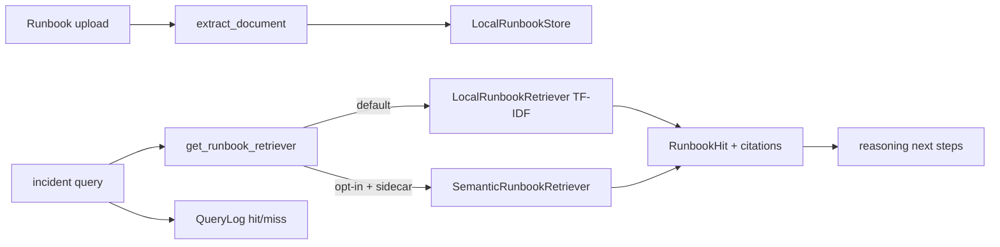

# src/rca_agent/rag Folder Specification

| Field | Value |
|-------|-------|
| Specification identifier | SPEC-src-rca_agent-rag |
| Repository-relative folder | `src/rca_agent/rag/` |
| Role | Production runtime — runbook retrieval (local TF-IDF + opt-in semantic), document store, query log |
| Current commit | `2f4774f0476d5b47426ac1548c479f132c467332` |
| Generated/refreshed | 2026-11-03 (query-log persistence notes reflect the incident-persistence-postgres feature) |
| Status | Draft until maintainer review |
| Parent specification | [`../SPECS.md`](../SPECS.md) |

Authority notice: the source files, tests, and build definitions in this
repository remain authoritative. This specification is derived, bounded
evidence and must be reconciled with source on any conflict.

## 1. Intent and significance

This folder owns Retrieval-Augmented Generation (RAG) over operator runbooks.
The agent only reads runbooks and surfaces them as suggested next steps for a
human; it never acts on them. It provides a local document store over files
uploaded via the dashboard, an extractive TF-IDF retriever (the default), an
opt-in embeddings-based semantic retriever gated behind a live LLM sidecar, and
a query log that records every retrieval attempt (including zero-hit
"negatives"). It is a leaf directory.

## 2. Scope and contents

- Direct files: 5 Python files. Immediate child folders: 0.
- [`runbook_retriever.py`](runbook_retriever.py) — `RunbookRetriever` (abstract),
  `LocalRunbookRetriever`, `NullRunbookRetriever`, `StubRunbookRetriever`,
  `RunbookHit`, `RunbookAsset`, `get_runbook_retriever`.
- [`local_store.py`](local_store.py) — `LocalRunbookStore`, `extract_document`,
  `extract_text`, `get_local_store`.
- [`semantic_store.py`](semantic_store.py) — embeddings + in-memory ChromaDB
  semantic retriever (opt-in `rag-semantic` extra).
- [`query_log.py`](query_log.py) — `QueryLog`, `QueryLogEntry`, `get_query_log`.
- [`__init__.py`](__init__.py) — re-exports the public surface.
- Language: Python 3.10+; TF-IDF via stdlib (`re`, `collections.Counter`,
  `math`); semantic path uses optional heavy deps imported lazily.

## 3. Inputs

- Uploaded runbook documents (`.txt`/`.md`/`.pdf`) from the dashboard Runbooks
  tab (parsed by `extract_document`/`extract_text`).
- A query string derived from the incident (resource name, reasons; hash-like
  Kubernetes suffixes and stopwords are stripped before scoring).
- `Settings` (`runbook_store_path`, `runbook_rag_top_k`, `runbook_asset_dir`,
  `runbook_rag_semantic`, `runbook_rag_embed_model`, `runbook_rag_url`,
  `runbook_query_log_max_entries`).

## 4. Outputs

- `RunbookHit` results (ranked matches with citations) and `RunbookAsset`
  references (page images extracted from PDFs).
- `QueryLogEntry` records (query, hit/miss, timestamp).
- Direct consumers: [`../reasoning/`](../reasoning/SPECS.md) (next-step
  synthesis), [`../webhook/`](../webhook/SPECS.md) (upload/list/query endpoints).

## 5. Contracts and models

### 5.1 Behavioral contracts

- Two separate additive sources: `LocalRunbookRetriever` (local, no network/LLM,
  built) and the still-unbuilt HTTP doc-intelligence retriever. Local takes
  priority when documents are uploaded.
- Semantic mode is gated: used only when `runbook_rag_semantic` is True AND the
  semantic deps import AND the LLM sidecar is opted-in and reachable; otherwise
  it falls back transparently to extractive TF-IDF.
- Structure-aware extraction (tables, command blocks, page images) is default
  via `extract_document`, independent of the semantic opt-in.
- The query log records every attempt; a zero-hit entry is the signal to write a
  new runbook.
- Durable query log: when a query-log store is wired in (injected by the webhook
  lifespan), `QueryLog.record(...)` write-through-persists each entry via
  `append` (non-fatal on failure), `clear()` also clears the DB rows (so a
  cleared log stays cleared across restarts), and `QueryLog.rehydrate(...)`
  reloads recent entries from the store at startup. See
  [`../store/`](../store/SPECS.md).

### 5.2 Declared models and callable surface

| Symbol | Kind | Source |
|--------|------|--------|
| `RunbookRetriever` | abstract base | [`runbook_retriever.py`](runbook_retriever.py) |
| `LocalRunbookRetriever` | class | [`runbook_retriever.py`](runbook_retriever.py) |
| `NullRunbookRetriever` / `StubRunbookRetriever` | classes | [`runbook_retriever.py`](runbook_retriever.py) |
| `RunbookHit` / `RunbookAsset` | models | [`runbook_retriever.py`](runbook_retriever.py) |
| `get_runbook_retriever` | factory | [`runbook_retriever.py`](runbook_retriever.py) |
| `LocalRunbookStore` / `extract_document` / `extract_text` / `get_local_store` | class/functions | [`local_store.py`](local_store.py) |
| `QueryLog` / `QueryLogEntry` / `get_query_log` | class/model/factory | [`query_log.py`](query_log.py) |
| (semantic retriever) | class | [`semantic_store.py`](semantic_store.py) |

### 5.3 Required invariants

- Read-only toward runbooks: no automated action is taken on retrieved content.
- Semantic index is held in memory only (no on-disk Chroma sqlite volume);
  rebuilt from the local store on startup (documented in [`../config.py`](../config.py)).
- Query log is bounded by `runbook_query_log_max_entries` (default 1000).

## 6. Interaction points

| Direction | Folder | Type |
|-----------|--------|------|
| Parent | [`../`](../SPECS.md) | containment |
| Outbound | [`../config.py`](../config.py) | import (`Settings`) |
| Outbound | [`../store/`](../store/SPECS.md) | write-through `append`/`clear` + rehydrate of the query log (optional store, non-fatal) |
| Inbound | [`../reasoning/`](../reasoning/SPECS.md) | runbook retrieval |
| Inbound | [`../webhook/`](../webhook/SPECS.md) | import (`extract_document`, `get_local_store`, `get_query_log`); injects the query-log store |

Semantic-mode dependency on the LLM sidecar is runtime/dynamic; the heavy deps
are imported lazily and not proven present by a static scan.

## 7. Exception and error handling

Semantic path falls back to extractive on missing deps or an unreachable
sidecar (documented). PDF parsing has a pure-Python `pypdf` fallback when
`pymupdf4llm`/PyMuPDF are unavailable (documented in [`../../../pyproject.toml`](../../../pyproject.toml)
`rag` extra). Exact exception handling in `local_store.py`/`semantic_store.py`
needs a full read (bounded scan — see unknowns).

## 8. Environment variables and configuration

No direct `os.environ` access observed in `runbook_retriever.py`. Configuration
arrives via `Settings` (`RCA_RUNBOOK_*`). Default store/asset paths are under
`/tmp/runbooks/`.

## 9. Storage, memory, and resource map

| Resource | Owner | Lifetime | Release |
|----------|-------|----------|---------|
| Runbook store JSON (`runbook_store_path`) | `LocalRunbookStore` | persistent (local disk) | wiped on redeploy |
| Extracted PDF assets (`runbook_asset_dir`) | `extract_document` | persistent (local disk) | wiped on redeploy |
| In-memory Chroma index | semantic retriever | process lifetime | rebuilt on startup, GC |
| Query log entries | `QueryLog` | process lifetime (in-memory, bounded) + durable DB rows via the store | bounded in memory, oldest evicted; DB rows retained (cleared only by `clear()`) |

## 10. Interaction diagram

## 11. Cross-cutting design considerations

- Portability: base install is stdlib-only TF-IDF; heavy deps are opt-in extras.
- Observability: the query log surfaces coverage gaps (negatives).
- Security: uploaded runbooks and extracted assets are local; store is wiped on
  redeploy.

## 12. Spec-driven development protocol

Future work must: (1) record any change to retriever selection, scoring, or the
store format here; (2) identify affected reasoning/webhook specs; (3) add a RAG
unit test (see `tests/test_runbook_rag.py`, `tests/test_semantic_rag.py`);
(4) implement keeping semantic strictly opt-in with extractive fallback;
(5) run `pytest -q`; (6) reconcile this spec.

Acceptance scenarios:

- SPEC-src-rca_agent-rag-AC1 (valid): Given an uploaded runbook and an incident
  query, When the local retriever runs, Then it returns ranked `RunbookHit`
  results with citations.
- SPEC-src-rca_agent-rag-AC2 (failure/fallback): Given `runbook_rag_semantic` is
  True but the sidecar is unreachable, When retrieval runs, Then it falls back to
  the extractive TF-IDF retriever.
- SPEC-src-rca_agent-rag-AC3 (compatibility): Given PyMuPDF is unavailable, When
  a PDF is uploaded, Then the pure-Python `pypdf` fallback extracts text.
- SPEC-src-rca_agent-rag-AC4 (verification): Given a query with no matching
  runbook, When retrieval runs, Then a zero-hit `QueryLogEntry` is recorded.

## 13. Verification strategy

Unit tests over TF-IDF scoring, document extraction, query log, and semantic
fallback. Related tests:
[`../../../tests/test_runbook_rag.py`](../../../tests/test_runbook_rag.py),
[`../../../tests/test_semantic_rag.py`](../../../tests/test_semantic_rag.py).
No tests were executed for this documentation task.

## 14. Evidence inventory

| File | Type | Bytes |
|------|------|-------|
| [`runbook_retriever.py`](runbook_retriever.py) | Python | ~13.5 KB (13,460) |
| [`local_store.py`](local_store.py) | Python | ~21.2 KB (21,156) |
| [`semantic_store.py`](semantic_store.py) | Python | ~9.4 KB (9,390) |
| [`query_log.py`](query_log.py) | Python | ~2.6 KB (2,648) |
| [`__init__.py`](__init__.py) | Python | ~1.2 KB |

## 15. Unknowns and review items

- Only `runbook_retriever.py` header and `__init__.py` were fully read in this
  bounded scan; `local_store.py`, `semantic_store.py`, and `query_log.py` need a
  complete read to confirm store format, extraction behavior, and log eviction
  before this spec is marked reviewed.
- The HTTP doc-intelligence retriever is documented as unbuilt; confirm it
  remains inert when `runbook_rag_url` is set.
