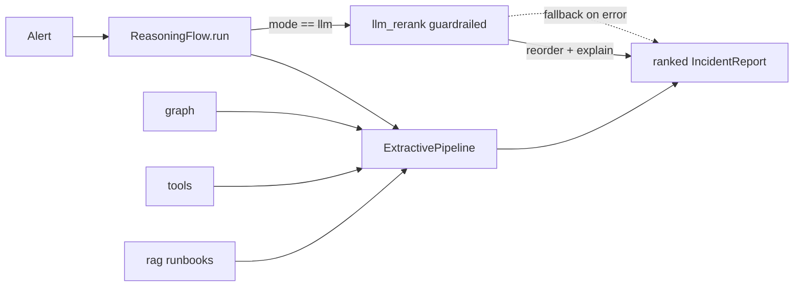

# src/rca_agent/reasoning Folder Specification

| Field | Value |
|-------|-------|
| Specification identifier | SPEC-src-rca_agent-reasoning |
| Repository-relative folder | `src/rca_agent/reasoning/` |
| Role | Production runtime — reasoning entry point: deterministic extractive pipeline + optional LLM re-rank |
| Current commit | `2f4774f0476d5b47426ac1548c479f132c467332` |
| Generated/refreshed | 2026-11-03 |
| Status | Draft until maintainer review |
| Parent specification | [`../SPECS.md`](../SPECS.md) |

Authority notice: the source files, tests, and build definitions in this
repository remain authoritative. This specification is derived, bounded
evidence and must be reconciled with source on any conflict.

## 1. Intent and significance

This folder owns the reasoning entry point used by both detection paths. The
deterministic extractive pipeline gathers evidence and produces ranked
candidate causes with no LLM; when `reasoning_mode == "llm"`, a local llama.cpp
sidecar re-ranks and explains the rule-gathered hypotheses only. The LLM can
never introduce a cause lacking supporting evidence, and any failure falls back
to the extractive order, so extractive stays the reproducible default. This
embodies the project's "rules first, LLM second" principle. It is a leaf
directory and the single reasoning boundary.

## 2. Scope and contents

- Direct files: 7 Python files. Immediate child folders: 0.
- [`flow.py`](flow.py) — `ReasoningFlow` (entry point; chooses extractive or LLM re-rank).
- [`extractive.py`](extractive.py) — `ExtractivePipeline` (deterministic evidence gathering + ranking).
- [`llm_rerank.py`](llm_rerank.py) — `llm_rerank` (guardrailed reorder + explain via sidecar).
- [`runbook_synth.py`](runbook_synth.py) — runbook-based next-step synthesis.
- [`state.py`](state.py) — `ReasoningState`.
- [`steps.py`](steps.py) — pipeline step helpers.
- [`__init__.py`](__init__.py) — re-exports `ExtractivePipeline`, `ReasoningFlow`, `ReasoningState`.
- Language: Python 3.10+; LLM path uses the optional `llm` extra (LangGraph).

## 3. Inputs

- An `Alert` (from webhook or synthesized from a `KubeEvent` by detection).
- A `DependencyGraph` (upstream/downstream/anchor data).
- Evidence from [`../tools/`](../tools/SPECS.md) (pod status, events, logs,
  metrics, changes).
- Runbook hits from [`../rag/`](../rag/SPECS.md).
- `Settings` (`reasoning_mode`, `llm_*`, correlation windows, runbook settings).

## 4. Outputs

- A ranked `IncidentReport` with hypotheses, evidence chains, citations, blast
  radius, upstream-unhealthy, and suggested next steps.
- `reasoning_mode` provenance stamped on the report.
- Direct consumers: [`../detection/`](../detection/SPECS.md),
  [`../webhook/`](../webhook/SPECS.md).

## 5. Contracts and models

### 5.1 Behavioral contracts

- `ReasoningFlow.run(alert)` always runs the extractive pipeline first, then
  applies LLM re-rank only when `reasoning_mode == "llm"`.
- `llm_rerank` enforces guardrails: reorder + explain only, reject unknown
  hypothesis ids, fence untrusted evidence, and fall back to extractive order on
  any error/unavailable sidecar (documented in `flow.py`/`llm_rerank.py`).
- The LLM has no cluster tool and cannot add a cause (documented).

### 5.2 Declared models and callable surface

| Symbol | Kind | Source |
|--------|------|--------|
| `ReasoningFlow` | class | [`flow.py`](flow.py) |
| `ExtractivePipeline` | class | [`extractive.py`](extractive.py) |
| `llm_rerank` | function | [`llm_rerank.py`](llm_rerank.py) |
| `ReasoningState` | class | [`state.py`](state.py) |
| (runbook synth helpers) | functions | [`runbook_synth.py`](runbook_synth.py) |
| (step helpers) | functions | [`steps.py`](steps.py) |

### 5.3 Required invariants

- Extractive mode produces the same ranked candidates and evidence table with
  no LLM (reproducibility invariant).
- Enabling the LLM can change only hypothesis order + a short explanation, never
  which causes exist.
- All claims carry citations (every hypothesis/evidence links to a source).

## 6. Interaction points

| Direction | Folder | Type |
|-----------|--------|------|
| Parent | [`../`](../SPECS.md) | containment |
| Outbound | [`../config.py`](../config.py) | import (`Settings`) |
| Outbound | [`../graph/`](../graph/SPECS.md) | import (`DependencyGraph`) |
| Outbound | [`../models/`](../models/SPECS.md) | import (`Alert`, `IncidentReport`) |
| Outbound | [`../tools/`](../tools/SPECS.md) | evidence queries |
| Outbound | [`../rag/`](../rag/SPECS.md) | runbook retrieval for next steps |
| Inbound | [`../detection/`](../detection/SPECS.md) | import (`ReasoningFlow`) |
| Inbound | [`../webhook/`](../webhook/SPECS.md) | import (`ReasoningFlow`) |

The LLM sidecar call is a runtime/dynamic relationship over loopback
(`llm_base_url`); a static scan cannot prove the live HTTP call.

## 7. Exception and error handling

`_llm_rerank` delegates to `llm_rerank`, which is documented to fall back to the
extractive order on any failure (timeout, unavailable sidecar, invalid
response). This guarantees the service always returns a valid report. Extractive
step error handling needs a full read of `extractive.py`/`steps.py` (bounded
scan — see unknowns).

## 8. Environment variables and configuration

No direct `os.environ` access. Configuration arrives via `Settings`
(`RCA_REASONING_MODE`, `RCA_LLM_PROVIDER`, `RCA_LLM_MODEL`, `RCA_LLM_BASE_URL`,
`RCA_LLM_TIMEOUT_SECONDS`, `RCA_LLM_MAX_TOKENS`, `RCA_LLM_TEMPERATURE`,
`RCA_RUNBOOK_*`).

## 9. Storage, memory, and resource map

| Resource | Owner | Lifetime | Release |
|----------|-------|----------|---------|
| `ExtractivePipeline` instance | `ReasoningFlow` | per flow | GC |
| HTTP connection to llama.cpp sidecar | `llm_rerank` | per request | closed after call |
| Report objects | caller | per incident | GC |

No persistent storage owned here. The sidecar is an external loopback process.

## 10. Interaction diagram

## 11. Cross-cutting design considerations

- Reproducibility: extractive default is deterministic and cheap.
- Security: LLM input evidence is fenced as untrusted; sidecar bound to loopback.
- Compatibility: LLM re-rank cannot change the set of causes, protecting
  consumers that depend on the extractive contract.

## 12. Spec-driven development protocol

Future work must: (1) record any change to the ranking or guardrail contract
here; (2) identify affected detection/webhook/models specs; (3) add a reasoning
unit test (see `tests/test_reasoning.py`, `tests/test_llm_rerank.py`);
(4) implement without letting the LLM invent causes; (5) run `pytest -q`;
(6) reconcile this spec.

Acceptance scenarios:

- SPEC-src-rca_agent-reasoning-AC1 (valid): Given extractive mode and an alert
  with evidence, When `ReasoningFlow.run` executes, Then a ranked report with
  cited hypotheses is returned deterministically.
- SPEC-src-rca_agent-reasoning-AC2 (failure): Given LLM mode and an unavailable
  sidecar, When re-rank is attempted, Then the extractive order is returned and
  the service does not fail.
- SPEC-src-rca_agent-reasoning-AC3 (guardrail/compatibility): Given the LLM
  returns an unknown hypothesis id, When re-rank validates, Then it is rejected
  and no new cause is introduced.
- SPEC-src-rca_agent-reasoning-AC4 (verification): Given the same alert in
  extractive and LLM modes, When both run, Then the set of hypotheses is
  identical and only order/explanation may differ.

## 13. Verification strategy

Unit tests over extractive ranking, LLM re-rank guardrails, and runbook
synthesis. Related tests:
[`../../../tests/test_reasoning.py`](../../../tests/test_reasoning.py),
[`../../../tests/test_llm_rerank.py`](../../../tests/test_llm_rerank.py),
[`../../../tests/test_runbook_synth.py`](../../../tests/test_runbook_synth.py).
No tests were executed for this documentation task.

## 14. Evidence inventory

| File | Type | Bytes |
|------|------|-------|
| [`flow.py`](flow.py) | Python | ~2.0 KB (2,003) |
| [`extractive.py`](extractive.py) | Python | ~5.3 KB (5,304) |
| [`llm_rerank.py`](llm_rerank.py) | Python | ~10.1 KB (10,121) |
| [`runbook_synth.py`](runbook_synth.py) | Python | ~4.5 KB (4,494) |
| [`state.py`](state.py) | Python | ~1.3 KB (1,330) |
| [`steps.py`](steps.py) | Python | ~24.5 KB (24,496) |
| [`__init__.py`](__init__.py) | Python | ~0.3 KB (300) |

## 15. Unknowns and review items

- All seven files were read in full during reconciliation. `steps.py` defines
  the six deterministic steps (`triage`, `gather_evidence`, `graph_walk`,
  `change_correlation`, `hypothesize_and_rank`, `build_next_steps`) plus
  `build_service_area`, each mutating a `ReasoningState`, with a `fence()`
  untrusted-data delimiter. `llm_rerank.py` confirms the guardrails: index
  permutation validation (`_validate_order`), unknown-id rejection, evidence
  fencing, echo rejection (`_is_echo`), a `sidecar_available` liveness probe,
  and extractive fallback on any error. Content is corroborated; status stays
  draft pending maintainer review.
- `ReasoningState` ([`state.py`](state.py)) is a plain mutable state object
  shared by the extractive pipeline and the LangGraph nodes (confirmed by the
  `steps.py` module docstring), not a LangGraph-specific type.
