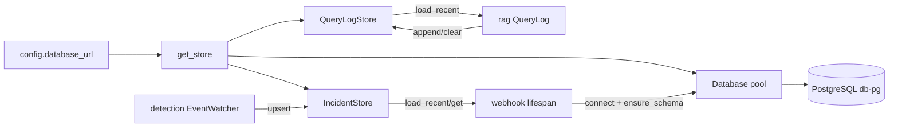

# src/rca_agent/store Folder Specification

| Field | Value |
|-------|-------|
| Specification identifier | SPEC-src-rca_agent-store |
| Repository-relative folder | `src/rca_agent/store/` |
| Role | Production runtime — durable PostgreSQL datastore for incidents and the runbook query log |
| Current commit | `2f4774f0476d5b47426ac1548c479f132c467332` |
| Generated/refreshed | 2026-11-03 (reflects the incident-persistence-postgres feature) |
| Status | Draft until maintainer review |
| Parent specification | [`../SPECS.md`](../SPECS.md) |

Authority notice: the source files, tests, and build definitions in this
repository remain authoritative. This specification is derived, bounded
evidence and must be reconciled with source on any conflict.

Reconciliation note: this folder is new in the incident-persistence-postgres
feature; its machine-generated sections are draft and reflect the feature
code rather than the baseline commit named above (kept to match the sibling
specs). Re-verify on the next full reconciliation pass.

## 1. Intent and significance

This folder owns the agent's own durable datastore. Before this feature the
in-memory incident store and runbook query log were lost on every restart — an
inactive incident or a cleared query log did not survive a redeploy. This
package adds a thin, mandatory PostgreSQL store (decisions D1–D6) so incidents
and runbook-retrieval attempts persist across restarts and can be rehydrated
into the in-memory caches at startup. The store is write-through: callers keep
their in-memory copy and the DB is the durable superset. It is a leaf directory
and imports only `psycopg`/`psycopg_pool`, the stdlib, and the agent models —
never cluster or heavy app modules. The database is the agent's own datastore,
never a Kubernetes write path (the read-only-toward-Kubernetes posture is
unchanged).

## 2. Scope and contents

- Direct files: 5 Python files. Immediate child folders: 0.
- [`db.py`](db.py) — `Database` (psycopg_pool `ConnectionPool`,
  `connect_with_retry`, `ensure_schema`, `is_ready`, `connection`, `close`),
  `ConfigurationError`, and the idempotent schema DDL.
- [`incident_store.py`](incident_store.py) — `IncidentStore` (`upsert`,
  `load_recent`, `get`, `count`) over the `incidents` table.
- [`query_log_store.py`](query_log_store.py) — `QueryLogStore` (`append`,
  `load_recent`, `clear`, `stats`) over the `runbook_query_log` table.
- [`factory.py`](factory.py) — `Store` dataclass and the `@lru_cache`
  `get_store()` process singleton.
- [`__init__.py`](__init__.py) — re-exports `ConfigurationError`, `Database`,
  `IncidentStore`, `QueryLogStore`, `Store`, `get_store`.
- Language: Python 3.10+; psycopg v3 (synchronous) + psycopg_pool, both core
  dependencies (D2).

## 3. Inputs

- `RCA_DATABASE_URL` (the `db-pg` connection string), read via
  `Settings.database_url` from [`../config.py`](../config.py). Sourced from a
  Secret in deployment.
- `IncidentReport` objects to persist (from [`../detection/`](../detection/SPECS.md)
  and [`../webhook/`](../webhook/SPECS.md)).
- `QueryLogEntry` objects to persist (from [`../rag/`](../rag/SPECS.md)).

## 4. Outputs

- Rehydrated `IncidentReport` lists (`load_recent`/`get`) and `QueryLogEntry`
  lists (`load_recent`) reconstructed from the JSONB payload.
- `stats()`/`count()` aggregates computed by SQL.
- A `is_ready()` readiness flag consulted by [`../webhook/`](../webhook/SPECS.md)
  `/readyz`.
- Direct consumers: [`../webhook/`](../webhook/SPECS.md) (lifespan construct +
  connect + rehydrate, `/incidents/{id}` DB fallback),
  [`../detection/`](../detection/SPECS.md) (incident write-through),
  [`../rag/`](../rag/SPECS.md) (query-log write-through + rehydrate).

## 5. Contracts and models

### 5.1 Behavioral contracts

- The store is mandatory (D1): constructing `Database` with an unset
  `RCA_DATABASE_URL` raises `ConfigurationError` (fail fast, Req 4.3). There is
  no in-memory-only runtime mode.
- `connect_with_retry` opens the pool with bounded exponential backoff and does
  not raise past its attempt budget; on persistent failure the pool stays `None`
  and `is_ready()` returns False (Req 5.1). `/readyz` reflects readiness;
  `/healthz` must not depend on the DB (Req 5.2).
- `ensure_schema()` is idempotent (`CREATE TABLE/INDEX IF NOT EXISTS`), safe to
  run on every startup (Req 4.4).
- One table per store plus a JSONB `payload` full-record column (D4). The
  payload is the source of truth on reload: `IncidentReport.model_validate` /
  `QueryLogEntry(**payload)` so nested fields round-trip faithfully (Req 2.5, 9.2).
- `IncidentStore.upsert` is `INSERT ... ON CONFLICT (incident_id) DO UPDATE`, so
  re-persisting a mutated incident updates in place (no duplicate row, Req 2.1).
- `QueryLogStore.append` is append-only (Req 9.1); `clear()` is a durable
  `TRUNCATE` returning the removed count (Req 9.5).
- All SQL uses parameterized `%s` placeholders — values are never
  string-formatted into SQL.

### 5.2 Declared models and callable surface

| Symbol | Kind | Source |
|--------|------|--------|
| `Database` | class | [`db.py`](db.py) |
| `ConfigurationError` | exception | [`db.py`](db.py) |
| `IncidentStore` (+ `upsert`, `load_recent`, `get`, `count`) | class | [`incident_store.py`](incident_store.py) |
| `QueryLogStore` (+ `append`, `load_recent`, `clear`, `stats`) | class | [`query_log_store.py`](query_log_store.py) |
| `Store` | dataclass | [`factory.py`](factory.py) |
| `get_store` | cached singleton factory | [`factory.py`](factory.py) |

Tables: `incidents` (typed columns `incident_id` PK, `created_at`, `status`,
`resolved_at`, `affected_resource`, `namespace`, `severity`, plus `payload`
JSONB and `updated_at`) and `runbook_query_log` (`id` bigserial PK, `ts`,
`query`, `retriever`, `hit_count`, `payload` JSONB), with the
`incidents_status_created_at_idx` and `runbook_query_log_ts_idx` indexes.

### 5.3 Required invariants

- `get_store()` only *constructs* the store graph; it never opens the pool or
  creates the schema — connection lifecycle is the app lifespan's job.
- `db.py` imports nothing from the agent config (to avoid an import cycle);
  `factory.py` reaches `get_settings()` lazily.
- The store is never a Kubernetes write path; the read-only posture is unchanged.

## 6. Interaction points

| Direction | Folder | Type |
|-----------|--------|------|
| Parent | [`../`](../SPECS.md) | containment |
| Outbound | [`../config.py`](../config.py) | import (`get_settings`, `database_url`) |
| Outbound | [`../models/`](../models/SPECS.md) | import (`IncidentReport`) |
| Outbound | [`../rag/`](../rag/SPECS.md) | import (`QueryLogEntry`) |
| Inbound | [`../webhook/`](../webhook/SPECS.md) | construct/connect/rehydrate; `/incidents/{id}` DB fallback; `/readyz` |
| Inbound | [`../detection/`](../detection/SPECS.md) | write-through `upsert` of incidents |
| Inbound | [`../rag/`](../rag/SPECS.md) | write-through `append`/`clear` + rehydrate of the query log |

Static import evidence proves dependency edges, not full runtime call sequences.

## 7. Exception and error handling

A missing `RCA_DATABASE_URL` raises `ConfigurationError` at `Database`
construction (fail fast, Req 4.3). `connect_with_retry` catches connect errors,
logs each attempt, and does not raise past its bounded attempts (Req 5.1).
`ensure_schema`/`connection` raise `ConfigurationError` if called before a pool
is connected. `close()` is best-effort (logs and swallows on error). Per-write
non-fatal handling lives in the callers ([`../detection/`](../detection/SPECS.md),
[`../rag/`](../rag/SPECS.md)): a runtime write failure is logged and the
in-memory copy is retained (Req 5.3, 5.4).

## 8. Environment variables and configuration

No direct `os.environ` access. Driven by `Settings.database_url`
(`RCA_DATABASE_URL`) from [`../config.py`](../config.py). Pool sizing
(`min_size`/`max_size`) is a `Database` constructor argument (defaults 1/4).

## 9. Storage, memory, and resource map

| Resource | Owner | Lifetime | Release |
|----------|-------|----------|---------|
| Connection pool | `Database` | opened at lifespan startup | `close()` on shutdown |
| Pooled connection | `Database.connection()` | per operation | returned to pool |
| `incidents` / `runbook_query_log` tables | PostgreSQL (`db-pg`) | persistent (DB-backed) | retained while the DB lasts |
| `Store` singleton | `get_store` lru_cache | process lifetime | process exit |

Retention: no application-level pruning — history grows with the DB while the
in-memory caches stay capped; a read can page beyond the in-memory cap (Req 8.x).

## 10. Interaction diagram

## 11. Cross-cutting design considerations

- Safety: the DB is the agent's own datastore, never a cluster write; the
  read-only-toward-Kubernetes posture is preserved.
- Resilience: startup connect is non-fatal with bounded backoff; per-write
  failures degrade gracefully and are retried on the next mutation.
- Security: PG credentials come only from a Secret/env (never committed);
  stored `payload` rows carry real log text and object names — treat as
  sensitive (mirrors [`../config.py`](../config.py) capture redaction guidance).
- Compatibility: write-through is additive; the in-memory caches and their caps
  are unchanged, and the DB is the durable superset.

## 12. Spec-driven development protocol

Future work must: (1) record any schema or store-contract change here;
(2) identify affected consumer specs (webhook, detection, rag) and the config
spec; (3) add the smallest DB-backed round-trip test (skip-if-no-DB marker);
(4) implement keeping the store off the Kubernetes write path and non-fatal at
runtime; (5) run `make check` (lint + tests, which still pass without a test
PostgreSQL via the skip marker); (6) reconcile this spec.

Acceptance scenarios:

- SPEC-src-rca_agent-store-AC1 (valid): Given a connected store and an
  `IncidentReport`, When `upsert` then `get`/`load_recent` run, Then the
  reconstructed report equals the original across all nested fields.
- SPEC-src-rca_agent-store-AC2 (invalid/fail-fast): Given `RCA_DATABASE_URL` is
  unset, When `get_store()`/`Database(...)` constructs, Then `ConfigurationError`
  is raised.
- SPEC-src-rca_agent-store-AC3 (compatibility/idempotent): Given `ensure_schema`
  runs twice, Then no error occurs and the tables/indexes are unchanged.
- SPEC-src-rca_agent-store-AC4 (verification/durability): Given incidents and a
  cleared query log are persisted, When a fresh store rehydrates after a restart,
  Then the previously-inactive incident is present and the cleared log stays
  empty.

## 13. Verification strategy

DB-backed round-trip and idempotency tests gated by a skip-if-no-DB marker so
`make check` still runs without PostgreSQL. Related tests cover the store
round-trips, schema idempotency, restart survival, and failure-mode behavior
(see the incident-persistence-postgres test additions under
[`../../../tests/`](../../../tests/SPECS.md)). No tests were executed for this
documentation task.

## 14. Evidence inventory

| File | Type | Bytes |
|------|------|-------|
| [`db.py`](db.py) | Python | ~8 KB |
| [`incident_store.py`](incident_store.py) | Python | ~5 KB |
| [`query_log_store.py`](query_log_store.py) | Python | ~5 KB |
| [`factory.py`](factory.py) | Python | ~2 KB |
| [`__init__.py`](__init__.py) | Python | ~0.8 KB |

Byte sizes are approximate (feature code just added); re-verify from file
metadata on the next reconciliation pass.

## 15. Unknowns and review items

- This folder is new; byte sizes above are approximate and should be refreshed
  from file metadata on the next full reconciliation pass.
- Exact retry/backoff timing and pool sizing defaults are documented in `db.py`;
  confirm they match the deployment's PG resource limits.
- The `payload` JSONB rows are sensitive (real log/object text); confirm the
  retention/redaction posture with the maintainer before this spec is reviewed.
