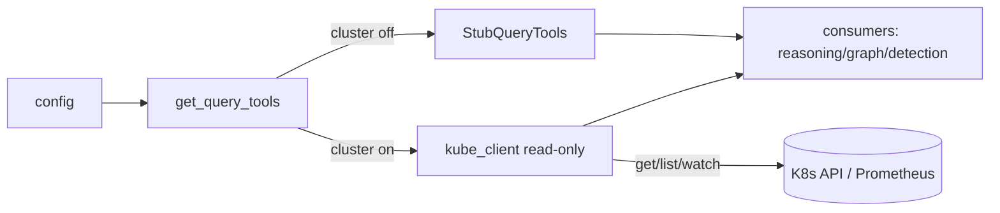

# src/rca_agent/tools Folder Specification

| Field | Value |
|-------|-------|
| Specification identifier | SPEC-src-rca_agent-tools |
| Repository-relative folder | `src/rca_agent/tools/` |
| Role | Production runtime — read-only query tools over cluster state (pods, events, logs, metrics, changes) |
| Current commit | `2f4774f0476d5b47426ac1548c479f132c467332` |
| Generated/refreshed | 2026-11-03 |
| Status | Draft until maintainer review |
| Parent specification | [`../SPECS.md`](../SPECS.md) |

Authority notice: the source files, tests, and build definitions in this
repository remain authoritative. This specification is derived, bounded
evidence and must be reconciled with source on any conflict.

## 1. Intent and significance

This folder is the only place the agent touches the cluster, and it is
deliberately read-only: there is no write, patch, or delete tool. Safety is
enforced by the absence of a write capability combined with `get/list/watch`
RBAC (see [`../../../deploy/helm/templates/rbac.yaml`](../../../deploy/helm/templates/rbac.yaml)).
It defines a pluggable `QueryTools` abstract interface with a deterministic
`StubQueryTools` implementation (no cluster) and a cluster-backed path. It is a
leaf directory and a key security boundary.

## 2. Scope and contents

- Direct files: 3 Python files. Immediate child folders: 0.
- [`query_tools.py`](query_tools.py) — `QueryTools` (abstract), `StubQueryTools`, `get_query_tools`.
- [`kube_client.py`](kube_client.py) — read-only Kubernetes client wrapper.
- [`__init__.py`](__init__.py) — re-exports `QueryTools`, `StubQueryTools`, `get_query_tools`.
- Language: Python 3.10+; abstract base classes (`abc.ABC`).

## 3. Inputs

- Resource name, namespace, and query parameters from callers.
- `Settings` from [`../config.py`](../config.py) (`cluster_enabled`,
  `log_tail_lines`, `change_correlation_window_minutes`, `prometheus_url`).
- When cluster access is enabled, read-only Kubernetes API responses via
  `kube_client.py`.

## 4. Outputs

- `pod_status` dict, `recent_events` list of `KubeEvent`, `logs` list of strings
  (treated as untrusted data), `metrics` dict, `recent_changes` list of dicts.
- Change citations carry `actor`/`actor_source`/`is_automation` classified from
  Kubernetes `managedFields` (feeds `Citation` in [`../models/`](../models/SPECS.md)).
- Direct consumers: [`../reasoning/`](../reasoning/SPECS.md),
  [`../graph/`](../graph/SPECS.md), [`../detection/`](../detection/SPECS.md).

## 5. Contracts and models

### 5.1 Behavioral contracts

- `QueryTools` declares abstract methods `pod_status`, `recent_events`, `logs`,
  `metrics`, `recent_changes` — the complete read-only surface.
- `StubQueryTools` returns deterministic demo data mirroring the headline
  scenario (UPF OOMKilled after a ConfigMap memory-limit change cascading into
  SMF errors).
- `logs()` output is documented as untrusted data (prompt-injection defense).
- `get_query_tools()` selects the stub or cluster implementation based on
  configuration (factory).

### 5.2 Declared models and callable surface

| Symbol | Kind | Source |
|--------|------|--------|
| `QueryTools` | abstract base | [`query_tools.py`](query_tools.py) |
| `StubQueryTools` | class | [`query_tools.py`](query_tools.py) |
| `get_query_tools` | factory function | [`query_tools.py`](query_tools.py) |
| (read-only client) | class/helpers | [`kube_client.py`](kube_client.py) |

### 5.3 Required invariants

- No write/patch/delete method exists on the interface (safety invariant).
- Log content is treated as untrusted and must be fenced as data by consumers.
- `metrics()` degrades gracefully when `prometheus_url` is unset (documented in
  [`../config.py`](../config.py)); pod status/events/logs/changes still work.

## 6. Interaction points

| Direction | Folder | Type |
|-----------|--------|------|
| Parent | [`../`](../SPECS.md) | containment |
| Outbound | [`../config.py`](../config.py) | import (`Settings`) |
| Outbound | [`../models/`](../models/SPECS.md) | import (`KubeEvent`) |
| Inbound | [`../reasoning/`](../reasoning/SPECS.md) | evidence gathering |
| Inbound | [`../graph/`](../graph/SPECS.md) | cluster listing for builder |
| Inbound | [`../detection/`](../detection/SPECS.md) | event polling |

The live Kubernetes call path is runtime/dynamic (only when `cluster_enabled`);
a static scan proves imports, not the live network call sequence.

## 7. Exception and error handling

`StubQueryTools` cannot fail at the network layer (in-memory data). The
cluster-backed path in `kube_client.py` handles API/connection errors; the
`metrics()` tool is documented to skip gracefully when Prometheus is not
configured. Exact exception translation in `kube_client.py` needs a full read
(bounded scan, see unknowns).

## 8. Environment variables and configuration

No direct `os.environ` access observed in `query_tools.py`. Configuration
arrives via `Settings` (`RCA_CLUSTER_ENABLED`, `RCA_LOG_TAIL_LINES`,
`RCA_CHANGE_CORRELATION_WINDOW_MINUTES`, `RCA_PROMETHEUS_URL`,
`RCA_KUBECONFIG_MODE`). `kube_client.py` may read kubeconfig/ServiceAccount
paths — verify in source.

## 9. Storage, memory, and resource map

| Resource | Owner | Lifetime | Release |
|----------|-------|----------|---------|
| Kubernetes API client/session | `kube_client.py` | process / per-call | client-managed |
| Stub demo dicts | `StubQueryTools` | per call | GC |
| Network socket to API server / Prometheus | cluster path | per request | connection-managed |

## 10. Interaction diagram

## 11. Cross-cutting design considerations

- Security: read-only by construction; the key control that enforces "never
  changes the cluster." Logs are untrusted input.
- Testability: the abstract interface and stub make the whole pipeline runnable
  with no cluster.
- Observability: change citations record who made a change and whether it was
  automation.

## 12. Spec-driven development protocol

Future work must: (1) record any new read-only query method here and confirm no
write capability is added; (2) identify affected reasoning/graph/detection
specs; (3) add a tool unit test (see `tests/test_query_tools.py`); (4) implement
without widening the capability surface; (5) run `pytest -q`; (6) reconcile this
spec.

Acceptance scenarios:

- SPEC-src-rca_agent-tools-AC1 (valid): Given cluster is disabled, When
  `get_query_tools()` returns `StubQueryTools` and `pod_status("upf", ns)` is
  called, Then it returns the deterministic OOMKilled demo status.
- SPEC-src-rca_agent-tools-AC2 (failure): Given `prometheus_url` is unset, When
  `metrics()` is called, Then it degrades gracefully without failing the rest
  of evidence gathering.
- SPEC-src-rca_agent-tools-AC3 (compatibility/safety): Given a change adds a new
  method, When reviewed, Then it must remain `get/list/watch`-only with no
  write/patch/delete capability.
- SPEC-src-rca_agent-tools-AC4 (verification): Given a change record from
  `managedFields`, When classified, Then the citation records `actor`,
  `actor_source`, and `is_automation`.

## 13. Verification strategy

Unit tests over `StubQueryTools` and change classification are the cheapest
boundary. Related tests:
[`../../../tests/test_query_tools.py`](../../../tests/test_query_tools.py). No
tests were executed for this documentation task.

## 14. Evidence inventory

| File | Type | Bytes |
|------|------|-------|
| [`query_tools.py`](query_tools.py) | Python | ~24.6 KB (24,579) |
| [`kube_client.py`](kube_client.py) | Python | ~3.2 KB (3,224) |
| [`__init__.py`](__init__.py) | Python | ~0.3 KB |

## 15. Unknowns and review items

- `kube_client.py` was not fully read in this bounded scan; its exact RBAC
  verbs used, kubeconfig loading modes, and exception handling need a complete
  review before this spec is marked reviewed.
- `get_query_tools()` cluster-path selection logic should be confirmed against
  `cluster_enabled` and `kubeconfig_mode`.
