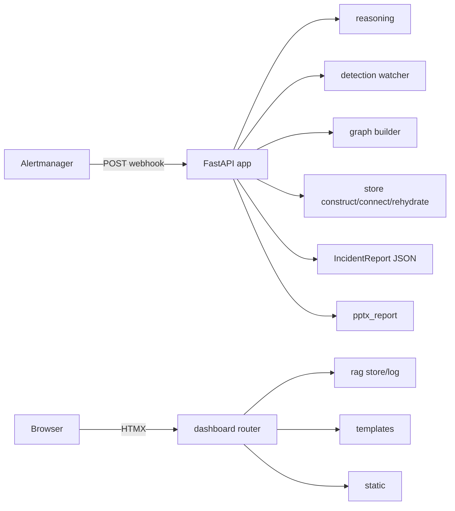

# src/rca_agent/webhook Folder Specification

| Field | Value |
|-------|-------|
| Specification identifier | SPEC-src-rca_agent-webhook |
| Repository-relative folder | `src/rca_agent/webhook/` |
| Role | Production runtime — FastAPI app (Alertmanager webhook, health, incidents, runbooks, dashboard, PPTX export) |
| Current commit | `2f4774f0476d5b47426ac1548c479f132c467332` |
| Generated/refreshed | 2026-11-03 (startup/readiness/DB-fallback notes reflect the incident-persistence-postgres feature) |
| Status | Draft until maintainer review |
| Parent specification | [`../SPECS.md`](../SPECS.md) |

Authority notice: the source files, tests, and build definitions in this
repository remain authoritative. This specification is derived, bounded
evidence and must be reconciled with source on any conflict.

## 1. Intent and significance

This folder is the application's single process boundary and public surface. One
`uvicorn` process serves both the read-only API (Alertmanager webhook, health,
incidents) and the server-rendered HTML dashboard (Jinja2 + Bootstrap + HTMX) in
the same process, reading live shared state (graph builder, event watcher, local
runbook store, query log) with no HTTP round-trip. It builds the dependency
graph at startup and runs the background event watcher. It is an aggregation
boundary with two child folders (`static`, `templates`).

## 2. Scope and contents

- Direct files: 4 Python files. Immediate child folders: 2 (`static`, `templates`).
- [`app.py`](app.py) — FastAPI app, endpoints, startup graph build, background watcher.
- [`ui.py`](ui.py) — dashboard router (Jinja2 + HTMX), read-only except local
  runbook upload/delete and query-log clear.
- [`pptx_report.py`](pptx_report.py) — on-demand per-incident RCA PPTX export (lazy `pptx` extra).
- [`__init__.py`](__init__.py) — package marker.
- Child folders: [`static/`](static/SPECS.md) (vendored Bootstrap/HTMX),
  [`templates/`](templates/SPECS.md) (Jinja2 templates).

## 3. Inputs

- HTTP requests: Alertmanager v4 webhook JSON, runbook uploads
  (`.txt`/`.md`/`.pdf`), dashboard navigation (HTMX).
- `Settings` from [`../config.py`](../config.py) (`host`, `port`, `log_level`,
  and all feature settings).
- Shared runtime objects: `GraphBuilder`, `EventWatcher`, local runbook store,
  query log.

## 4. Outputs

- JSON `IncidentReport`(s) for the webhook and `/incidents` endpoints.
- Health responses (`/healthz`, `/readyz`), `/graph/stats`.
- HTML dashboard fragments (via templates/static).
- PPTX bytes for `/ui/incidents/{id}/pptx` (in-memory, no temp files).
- Direct consumers: Alertmanager, operators (browser), tests.

## 5. Contracts and models

### 5.1 Behavioral contracts

- Endpoints (direct evidence, `app.py` docstring): `GET /healthz`, `GET /readyz`,
  `GET /graph/stats`, `GET /incidents`, `GET /incidents/{id}`,
  `POST /webhook/alertmanager`, `POST /runbooks`, `GET /runbooks`,
  `DELETE /runbooks/{name}`, `GET /runbook-queries`, `DELETE /runbook-queries`.
- The graph is built once at import and reused; a cluster/kubeconfig failure at
  startup must not crash the process (logged, empty graph, background retry).
- Each firing alert is reasoned about independently and returned as an
  `IncidentReport`.
- Dashboard mutations touch only the agent's own local store/log — never the
  cluster (no Kubernetes write capability).
- Datastore lifecycle: the `_lifespan` startup constructs the durable store
  (`get_store`), connects it (`connect_with_retry`), ensures the schema
  (`ensure_schema`), and rehydrates the `EventWatcher` incident cache and the
  `QueryLog` from the DB before serving traffic (blocking calls wrapped in
  `asyncio.to_thread`). It also injects the incident store into the watcher and
  the query-log store into the query log for write-through. A missing
  `RCA_DATABASE_URL` fails fast (Req 4.3); a transient DB outage is non-fatal
  (logged, startup continues). See [`../store/`](../store/SPECS.md).
- `/readyz` reports not-ready until the DB connects (the mandatory datastore is
  part of readiness, Req 5.1); `/healthz` stays independent of the DB (Req 5.2).
- `GET /incidents/{id}` has a durable DB fallback (Req 8.3): an id that has aged
  out of the 200-item in-memory cache is still resolved from the store when it
  is ready; the lookup is non-fatal and preserves the same 404 shape on miss.

### 5.2 Declared models and callable surface

| Symbol | Kind | Source |
|--------|------|--------|
| `app` (FastAPI) | ASGI app | [`app.py`](app.py) |
| `main` | entrypoint (`rca-agent` script) | [`app.py`](app.py) |
| `_safe_rebuild` | internal | [`app.py`](app.py) |
| dashboard `APIRouter` | router | [`ui.py`](ui.py) |
| PPTX builder | function(s) | [`pptx_report.py`](pptx_report.py) |

The console script `rca-agent = rca_agent.webhook.app:main` is declared in
[`../../../pyproject.toml`](../../../pyproject.toml).

### 5.3 Required invariants

- Single process, single graph instance shared across requests and the watcher.
- Read-only toward Kubernetes; the only mutations are local runbook/query-log.
- PPTX export is on-demand and in-memory (safe on a read-only root filesystem).

## 6. Interaction points

| Direction | Folder | Type |
|-----------|--------|------|
| Parent | [`../`](../SPECS.md) | containment |
| Children | [`static/`](static/SPECS.md), [`templates/`](templates/SPECS.md) | ownership |
| Outbound | [`../config.py`](../config.py) | import (`get_settings`) |
| Outbound | [`../graph/`](../graph/SPECS.md) | import (`GraphBuilder`) |
| Outbound | [`../detection/`](../detection/SPECS.md) | import (`EventWatcher`) |
| Outbound | [`../models/`](../models/SPECS.md) | import (payload + report) |
| Outbound | [`../reasoning/`](../reasoning/SPECS.md) | import (`ReasoningFlow`) |
| Outbound | [`../rag/`](../rag/SPECS.md) | import (store, query log, extract) |
| Outbound | [`../store/`](../store/SPECS.md) | lifespan construct/connect/rehydrate; `/incidents/{id}` DB fallback; `/readyz` reflects DB readiness |
| Inbound | [`../../../docker/`](../../../docker/SPECS.md) | entrypoint runs `uvicorn ... webhook.app:app` |
| Inbound | [`../../../deploy/helm/`](../../../deploy/helm/SPECS.md) | Deployment runs the app |

## 7. Exception and error handling

Startup rebuild is wrapped so cluster failures are logged and do not crash the
process (direct evidence `_safe_rebuild`). Endpoints raise `HTTPException` for
invalid requests (imported in both `app.py` and `ui.py`). The PPTX endpoint
returns a clear message when the `[pptx]` extra is not installed. Full endpoint
error-path coverage needs a complete read of `app.py`/`ui.py` (bounded scan).

## 8. Environment variables and configuration

No direct `os.environ` access observed; configuration is read via
`get_settings()`. The entrypoint shell reads `RCA_HOST`, `RCA_PORT`,
`RCA_LOG_LEVEL` (see [`../../../docker/`](../../../docker/SPECS.md)).

## 9. Storage, memory, and resource map

| Resource | Owner | Lifetime | Release |
|----------|-------|----------|---------|
| FastAPI `app` + shared graph | module | process lifetime | process exit |
| Background event-watch task | lifespan | process lifetime | cancelled on shutdown |
| Durable store (`Store` + connection pool) | lifespan (`get_store`) | process lifetime | pool closed on shutdown |
| Uploaded runbook files / assets | local store (rag) | persistent (local) | wiped on redeploy |
| PPTX bytes | request | per request | in-memory, GC |
| Listening socket (`host:port`) | uvicorn | process lifetime | closed on exit |

## 10. Interaction diagram

## 11. Cross-cutting design considerations

- Deployment: single process reduces image size and complexity (Streamlit
  dropped in 0.5.0).
- Security: read-only toward the cluster; local-only mutations.
- Observability: health/readiness and graph stats endpoints.
- Performance: shared in-process state avoids HTTP round-trips.

## 12. Spec-driven development protocol

Future work must: (1) record any endpoint/contract change here; (2) identify
affected child (static/templates) and consumer (docker/helm) specs; (3) add a
webhook/UI test (see `tests/test_webhook.py`, `tests/test_gui_*`);
(4) implement without adding a Kubernetes write capability; (5) run `pytest -q`;
(6) reconcile this spec.

Acceptance scenarios:

- SPEC-src-rca_agent-webhook-AC1 (valid): Given a valid Alertmanager v4 payload,
  When posted to `/webhook/alertmanager`, Then one `IncidentReport` per firing
  alert is returned.
- SPEC-src-rca_agent-webhook-AC2 (failure): Given the cluster is unreachable at
  startup, When the app imports, Then it logs the failure, serves an empty
  graph, and does not crash.
- SPEC-src-rca_agent-webhook-AC3 (compatibility/safety): Given a dashboard
  runbook upload, When processed, Then only the local store changes and no
  Kubernetes write is performed.
- SPEC-src-rca_agent-webhook-AC4 (verification): Given the `[pptx]` extra is
  missing, When `/ui/incidents/{id}/pptx` is requested, Then a clear message is
  returned instead of an unhandled error.

## 13. Verification strategy

FastAPI `TestClient` tests are the cheapest boundary. Related tests:
[`../../../tests/test_webhook.py`](../../../tests/test_webhook.py),
[`../../../tests/test_gui_incident_0_7_1.py`](../../../tests/test_gui_incident_0_7_1.py),
[`../../../tests/test_gui_service_area.py`](../../../tests/test_gui_service_area.py),
[`../../../tests/test_pptx_report.py`](../../../tests/test_pptx_report.py). No
tests were executed for this documentation task.

## 14. Evidence inventory

| File | Type | Bytes |
|------|------|-------|
| [`app.py`](app.py) | Python | ~18.3 KB (18,252) |
| [`ui.py`](ui.py) | Python | ~11.9 KB (11,870) |
| [`pptx_report.py`](pptx_report.py) | Python | ~9.8 KB (9,801) |
| [`__init__.py`](__init__.py) | Python | ~0.1 KB (132) |

## 15. Unknowns and review items

- Only the headers/first lines of `app.py`, `ui.py`, and `pptx_report.py` were
  read in this bounded scan; the full set of route handlers, request/response
  models, and error paths need a complete read before this spec is marked
  reviewed.
- Confirm the dashboard route prefixes (`/ui/...`) and the full HTMX fragment
  contract against `templates/`.
