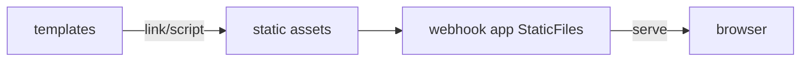

# src/rca_agent/webhook/static Folder Specification

| Field | Value |
|-------|-------|
| Specification identifier | SPEC-src-rca_agent-webhook-static |
| Repository-relative folder | `src/rca_agent/webhook/static/` |
| Role | Documentation / static asset — vendored front-end libraries (Bootstrap CSS, HTMX JS) served offline |
| Current commit | `2f4774f0476d5b47426ac1548c479f132c467332` |
| Generated/refreshed | 2026-11-03 |
| Status | Draft until maintainer review |
| Parent specification | [`../SPECS.md`](../SPECS.md) |

Authority notice: the source files, tests, and build definitions in this
repository remain authoritative. This specification is derived, bounded
evidence and must be reconciled with source on any conflict.

## 1. Intent and significance

This folder vendors the dashboard's front-end dependencies so the UI renders
with no outbound network access (offline-safe). It holds the minified Bootstrap
stylesheet and the HTMX JavaScript library that the server-rendered templates
reference. It is a leaf directory of static assets, not runtime Python.

## 2. Scope and contents

- Direct files: 2. Immediate child folders: 0.
- [`bootstrap.min.css`](bootstrap.min.css) — minified Bootstrap CSS (vendored).
- [`htmx.min.js`](htmx.min.js) — minified HTMX library (vendored).
- Format: minified CSS and JavaScript. These are third-party vendored assets,
  not authored in this repository.

## 3. Inputs

None at runtime. The files are static; they are mounted by the FastAPI app and
served as HTTP responses.

## 4. Outputs

- HTTP static responses (CSS/JS) to the browser.
- Consumed by [`../templates/`](../templates/SPECS.md) via `<link>`/`<script>`
  references and mounted by [`../`](../SPECS.md) (`StaticFiles`, imported in
  `ui.py`).

## 5. Contracts and models

### 5.1 Behavioral contracts

- These files are served verbatim; their contract is the public Bootstrap CSS
  class names and HTMX attributes the templates rely on.

### 5.2 Declared models and callable surface

Not applicable — no declared symbols. The effective contract is the vendored
library versions (Bootstrap, HTMX) expected by the templates.

### 5.3 Required invariants

- Offline-safe: no remote fetch; assets must be served locally.
- Packaged in the wheel via `package-data` in
  [`../../../../pyproject.toml`](../../../../pyproject.toml)
  (`webhook/static/*`).

## 6. Interaction points

| Direction | Folder | Type |
|-----------|--------|------|
| Parent | [`../`](../SPECS.md) | containment |
| Inbound | [`../templates/`](../templates/SPECS.md) | HTML asset references |
| Inbound | [`../`](../SPECS.md) | `StaticFiles` mount |

## 7. Exception and error handling

Not applicable — static files. A missing asset would surface as an HTTP 404 from
the static mount (inferred from FastAPI `StaticFiles` behavior, not a local
mechanism).

## 8. Environment variables and configuration

None. No configuration affects these files directly.

## 9. Storage, memory, and resource map

| Resource | Owner | Lifetime | Release |
|----------|-------|----------|---------|
| Vendored CSS/JS files | repository / wheel | persistent | n/a |

Served from disk/package data; no process resources owned.

## 10. Interaction diagram

## 11. Cross-cutting design considerations

- Portability/offline operation: vendoring removes a runtime network
  dependency.
- Maintenance: upgrading Bootstrap/HTMX means replacing these files and
  revalidating the templates.

## 12. Spec-driven development protocol

Future work must: (1) record any asset version bump here; (2) identify the
affected `templates/` and webhook specs; (3) verify the dashboard still renders
offline; (4) implement without introducing a remote CDN reference; (5) load the
dashboard to confirm rendering; (6) reconcile this spec.

Acceptance scenarios:

- SPEC-src-rca_agent-webhook-static-AC1 (valid): Given the app is running
  offline, When the dashboard loads, Then Bootstrap styles and HTMX behavior are
  served from these local assets.
- SPEC-src-rca_agent-webhook-static-AC2 (invalid): Given an asset file is
  missing, When a template references it, Then the browser receives a 404 and
  the gap is visible.
- SPEC-src-rca_agent-webhook-static-AC3 (compatibility): Given Bootstrap is
  upgraded, When templates use removed classes, Then the templates must be
  updated in the same change.
- SPEC-src-rca_agent-webhook-static-AC4 (verification): Given the wheel is built,
  When installed, Then `webhook/static/*` is present via `package-data`.

## 13. Verification strategy

Manual dashboard load (offline) plus confirming `package-data` inclusion in
[`../../../../pyproject.toml`](../../../../pyproject.toml). No automated test
targets these assets directly; no checks were executed for this documentation
task.

## 14. Evidence inventory

| File | Type | Bytes |
|------|------|-------|
| [`bootstrap.min.css`](bootstrap.min.css) | CSS (vendored) | see file |
| [`htmx.min.js`](htmx.min.js) | JavaScript (vendored) | see file |

Total vendored static (~275 KB per the repository README).

## 15. Unknowns and review items

- Exact Bootstrap and HTMX versions are not declared in a manifest within this
  folder; maintainer should record the pinned versions for supply-chain
  traceability.
