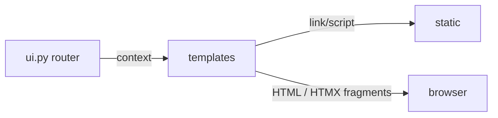

# src/rca_agent/webhook/templates Folder Specification

| Field | Value |
|-------|-------|
| Specification identifier | SPEC-src-rca_agent-webhook-templates |
| Repository-relative folder | `src/rca_agent/webhook/templates/` |
| Role | Documentation / static asset — server-rendered Jinja2 + HTMX dashboard templates |
| Current commit | `2f4774f0476d5b47426ac1548c479f132c467332` |
| Generated/refreshed | 2026-11-03 |
| Status | Draft until maintainer review |
| Parent specification | [`../SPECS.md`](../SPECS.md) |

Authority notice: the source files, tests, and build definitions in this
repository remain authoritative. This specification is derived, bounded
evidence and must be reconciled with source on any conflict.

## 1. Intent and significance

This folder owns the HTML presentation of the dashboard. The base layout plus a
set of HTMX partials (fragments) render live agent state — graph, health,
incidents, metrics, runbooks, and the query log — using data passed from the
dashboard router. It is a leaf directory; its contract is the template filenames
and the context variables each fragment expects from `ui.py`.

## 2. Scope and contents

- Direct files: 13 HTML templates. Immediate child folders: 0.
- [`base.html`](base.html) — page layout (references vendored static assets).
- Fragments: [`_graph.html`](_graph.html), [`_graph_picker.html`](_graph_picker.html),
  [`_health.html`](_health.html), [`_incidents.html`](_incidents.html),
  [`_incidents_table.html`](_incidents_table.html),
  [`_incident_detail.html`](_incident_detail.html), [`_metrics.html`](_metrics.html),
  [`_querylog.html`](_querylog.html), [`_querylog_table.html`](_querylog_table.html),
  [`_runbooks.html`](_runbooks.html), [`_runbooks_list.html`](_runbooks_list.html).
- Format: Jinja2 HTML templates with HTMX attributes.

## 3. Inputs

- Template context dictionaries passed by the dashboard router in
  [`../ui.py`](../ui.py) (`Jinja2Templates`), carrying graph stats, incidents,
  health, metrics, runbook listings, and query-log rows.

## 4. Outputs

- Rendered HTML pages and HTMX fragment responses returned to the browser.
- Consumed by the browser (direct) via the dashboard router in [`../`](../SPECS.md).

## 5. Contracts and models

### 5.1 Behavioral contracts

- `base.html` is the full-page shell; the `_`-prefixed templates are partial
  fragments swapped in via HTMX requests.
- Each fragment's contract is the set of context variables the router supplies
  (e.g. incident fields from [`../../models/`](../../models/SPECS.md)).

### 5.2 Declared models and callable surface

Not applicable — templates declare no code symbols. The effective contract is
the template name registry and per-template context variables resolved in
`ui.py`.

### 5.3 Required invariants

- Template filenames must match the names referenced by the router.
- References to Bootstrap/HTMX must resolve to the vendored
  [`../static/`](../static/SPECS.md) assets (offline-safe).
- Packaged in the wheel via `package-data` (`webhook/templates/*.html`) in
  [`../../../../pyproject.toml`](../../../../pyproject.toml).

## 6. Interaction points

| Direction | Folder | Type |
|-----------|--------|------|
| Parent | [`../`](../SPECS.md) | containment |
| Outbound | [`../static/`](../static/SPECS.md) | asset references |
| Inbound | [`../`](../SPECS.md) (`ui.py`) | `Jinja2Templates` render |

The exact variable set each fragment requires is determined by the router at
render time; a static scan of templates alone cannot prove every binding.

## 7. Exception and error handling

A missing template name or an undefined context variable raises a Jinja2 error
at render time (inferred from Jinja2 behavior, not a local mechanism). No local
error handling is declared in the templates.

## 8. Environment variables and configuration

None directly. Rendered content depends on `Settings`-driven feature state
surfaced through the router.

## 9. Storage, memory, and resource map

| Resource | Owner | Lifetime | Release |
|----------|-------|----------|---------|
| Template files | repository / wheel | persistent | n/a |
| Compiled template cache | Jinja2 environment (router) | process lifetime | GC |

No process resources are owned directly by this folder.

## 10. Interaction diagram

## 11. Cross-cutting design considerations

- Accessibility: HTML structure and Bootstrap components affect accessibility;
  changes should preserve semantic markup and ARIA where present.
- Maintainability: fragments decouple partial updates (HTMX) from full-page
  reloads.
- Compatibility: template/context coupling with `ui.py` must stay in sync.

## 12. Spec-driven development protocol

Future work must: (1) record new templates or context-variable changes here;
(2) identify the affected webhook (`ui.py`) and static specs; (3) add or update
a GUI test (see `tests/test_gui_*`); (4) implement without adding remote asset
references; (5) render the dashboard to confirm; (6) reconcile this spec.

Acceptance scenarios:

- SPEC-src-rca_agent-webhook-templates-AC1 (valid): Given the router renders
  `_incidents_table.html` with incident rows, When requested via HTMX, Then the
  fragment HTML lists the incidents correctly.
- SPEC-src-rca_agent-webhook-templates-AC2 (invalid): Given a fragment
  references a context variable the router does not supply, When rendered, Then
  a Jinja2 error surfaces and the gap is visible.
- SPEC-src-rca_agent-webhook-templates-AC3 (compatibility): Given a template
  renames a block used by HTMX, When the router targets the old name, Then both
  must be updated in the same change.
- SPEC-src-rca_agent-webhook-templates-AC4 (verification): Given the wheel is
  built, When installed, Then `webhook/templates/*.html` is present via
  `package-data`.

## 13. Verification strategy

GUI tests via the FastAPI `TestClient` exercise rendered fragments. Related
tests: [`../../../../tests/test_gui_incident_0_7_1.py`](../../../../tests/test_gui_incident_0_7_1.py),
[`../../../../tests/test_gui_service_area.py`](../../../../tests/test_gui_service_area.py).
No tests were executed for this documentation task.

## 14. Evidence inventory

| File | Type | Bytes |
|------|------|-------|
| [`base.html`](base.html) | Jinja2 HTML | see file |
| [`_graph.html`](_graph.html) | Jinja2 HTML | see file |
| [`_graph_picker.html`](_graph_picker.html) | Jinja2 HTML | see file |
| [`_health.html`](_health.html) | Jinja2 HTML | see file |
| [`_incidents.html`](_incidents.html) | Jinja2 HTML | see file |
| [`_incidents_table.html`](_incidents_table.html) | Jinja2 HTML | see file |
| [`_incident_detail.html`](_incident_detail.html) | Jinja2 HTML | see file |
| [`_metrics.html`](_metrics.html) | Jinja2 HTML | see file |
| [`_querylog.html`](_querylog.html) | Jinja2 HTML | see file |
| [`_querylog_table.html`](_querylog_table.html) | Jinja2 HTML | see file |
| [`_runbooks.html`](_runbooks.html) | Jinja2 HTML | see file |
| [`_runbooks_list.html`](_runbooks_list.html) | Jinja2 HTML | see file |

(12 files listed; the folder contains 13 templates — see the folder listing for
the complete set.)

## 15. Unknowns and review items

- The exact per-fragment context-variable contract is defined in `ui.py` and was
  not fully enumerated in this bounded scan; maintainer should document each
  fragment's required variables.
- Accessibility conformance of the rendered markup was not evaluated here.
