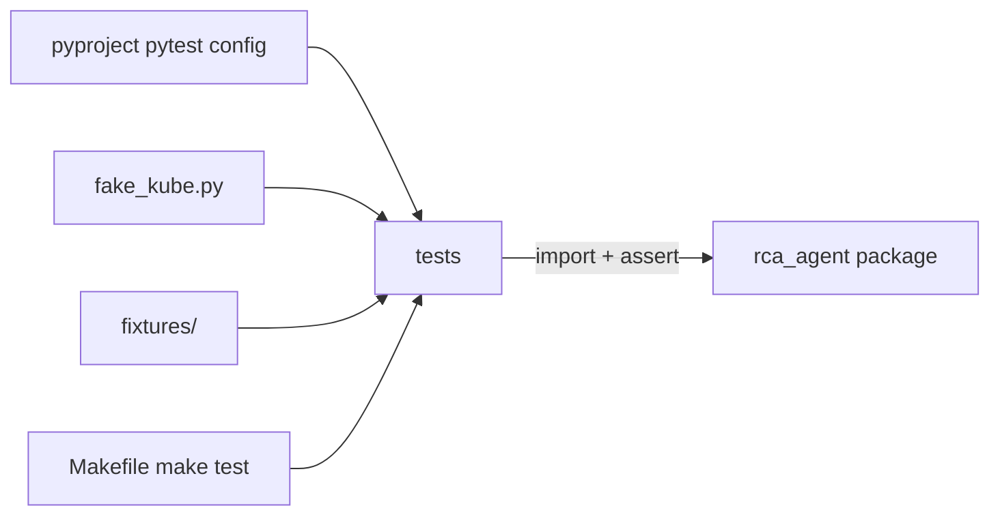

# tests Folder Specification

| Field | Value |
|-------|-------|
| Specification identifier | SPEC-tests |
| Repository-relative folder | `tests/` |
| Role | Test — pytest unit/component suite for the agent, plus a fake Kubernetes client |
| Current commit | `2f4774f0476d5b47426ac1548c479f132c467332` |
| Generated/refreshed | 2026-11-03 |
| Status | Draft until maintainer review |
| Parent specification | [`../SPECS.md`](../SPECS.md) |

Authority notice: the source files, tests, and build definitions in this
repository remain authoritative. This specification is derived, bounded
evidence and must be reconciled with source on any conflict.

## 1. Intent and significance

This folder owns the automated test suite that proves the agent's behavior
without a live cluster or LLM. It covers webhook endpoints, the dependency
graph, query tools, detection/event watching, reasoning (extractive and LLM
re-rank), runbook RAG (keyword and semantic), service-area impact, the
evaluation harness, PPTX export, ASCII safety, and GUI fragments. It is an
aggregation boundary with one child folder (`fixtures`).

## 2. Scope and contents

- Direct files: 25 Python files (plus the `fixtures/` child).
- [`fake_kube.py`](fake_kube.py) — shared fake Kubernetes client for tests.
- [`__init__.py`](__init__.py) — package marker.
- Test modules (capped selection; all follow `test_*.py`):
  [`test_webhook.py`](test_webhook.py), [`test_cluster_graph.py`](test_cluster_graph.py),
  [`test_query_tools.py`](test_query_tools.py), [`test_event_watcher.py`](test_event_watcher.py),
  [`test_reasoning.py`](test_reasoning.py), [`test_llm_rerank.py`](test_llm_rerank.py),
  [`test_runbook_rag.py`](test_runbook_rag.py), [`test_semantic_rag.py`](test_semantic_rag.py),
  [`test_runbook_synth.py`](test_runbook_synth.py), [`test_impact_loader.py`](test_impact_loader.py),
  [`test_impact_pipeline.py`](test_impact_pipeline.py), [`test_eval_harness.py`](test_eval_harness.py),
  [`test_pptx_report.py`](test_pptx_report.py), [`test_incident_capture.py`](test_incident_capture.py),
  [`test_pipeline_cluster.py`](test_pipeline_cluster.py), [`test_ascii_safety.py`](test_ascii_safety.py),
  [`test_gui_incident_0_7_1.py`](test_gui_incident_0_7_1.py), [`test_gui_service_area.py`](test_gui_service_area.py),
  [`test_anchor_phase1.py`](test_anchor_phase1.py), [`test_anchor_phase2.py`](test_anchor_phase2.py),
  [`test_anchor_phase3.py`](test_anchor_phase3.py), [`test_detection_fixes_0_6_1.py`](test_detection_fixes_0_6_1.py),
  [`test_fixes_0_5_1.py`](test_fixes_0_5_1.py).
- Child folder: [`fixtures/`](fixtures/SPECS.md).

## 3. Inputs

- The application package `rca_agent` (imported via `pythonpath=["src"]`).
- Fixtures from [`fixtures/`](fixtures/SPECS.md) and `fake_kube.py`.

## 4. Outputs

- Pass/fail results and assertions; the verification evidence for the whole
  repository. No runtime artifact.

## 5. Contracts and models

### 5.1 Behavioral contracts

- Discovered by pytest via `testpaths = ["tests"]` in
  [`../pyproject.toml`](../pyproject.toml).
- Tests are cluster-free and LLM-free (use `fake_kube.py`/fixtures).

### 5.2 Declared models and callable surface

| Symbol | Kind | Source |
|--------|------|--------|
| `fake_kube` client | test helper | [`fake_kube.py`](fake_kube.py) |
| `test_*` functions | pytest tests | each `test_*.py` |

### 5.3 Required invariants

- Tests must run without network, cluster, or LLM access.
- Each test asserts only the behavior it exercises (a test proves what it
  asserts, not more).

## 6. Interaction points

| Direction | Folder | Type |
|-----------|--------|------|
| Parent | [`../`](../SPECS.md) | containment |
| Child | [`fixtures/`](fixtures/SPECS.md) | ownership |
| Outbound | [`../src/rca_agent/`](../src/rca_agent/SPECS.md) | imports under test |
| Inbound | [`../Makefile`](../Makefile) | `make test` / `make check` |

## 7. Exception and error handling

Tests use pytest assertions and may assert expected exceptions. `fake_kube.py`
simulates cluster responses so no real API errors occur. Expected-failure or
skip markers (if any) are per-test; a full enumeration was not performed in this
bounded scan.

## 8. Environment variables and configuration

Driven by pytest config in [`../pyproject.toml`](../pyproject.toml)
(`pythonpath`, `testpaths`). Individual tests may set `RCA_*` settings in-process
to exercise feature flags (verify per test).

## 9. Storage, memory, and resource map

| Resource | Owner | Lifetime | Release |
|----------|-------|----------|---------|
| Fake-kube fixtures | `fake_kube.py` / tests | per test | GC |
| Temp files (if any) | individual tests | per test | pytest tmp cleanup |
| `__pycache__/` | interpreter | transient | ignored (not in scope) |

## 10. Interaction diagram

## 11. Cross-cutting design considerations

- Reproducibility: deterministic, offline tests.
- Testability: shared fake client keeps the real read-only interface honest.
- Coverage: tests span every runtime sub-package.

## 12. Spec-driven development protocol

Future work must: (1) record the new/changed behavior being proven here;
(2) identify the affected source-folder spec; (3) add the smallest test that
proves it; (4) implement; (5) run `make test`; (6) reconcile the relevant specs.

Acceptance scenarios:

- SPEC-tests-AC1 (valid): Given the suite runs, When `make test` executes, Then
  all tests pass without cluster/network/LLM access.
- SPEC-tests-AC2 (invalid/regression): Given a source change breaks a contract,
  When the suite runs, Then the relevant test fails with a clear assertion.
- SPEC-tests-AC3 (compatibility): Given a new source behavior, When a test is
  added, Then it uses `fake_kube.py`/fixtures and stays offline.
- SPEC-tests-AC4 (verification): Given `fixtures/`, When a test consumes a
  fixture, Then the fixture path resolves and the assertion holds.

## 13. Verification strategy

`make test` (`pytest -q`) is the cheapest and authoritative boundary. No tests
were executed for this documentation task (documentation-only change).

## 14. Evidence inventory

| File | Type | Bytes |
|------|------|-------|
| [`fake_kube.py`](fake_kube.py) | Python | ~7.2 KB |
| [`test_cluster_graph.py`](test_cluster_graph.py) | Python | ~12.8 KB |
| [`test_runbook_rag.py`](test_runbook_rag.py) | Python | ~16.1 KB |
| [`test_event_watcher.py`](test_event_watcher.py) | Python | ~9.4 KB |
| [`test_pipeline_cluster.py`](test_pipeline_cluster.py) | Python | ~9.1 KB |
| [`test_semantic_rag.py`](test_semantic_rag.py) | Python | ~8.8 KB |
| [`test_llm_rerank.py`](test_llm_rerank.py) | Python | ~8.2 KB |
| [`test_gui_incident_0_7_1.py`](test_gui_incident_0_7_1.py) | Python | ~7.9 KB |
| ... (remaining `test_*.py`) | Python | see folder listing |

Total: 25 direct Python files plus the `fixtures/` child. The table is capped;
see the folder listing for the complete set.

## 15. Unknowns and review items

- Per-test skip/marker contracts and any in-test `RCA_*` overrides were not fully
  enumerated in this bounded scan; maintainer should confirm no test depends on
  network, cluster, or an LLM sidecar.
