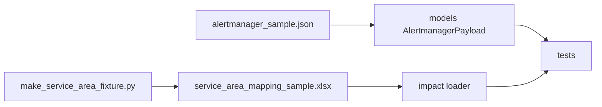

# tests/fixtures Folder Specification

| Field | Value |
|-------|-------|
| Specification identifier | SPEC-tests-fixtures |
| Repository-relative folder | `tests/fixtures/` |
| Role | Test fixture — sample payloads and a service-area mapping workbook used by the suite |
| Current commit | `2f4774f0476d5b47426ac1548c479f132c467332` |
| Generated/refreshed | 2026-11-03 |
| Status | Draft until maintainer review |
| Parent specification | [`../SPECS.md`](../SPECS.md) |

Authority notice: the source files, tests, and build definitions in this
repository remain authoritative. This specification is derived, bounded
evidence and must be reconciled with source on any conflict.

## 1. Intent and significance

This folder holds the static fixtures the test suite consumes: a sample
Alertmanager webhook payload and a small service-area mapping workbook (with a
generator for it). These fixtures let tests exercise the webhook and
service-area impact paths deterministically and offline. It is a leaf directory.

## 2. Scope and contents

- Direct files: 3. Immediate child folders: 0.
- [`alertmanager_sample.json`](alertmanager_sample.json) — sample Alertmanager v4
  payload (also referenced by the README quick start).
- [`service_area_mapping_sample.xlsx`](service_area_mapping_sample.xlsx) — small
  curated service-area mapping workbook.
- [`make_service_area_fixture.py`](make_service_area_fixture.py) — generator that
  produces the sample workbook.
- Format: JSON, XLSX (openpyxl), Python.

## 3. Inputs

- `make_service_area_fixture.py` runs to (re)generate the `.xlsx` fixture.

## 4. Outputs

- Fixture data consumed by [`../`](../SPECS.md) tests (webhook and impact).
- The JSON sample is also used in the README quick-start `curl` example.

## 5. Contracts and models

### 5.1 Behavioral contracts

- `alertmanager_sample.json` conforms to the Alertmanager v4 shape parsed by
  [`../../src/rca_agent/models/`](../../src/rca_agent/models/SPECS.md)
  (`AlertmanagerPayload`).
- `service_area_mapping_sample.xlsx` matches the workbook schema read by
  [`../../src/rca_agent/impact/`](../../src/rca_agent/impact/SPECS.md).

### 5.2 Declared models and callable surface

| Symbol | Kind | Source |
|--------|------|--------|
| fixture generator | script | [`make_service_area_fixture.py`](make_service_area_fixture.py) |

### 5.3 Required invariants

- Fixtures must stay compatible with the schemas their consuming code parses.
- Fixtures contain only synthetic/sample data (no secrets or production records).

## 6. Interaction points

| Direction | Folder | Type |
|-----------|--------|------|
| Parent | [`../`](../SPECS.md) | containment |
| Inbound | [`../`](../SPECS.md) (tests) | fixture consumption |
| Outbound | [`../../src/rca_agent/impact/`](../../src/rca_agent/impact/SPECS.md) | schema it must match |
| Outbound | [`../../src/rca_agent/models/`](../../src/rca_agent/models/SPECS.md) | payload schema it must match |

## 7. Exception and error handling

Not applicable to the data files. The generator handles its own write; a schema
mismatch would surface as a parse/assertion failure in the consuming test.

## 8. Environment variables and configuration

None. The generator is run directly; tests reference the files by relative path.

## 9. Storage, memory, and resource map

| Resource | Owner | Lifetime | Release |
|----------|-------|----------|---------|
| JSON/XLSX fixture files | repository | persistent | n/a |
| Generated workbook (regen) | generator | persistent | overwritten on regen |

## 10. Interaction diagram

## 11. Cross-cutting design considerations

- Data integrity: fixtures must track schema changes in their consumers.
- Reproducibility: the generator keeps the workbook fixture rebuildable.
- Security: sample-only data; no real PII or credentials.

## 12. Spec-driven development protocol

Future work must: (1) record any fixture schema change here; (2) identify the
affected models/impact and tests specs; (3) regenerate the workbook via the
generator when its schema changes; (4) implement without embedding real data;
(5) run `make test`; (6) reconcile this spec.

Acceptance scenarios:

- SPEC-tests-fixtures-AC1 (valid): Given `alertmanager_sample.json`, When the
  webhook test posts it, Then it parses into `AlertmanagerPayload` and produces a
  report.
- SPEC-tests-fixtures-AC2 (invalid): Given the workbook schema drifts from the
  impact loader, When an impact test runs, Then it fails and surfaces the drift.
- SPEC-tests-fixtures-AC3 (compatibility): Given the impact schema changes, When
  the generator is re-run, Then the regenerated workbook matches the new schema.
- SPEC-tests-fixtures-AC4 (verification): Given a test references a fixture path,
  When the suite runs, Then the relative path resolves from `tests/`.

## 13. Verification strategy

Verified indirectly by the webhook and impact tests in [`../`](../SPECS.md). No
checks were executed for this documentation task.

## 14. Evidence inventory

| File | Type | Bytes |
|------|------|-------|
| [`alertmanager_sample.json`](alertmanager_sample.json) | JSON | see file |
| [`service_area_mapping_sample.xlsx`](service_area_mapping_sample.xlsx) | XLSX | see file |
| [`make_service_area_fixture.py`](make_service_area_fixture.py) | Python | see file |

## 15. Unknowns and review items

- The exact column schema of the sample workbook was not read in this bounded
  scan; confirm it against the impact loader before marking this spec reviewed.
